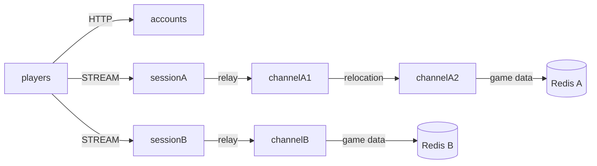

# MyGame world channels

This template runs independent MMORPG worlds. Each world has its own Session process, channel servers, Redis data and route mesh. A Player Actor owns gold. Fixed Zone User Spots host channels, and changing channels uses public Actor relocation while preserving the client connection.



## Prerequisites

Default execution requires Docker Linux containers; no host .NET SDK is needed.

Docker with Compose v2 (Linux containers), and PowerShell 7 on Windows or Bash on Linux are required. Framework and connector packages are pinned to 0.30.2 in `Directory.Packages.props`. Binding 1.20.0 and Redis client 2.8.31 are pinned there as well. NuGet restore uses nuget.org. The template is independent of the ZLink source repository.

## Build

Run commands from this project root:

```sh
./run-e2e.sh --build-only
```

PowerShell builds the same Dockerfile targets:

```powershell
pwsh -NoProfile -File ./run-e2e.ps1 -BuildOnly
```

`Dockerfile` owns fixed `SDK_IMAGE`, `RUNTIME_IMAGE`, and `DOCKER_CLI_IMAGE` defaults. Replace the appropriate base ARG when adopting a ZLink base image. All node roles share the node image because their runtime dependencies match; each retains its own executable entry point. The ASP.NET Core runtime supplies shared hosting dependencies. The runner target adds Docker CLI and structure inputs without including the SDK.

Scripts remove unique image tags after each invocation. Docker retains build layers for subsequent runs.

## Local e2e

Both scripts build images and call the same C# orchestrator inside a runner container. A unique Compose project/network contains Redis and the runner. The runner checks structure before starting nodes. Nodes share its network namespace, preserving loopback listeners and OS-assigned ports without host port mappings. Redis publishes an ephemeral loopback port for local debugging.

The runner creates each node with interactive stdin, copies its configuration with `docker cp`, and attaches through `docker start -a -i`. `ManagedProcess` retains readiness, drain, shutdown, and replacement controls. Only the runner mounts the Docker socket; use a trusted local daemon. Scripts remove their labeled containers, Compose project, and image tags. Cleanup failure returns exit code 1.

Node stderr logs (`<node>.err.log`) include Framework message flow records because dispatch diagnostics use `Normal`. Inspect these logs from the first failing run.

On Unix sockets, Bash runs the runner with the caller's UID/GID and the socket's group so retained logs remain writable by the caller. Windows uses Docker Desktop's filesystem mapping. Build, Redis, and outer cleanup logs are in `.logs/docker-<project>/`; node settings and control logs are in `.logs/run-<id>/`.

For host process debugging, install the .NET 8 SDK and add `--local` or `-Local`. Redis remains in Docker. After a local build, `--no-build` or `-NoBuild` skips compilation:

```sh
./run-e2e.sh --local
./run-e2e.sh --local --no-build
```

```powershell
pwsh -NoProfile -File ./run-e2e.ps1 -Local
pwsh -NoProfile -File ./run-e2e.ps1 -Local -NoBuild
```

Linux:

```sh
./run-e2e.sh
./run-e2e.sh --scenario worlds,channel,reconnect,update
./run-e2e.sh --check-structure
```

Windows:

```powershell
pwsh -NoProfile -File ./run-e2e.ps1
pwsh -NoProfile -File ./run-e2e.ps1 -Scenario worlds,channel,reconnect,update
pwsh -NoProfile -File ./run-e2e.ps1 -CheckStructure
```

The runner validates `zlink.structure.json`, starts an isolated Compose project with two Redis services on OS-assigned loopback ports, and launches channel, Session and accounts processes. Each run uses independent Redis key prefixes. Node configuration and stdout/stderr, including Framework message flow, are retained in `.logs/run-<id>/`. Cleanup removes only this run's processes and Compose project; cleanup failures fail the run.

| Scenario | Verification |
| --- | --- |
| `worlds` | HTTP returns both published Session endpoints. A repeated earn is rejected without changing gold, returns `earn-too-soon` with `RetryAfterMs`, and succeeds after that duration. The same player starts with 0 gold in B. |
| `channel` | Players in one channel see the same `ChannelView`; another channel is isolated. Oversized channel requests return `integer-out-of-range` without changing membership. A move and disconnect remove the player from the previous channel list. Session rejects internal packets with `packet-not-allowed`; channel relocation preserves connection, SessionInfo and gold. |
| `reconnect` | A new connection binds the same Actor generation, channel and gold. |
| `update` | channelA1 drains into channelA2, without affecting B. SessionInfo and gold remain unchanged. The source stops and a replacement starts with the same config, executes Zone lookup during bootstrap, and a new Zone on the replacement processes Player work. |

Use `--check-structure` through the default script to validate without starting nodes, or combine `--local --no-build --check-structure` after a local build to validate without Docker. The structure declares a `mesh` on fixed Zones because `field@1` exists independently in both worlds. Logical identity is checked within its owning mesh. This differs from the current format document's composition-wide logical ID uniqueness requirement; the topology requires separate world namespaces.

## Known issues

Validated against the published Framework 0.30.2 packages.

## Deployment sequence

1. Provision separate Redis instances for A and B. Configure distinct key prefixes and world IDs; Framework keys and `player:<id>` application keys share only their world's namespace.
2. Start channelA1 (`field@1`), channelA2 (`field@2`) and channelB (`field@1`). ChannelA1 has capacity one and channelA2 has capacity two so channelA2 can receive channelA1 during maintenance.
3. Start sessionA and sessionB. Listener ports may be zero; use the actual endpoints from their `READY` JSON.
4. Configure the accounts `Worlds` list with those Session endpoints, then start accounts. Its HTTP listener publishes the actual endpoint in `READY`.
5. Send `drain` to channelA1. Wait for `RELOCATION_REQUESTED`, `RELOCATED`, and `SAFE_TO_SHUTDOWN`. Send `shutdown`, wait for `STOPPED` and exit, and start the replacement with the same configuration. Existing Zones remain at their relocated authoritative owner.

Player data writes use the Actor execution turn. `GoldBalance` grants 10 gold per accepted request, enforces a 1000 ms monotonic interval and rejects a result above `9,007,199,254,740,991` without changing state. Its relocation snapshot stores the remaining cooldown in milliseconds. Each Zone owns its connected player IDs and includes them in its relocation snapshot. Initial admission selects channel 1; reconnect relays to the Actor's existing Zone and does not change channels. Account configuration contains the common node fields for a consistent JSON schema; the HTTP service does not connect to Redis or a mesh and uses a stateless Framework host for the same drain/shutdown control protocol.

`ChannelViewRequest` returns the Zone's connected player IDs. The Zone rebuilds this list from membership and disconnect callbacks; relocation carries the current list in `ZoneSnapshot`. A channel move keeps the client Session bound while the Player Actor changes Zones, so the list follows Zone membership callbacks.

This example trusts the supplied player ID and demonstrates server composition rather than account authentication. Production deployments must authenticate that identity before binding an Actor.

ChannelA1 has a one-Zone capacity and starts before channelA2, whose capacity is two.
This places each fixed Zone on its declared initial owner and leaves room for drain.
After replacement, update sends `create-update-zone` and waits for `UPDATE_ZONE_CREATED`.
The command creates verification Zone `field@3` through the public Spot manager.
ChannelA2 already holds two Zones, so the replacement must host the new Zone.
A new Player joins it and earns gold; the test checks channelA1 in both responses.
Existing Players remain in their relocated Zones. The replacement uses the same configuration.
Message Follow is explicitly 30 seconds; the safe shutdown observation budget is
derived from that duration and the existing operation budget.

## 한국어 실행 안내

기본 실행은 Docker에서 node와 e2e runner를 함께 실행하므로 호스트 .NET SDK가 필요하지 않습니다. Docker Compose v2와 Linux container 환경을 준비하십시오. 로컬 process 디버깅은 .NET 8 SDK를 설치한 뒤 `./run-e2e.sh --local` 또는 `pwsh -NoProfile -File ./run-e2e.ps1 -Local`로 실행합니다. 이미지 빌드·정리 로그는 `.logs/docker-<project>/`, node 로그는 `.logs/run-<id>/`에 남습니다. 이 디렉터리에서 `./run-e2e.sh --build-only`으로 빌드합니다. Windows에서는 `pwsh -NoProfile -File ./run-e2e.ps1`, Linux에서는 `./run-e2e.sh`로 전체 시나리오를 실행합니다. 실행에 사용하는 Redis와 node는 매번 별도로 생성되며 로그는 `.logs/run-<id>/`에 보존됩니다.

월드 A와 B는 Redis와 mesh를 분리합니다. `GoldBalance`가 요청마다 10 gold를 지급하고 단조 시계로 1000 ms 간격과 `9,007,199,254,740,991` 상한을 판정합니다. 거부한 요청은 gold와 cooldown을 바꾸지 않으며 `ActionRejected(Reason, RetryAfterMs)`를 반환합니다. `RetryAfterMs`가 있는 거부는 응답값만큼 지난 뒤 다시 요청합니다. 상한을 넘는 채널 요청은 `integer-out-of-range`로 거부하고 membership을 바꾸지 않습니다. Zone은 현재 접속 중인 player ID를 보유하고 채널 이동·연결 종료 때 목록에서 제거합니다. 채널 이동 때 client Session은 유지되고 Player Actor의 Zone이 바뀌므로 목록은 Zone membership callback에서 갱신합니다. relocation snapshot은 목록과 남은 cooldown ms를 저장합니다. 채널 변경과 재접속은 같은 Actor 상태를 유지합니다. 유지보수에서는 drain 완료와 SafeToShutdown을 확인한 뒤 원본 node를 종료하고 같은 설정으로 대체 node를 시작합니다. 공개 Framework 0.30.2 패키지로 검증했습니다.
