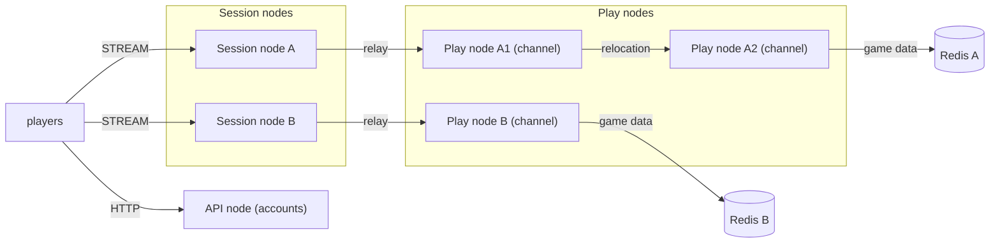

# MyGame world channels

This template runs independent MMORPG worlds. Each world has its own Session node, channel servers, Redis data and route mesh. A Player Actor owns gold. Fixed Zone User Spots host channels, and changing channels uses public Actor relocation while preserving the client connection.



This template is a reference. To build a new game, create a new project and design its nodes, Spots, Actors and messages for that game, using this template's structure and rules as reference; do not rename or edit this template in place into the game.

## Prerequisites

Default execution requires Docker Linux containers; no host .NET SDK is needed.

Docker with Compose v2 (Linux containers), and PowerShell 7 on Windows or Bash on Linux are required. Framework and connector packages are pinned to 0.34.0 in `Directory.Packages.props`. Binding 1.26.0 and Redis client 2.8.31 are pinned there as well. NuGet restore uses nuget.org. The template is independent of the ZLink source repository.

## Build

Run commands from this project root:

```sh
./run-e2e.sh --build-only
```

PowerShell builds the same Dockerfile targets:

```powershell
.\run-e2e.cmd -BuildOnly
```

`Dockerfile` owns fixed `SDK_IMAGE`, `RUNTIME_IMAGE`, and `DOCKER_CLI_IMAGE` defaults. Replace the appropriate base ARG when adopting a ZLink base image. All node roles share the node image because their runtime dependencies match; each retains its own executable entry point. The ASP.NET Core runtime supplies shared hosting dependencies. The runner target adds Docker CLI and structure inputs without including the SDK.

Scripts remove unique image tags after each invocation. Docker retains build layers for subsequent runs.

## Local server

Run from the template directory with the .NET 8 SDK and Docker Compose v2 available. The command builds the server and starts Redis in Docker and the game nodes as local processes.

```bash
./run-server.sh
```

```powershell
.\run-server.cmd
```

Connect clients to the WebSocket address in the `Server ready` line. When the topology has an HTTP API, the runner also prints its address. Ctrl+C stops the nodes and Redis. A second start is rejected while the server is running.

## Client connection

### Endpoint and first packet

First call `GET /worlds` on the accounts API node. `server/config/accounts.json` defaults `HttpEndpoint` to `http://127.0.0.1:0`; use `httpEndpoint` from the accounts API node `READY` JSON. The response lists `WorldId`, `Name`, and `SessionEndpoint`. Select a world and connect to its advertised STREAM endpoint. `server/config/sessionA.json` and `sessionB.json` default `StreamEndpoint` to `ws://127.0.0.1:0`, root path `/`. Use each Session's `streamEndpoint` from `READY`. Configure Accounts `Worlds[].SessionEndpoint` with those actual addresses, as `e2e/MyGame.E2E/WorldRun.cs` does. Port `0` is not a client destination. Channel mesh listeners and Redis are internal endpoints.

Send `EnterWorldRequest(PlayerId)` first. Successful Actor binding and entry produce a `PlayerView` push with world/channel and persisted player data. World A and B keep separate state; channel changes use `ChangeChannelRequest` after entry. `ActionRejected` reports rejected actions. Entry is send/push; `SessionInfoRequest` is request/reply after binding. The accounts API node lists worlds but does not authenticate players; validate identity before binding when adding authentication.

### Connector installation

The default loopback listener is reachable only within its host/network namespace. Docker e2e nodes share the runner network namespace and are removed at the end. External clients need a deployment kept running with a reachable listener and an exposed container port. Browser, Unity WebGL, and Cocos Creator web clients can use this WebSocket endpoint; HTTPS pages require a secure `wss://` deployment. HTTP entry points also need a browser-accessible origin/CORS policy when called from a web client.

Use the release pinned in `Directory.Packages.props`, at `PackageVersion Include="Zlink.Framework"` and `PackageVersion Include="Zlink.Stream.Connector"` (`Version` attributes). Replace `<version>` in the installation commands with that release. Check linked guides against that pin; engine adapters follow the linked repository READMEs. All clients use this template's packet contract.

| Client                             | Connector installation                                                                                                                                                                                                                                                                                                                                                                                                                                                          | Documentation guide                                                                                                                                                          |
| ---------------------------------- | ------------------------------------------------------------------------------------------------------------------------------------------------------------------------------------------------------------------------------------------------------------------------------------------------------------------------------------------------------------------------------------------------------------------------------------------------------------------------------- | ---------------------------------------------------------------------------------------------------------------------------------------------------------------------------- |
| Unity                              | Native/Editor: restore `Zlink.Stream.Connector` with NuGetForUnity. WebGL: add the `com.zlink.stream-connector.webgl` UPM Git package; include only the connector assembly for the active target. See the [Unity README](https://github.com/zlink-systems/zlink/blob/main/framework/languages/engines/Unity/README.md) and its package manifest.                                                                                                                                | [.NET engine integration](https://docs.zlink.systems/dotnet/guide/stream-connector/12-engine-integration/)                                                                   |
| Unreal                             | Copy `framework/languages/cpp/connector/engines/unreal` into `Plugins/ZLinkStreamConnector`, then package the native connector under `ThirdParty/ZLink` as described in the [Unreal README](https://github.com/zlink-systems/zlink/blob/main/framework/languages/engines/Unreal/README.md).                                                                                                                                                                                     | [C++ engine integration](https://docs.zlink.systems/cpp/guide/stream-connector/12-engine-integration/)                                                                       |
| Godot                              | .NET: add the NuGet package `Zlink.Stream.Connector` and run `dotnet restore`; see the [C# README](https://github.com/zlink-systems/zlink/blob/main/framework/languages/engines/Godot/csharp/README.md). GDExtension: build the C++ Godot adapter against the framework prebuilt and matching `godot-cpp`; see the [C++ README](https://github.com/zlink-systems/zlink/blob/main/framework/languages/engines/Godot/cpp/README.md). The .NET sample does not support Web export. | [.NET](https://docs.zlink.systems/dotnet/guide/stream-connector/12-engine-integration/), [C++](https://docs.zlink.systems/cpp/guide/stream-connector/12-engine-integration/) |
| Cocos Creator                      | Web target: `npm install @zlink-systems/stream-connector@<version>`; see the [Cocos Creator README](https://github.com/zlink-systems/zlink/blob/main/framework/languages/engines/CocosCreator/README.md). This package does not provide a Creator native adapter.                                                                                                                                                                                                                  | [TypeScript engine integration](https://docs.zlink.systems/node/guide/stream-connector/12-engine-integration/)                                                               |
| Axmol                              | Copy `framework/languages/cpp/connector/engines/axmol` into `third_party/zlink_axmol_connector` and link `zlink::stream_connector` from the installed C++ framework package; see the [Axmol README](https://github.com/zlink-systems/zlink/blob/main/framework/languages/engines/Axmol/README.md).                                                                                                                                                                              | [C++ engine integration](https://docs.zlink.systems/cpp/guide/stream-connector/12-engine-integration/)                                                                       |
| Web browser (TypeScript connector) | `npm install @zlink-systems/stream-connector@<version>`; import the package root in the browser build. Use `ws://` or `wss://`, subject to the page's security policy.                                                                                                                                                                                                                                                                                                             | [TypeScript connector](https://docs.zlink.systems/node/guide/stream-connector/)                                                                                              |
| C++                                | Install the C++ framework prebuilt containing the connector; use `find_package(zlink_stream_connector_cpp CONFIG REQUIRED)` and link `zlink::stream_connector`.                                                                                                                                                                                                                                                                                                                 | [C++ connector](https://docs.zlink.systems/cpp/guide/stream-connector/)                                                                                                      |
| C#/.NET                            | `dotnet add package Zlink.Stream.Connector --version <version>`                                                                                                                                                                                                                                                                                                                                                                                                                    | [.NET connector](https://docs.zlink.systems/dotnet/guide/stream-connector/)                                                                                                  |
| Java                               | Add Maven/Gradle dependency `systems.zlink:zlink-stream-connector:<version>`.                                                                                                                                                                                                                                                                                                                                                                                                      | [Java connector](https://docs.zlink.systems/java/guide/stream-connector/)                                                                                                    |
| Kotlin                             | Add `systems.zlink:zlink-stream-connector:<version>` and `systems.zlink:zlink-framework-kotlin:<version>` for the coroutine wrapper.                                                                                                                                                                                                                                                                                                                                                  | [Kotlin connector](https://docs.zlink.systems/kotlin/guide/stream-connector/)                                                                                                |
| Node                               | `npm install @zlink-systems/stream-connector@<version>`; use the package root and Node.js 22 or later.                                                                                                                                                                                                                                                                                                                                                     | [Node connector](https://docs.zlink.systems/node/guide/stream-connector/)                                                                                                    |

### World selection and entry example

Create a .NET 8 console project in a copy, reference `server/MyGame.Shared/MyGame.Shared.csproj`, and add `Zlink.Stream.Connector` using the pinned version described above. Save as `Program.cs`, then run `dotnet run --project <client-project> -- <actual-accounts-http-endpoint>` against separately running Accounts, Sessions, Channels, and Redis. Use a fresh player ID. E2E removes its temporary deployment; its `GameClient.cs` shows the complete flow.

```csharp
using System.Net.Http.Json;
using MyGame.Shared;
using Systems.Zlink.Stream.Connector;
using Systems.Zlink.Stream.Connector.Contracts;

using var deadline = new CancellationTokenSource(TimeSpan.FromSeconds(10));
var ct = deadline.Token;
using var http = new HttpClient();
var worlds = await http.GetFromJsonAsync<WorldInfo[]>(args[0] + "/worlds", ct)
    ?? throw new InvalidDataException("Missing worlds");
var world = worlds.Single(candidate => candidate.WorldId == "A");
await using var client = ZlinkStreamConnectorFactory.Create(new ZlinkStreamConnectorOptions
{
    Endpoint = new Uri(world.SessionEndpoint),
    DispatchMode = ZlinkStreamDispatchMode.Immediate,
    Reconnect = new ZlinkStreamReconnectOptions { Enabled = false },
});
var received = new TaskCompletionSource<PlayerView>(TaskCreationOptions.RunContinuationsAsynchronously);
using var view = client.On<PlayerView>((message, _) =>
{
    received.TrySetResult(message.Payload!);
    return ValueTask.CompletedTask;
});
using var rejected = client.On<ActionRejected>((message, _) =>
{
    received.TrySetException(new InvalidOperationException(message.Payload!.ToString()));
    return ValueTask.CompletedTask;
});
using var error = client.OnErrorReceived((message, _) =>
{
    received.TrySetException(new IOException(message.Message));
    return ValueTask.CompletedTask;
});
using var disconnected = client.OnDisconnected((_, _) =>
{
    received.TrySetException(new IOException("Disconnected before PlayerView"));
    return ValueTask.CompletedTask;
});
await client.Connect.Async(ct);
await client.Send(new EnterWorldRequest("guide-player")).Async(ct);
Console.WriteLine(await received.Task.WaitAsync(ct));
```

## Local e2e

Run `run-e2e` from another terminal to detect the running server through `.logs/server.json`, or run it with the server stopped to use an isolated Docker deployment. The attached run skips `update` because node replacement needs isolated processes.

The runner prints each scenario result and the pass total. Find per-node stdout, stderr, and Framework message flow in `.logs/run-<id>/` as `<node>.out.log`, `<node>.err.log`, and `<node>.flow.log`. An isolated scenario with its own deployment keeps these files in a scenario subdirectory. Failures reference a `*-failure.log` file. Docker build and cleanup logs remain in `.logs/docker-<project>/`.

In isolated Docker mode, both scripts build images and call the same C# runner inside a container. A unique Compose project/network contains Redis and the runner. The runner checks structure before starting nodes. Nodes share its network namespace, preserving loopback listeners and OS-assigned ports without host port mappings. Redis publishes an ephemeral loopback port for local debugging.

The runner creates each node with interactive stdin, copies its configuration with `docker cp`, and attaches through `docker start -a -i`. `ManagedProcess` retains readiness, drain, shutdown, and replacement controls. Only the runner mounts the Docker socket; use a trusted local daemon. Scripts remove their labeled containers, Compose project, and image tags. Cleanup failure returns exit code 1.

Node stderr logs (`<node>.err.log`) include Framework message flow records because dispatch diagnostics use `Normal`. Inspect these logs from the first failing run.

On Unix sockets, the script runs the runner with the caller's UID/GID and the socket's group so retained logs remain writable by the caller. Windows uses Docker Desktop's filesystem mapping. Build, Redis, and outer cleanup logs are in `.logs/docker-<project>/`; node settings and control logs are in `.logs/run-<id>/`.

For host process debugging, install the .NET 8 SDK and add `--local` or `-Local`. Redis remains in Docker. After a local build, `--no-build` or `-NoBuild` skips compilation:

```sh
./run-e2e.sh --local
./run-e2e.sh --local --no-build
```

```powershell
.\run-e2e.cmd -Local
.\run-e2e.cmd -Local -NoBuild
```

Linux:

```sh
./run-e2e.sh
./run-e2e.sh --scenario worlds,channel,reconnect,update
./run-e2e.sh --check-structure
```

Windows:

```powershell
.\run-e2e.cmd
.\run-e2e.cmd -Scenario worlds,channel,reconnect,update
.\run-e2e.cmd -CheckStructure
```

The runner validates `zlink.structure.json`, starts an isolated Compose project with two Redis services on OS-assigned loopback ports, and launches channel, Session and accounts processes. Each run uses independent Redis key prefixes. Node configuration and stdout/stderr, including Framework message flow, are retained in `.logs/run-<id>/`. Cleanup removes only this run's processes and Compose project; cleanup failures fail the run.

| Scenario | Verification |
| --- | --- |
| `worlds` | HTTP returns both published Session endpoints. A repeated earn is rejected without changing gold, returns `earn-too-soon` with `RetryAfterMs`, and succeeds after that duration. The same player starts with 0 gold in B. |
| `channel` | Players in one channel see the same `ChannelView`; another channel is isolated. Oversized channel requests return `integer-out-of-range` without changing membership. A move and disconnect remove the player from the previous channel list. Session rejects internal packets with `packet-not-allowed`; channel relocation preserves connection, SessionInfo and gold. |
| `reconnect` | A new connection binds the same Actor generation, channel and gold. |
| `update` | channelA1 drains into channelA2, without affecting B. SessionInfo and gold remain unchanged. The source stops and a replacement starts with the same config, executes Zone lookup during bootstrap, and a new Zone on the replacement processes Player work. |

Use `--check-structure` through the default script to validate without starting nodes, or combine `--local --no-build --check-structure` after a local build to validate without Docker. The structure declares a `mesh` on fixed Zones because `field@1` exists independently in both worlds. Logical identity is checked within its owning mesh. This differs from the current format document's composition-wide logical ID uniqueness requirement; the topology requires separate world namespaces.

## Framework behavior to know

- **Waiting for DB or file I/O in a handler** — An ordinary async terminal holds the turn, while `Yield` lets other handlers on the same Spot proceed. [Guide](https://docs.zlink.systems/dotnet/guide/server/32-execution-model/#io-worker-wait). [server/MyGame.Channel/Infrastructure/ZLink/PlayerActor.cs:34](server/MyGame.Channel/Infrastructure/ZLink/PlayerActor.cs).
- **Creation that misses its deadline** — `DeadlineExceeded` and caller cancellation have distinct outcomes. [Guide](https://docs.zlink.systems/dotnet/guide/server/22-actor/#creation-deadline). [server/MyGame.Session/PlayerSession.cs:59](server/MyGame.Session/PlayerSession.cs).
- **Many logins at once** — Each creation for a different ID requires a Location Store round trip, so measure expected load when setting the deadline. [Guide](https://docs.zlink.systems/dotnet/guide/server/25-location/#creation-load).
- **Sending under load** — A send waits for capacity and the application observes only its final result. [Guide](https://docs.zlink.systems/dotnet/guide/server/33-backpressure/#send-backpressure). [server/MyGame.Channel/Infrastructure/ZLink/PlayerActor.cs:22](server/MyGame.Channel/Infrastructure/ZLink/PlayerActor.cs).
- **Duplicate login** — Without a callback, binding a different Session is accepted; reject it in the Actor duplicate-bind callback to prevent it. [Guide](https://docs.zlink.systems/dotnet/guide/server/39-session-binding/#duplicate-session-bind). This template keeps the default (accepts the new Session).
- **ObjectGeneration** — `ObjectGeneration` identifies a logical incarnation of the same ID; it is neither a data version nor write authority. [Guide](https://docs.zlink.systems/dotnet/guide/server/34-activation-lifetime/#object-generation). [server/MyGame.Session/PlayerSession.cs:77](server/MyGame.Session/PlayerSession.cs).
- **READY and Serving** — Framework nodes print `READY` after observing runtime `Serving`; the Accounts process prints `READY` without a Framework runtime. [Guide](https://docs.zlink.systems/dotnet/guide/server/12-operations/#wait-for-serving). [server/MyGame.Shared/NodeControl.cs:19](server/MyGame.Shared/NodeControl.cs); [server/MyGame.Shared/NodeControl.cs:66](server/MyGame.Shared/NodeControl.cs); [server/MyGame.Shared/NodeControl.cs:47](server/MyGame.Shared/NodeControl.cs).

## Known issues

Drain confirmation takes about 30 seconds, so a turn clock may expire during the wait. For an update scenario in a game with turn clocks, finish the round before relocating it. Verify that relocation preserves the remaining time in a domain check with a controlled clock.

Validated against the published Framework 0.34.0 packages.

## Deployment sequence

1. Provision separate Redis instances for A and B. Configure distinct key prefixes and world IDs; Framework keys and `player:<id>` application keys share only their world's namespace.
2. Start channelA1 (`field@1`), channelA2 (`field@2`) and channelB (`field@1`). ChannelA1 has capacity one and channelA2 has capacity two so channelA2 can receive channelA1 during maintenance.
3. Start sessionA and sessionB. Listener ports may be zero; use the actual endpoints from their `READY` JSON.
4. Configure the accounts `Worlds` list with those Session endpoints, then start accounts. Its HTTP listener publishes the actual endpoint in `READY`.
5. Send `drain` to channelA1. Wait for `RELOCATION_REQUESTED`, `RELOCATED`, and `SAFE_TO_SHUTDOWN`. Send `shutdown`, wait for `STOPPED` and exit, and start the replacement with the same configuration. Existing Zones remain at their relocated authoritative owner.

Player data writes use the Actor execution turn. `GoldBalance` grants 10 gold per accepted request, enforces a 1000 ms monotonic interval and rejects a result above `9,007,199,254,740,991` without changing state. Its relocation snapshot stores the remaining cooldown in milliseconds. Each Zone owns its connected player IDs and includes them in its relocation snapshot. Initial admission selects channel 1; reconnect relays to the Actor's existing Zone and does not change channels. Account configuration contains the common node fields for a consistent JSON schema; the HTTP service does not connect to Redis or a mesh and uses a stateless Framework host for the same drain/shutdown control protocol.

`ChannelViewRequest` returns the Zone's connected player IDs. The Zone rebuilds this list from membership and disconnect callbacks; relocation carries the current list in `ZoneSnapshot`. A channel move keeps the client Session bound while the Player Actor changes Zones, so the list follows Zone membership callbacks.

This example trusts the supplied player ID and demonstrates server composition rather than account authentication. Production deployments must authenticate that identity before binding an Actor.

ChannelA1 has a one-Zone capacity and starts before channelA2, whose capacity is two.
This places each fixed Zone on its declared initial owner and leaves room for drain.
After replacement, update sends `create-update-zone` and waits for `UPDATE_ZONE_CREATED`.
The command creates verification Zone `field@3` through the public Spot manager.
ChannelA2 already holds two Zones, so the replacement must host the new Zone.
A new Player joins it and earns gold; the test checks channelA1 in both responses.
Existing Players remain in their relocated Zones. The replacement uses the same configuration.
Message Follow is explicitly 30 seconds; the safe shutdown observation budget is
derived from that duration and the existing operation budget.
