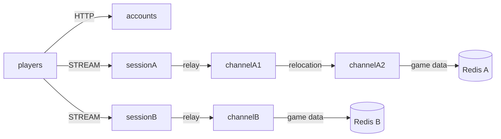

# MyGame world channels

This template runs independent MMORPG worlds. Each world has its own Session process, channel servers, Redis data and route mesh. A Player Actor owns gold. Fixed Zone User Spots host channels, and changing channels uses public Actor relocation while preserving the client connection.



## Prerequisites

.NET SDK 8 or later, Docker with Compose v2, and PowerShell 7 on Windows or Bash on Linux are required. Framework and connector packages are pinned to 0.30.1 in `Directory.Packages.props`. Binding 1.19.0 and Redis client 2.8.31 are pinned there as well. NuGet restore uses nuget.org. The template is independent of the ZLink source repository.

## Build

From this directory, on either platform:

```text
dotnet build server/MyGame.sln
```

## Local e2e

Linux:

```sh
./run-e2e.sh
./run-e2e.sh --scenario worlds,channel,reconnect,update
```

Windows:

```powershell
pwsh -NoProfile -File ./run-e2e.ps1
pwsh -NoProfile -File ./run-e2e.ps1 -Scenario worlds,channel,reconnect,update
```

The runner validates `zlink.structure.json`, starts an isolated Compose project with two Redis services on OS-assigned loopback ports, and launches channel, Session and accounts processes. Each run uses independent Redis key prefixes. Node configuration and stdout/stderr, including Framework message flow, are retained in `.logs/run-<id>/`. Cleanup removes only this run's processes and Compose project; cleanup failures fail the run.

| Scenario | Verification |
| --- | --- |
| `worlds` | HTTP returns both published Session endpoints. The same player earns 10 gold in A and starts with 0 in B. |
| `channel` | Channel 1 to 2 preserves connection, SessionInfo and gold; the new owner is channelA2. |
| `reconnect` | A new connection binds the same Actor generation, channel and gold. |
| `update` | channelA1 drains into channelA2, without affecting B. SessionInfo and gold remain unchanged. The source stops and a replacement starts with the same config, executes Zone lookup during bootstrap, and a new Zone on the replacement processes Player work. |

Use `--check-structure` through the runner arguments to validate without Docker. The structure declares a `mesh` on fixed Zones because `field@1` exists independently in both worlds. Logical identity is checked within its owning mesh. This differs from the current format document's composition-wide logical ID uniqueness requirement; the topology requires separate world namespaces.

## Known issues

Framework 0.30.1 is pending publication. Public 0.30.0 validation failed at initial cross-node admission (#1723) and at a signed 64-bit `EarnRequest` on world B (#1692, typed JSON integer profile). These defects must be resolved in Framework; do not add template retries, alternate codecs or internal API access.

## Deployment sequence

1. Provision separate Redis instances for A and B. Configure distinct key prefixes and world IDs; Framework keys and `player:<id>` application keys share only their world's namespace.
2. Start channelA1 (`field@1`), channelA2 (`field@2`) and channelB (`field@1`). ChannelA1 has capacity one and channelA2 has capacity two so channelA2 can receive channelA1 during maintenance.
3. Start sessionA and sessionB. Listener ports may be zero; use the actual endpoints from their `READY` JSON.
4. Configure the accounts `Worlds` list with those Session endpoints, then start accounts. Its HTTP listener publishes the actual endpoint in `READY`.
5. Send `drain` to channelA1. Wait for `RELOCATION_REQUESTED`, `RELOCATED`, and `SAFE_TO_SHUTDOWN`. Send `shutdown`, wait for `STOPPED` and exit, and start the replacement with the same configuration. Existing Zones remain at their relocated authoritative owner.

Player data writes use the Actor execution turn. Gold must be positive when earning and checked arithmetic rejects overflow. Initial admission selects channel 1; reconnect relays to the Actor's existing Zone and does not change channels. No Spot retains Actor references or duplicates Framework membership. Account configuration contains the common node fields for a consistent JSON schema; the HTTP service does not connect to Redis or a mesh and uses a stateless Framework host for the same drain/shutdown control protocol.

This example trusts the supplied player ID and demonstrates server composition rather than account authentication. Production deployments must authenticate that identity before binding an Actor.

ChannelA1 has a one-Zone capacity and starts before channelA2, whose capacity is two.
This places each fixed Zone on its declared initial owner and leaves room for drain.
After replacement, update sends `create-update-zone` and waits for `UPDATE_ZONE_CREATED`.
The command creates verification Zone `field@3` through the public Spot manager.
ChannelA2 already holds two Zones, so the replacement must host the new Zone.
A new Player joins it and earns gold; the test checks channelA1 in both responses.
Existing Players remain in their relocated Zones. The replacement uses the same configuration.
Message Follow is explicitly 30 seconds; the safe shutdown observation budget is
derived from that duration and the existing operation budget.

## 한국어 실행 안내

이 디렉터리에서 `dotnet build server/MyGame.sln`으로 빌드합니다. Windows에서는 `pwsh -NoProfile -File ./run-e2e.ps1`, Linux에서는 `./run-e2e.sh`로 전체 시나리오를 실행합니다. 실행에 사용하는 Redis와 node는 매번 별도로 생성되며 로그는 `.logs/run-<id>/`에 보존됩니다.

월드 A와 B는 Redis와 mesh를 분리합니다. Player Actor가 gold를 소유하며 채널 변경과 재접속에서도 동일한 Actor 상태를 유지합니다. 유지보수에서는 drain 완료와 SafeToShutdown을 확인한 뒤 원본 node를 종료하고 같은 설정으로 대체 node를 시작합니다. Framework 0.30.1 게시 전에는 공개 패키지 복원이 제한되며, 0.30.0의 알려진 결함을 템플릿에서 우회하지 않습니다.
