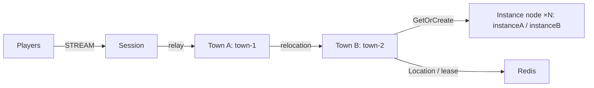

# MyGame — MORPG channel town

Players meet in a town channel, create parties of up to four, and enter a dedicated Dungeon User Spot. Town owns channel population and parties. Dungeon owns its party roster and stage. Stateless Player Actors carry bound Session delivery across Spot joins and host relocation.



## Prerequisites

Default execution requires Docker Linux containers; no host .NET SDK is needed.

Docker with Compose v2 (Linux containers), and PowerShell 7 or Bash. The project uses public ZLink Framework and Stream Connector 0.34.0 packages from NuGet.org. No repository checkout is needed. The transitive .NET binding is pinned to 1.26.0. Package versions are owned by `Directory.Packages.props`.

## Build

Run commands from this project root:

```sh
./run-e2e.sh --build-only
```

PowerShell builds the same Dockerfile targets:

```powershell
pwsh -NoProfile -File ./run-e2e.ps1 -BuildOnly
```

`Dockerfile` owns fixed `SDK_IMAGE`, `RUNTIME_IMAGE`, and `DOCKER_CLI_IMAGE` defaults. Replace the appropriate base ARG when adopting a ZLink base image. All node roles share the node image because their runtime dependencies match; each retains its own executable entry point. The ASP.NET Core runtime supplies shared hosting dependencies. The runner target adds Docker CLI and structure inputs without including the SDK.

Scripts remove unique image tags after each invocation. Docker retains build layers for subsequent runs.

## Client connection

### Endpoint and first packet

The Session `players` STREAM listener uses `StreamEndpoint` in `server/config/session.json`, defaulting to `ws://127.0.0.1:0`: loopback WebSocket, OS-assigned port, root path `/`. Read `StreamEndpoint` from Session `READY` JSON, as `e2e/MyGame.E2E/WorldRun.cs` does. Town/Instance mesh listeners and Redis are internal endpoints.

Send `JoinTownRequest(PlayerId, Channel)` first; channel `1` selects `town-1`. Actor binding and fresh entry produce a `TownView` push. Reconnecting can restore Dungeon membership and produce `DungeonView` instead. Create or join a party after town entry; only its leader starts a Dungeon with `EnterDungeonRequest`. Internal `JoinDungeon` is not a client admission packet. `ActionRejected` reports rejected actions. Entry is send/push; `SessionInfoRequest` is request/reply after binding. There is no product authentication; validate identity before binding when adding it.

### Connector installation

The default loopback listener is reachable only within its host/network namespace. Docker e2e nodes share the runner network namespace and are removed at the end. External clients need a deployment kept running with a reachable listener and an exposed container port. Browser, Unity WebGL, and Cocos Creator web clients can use this WebSocket endpoint; HTTPS pages require a secure `wss://` deployment. HTTP entry points also need a browser-accessible origin/CORS policy when called from a web client.

Use the release pinned in `Directory.Packages.props`, at `PackageVersion Include="Zlink.Framework"` and `PackageVersion Include="Zlink.Stream.Connector"` (`Version` attributes). Replace `<version>` in the installation commands with that release. Check linked guides against that pin; engine adapters follow the linked repository READMEs. All clients use this template's packet contract.

| Client                             | Connector installation                                                                                                                                                                                                                                                                                                                                                                                                                                                          | Documentation guide                                                                                                                                                          |
| ---------------------------------- | ------------------------------------------------------------------------------------------------------------------------------------------------------------------------------------------------------------------------------------------------------------------------------------------------------------------------------------------------------------------------------------------------------------------------------------------------------------------------------- | ---------------------------------------------------------------------------------------------------------------------------------------------------------------------------- |
| Unity                              | Native/Editor: restore `Zlink.Stream.Connector` with NuGetForUnity. WebGL: add the `com.zlink.stream-connector.webgl` UPM Git package; include only the connector assembly for the active target. See the [Unity README](https://github.com/zlink-systems/zlink/blob/main/framework/languages/engines/Unity/README.md) and its package manifest.                                                                                                                                | [.NET engine integration](https://docs.zlink.systems/dotnet/guide/stream-connector/12-engine-integration/)                                                                   |
| Unreal                             | Copy `framework/languages/cpp/connector/engines/unreal` into `Plugins/ZLinkStreamConnector`, then package the native connector under `ThirdParty/ZLink` as described in the [Unreal README](https://github.com/zlink-systems/zlink/blob/main/framework/languages/engines/Unreal/README.md).                                                                                                                                                                                     | [C++ engine integration](https://docs.zlink.systems/cpp/guide/stream-connector/12-engine-integration/)                                                                       |
| Godot                              | .NET: add the NuGet package `Zlink.Stream.Connector` and run `dotnet restore`; see the [C# README](https://github.com/zlink-systems/zlink/blob/main/framework/languages/engines/Godot/csharp/README.md). GDExtension: build the C++ Godot adapter against the framework prebuilt and matching `godot-cpp`; see the [C++ README](https://github.com/zlink-systems/zlink/blob/main/framework/languages/engines/Godot/cpp/README.md). The .NET sample does not support Web export. | [.NET](https://docs.zlink.systems/dotnet/guide/stream-connector/12-engine-integration/), [C++](https://docs.zlink.systems/cpp/guide/stream-connector/12-engine-integration/) |
| Cocos Creator                      | Web target: `npm install @zlink-systems/stream-connector@<version>`; see the [Cocos Creator README](https://github.com/zlink-systems/zlink/blob/main/framework/languages/engines/CocosCreator/README.md). This package does not provide a Creator native adapter.                                                                                                                                                                                                                  | [TypeScript engine integration](https://docs.zlink.systems/node/guide/stream-connector/12-engine-integration/)                                                               |
| Axmol                              | Copy `framework/languages/cpp/connector/engines/axmol` into `third_party/zlink_axmol_connector` and link `zlink::stream_connector` from the installed C++ framework package; see the [Axmol README](https://github.com/zlink-systems/zlink/blob/main/framework/languages/engines/Axmol/README.md).                                                                                                                                                                              | [C++ engine integration](https://docs.zlink.systems/cpp/guide/stream-connector/12-engine-integration/)                                                                       |
| Web browser (TypeScript connector) | `npm install @zlink-systems/stream-connector@<version>`; import the package root in the browser build. Use `ws://` or `wss://`, subject to the page's security policy.                                                                                                                                                                                                                                                                                                             | [TypeScript connector](https://docs.zlink.systems/node/guide/stream-connector/)                                                                                              |
| C++                                | Install the C++ framework prebuilt containing the connector; use `find_package(zlink_stream_connector_cpp CONFIG REQUIRED)` and link `zlink::stream_connector`.                                                                                                                                                                                                                                                                                                                 | [C++ connector](https://docs.zlink.systems/cpp/guide/stream-connector/)                                                                                                      |
| C#/.NET                            | `dotnet add package Zlink.Stream.Connector --version <version>`                                                                                                                                                                                                                                                                                                                                                                                                                    | [.NET connector](https://docs.zlink.systems/dotnet/guide/stream-connector/)                                                                                                  |
| Java                               | Add Maven/Gradle dependency `systems.zlink:zlink-stream-connector:<version>`.                                                                                                                                                                                                                                                                                                                                                                                                      | [Java connector](https://docs.zlink.systems/java/guide/stream-connector/)                                                                                                    |
| Kotlin                             | Add `systems.zlink:zlink-stream-connector:<version>` and `systems.zlink:zlink-framework-kotlin:<version>` for the coroutine wrapper.                                                                                                                                                                                                                                                                                                                                                  | [Kotlin connector](https://docs.zlink.systems/kotlin/guide/stream-connector/)                                                                                                |
| Node                               | `npm install @zlink-systems/stream-connector@<version>`; use the package root and Node.js 22 or later.                                                                                                                                                                                                                                                                                                                                                     | [Node connector](https://docs.zlink.systems/node/guide/stream-connector/)                                                                                                    |

### First town example

Create a .NET 8 console project in a copy, reference `server/MyGame.Shared/MyGame.Shared.csproj`, and add `Zlink.Stream.Connector` using the pinned version described above. Save as `Program.cs`, then run `dotnet run --project <client-project> -- <actual-session-endpoint>` against separately running Session, Town/Instance nodes, and Redis. Use a fresh player ID for the `TownView` path. E2E removes its temporary deployment; its `GameClient.cs` shows the complete flow.

```csharp
using MyGame.Shared;
using Systems.Zlink.Stream.Connector;
using Systems.Zlink.Stream.Connector.Contracts;

using var deadline = new CancellationTokenSource(TimeSpan.FromSeconds(10));
var ct = deadline.Token;
await using var client = ZlinkStreamConnectorFactory.Create(new ZlinkStreamConnectorOptions
{
    Endpoint = new Uri(args[0]),
    DispatchMode = ZlinkStreamDispatchMode.Immediate,
    Reconnect = new ZlinkStreamReconnectOptions { Enabled = false },
});
var received = new TaskCompletionSource<TownView>(TaskCreationOptions.RunContinuationsAsynchronously);
using var view = client.On<TownView>((message, _) =>
{
    received.TrySetResult(message.Payload!);
    return ValueTask.CompletedTask;
});
using var rejected = client.On<ActionRejected>((message, _) =>
{
    received.TrySetException(new InvalidOperationException(message.Payload!.ToString()));
    return ValueTask.CompletedTask;
});
using var error = client.OnErrorReceived((message, _) =>
{
    received.TrySetException(new IOException(message.Message));
    return ValueTask.CompletedTask;
});
using var disconnected = client.OnDisconnected((_, _) =>
{
    received.TrySetException(new IOException("Disconnected before TownView"));
    return ValueTask.CompletedTask;
});
await client.Connect.Async(ct);
await client.Send(new JoinTownRequest("guide-player", 1)).Async(ct);
Console.WriteLine(await received.Task.WaitAsync(ct));
```

## Local e2e

Both scripts build images and call the same C# orchestrator inside a runner container. A unique Compose project/network contains Redis and the runner. The runner checks structure before starting nodes. Nodes share its network namespace, preserving loopback listeners and OS-assigned ports without host port mappings. Redis publishes an ephemeral loopback port for local debugging.

The runner creates each node with interactive stdin, copies its configuration with `docker cp`, and attaches through `docker start -a -i`. `ManagedProcess` retains readiness, drain, shutdown, and replacement controls. Only the runner mounts the Docker socket; use a trusted local daemon. Scripts remove their labeled containers, Compose project, and image tags. Cleanup failure returns exit code 1.

Node stderr logs (`<node>.err.log`) include Framework message flow records because dispatch diagnostics use `Normal`. Inspect these logs from the first failing run.

On Unix sockets, Bash runs the runner with the caller's UID/GID and the socket's group so retained logs remain writable by the caller. Windows uses Docker Desktop's filesystem mapping. Build, Redis, and outer cleanup logs are in `.logs/docker-<project>/`; node settings and control logs are in `.logs/run-<id>/`.

For host process debugging, install the .NET 8 SDK and add `--local` or `-Local`. Redis remains in Docker. After a local build, `--no-build` or `-NoBuild` skips compilation:

```sh
./run-e2e.sh --local
./run-e2e.sh --local --no-build
```

```powershell
pwsh -NoProfile -File ./run-e2e.ps1 -Local
pwsh -NoProfile -File ./run-e2e.ps1 -Local -NoBuild
```

Bash:

```sh
./run-e2e.sh
./run-e2e.sh --scenario channel,dungeon,reconnect,update
./run-e2e.sh --check-structure
./run-e2e.sh --check-domain
```

PowerShell:

```powershell
pwsh -NoProfile -File ./run-e2e.ps1
pwsh -NoProfile -File ./run-e2e.ps1 -Scenario channel,dungeon,reconnect,update
pwsh -NoProfile -File ./run-e2e.ps1 -CheckStructure
pwsh -NoProfile -File ./run-e2e.ps1 -CheckDomain
```

| Scenario | Observation |
| --- | --- |
| `channel` | Session continuity while changing town channels. |
| `dungeon` | Server-issued party/run identities; two entry sends without waiting; identical active Dungeon views; nonleader and internal packet rejection with unchanged state; FinalStage completion; distinct dungeons for parties in town-1 and town-2. |
| `reconnect` | Actor identity and Dungeon RunId, Phase, Stage and roster after reconnect. |
| `update` | Drain completion, preserved Dungeon state and Session identity, and a replacement instance accepting a distinct party run from the other channel. |

`--check-domain` (`-CheckDomain`) runs domain boundary checks before any scenario nodes start. Selecting reconnect or update runs the party setup first. Each run owns a unique Compose project, Redis key prefix, and `.logs/run-<id>/` directory. Redis, mesh and STREAM ports are assigned by the OS. Cleanup failures fail the run.

## Framework behavior to know

- **Waiting for DB or file I/O in a handler** — An ordinary async terminal holds the turn, while `Yield` lets other handlers on the same Spot proceed. [Guide](https://docs.zlink.systems/dotnet/guide/server/32-execution-model/#io-worker-wait).
- **Creation that misses its deadline** — `DeadlineExceeded` and caller cancellation have distinct outcomes. [Guide](https://docs.zlink.systems/dotnet/guide/server/22-actor/#creation-deadline). [server/MyGame.Session/PlayerSession.cs:48](server/MyGame.Session/PlayerSession.cs).
- **Many logins at once** — Each creation for a different ID requires a Location Store round trip, so measure expected load when setting the deadline. [Guide](https://docs.zlink.systems/dotnet/guide/server/25-location/#creation-load).
- **Sending under load** — A send waits for capacity and the application observes only its final result. [Guide](https://docs.zlink.systems/dotnet/guide/server/33-backpressure/#send-backpressure). [server/MyGame.Instance/DungeonSpot.cs:74](server/MyGame.Instance/DungeonSpot.cs).
- **Duplicate login** — Without a callback, binding a different Session is accepted; reject it in the Actor duplicate-bind callback to prevent it. [Guide](https://docs.zlink.systems/dotnet/guide/server/39-session-binding/#duplicate-session-bind). This template keeps the default (accepts the new Session).
- **ObjectGeneration** — `ObjectGeneration` identifies a logical incarnation of the same ID; it is neither a data version nor write authority. [Guide](https://docs.zlink.systems/dotnet/guide/server/34-activation-lifetime/#object-generation). [server/MyGame.Session/PlayerSession.cs:66](server/MyGame.Session/PlayerSession.cs).
- **READY and Serving** — Framework nodes print `READY` after observing runtime `Serving`. [Guide](https://docs.zlink.systems/dotnet/guide/server/12-operations/#wait-for-serving). [server/MyGame.Shared/NodeControl.cs:19](server/MyGame.Shared/NodeControl.cs); [server/MyGame.Shared/NodeControl.cs:46](server/MyGame.Shared/NodeControl.cs).

## Known issues

Validated against the published Framework 0.34.0 packages.

## Deployment sequence

Bootstrap Town providers sequentially and wait for each READY before starting the next. Each provider's public Town stable-type capacity must equal its configured fixed Town count; the structure checker enforces this. Earlier providers are full and later providers are absent, making each fixed Town's declared initial owner deterministic. Entry declarations describe the application Entry registered by Town and Instance, excluding Framework default Entries.

Start Redis, then townA, townB, instanceA, instanceB, and session. Each role has its own executable under `server/`. Pass `--config server/config/<node>.json` to the executable. Instance capacity of one makes replacement placement observable in the local e2e. Increase instance capacity for deployment needs. Party order defines the leader. Forming members leave the party when changing channel; run rosters remain recorded after departure. Dungeon rosters survive disconnects. This template does not provide authentication; a production Session must authenticate the player ID before creating or binding an Actor.

Wait for `READY` before connecting clients. Send `drain` through node stdin and wait for `RELOCATION_REQUESTED`, `RELOCATED`, and `SAFE_TO_SHUTDOWN`. Send `shutdown` and wait for `STOPPED` before restarting the same instance configuration. Application snapshots contain only game state. Framework owns placement, Actor identity, bindings, membership, routes, leases, queues, and relocation completion.

All Object Servers that register Player factories also register the shared Entry and first-admission handler, including both Instance nodes. Entry admission joins the requested fixed Town channel. Each Instance declares its dynamic Dungeon factory in `zlink.structure.json`.

The e2e configuration uses one Dungeon slot per Instance. After drain, the surviving Instance is full, so only the replacement can accept the fresh Dungeon. The structure checker enforces this configuration. Message Follow remains 30 seconds; the SafeToShutdown observation budget is derived from that duration plus the existing relocation operation budget.
