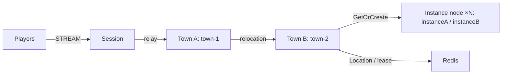

# MyGame — MORPG channel town

Players meet in a town channel, create parties of up to four, and enter a dedicated Dungeon User Spot. Town owns channel population and parties. Dungeon owns its party roster and stage. Stateless Player Actors carry bound Session delivery across Spot joins and host relocation.



## Prerequisites

Default execution requires Docker Linux containers; no host .NET SDK is needed.

Docker with Compose v2 (Linux containers), and PowerShell 7 or Bash. The project uses public ZLink Framework and Stream Connector 0.30.2 packages from NuGet.org. No repository checkout is needed. The transitive .NET binding is pinned to 1.20.0. Package versions are owned by `Directory.Packages.props`.

## Build

Run commands from this project root:

```sh
./run-e2e.sh --build-only
```

PowerShell builds the same Dockerfile targets:

```powershell
pwsh -NoProfile -File ./run-e2e.ps1 -BuildOnly
```

`Dockerfile` owns fixed `SDK_IMAGE`, `RUNTIME_IMAGE`, and `DOCKER_CLI_IMAGE` defaults. Replace the appropriate base ARG when adopting a ZLink base image. All node roles share the node image because their runtime dependencies match; each retains its own executable entry point. The ASP.NET Core runtime supplies shared hosting dependencies. The runner target adds Docker CLI and structure inputs without including the SDK.

Scripts remove unique image tags after each invocation. Docker retains build layers for subsequent runs.

## Local e2e

Both scripts build images and call the same C# orchestrator inside a runner container. A unique Compose project/network contains Redis and the runner. The runner checks structure before starting nodes. Nodes share its network namespace, preserving loopback listeners and OS-assigned ports without host port mappings. Redis publishes an ephemeral loopback port for local debugging.

The runner creates each node with interactive stdin, copies its configuration with `docker cp`, and attaches through `docker start -a -i`. `ManagedProcess` retains readiness, drain, shutdown, and replacement controls. Only the runner mounts the Docker socket; use a trusted local daemon. Scripts remove their labeled containers, Compose project, and image tags. Cleanup failure returns exit code 1.

Node stderr logs (`<node>.err.log`) include Framework message flow records because dispatch diagnostics use `Normal`. Inspect these logs from the first failing run.

On Unix sockets, Bash runs the runner with the caller's UID/GID and the socket's group so retained logs remain writable by the caller. Windows uses Docker Desktop's filesystem mapping. Build, Redis, and outer cleanup logs are in `.logs/docker-<project>/`; node settings and control logs are in `.logs/run-<id>/`.

For host process debugging, install the .NET 8 SDK and add `--local` or `-Local`. Redis remains in Docker. After a local build, `--no-build` or `-NoBuild` skips compilation:

```sh
./run-e2e.sh --local
./run-e2e.sh --local --no-build
```

```powershell
pwsh -NoProfile -File ./run-e2e.ps1 -Local
pwsh -NoProfile -File ./run-e2e.ps1 -Local -NoBuild
```


Bash:

```sh
./run-e2e.sh
./run-e2e.sh --scenario channel,dungeon,reconnect,update
./run-e2e.sh --check-structure
```

PowerShell:

```powershell
pwsh -NoProfile -File ./run-e2e.ps1
pwsh -NoProfile -File ./run-e2e.ps1 -Scenario channel,dungeon,reconnect,update
pwsh -NoProfile -File ./run-e2e.ps1 -CheckStructure
```

`channel` checks Session continuity while switching towns. `dungeon` checks party entry and stage broadcasts. `reconnect` checks Actor identity and Dungeon state after reconnect. `update` drains the active instance, checks state and Session continuity, shuts it down, and verifies its replacement accepts a new dungeon. Selecting reconnect or update runs the party setup first. Each run owns a unique Compose project, Redis key prefix, and `.logs/run-<id>/` directory. Redis, mesh and STREAM ports are assigned by the OS. Cleanup failures fail the run.

## Known issues

Framework 0.30.2 candidate validation is pending package availability. Public 0.30.0 reproduces cross-node join message loss ([#1723](https://github.com/zlink-systems/zlink/issues/1723)); channel and party setup cannot complete reliably on that version. Keep 0.30.2 pinned and verify all four scenarios when its packages are available. Preserve failed node logs instead of changing deadlines or join ordering.

## Deployment sequence

Bootstrap Town providers sequentially and wait for each READY before starting the next. Each provider's public Town stable-type capacity must equal its configured fixed Town count; the structure checker enforces this. Earlier providers are full and later providers are absent, making each fixed Town's declared initial owner deterministic. Entry declarations describe the application Entry registered by Town and Instance, excluding Framework default Entries.

Start Redis, then townA, townB, instanceA, instanceB, and session. Each role has its own executable under `server/`. Pass `--config server/config/<node>.json` to the executable. Instance capacity of one makes replacement placement observable in the local e2e. Increase instance capacity for deployment needs. Party order defines the leader; a leader leaving town transfers leadership to the first remaining member. Dungeon rosters survive disconnects. This template does not provide authentication; a production Session must authenticate the player ID before creating or binding an Actor.

Wait for `READY` before connecting clients. Send `drain` through node stdin and wait for `RELOCATION_REQUESTED`, `RELOCATED`, and `SAFE_TO_SHUTDOWN`. Send `shutdown` and wait for `STOPPED` before restarting the same instance configuration. Application snapshots contain only game state. Framework owns placement, Actor identity, bindings, membership, routes, leases, queues, and relocation completion.

All Object Servers that register Player factories also register the shared Entry and first-admission handler, including both Instance nodes. Entry admission joins the requested fixed Town channel. Each Instance declares its dynamic Dungeon factory in `zlink.structure.json`.

The e2e configuration uses one Dungeon slot per Instance. After drain, the surviving Instance is full, so only the replacement can accept the fresh Dungeon. The structure checker enforces this configuration. Message Follow remains 30 seconds; the SafeToShutdown observation budget is derived from that duration plus the existing relocation operation budget.

## 한국어 실행 안내

기본 실행은 Docker에서 node와 e2e runner를 함께 실행하므로 호스트 .NET SDK가 필요하지 않습니다. Docker Compose v2와 Linux container 환경을 준비하십시오. 로컬 process 디버깅은 .NET 8 SDK를 설치한 뒤 `./run-e2e.sh --local` 또는 `pwsh -NoProfile -File ./run-e2e.ps1 -Local`로 실행합니다. 이미지 빌드·정리 로그는 `.logs/docker-<project>/`, node 로그는 `.logs/run-<id>/`에 남습니다. Docker Compose를 준비한 뒤 템플릿 루트에서 위 Build 명령을 실행합니다. Windows에서는 PowerShell 7의 실행 명령을, WSL에서는 Bash 실행 명령을 사용합니다. 실행마다 Redis와 다섯 server process가 기동되며, 실제 listener endpoint는 READY 출력으로 확인할 수 있습니다.

네 시나리오는 채널 이동, 파티 던전 입장과 stage 진행, 재접속, instance 교체를 검증합니다. 실패 구간과 message flow는 `.logs/run-<id>/`에 보존됩니다. 운영 환경에서는 Session의 player ID 인증과 용량 설정을 적용한 뒤 drain 완료 및 STOPPED를 확인하여 process를 교체합니다.
