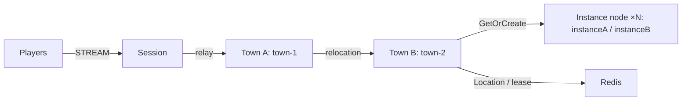

# MyGame — MORPG channel town

Players meet in a town channel, create parties of up to four, and enter a dedicated Dungeon User Spot. Town owns channel population and parties. Dungeon owns its party roster and stage. Stateless Player Actors carry bound Session delivery across Spot joins and host relocation.



## Prerequisites

.NET SDK 8 or later, Docker with Compose v2, and PowerShell 7 or Bash. The project uses public ZLink Framework and Stream Connector 0.30.1 packages from NuGet.org. No repository checkout is needed. The transitive .NET binding is pinned to 1.19.0. Package versions are owned by `Directory.Packages.props`.

## Build

```sh
dotnet build server/MyGame.sln
```

## Local e2e

Bash:

```sh
./run-e2e.sh
./run-e2e.sh --scenario channel,dungeon,reconnect,update
```

PowerShell:

```powershell
./run-e2e.ps1
./run-e2e.ps1 -Scenario channel,dungeon,reconnect,update
```

`channel` checks Session continuity while switching towns. `dungeon` checks party entry and stage broadcasts. `reconnect` checks Actor identity and Dungeon state after reconnect. `update` drains the active instance, checks state and Session continuity, shuts it down, and verifies its replacement accepts a new dungeon. Selecting reconnect or update runs the party setup first. Each run owns a unique Compose project, Redis key prefix, and `.logs/run-<id>/` directory. Redis, mesh and STREAM ports are assigned by the OS. Cleanup failures fail the run.

## Known issues

Framework 0.30.1 candidate validation is pending package availability. Public 0.30.0 reproduces cross-node join message loss ([#1723](https://github.com/zlink-systems/zlink/issues/1723)); channel and party setup cannot complete reliably on that version. Keep 0.30.1 pinned and verify all four scenarios when its packages are available. Preserve failed node logs instead of changing deadlines or join ordering.

## Deployment sequence

Start Redis, then townA, townB, instanceA, instanceB, and session. Each role has its own executable under `server/`. Pass `--config server/config/<node>.json` to the executable. The town capacity of one ensures each startup town owns its configured fixed Spot; instance capacity of one makes replacement placement observable in the local e2e. Increase instance capacity for deployment needs. Party order defines the leader; a leader leaving town transfers leadership to the first remaining member. Dungeon rosters survive disconnects. This template does not provide authentication; a production Session must authenticate the player ID before creating or binding an Actor.

Wait for `READY` before connecting clients. Send `drain` through node stdin and wait for `RELOCATION_REQUESTED`, `RELOCATED`, and `SAFE_TO_SHUTDOWN`. Send `shutdown` and wait for `STOPPED` before restarting the same instance configuration. Application snapshots contain only game state. Framework owns placement, Actor identity, bindings, membership, routes, leases, queues, and relocation completion.

## 한국어 실행 안내

.NET SDK와 Docker Compose를 준비한 뒤 템플릿 루트에서 위 Build 명령을 실행합니다. Windows에서는 PowerShell 7의 실행 명령을, WSL에서는 Bash 실행 명령을 사용합니다. 실행마다 Redis와 다섯 server process가 기동되며, 실제 listener endpoint는 READY 출력으로 확인할 수 있습니다.

네 시나리오는 채널 이동, 파티 던전 입장과 stage 진행, 재접속, instance 교체를 검증합니다. 실패 구간과 message flow는 `.logs/run-<id>/`에 보존됩니다. 운영 환경에서는 Session의 player ID 인증과 용량 설정을 적용한 뒤 drain 완료 및 STOPPED를 확인하여 process를 교체합니다.
