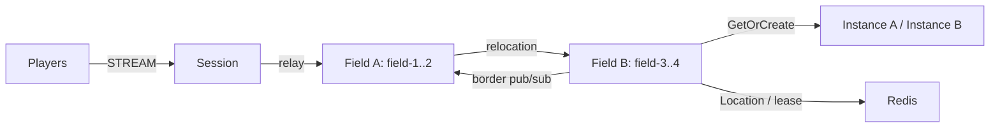

# MyGame — MORPG fields and instances

Players cross fixed fields while retaining their STREAM connection, observe nearby players across field boundaries, and form parties to enter dynamic Dungeon User Spots. Field position domains own movement decisions and visibility. Independent Party User Spots own membership, leadership, and run state across Field changes. Player Actors retain accepted position observations. Dungeon Spots own their prepared roster and stages.



## Prerequisites

Default execution requires Docker Linux containers; no host .NET SDK is needed.

Docker with Compose v2 (Linux containers), and PowerShell 7 or Bash. `Directory.Packages.props` pins public ZLink Framework and Stream Connector 0.30.2 and the 1.20.0 binding. The project uses NuGet.org and requires no repository checkout.

## Build

Run commands from this project root:

```sh
./run-e2e.sh --build-only
```

PowerShell builds the same Dockerfile targets:

```powershell
pwsh -NoProfile -File ./run-e2e.ps1 -BuildOnly
```

`Dockerfile` owns fixed `SDK_IMAGE`, `RUNTIME_IMAGE`, and `DOCKER_CLI_IMAGE` defaults. Replace the appropriate base ARG when adopting a ZLink base image. All node roles share the node image because their runtime dependencies match; each retains its own executable entry point. The ASP.NET Core runtime supplies shared hosting dependencies. The runner target adds Docker CLI and structure inputs without including the SDK.

Scripts remove unique image tags after each invocation. Docker retains build layers for subsequent runs.

## Local e2e

Both scripts build images and call the same C# orchestrator inside a runner container. A unique Compose project/network contains Redis and the runner. The runner checks structure before starting nodes. Nodes share its network namespace, preserving loopback listeners and OS-assigned ports without host port mappings. Redis publishes an ephemeral loopback port for local debugging.

The runner creates each node with interactive stdin, copies its configuration with `docker cp`, and attaches through `docker start -a -i`. `ManagedProcess` retains readiness, drain, shutdown, and replacement controls. Only the runner mounts the Docker socket; use a trusted local daemon. Scripts remove their labeled containers, Compose project, and image tags. Cleanup failure returns exit code 1.

Node stderr logs (`<node>.err.log`) include Framework message flow records because dispatch diagnostics use `Normal`. Inspect these logs from the first failing run.

On Unix sockets, Bash runs the runner with the caller's UID/GID and the socket's group so retained logs remain writable by the caller. Windows uses Docker Desktop's filesystem mapping. Build, Redis, and outer cleanup logs are in `.logs/docker-<project>/`; node settings and control logs are in `.logs/run-<id>/`.

For host process debugging, install the .NET 8 SDK and add `--local` or `-Local`. Redis remains in Docker. After a local build, `--no-build` or `-NoBuild` skips compilation:

```sh
./run-e2e.sh --local
./run-e2e.sh --local --no-build
```

```powershell
pwsh -NoProfile -File ./run-e2e.ps1 -Local
pwsh -NoProfile -File ./run-e2e.ps1 -Local -NoBuild
```

Bash:

```sh
./run-e2e.sh
./run-e2e.sh --scenario field,dungeon,reconnect,update
./run-e2e.sh --check-structure
```

PowerShell:

```powershell
pwsh -NoProfile -File ./run-e2e.ps1
pwsh -NoProfile -File ./run-e2e.ps1 -Scenario field,dungeon,reconnect,update
pwsh -NoProfile -File ./run-e2e.ps1 -CheckStructure
```

| Scenario | Client observations |
| --- | --- |
| `field` | Field crossing, border visibility, unchanged Session, party members and leader preserved across Fields, movement rejections preserving position and sequence, server-provided movement retry delay, internal-packet rejection. |
| `dungeon` | Server-issued IDs, immutable nonleader rejection, duplicate entry requests sharing a run, shared Dungeon and stage broadcasts, completion at FinalStage 3. |
| `reconnect` | Same Actor, Dungeon, RunId, Phase, roster and stage after reconnection. |
| `update` | Instance drain, relocated RunId/Phase/stage and Session continuity, replacement accepting a distinct party run. |

Selecting reconnect or update includes party setup. `./run-e2e.sh --check-domain` (PowerShell `-CheckDomain`) runs 95 domain checks before starting game nodes.

Each run owns a unique Compose project, Redis key prefix and `.logs/run-<id>/` directory. Redis, mesh and STREAM listeners use OS-assigned ports. The structure checker runs before Redis or node startup. Cleanup failures fail the run.

## Known issues

Validated against the published Framework 0.30.2 packages.

## Deployment sequence

Start Redis, then fieldA, fieldB, instanceA, instanceB and session. Each role has its own executable under `server/`; pass `--config server/config/<node>.json`. Field capacity two and sequential bootstrap place field-1..2 on fieldA and field-3..4 on fieldB. Instance capacity one makes replacement placement observable in e2e; choose deployment capacity to suit the workload. Fields have width 100 and border radius 10. Parties contain at most four members; insertion order defines the leader. Leaving a Field clears only visibility; party members and leader remain unchanged. Movement uses Delta and a 64-bit Sequence with a maximum of 9,007,199,254,740,991. MaxStep is 10, MaxSpeed is 50 units/s, and the first move has the full budget. Rejected inputs preserve state; only move-budget returns a positive RetryAfterMs. Dungeon rosters and stage survive disconnects.

Wait for `READY` before connecting clients. Send `drain` through node stdin and wait for `RELOCATION_REQUESTED`, `RELOCATED` and `SAFE_TO_SHUTDOWN`. Send `shutdown` and wait for `STOPPED` before restarting the same instance configuration. Application snapshots contain game state only. Framework owns placement, identity, bindings, membership, routes, leases, queues and relocation completion. Production Session code must authenticate the player ID before creating or binding an Actor.

Player Actor factories and the shared Entry implementation are registered on both Field and Instance nodes. Declare one Entry in `zlink.structure.json` for each Field or Instance node, where the application registers Entry and its first-entry handler. Do not declare Framework default Entries on other roles. The update scenario uses Dungeon capacity 1: after relocation, the occupied peer cannot create the new Dungeon, so the replacement must accept it.

GameTiming owns the 30-second Message Follow duration and the 30-second relocation observation budget. Safe-shutdown observation is derived as Message Follow plus that relocation budget.

Initial Field placement uses public stable-type capacity and sequential startup. Set each Field node capacity to exactly its configured Field ID count. Start one Field node and wait for its READY, which follows creation of all its Fields, before starting the next Field node. Earlier nodes are full, so the newly started node is the only eligible Field host. Do not start initial Field hosts concurrently.

## 한국어 실행 안내

기본 실행은 Docker에서 node와 e2e runner를 함께 실행하므로 호스트 .NET SDK가 필요하지 않습니다. Docker Compose v2와 Linux container 환경을 준비하십시오. 로컬 process 디버깅은 .NET 8 SDK를 설치한 뒤 `./run-e2e.sh --local` 또는 `pwsh -NoProfile -File ./run-e2e.ps1 -Local`로 실행합니다. 이미지 빌드·정리 로그는 `.logs/docker-<project>/`, node 로그는 `.logs/run-<id>/`에 남습니다. Docker Compose를 준비한 뒤 템플릿 루트에서 위 Build 명령을 실행합니다. Windows에서는 PowerShell 7을, WSL에서는 Bash를 사용합니다. 실행마다 Redis와 다섯 server process가 기동되며, 실제 listener endpoint는 READY 출력으로 확인합니다.

시나리오는 서버 권위 이동과 거부 뒤 상태 불변, Field 경계를 넘는 파티 유지, 중복 던전 입장과 실행 완료, 재접속 및 instance 교체 뒤 RunId·Phase·Stage 복원을 검증합니다. `--check-domain`으로 도메인 경계 시험을 따로 실행합니다. 공개 Framework 0.30.2 패키지를 사용합니다. 실패 로그는 `.logs/run-<id>/`에 보존합니다. 운영 환경에서는 Session의 인증과 용량 설정을 적용하고 drain 완료 및 STOPPED를 확인한 뒤 process를 교체합니다.
