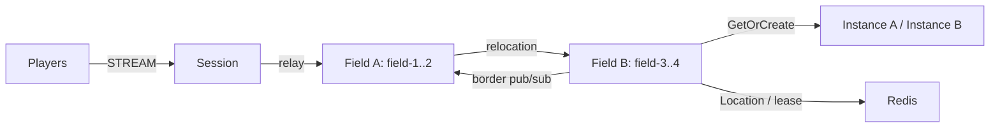

# MyGame — MORPG fields and instances

Players cross fixed fields while retaining their STREAM connection, observe nearby players across field boundaries, and form parties to enter dynamic Dungeon User Spots. Field Spots own parties and visibility projections. Player Actors own position and movement sequence. Dungeon Spots own their party roster and stage.



## Prerequisites

.NET SDK 8 or later, Docker with Compose v2, and PowerShell 7 or Bash. `Directory.Packages.props` pins public ZLink Framework and Stream Connector 0.30.1 and the 1.19.0 binding. The 0.30.1 release is pending availability; candidate validation is not complete. The project uses NuGet.org and requires no repository checkout.

## Build

```sh
dotnet build server/MyGame.sln
```

## Local e2e

Bash:

```sh
./run-e2e.sh
./run-e2e.sh --scenario field,dungeon,reconnect,update
```

PowerShell:

```powershell
./run-e2e.ps1
./run-e2e.ps1 -Scenario field,dungeon,reconnect,update
```

`field` crosses from field-2 on fieldA to field-3 on fieldB and checks a nearby observer's `BorderVisible` event and unchanged `SessionInfo`. `dungeon` checks a two-player party's shared dungeon and stage broadcast. `reconnect` checks the same Actor, dungeon and stage after reconnect. `update` drains the active instance, checks game state and Session continuity, waits for stopped shutdown, and verifies its replacement accepts a new dungeon. Selecting reconnect or update includes party setup.

Each run owns a unique Compose project, Redis key prefix and `.logs/run-<id>/` directory. Redis, mesh and STREAM listeners use OS-assigned ports. The structure checker runs before Redis or node startup. Cleanup failures fail the run.

## Known issues

Public 0.30.0 builds successfully, but its startup validator calls `FieldSpot.Configure()` with an empty `SpotId`, preventing identity-dependent border subscription registration. This failure occurs before clients connect; no scenario has been accepted. Candidate 0.30.1 validation must confirm this startup contract before testing gameplay. Cross-node join message loss is also a known 0.30.0 issue ([#1723](https://github.com/zlink-systems/zlink/issues/1723)); this template has not reached that path. Preserve node stderr and message-flow records without changing subscriptions, deadlines or join ordering to bypass Framework failures.

## Deployment sequence

Start Redis, then fieldA, fieldB, instanceA, instanceB and session. Each role has its own executable under `server/`; pass `--config server/config/<node>.json`. Field capacity two and sequential bootstrap place field-1..2 on fieldA and field-3..4 on fieldB. Instance capacity one makes replacement placement observable in e2e; choose deployment capacity to suit the workload. Fields have width 100 and border radius 10. Parties contain at most four members; insertion order defines the leader. A member leaving a field is removed from its party, and the first remaining member becomes leader. Dungeon rosters and stage survive disconnects.

Wait for `READY` before connecting clients. Send `drain` through node stdin and wait for `RELOCATION_REQUESTED`, `RELOCATED` and `SAFE_TO_SHUTDOWN`. Send `shutdown` and wait for `STOPPED` before restarting the same instance configuration. Application snapshots contain game state only. Framework owns placement, identity, bindings, membership, routes, leases, queues and relocation completion. Production Session code must authenticate the player ID before creating or binding an Actor.

## 한국어 실행 안내

.NET SDK와 Docker Compose를 준비한 뒤 템플릿 루트에서 위 Build 명령을 실행합니다. Windows에서는 PowerShell 7을, WSL에서는 Bash를 사용합니다. 실행마다 Redis와 다섯 server process가 기동되며, 실제 listener endpoint는 READY 출력으로 확인합니다.

시나리오는 필드 이동과 경계 구독, 파티 던전 입장과 stage 진행, 재접속, instance 교체를 검증합니다. 현재 공개 0.30.0 검증은 Field 시작 단계에서 차단되어 있으며 0.30.1 검증이 남아 있습니다. 실패 로그는 `.logs/run-<id>/`에 보존합니다. 운영 환경에서는 Session의 인증과 용량 설정을 적용하고 drain 완료 및 STOPPED를 확인한 뒤 process를 교체합니다.
