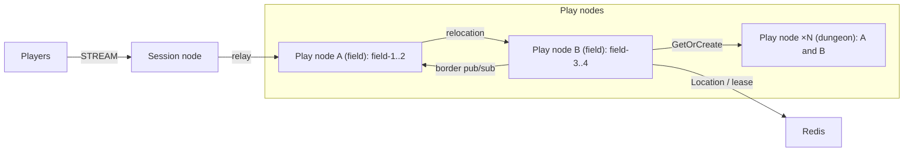

# MyGame — MORPG fields and instances

Players cross fixed fields while retaining their STREAM connection, observe nearby players across field boundaries, and form parties to enter dynamic Dungeon User Spots. Field position domains own movement decisions and visibility. Independent Party User Spots own membership, leadership, and run state across Field changes. Player Actors retain accepted position observations. Dungeon Spots own their prepared roster and stages.



This template is a reference. To build a new game, create a new project and design its nodes, Spots, Actors and messages for that game, using this template's structure and rules as reference; do not rename or edit this template in place into the game.

## Prerequisites

Default execution requires Docker Linux containers; no host .NET SDK is needed.

Docker with Compose v2 (Linux containers), and PowerShell 7 or Bash. `Directory.Packages.props` pins public ZLink Framework and Stream Connector 0.34.1 and the 1.26.0 binding. The project uses NuGet.org and requires no repository checkout.

## Build

Run commands from this project root:

```sh
./run-e2e.sh --build-only
```

PowerShell builds the same Dockerfile targets:

```powershell
.\run-e2e.cmd -BuildOnly
```

`Dockerfile` owns fixed `SDK_IMAGE`, `RUNTIME_IMAGE`, and `DOCKER_CLI_IMAGE` defaults. Replace the appropriate base ARG when adopting a ZLink base image. All node roles share the node image because their runtime dependencies match; each retains its own executable entry point. The ASP.NET Core runtime supplies shared hosting dependencies. The runner target adds Docker CLI and structure inputs without including the SDK.

Scripts remove unique image tags after each invocation. Docker retains build layers for subsequent runs.

## Local server

Run from the template directory with the .NET 8 SDK and Docker Compose v2 available. The command builds the server and starts Redis in Docker and the game nodes as local processes.

```bash
./run-server.sh
```

```powershell
.\run-server.cmd
```

Connect clients to the WebSocket address in the `Server ready` line. When the topology has an HTTP API, the runner also prints its address. Ctrl+C stops the nodes and Redis. A second start is rejected while the server is running.

Send `LeaveDungeonRequest` and wait for `DungeonLeft`. The Dungeon counts the players still inside after the leave and returns that count as `remainingPlayers`. At zero, the Session closes that Spot generation before replying and releases its capacity. A disconnect preserves Dungeon membership for reconnect.

## Client connection

### Endpoint and first packet

The Session `players` STREAM listener uses `StreamEndpoint` in `server/config/session.json`, defaulting to `ws://127.0.0.1:0`: loopback WebSocket, OS-assigned port, root path `/`. Read `StreamEndpoint` from Session `READY` JSON, as `e2e/MyGame.E2E/WorldRun.cs` does. Field/Instance mesh listeners and Redis are internal endpoints.

Send `JoinWorldRequest(PlayerId, X)` first; `X: 0` enters the first Field. Actor binding and entry produce a `WorldState` push. Party creation/join and leader-driven Dungeon entry follow world entry; internal `JoinDungeon` is not a client admission packet. Rejoining restores existing state where available. `ActionRejected` reports rejected actions. Entry is send/push; `SessionInfoRequest` is request/reply after binding. There is no product authentication; validate identity before binding when adding it.

### Connector installation

The default loopback listener is reachable only within its host/network namespace. Docker e2e nodes share the runner network namespace and are removed at the end. External clients need a deployment kept running with a reachable listener and an exposed container port. Browser, Unity WebGL, and Cocos Creator web clients can use this WebSocket endpoint; HTTPS pages require a secure `wss://` deployment. HTTP entry points also need a browser-accessible origin/CORS policy when called from a web client.

Use the release pinned in `Directory.Packages.props`, at `PackageVersion Include="Zlink.Framework"` and `PackageVersion Include="Zlink.Stream.Connector"` (`Version` attributes). Replace `<version>` in the installation commands with that release. Check linked guides against that pin; engine adapters follow the linked repository READMEs. All clients use this template's packet contract.

| Client                             | Connector installation                                                                                                                                                                                                                                                                                                                                                                                                                                                          | Documentation guide                                                                                                                                                          |
| ---------------------------------- | ------------------------------------------------------------------------------------------------------------------------------------------------------------------------------------------------------------------------------------------------------------------------------------------------------------------------------------------------------------------------------------------------------------------------------------------------------------------------------- | ---------------------------------------------------------------------------------------------------------------------------------------------------------------------------- |
| Unity                              | Native/Editor: restore `Zlink.Stream.Connector` with NuGetForUnity. WebGL: add the `com.zlink.stream-connector.webgl` UPM Git package; include only the connector assembly for the active target. See the [Unity README](https://github.com/zlink-systems/zlink/blob/main/framework/languages/engines/Unity/README.md) and its package manifest.                                                                                                                                | [.NET engine integration](https://docs.zlink.systems/dotnet/guide/stream-connector/12-engine-integration/)                                                                   |
| Unreal                             | Copy `framework/languages/cpp/connector/engines/unreal` into `Plugins/ZLinkStreamConnector`, then package the native connector under `ThirdParty/ZLink` as described in the [Unreal README](https://github.com/zlink-systems/zlink/blob/main/framework/languages/engines/Unreal/README.md).                                                                                                                                                                                     | [C++ engine integration](https://docs.zlink.systems/cpp/guide/stream-connector/12-engine-integration/)                                                                       |
| Godot                              | .NET: add the NuGet package `Zlink.Stream.Connector` and run `dotnet restore`; see the [C# README](https://github.com/zlink-systems/zlink/blob/main/framework/languages/engines/Godot/csharp/README.md). GDExtension: build the C++ Godot adapter against the framework prebuilt and matching `godot-cpp`; see the [C++ README](https://github.com/zlink-systems/zlink/blob/main/framework/languages/engines/Godot/cpp/README.md). The .NET sample does not support Web export. | [.NET](https://docs.zlink.systems/dotnet/guide/stream-connector/12-engine-integration/), [C++](https://docs.zlink.systems/cpp/guide/stream-connector/12-engine-integration/) |
| Cocos Creator                      | Web target: `npm install @zlink-systems/stream-connector@<version>`; see the [Cocos Creator README](https://github.com/zlink-systems/zlink/blob/main/framework/languages/engines/CocosCreator/README.md). This package does not provide a Creator native adapter.                                                                                                                                                                                                                  | [TypeScript engine integration](https://docs.zlink.systems/node/guide/stream-connector/12-engine-integration/)                                                               |
| Axmol                              | Copy `framework/languages/cpp/connector/engines/axmol` into `third_party/zlink_axmol_connector` and link `zlink::stream_connector` from the installed C++ framework package; see the [Axmol README](https://github.com/zlink-systems/zlink/blob/main/framework/languages/engines/Axmol/README.md).                                                                                                                                                                              | [C++ engine integration](https://docs.zlink.systems/cpp/guide/stream-connector/12-engine-integration/)                                                                       |
| Web browser (TypeScript connector) | `npm install @zlink-systems/stream-connector@<version>`; import the package root in the browser build. Use `ws://` or `wss://`, subject to the page's security policy.                                                                                                                                                                                                                                                                                                             | [TypeScript connector](https://docs.zlink.systems/node/guide/stream-connector/)                                                                                              |
| C++                                | Install the C++ framework prebuilt containing the connector; use `find_package(zlink_stream_connector_cpp CONFIG REQUIRED)` and link `zlink::stream_connector`.                                                                                                                                                                                                                                                                                                                 | [C++ connector](https://docs.zlink.systems/cpp/guide/stream-connector/)                                                                                                      |
| C#/.NET                            | `dotnet add package Zlink.Stream.Connector --version <version>`                                                                                                                                                                                                                                                                                                                                                                                                                    | [.NET connector](https://docs.zlink.systems/dotnet/guide/stream-connector/)                                                                                                  |
| Java                               | Add Maven/Gradle dependency `systems.zlink:zlink-stream-connector:<version>`.                                                                                                                                                                                                                                                                                                                                                                                                      | [Java connector](https://docs.zlink.systems/java/guide/stream-connector/)                                                                                                    |
| Kotlin                             | Add `systems.zlink:zlink-stream-connector:<version>` and `systems.zlink:zlink-framework-kotlin:<version>` for the coroutine wrapper.                                                                                                                                                                                                                                                                                                                                                  | [Kotlin connector](https://docs.zlink.systems/kotlin/guide/stream-connector/)                                                                                                |
| Node                               | `npm install @zlink-systems/stream-connector@<version>`; use the package root and Node.js 22 or later.                                                                                                                                                                                                                                                                                                                                                     | [Node connector](https://docs.zlink.systems/node/guide/stream-connector/)                                                                                                    |

### First field example

Create a .NET 8 console project in a copy, reference `server/MyGame.Shared/MyGame.Shared.csproj`, and add `Zlink.Stream.Connector` using the pinned version described above. Save as `Program.cs`, then run `dotnet run --project <client-project> -- <actual-session-endpoint>` against separately running Session, Field/play nodes (dungeon), and Redis. Use a fresh player ID. E2E removes its temporary deployment; its `GameClient.cs` shows the complete flow.

```csharp
using MyGame.Shared;
using Systems.Zlink.Stream.Connector;
using Systems.Zlink.Stream.Connector.Contracts;

using var deadline = new CancellationTokenSource(TimeSpan.FromSeconds(10));
var ct = deadline.Token;
await using var client = ZlinkStreamConnectorFactory.Create(new ZlinkStreamConnectorOptions
{
    Endpoint = new Uri(args[0]),
    DispatchMode = ZlinkStreamDispatchMode.Immediate,
    Reconnect = new ZlinkStreamReconnectOptions { Enabled = false },
});
var received = new TaskCompletionSource<WorldState>(TaskCreationOptions.RunContinuationsAsynchronously);
using var view = client.On<WorldState>((message, _) =>
{
    received.TrySetResult(message.Payload!);
    return ValueTask.CompletedTask;
});
using var rejected = client.On<ActionRejected>((message, _) =>
{
    received.TrySetException(new InvalidOperationException(message.Payload!.ToString()));
    return ValueTask.CompletedTask;
});
using var error = client.OnErrorReceived((message, _) =>
{
    received.TrySetException(new IOException(message.Message));
    return ValueTask.CompletedTask;
});
using var disconnected = client.OnDisconnected((_, _) =>
{
    received.TrySetException(new IOException("Disconnected before WorldState"));
    return ValueTask.CompletedTask;
});
await client.Connect.Async(ct);
await client.Send(new JoinWorldRequest("guide-player", 0)).Async(ct);
Console.WriteLine(await received.Task.WaitAsync(ct));
```

## Local e2e

Run `run-e2e` from another terminal to detect the running server through `.logs/server.json`, or run it with the server stopped to use an isolated Docker deployment. The attached run skips `update` because node replacement needs isolated processes.

The runner prints each scenario result and the pass total. Find per-node stdout, stderr, and Framework message flow in `.logs/run-<id>/` as `<node>.out.log`, `<node>.err.log`, and `<node>.flow.log`. An isolated scenario with its own deployment keeps these files in a scenario subdirectory. Failures reference a `*-failure.log` file. Docker build and cleanup logs remain in `.logs/docker-<project>/`.

In isolated Docker mode, both scripts build images and call the same C# runner inside a container. A unique Compose project/network contains Redis and the runner. The runner checks structure before starting nodes. Nodes share its network namespace, preserving loopback listeners and OS-assigned ports without host port mappings. Redis publishes an ephemeral loopback port for local debugging.

The runner creates each node with interactive stdin, copies its configuration with `docker cp`, and attaches through `docker start -a -i`. `ManagedProcess` retains readiness, drain, shutdown, and replacement controls. Only the runner mounts the Docker socket; use a trusted local daemon. Scripts remove their labeled containers, Compose project, and image tags. Cleanup failure returns exit code 1.

Node stderr logs (`<node>.err.log`) include Framework message flow records because dispatch diagnostics use `Normal`. Inspect these logs from the first failing run.

On Unix sockets, the script runs the runner with the caller's UID/GID and the socket's group so retained logs remain writable by the caller. Windows uses Docker Desktop's filesystem mapping. Build, Redis, and outer cleanup logs are in `.logs/docker-<project>/`; node settings and control logs are in `.logs/run-<id>/`.

For host process debugging, install the .NET 8 SDK and add `--local` or `-Local`. Redis remains in Docker. After a local build, `--no-build` or `-NoBuild` skips compilation:

```sh
./run-e2e.sh --local
./run-e2e.sh --local --no-build
```

```powershell
.\run-e2e.cmd -Local
.\run-e2e.cmd -Local -NoBuild
```

Bash:

```sh
./run-e2e.sh
./run-e2e.sh --scenario field,dungeon,reconnect,update
./run-e2e.sh --check-structure
```

PowerShell:

```powershell
.\run-e2e.cmd
.\run-e2e.cmd -Scenario field,dungeon,reconnect,update
.\run-e2e.cmd -CheckStructure
```

| Scenario | Client observations |
| --- | --- |
| `field` | Field crossing, border visibility, unchanged Session, party members and leader preserved across Fields, movement rejections preserving position and sequence, server-provided movement retry delay, internal-packet rejection. |
| `dungeon` | Server-issued IDs, immutable nonleader rejection, duplicate entry requests sharing a run, shared Dungeon and stage broadcasts, completion at FinalStage 3. |
| `reconnect` | Same Actor, Dungeon, RunId, Phase, roster and stage after reconnection. |
| `update` | Instance drain, relocated RunId/Phase/stage and Session continuity, replacement accepting a distinct party run. |
| `dungeon-leave` | Verify that the remaining player can query the same Dungeon after the first departure and that the last departure releases the slot. |

Selecting reconnect or update includes party setup. `./run-e2e.sh --check-domain` (PowerShell `-CheckDomain`) runs 95 domain checks before starting play nodes.

Each run owns a unique Compose project, Redis key prefix and `.logs/run-<id>/` directory. Redis, mesh and STREAM listeners use OS-assigned ports. The structure checker runs before Redis or node startup. Cleanup failures fail the run.

## Framework behavior to know

- **Waiting for DB or file I/O in a handler** — An ordinary async terminal holds the turn, while `Yield` lets other handlers on the same Spot proceed. [Guide](https://docs.zlink.systems/dotnet/guide/server/32-execution-model/#io-worker-wait).
- **Creation that misses its deadline** — `DeadlineExceeded` and caller cancellation have distinct outcomes. [Guide](https://docs.zlink.systems/dotnet/guide/server/22-actor/#creation-deadline). [server/MyGame.Session/PlayerSession.cs:47](server/MyGame.Session/PlayerSession.cs).
- **Many logins at once** — Each creation for a different ID requires a Location Store round trip, so measure expected load when setting the deadline. [Guide](https://docs.zlink.systems/dotnet/guide/server/25-location/#creation-load).
- **Sending under load** — A send waits for capacity and the application observes only its final result. [Guide](https://docs.zlink.systems/dotnet/guide/server/33-backpressure/#send-backpressure). [server/MyGame.Field/FieldSpot.cs:95](server/MyGame.Field/FieldSpot.cs).
- **Duplicate login** — Without a callback, binding a different Session is accepted; reject it in the Actor duplicate-bind callback to prevent it. [Guide](https://docs.zlink.systems/dotnet/guide/server/39-session-binding/#duplicate-session-bind). This template keeps the default (accepts the new Session).
- **ObjectGeneration** — `ObjectGeneration` identifies a logical incarnation of the same ID; it is neither a data version nor write authority. [Guide](https://docs.zlink.systems/dotnet/guide/server/34-activation-lifetime/#object-generation). [server/MyGame.Session/PlayerSession.cs:65](server/MyGame.Session/PlayerSession.cs).
- **READY and Serving** — Framework nodes print `READY` after observing runtime `Serving`. [Guide](https://docs.zlink.systems/dotnet/guide/server/12-operations/#wait-for-serving). [server/MyGame.Shared/NodeControl.cs:19](server/MyGame.Shared/NodeControl.cs); [server/MyGame.Shared/NodeControl.cs:46](server/MyGame.Shared/NodeControl.cs).

## Known issues

Drain confirmation takes about 30 seconds, so a turn clock may expire during the wait. For an update scenario in a game with turn clocks, finish the round before relocating it. Verify that relocation preserves the remaining time in a domain check with a controlled clock.

Validated against the published Framework 0.34.1 packages.

## Deployment sequence

Start Redis, then fieldA, fieldB, instanceA, instanceB and session. Each role has its own executable under `server/`; pass `--config server/config/<node>.json`. Field capacity two and sequential bootstrap place field-1..2 on fieldA and field-3..4 on fieldB. Instance capacity one makes replacement placement observable in e2e; choose deployment capacity to suit the workload. Fields have width 100 and border radius 10. Parties contain at most four members; insertion order defines the leader. Leaving a Field clears only visibility; party members and leader remain unchanged. Movement uses Delta and a 64-bit Sequence with a maximum of 9,007,199,254,740,991. MaxStep is 10, MaxSpeed is 50 units/s, and the first move has the full budget. Rejected inputs preserve state; only move-budget returns a positive RetryAfterMs. Dungeon rosters and stage survive disconnects.

Wait for `READY` before connecting clients. Send `drain` through node stdin and wait for `RELOCATION_REQUESTED`, `RELOCATED` and `SAFE_TO_SHUTDOWN`. Send `shutdown` and wait for `STOPPED` before restarting the same instance configuration. Application snapshots contain game state only. Framework owns placement, identity, bindings, membership, routes, leases, queues and relocation completion. Production Session code must authenticate the player ID before creating or binding an Actor.

Player Actor factories and the shared Entry implementation are registered on both play nodes (field and dungeon). Declare one Entry in `zlink.structure.json` for each play node (field or dungeon), where the application registers Entry and its first-entry handler. Do not declare Framework default Entries on other roles. The update scenario uses Dungeon capacity 1: after relocation, the occupied peer cannot create the new Dungeon, so the replacement must accept it.

GameTiming owns the 30-second Message Follow duration and the 30-second relocation observation budget. Safe-shutdown observation is derived as Message Follow plus that relocation budget.

Initial Field placement uses public stable-type capacity and sequential startup. Set each play node (field) capacity to exactly its configured Field ID count. Start one play node (field) and wait for its READY, which follows creation of all its Fields, before starting the next play node (field). Earlier nodes are full, so the newly started node is the only eligible play node (field). Do not start initial play nodes (field) concurrently.
