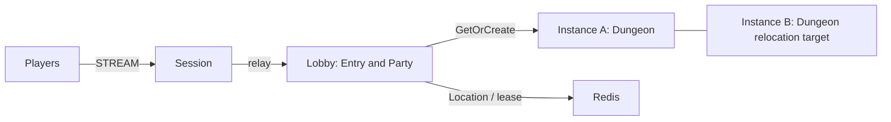

# MyGame — MORPG lobby and instances

Players connect to Session, form a party in Lobby and enter a Dungeon without a town channel. The Entry Spot routes party admission; a dynamic Party User Spot owns the roster and readiness. Dungeon User Spots own their admitted roster and stage. Framework owns Actor identity, Session binding and relocation.



## Prerequisites

.NET SDK 8 or later, Docker with Compose v2 and PowerShell 7 or Bash. Public NuGet packages are pinned in `Directory.Packages.props`: Framework and Stream Connector 0.30.1, binding 1.19.0. The template builds independently of the ZLink repository. Framework 0.30.1 must be available on NuGet.org before using these commands.

## Build

```sh
dotnet build server/MyGame.sln
```

## Local e2e

Bash:

```sh
./run-e2e.sh
./run-e2e.sh --scenario party,reconnect,update
```

PowerShell 7:

```powershell
./run-e2e.ps1
./run-e2e.ps1 -Scenario party,reconnect,update
```

The runner checks `zlink.structure.json`, starts Redis with a unique Compose project and key prefix, starts Lobby, instanceA, instanceB and Session, and cleans up its own processes and containers. Listeners bind port zero; clients use the endpoints published by Framework. Each run keeps configurations, stdout and stderr in `.logs/run-<id>/`. Node stderr includes message-flow diagnostics at Normal level.

| Scenario | Assertions |
| --- | --- |
| party | p1 creates a party, p2 joins, entry is rejected with `not-ready`, both become ready and enter the same stage-zero Dungeon; Advance reaches stage one on both clients |
| reconnect | p2 reconnects to the same Actor, Dungeon and stage |
| update | Dungeon host drains, reports relocation and safe shutdown; Sessions and game state remain unchanged; replacement process accepts a fresh Dungeon |

Party logical IDs use `party-<partyId>` and Dungeon IDs use `dungeon-<partyId>`. Maximum party size is four. The first admitted member is leader. `PartyView.Ready` contains booleans aligned with `Members`. Admission of a new member begins unready. Disconnect retains the roster. Party removes members and readiness as Actors leave for Dungeon; Dungeon then owns its admitted roster. This template does not implement disbanding or returning to Lobby. A Join request for an unknown party may create an empty Party Spot, but admission is rejected until a leader creates it. Lobby capacity is configurable. Each instance's Dungeon capacity is one in the local composition so update can prove that the replacement accepts new work.

## Known issues

Template validation under #1755 with public 0.30.0 stops during the second player's login: Framework places the new Player on instanceB, which has no application Entry Spot, then drops `JoinLobbyRequest` with `no_handler`. This is a Framework contract candidate: initial Actor creation requires Entry membership. The template retains the specified topology and does not add an Entry to instances or select a target node. The listed fixes for #1723 and #1728 do not establish that this placement case is fixed. Full 0.30.1 candidate validation remains required.

## Deployment sequence

Start Redis, Lobby and instance nodes before Session. Set `RedisEndpoint` and a deployment-specific `KeyPrefix` in `server/config/*.json`. Listener endpoints bind port zero for local runs; expose the published endpoints as appropriate for your deployment. Start each role with its own executable and `--config <file>`.

For an instance update, write `drain` to its stdin, wait for `RELOCATION_REQUESTED`, `RELOCATED` and `SAFE_TO_SHUTDOWN`, then write `shutdown` and wait for `STOPPED`. Start a replacement instance with the same configuration and wait for `READY`. A healthy instance with free capacity must be available as the relocation target. Party Spots are not stored in Entry and their adapters preserve only game state.

## 한국어 실행 안내

.NET SDK 8 이상과 Docker Compose v2를 준비한 뒤 템플릿 디렉터리에서 위 Build 명령을 실행합니다. Bash는 `./run-e2e.sh`, PowerShell 7은 `./run-e2e.ps1`로 전체 시나리오를 실행합니다. 공개 0.30.1 패키지가 NuGet.org에 게시되어 있어야 합니다.

runner는 실행별 Redis key prefix와 Compose project를 만들고 Framework가 게시한 임시 endpoint를 사용합니다. 로그는 `.logs/run-<id>/`에 보존됩니다. instance를 교체할 때는 drain 완료와 `SAFE_TO_SHUTDOWN`을 확인한 뒤 종료하고 같은 설정으로 대체 process를 시작합니다.
