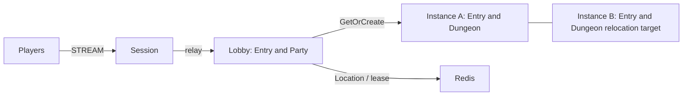

# MyGame — MORPG lobby and instances

Players connect to Session, form a party in Lobby and enter a Dungeon without a town channel. The Entry Spot routes party admission; a dynamic Party User Spot owns the roster and readiness. Dungeon User Spots own their admitted roster and stage. Framework owns Actor identity, Session binding and relocation.



The Lobby and Instance roles (`lobby`, `instanceA`, and `instanceB`) explicitly register the shared stateless application Entry and initial party-admission handlers. The structure declares Entry only for those application registrations; Framework infrastructure Entry instances are not declared. Party state remains in the Lobby Party User Spot. Message Follow is explicitly 30 seconds; the safe-shutdown observation budget adds that duration to the existing host-operation budget. Each instance admits one Dungeon, so the relocated Dungeon fills the surviving instance and fresh work must use the replacement.

## Prerequisites

Default execution requires Docker Linux containers; no host .NET SDK is needed.

.NET SDK 8 or later, Docker with Compose v2 and PowerShell 7 or Bash. Public NuGet packages are pinned in `Directory.Packages.props`: Framework and Stream Connector 0.30.2, binding 1.20.0. The template builds independently of the ZLink repository.

## Build

Run commands from this project root:

```sh
./run-e2e.sh --build-only
```

PowerShell builds the same Dockerfile targets:

```powershell
pwsh -NoProfile -File ./run-e2e.ps1 -BuildOnly
```

`Dockerfile` owns fixed `SDK_IMAGE`, `RUNTIME_IMAGE`, and `DOCKER_CLI_IMAGE` defaults. Replace the appropriate base ARG when adopting a ZLink base image. All node roles share the node image because their runtime dependencies match; each retains its own executable entry point. The ASP.NET Core runtime supplies shared hosting dependencies. The runner target adds Docker CLI and structure inputs without including the SDK.

Scripts remove unique image tags after each invocation. Docker retains build layers for subsequent runs.

## Local e2e

Both scripts build images and call the same C# orchestrator inside a runner container. A unique Compose project/network contains Redis and the runner. The runner checks structure before starting nodes. Nodes share its network namespace, preserving loopback listeners and OS-assigned ports without host port mappings. Redis publishes an ephemeral loopback port for local debugging.

The runner creates each node with interactive stdin, copies its configuration with `docker cp`, and attaches through `docker start -a -i`. `ManagedProcess` retains readiness, drain, shutdown, and replacement controls. Only the runner mounts the Docker socket; use a trusted local daemon. Scripts remove their labeled containers, Compose project, and image tags. Cleanup failure returns exit code 1.

Node stderr logs (`<node>.err.log`) include Framework message flow records because dispatch diagnostics use `Normal`. Inspect these logs from the first failing run.

On Unix sockets, Bash runs the runner with the caller's UID/GID and the socket's group so retained logs remain writable by the caller. Windows uses Docker Desktop's filesystem mapping. Build, Redis, and outer cleanup logs are in `.logs/docker-<project>/`; node settings and control logs are in `.logs/run-<id>/`.

For host process debugging, install the .NET 8 SDK and add `--local` or `-Local`. Redis remains in Docker. After a local build, `--no-build` or `-NoBuild` skips compilation:

```sh
./run-e2e.sh --local
./run-e2e.sh --local --no-build
```

```powershell
pwsh -NoProfile -File ./run-e2e.ps1 -Local
pwsh -NoProfile -File ./run-e2e.ps1 -Local -NoBuild
```

Bash:

```sh
./run-e2e.sh
./run-e2e.sh --scenario party,reconnect,update
./run-e2e.sh --check-structure
```

PowerShell 7:

```powershell
pwsh -NoProfile -File ./run-e2e.ps1
pwsh -NoProfile -File ./run-e2e.ps1 -Scenario party,reconnect,update
pwsh -NoProfile -File ./run-e2e.ps1 -CheckStructure
```

The runner checks `zlink.structure.json`, starts Redis with a unique Compose project and key prefix, starts Lobby, instanceA, instanceB and Session, and cleans up its own processes and containers. Listeners bind port zero; clients use the endpoints published by Framework. Each run keeps configurations, stdout and stderr in `.logs/run-<id>/`. Node stderr includes message-flow diagnostics at Normal level.

| Scenario | Assertions |
| --- | --- |
| party | server-issued party and run IDs; not-ready and non-leader rejection without state changes; internal packet rejection; back-to-back entry requests reach the same active Dungeon; FinalStage completes the run |
| reconnect | p2 reconnects to the same Actor, Dungeon, RunId, Phase and Stage |
| update | host relocation preserves Sessions, roster, RunId, Phase and Stage; replacement accepts a distinct party and Dungeon |

Party IDs are `party-<32hex>`, RunIds are `run-<32hex>`, and Dungeon IDs are `dungeon-<RunId>`. Maximum party size is four. The first member is leader; new members are unready. Unknown party IDs return `invalid-party`. Party Spot retains the roster and readiness during a run. The state machine is Forming → Preparing → Entering → Active → Completed; a new entry after Completed issues a new RunId. Advance is accepted only in Active and FinalStage is 3. Rejections use `ActionRejected(Reason, RetryAfterMs)` with zero RetryAfterMs. Integer values are bounded by 9,007,199,254,740,991. No time restriction or floating-point client value is used.

Run domain checks before scenario nodes with `./run-e2e.sh --check-domain` or `pwsh -NoProfile -File ./run-e2e.ps1 -CheckDomain`. The regular e2e runs them automatically.

## Known issues

Validated against the published Framework 0.30.2 packages.

## Deployment sequence

Start Redis, Lobby and instance nodes before Session. Set `RedisEndpoint` and a deployment-specific `KeyPrefix` in `server/config/*.json`. Listener endpoints bind port zero for local runs; expose the published endpoints as appropriate for your deployment. Start each role with its own executable and `--config <file>`.

For an instance update, write `drain` to its stdin, wait for `RELOCATION_REQUESTED`, `RELOCATED` and `SAFE_TO_SHUTDOWN`, then write `shutdown` and wait for `STOPPED`. Start a replacement instance with the same configuration and wait for `READY`. A healthy instance with free capacity must be available as the relocation target. Party Spots are not stored in Entry and their adapters preserve only game state.

## 한국어 실행 안내

기본 실행은 Docker에서 node와 e2e runner를 함께 실행하므로 호스트 .NET SDK가 필요하지 않습니다. Docker Compose v2와 Linux container 환경을 준비하십시오. 로컬 process 디버깅은 .NET 8 SDK를 설치한 뒤 `./run-e2e.sh --local` 또는 `pwsh -NoProfile -File ./run-e2e.ps1 -Local`로 실행합니다. 이미지 빌드·정리 로그는 `.logs/docker-<project>/`, node 로그는 `.logs/run-<id>/`에 남습니다. Docker Compose v2를 준비한 뒤 템플릿 디렉터리에서 위 Build 명령을 실행합니다. Bash는 `./run-e2e.sh`, PowerShell 7은 `pwsh -NoProfile -File ./run-e2e.ps1`로 전체 시나리오를 실행합니다.

runner는 실행별 Redis key prefix와 Compose project를 만들고 Framework가 게시한 임시 endpoint를 사용합니다. 로그는 `.logs/run-<id>/`에 보존됩니다. instance를 교체할 때는 drain 완료와 `SAFE_TO_SHUTDOWN`을 확인한 뒤 종료하고 같은 설정으로 대체 process를 시작합니다.

도메인 확장은 PartyState와 DungeonState에서 수행한다. `--check-domain`으로 상태 전이·멱등성·거부 뒤 상태 불변·스냅샷 경계를 검사한다. party는 중복 입장과 완료, reconnect·update는 RunId·Phase·Stage 보존을 관찰한다.
