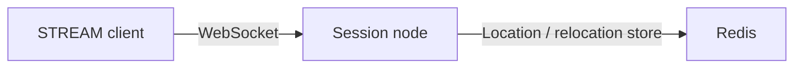

# MyGame .NET 스타터

Session node가 WebSocket으로 STREAM 연결을 받습니다. Redis는 Location Store와 relocation 저장소에 사용합니다. 호스팅, 진단, 프로세스 제어, 연결 e2e를 제공합니다. 게임 패킷, 인증, 구독, 애플리케이션 Spot 및 Actor 등록은 게임 프로젝트에서 추가합니다.



이 템플릿은 참고용입니다. 새 게임을 개발할 때는 새 프로젝트를 만들고, 이 템플릿의 구조와 규칙을 참고해 해당 게임의 노드, Spot, Actor, 메시지를 설계합니다. 템플릿의 이름이나 내용을 바꿔 게임 프로젝트로 사용하지 않습니다.

## 요구 사항과 빌드

Linux 컨테이너를 실행할 수 있는 Docker Compose v2를 설치합니다. Bash 또는 Windows용 PowerShell 7에서 스크립트를 실행합니다. 호스트에서 서버를 실행하거나 디버깅하려면 .NET 8 SDK를 설치합니다. `Directory.Packages.props`는 공개 Framework와 STREAM connector 0.34.0, binding 1.26.0을 사용합니다. NuGet.org에서 복원하며 저장소 checkout 없이 빌드할 수 있습니다.

```bash
./run-e2e.sh --build-only
```

```powershell
.\run-e2e.cmd -BuildOnly
```

Docker 빌드는 `server/MyGame.sln`의 프로젝트를 빌드합니다. 확인 후 이미지 태그를 지우고 재사용 가능한 빌드 계층은 유지합니다.

## 로컬 서버 실행

```bash
./run-server.sh
```

```powershell
.\run-server.cmd
```

서버를 빌드한 뒤 Redis는 Docker에서, 게임 노드는 로컬 프로세스로 시작합니다. `Server ready`에 표시되는 WebSocket 주소를 클라이언트에서 사용합니다. HTTP API가 있는 구성은 API 주소도 표시합니다. Ctrl+C로 노드와 Redis를 종료합니다. 서버가 실행 중이면 두 번째 시작을 거부합니다.

## 클라이언트 연결

공개 STREAM connector로 WebSocket에 연결합니다. 이 예제에는 애플리케이션 로그인이나 게임 패킷이 없으므로 별도의 첫 요청을 보내지 않습니다. 접속 주소는 `Server ready` 또는 Session의 READY JSON에서 확인합니다. 로컬 주소는 같은 호스트에서 사용할 수 있습니다. 외부 클라이언트에는 접근 가능한 인터페이스와 포트를 제공하며 HTTPS 페이지에는 wss://를 설정합니다. 브라우저의 HTTP 호출에는 접근 가능한 origin과 CORS 정책도 필요합니다.

`Directory.Packages.props`의 Zlink.Framework와 Zlink.Stream.Connector에 고정한 버전을 설치 명령의 `<version>`에 사용합니다.

| 클라이언트 | 설치 | 가이드 |
| --- | --- | --- |
| Unity | Native 및 Editor에서는 NuGetForUnity로 Zlink.Stream.Connector를 복원합니다. WebGL에서는 com.zlink.stream-connector.webgl UPM 패키지를 추가합니다. | [.NET engine integration](https://docs.zlink.systems/dotnet/guide/stream-connector/12-engine-integration/) |
| Unreal | Plugins/ZLinkStreamConnector에 네이티브 플러그인을 복사하고 ThirdParty/ZLink에 해당 SDK를 패키징합니다. | [C++ engine integration](https://docs.zlink.systems/cpp/guide/stream-connector/12-engine-integration/) |
| Godot | .NET에서 Zlink.Stream.Connector를 복원합니다. GDExtension은 호환 godot-cpp와 Framework 사전 빌드를 사용합니다. .NET 예제는 Web 내보내기를 지원하지 않습니다. | [.NET](https://docs.zlink.systems/dotnet/guide/stream-connector/12-engine-integration/), [C++](https://docs.zlink.systems/cpp/guide/stream-connector/12-engine-integration/) |
| Cocos Creator | Web 대상에 npm install @zlink-systems/stream-connector@`<version>`을 사용합니다. | [TypeScript engine integration](https://docs.zlink.systems/node/guide/stream-connector/12-engine-integration/) |
| Axmol | ZLinkStreamConnector adapter를 복사하고 zlink_stream_connector_cpp에 링크합니다. | [C++ engine integration](https://docs.zlink.systems/cpp/guide/stream-connector/12-engine-integration/) |
| 웹 브라우저 | 웹 빌드의 package root를 import합니다. 페이지 보안 정책에 맞춰 `ws://` 또는 wss://를 사용합니다. | [TypeScript connector](https://docs.zlink.systems/node/guide/stream-connector/) |
| C++ | C++ Framework 사전 빌드와 find_package(zlink_stream_connector_cpp CONFIG REQUIRED)를 사용합니다. | [C++ connector](https://docs.zlink.systems/cpp/guide/stream-connector/) |
| C#/.NET | dotnet add package Zlink.Stream.Connector --version `<version>`을 실행합니다. | [.NET connector](https://docs.zlink.systems/dotnet/guide/stream-connector/) |
| Java | Maven 또는 Gradle에서 systems.zlink:zlink-stream-connector:`<version>`을 사용합니다. | [Java connector](https://docs.zlink.systems/java/guide/stream-connector/) |
| Kotlin | Java 의존성에 systems.zlink:zlink-framework-kotlin:`<version>`을 추가합니다. | [Kotlin connector](https://docs.zlink.systems/kotlin/guide/stream-connector/) |
| Node | Node.js 22 이상에서 npm install @zlink-systems/stream-connector@`<version>`을 사용합니다. | [Node connector](https://docs.zlink.systems/node/guide/stream-connector/) |

### 연결 코드

별도 .NET 8 콘솔 프로젝트를 만들고 공개 STREAM connector를 추가합니다. 다음 예제는 실행 중인 노드의 주소를 사용합니다.

```csharp
using Systems.Zlink.Stream.Connector;
using Systems.Zlink.Stream.Connector.Contracts;

using var deadline = new CancellationTokenSource(TimeSpan.FromSeconds(10));
await using var client = ZlinkStreamConnectorFactory.Create(new ZlinkStreamConnectorOptions
{
    Endpoint = new Uri(args[0]),
    DispatchMode = ZlinkStreamDispatchMode.Immediate,
    Reconnect = new ZlinkStreamReconnectOptions { Enabled = false },
});
await client.Connect.Async(deadline.Token);
Console.WriteLine("STREAM connected; no game packets are registered");
```

## 로컬 e2e

```bash
./run-e2e.sh
./run-e2e.sh --scenario connect
./run-e2e.sh --check-structure
```

```powershell
.\run-e2e.cmd
.\run-e2e.cmd -Scenario connect
.\run-e2e.cmd -CheckStructure
```

실행 중인 서버가 있으면 .logs/server.json을 확인하고 자동 연결합니다. 서버를 종료한 상태에서는 Docker로 격리 실행합니다. 연결 실행은 STREAM 접속을 확인하며, 격리 실행은 drain과 종료도 확인합니다.

| 시나리오 | 검증 내용 |
| --- | --- |
| `connect` | 공개 STREAM connector로 연결하고 닫습니다. 격리 실행에서는 drain 마커와 정상 종료까지 확인합니다. |

격리 실행은 독립 Compose 프로젝트를 만들고 READY를 확인한 뒤 시나리오를 실행합니다. docker cp로 설정을 전달하고 docker start -a -i로 노드 표준 입출력을 연결합니다. 각 실행은 자신이 시작한 프로세스와 컨테이너를 정리합니다. 호스트 노드를 디버깅하려면 `--local` 또는 -Local을 사용합니다. Redis는 Docker에서 실행합니다. Debug 빌드가 있으면 `--no-build` 또는 -NoBuild로 빌드를 생략할 수 있습니다.

콘솔에 시나리오별 성공·실패와 합계를 표시합니다. .logs/run-<id>/에 노드의 `.out.log`, `.err.log`, .flow.log와 실패 상세 *-failure.log를 기록합니다. Framework dispatch 진단은 `Normal`입니다. 독립 배포를 사용하는 시나리오는 해당 실행 디렉터리 아래 시나리오 디렉터리에 노드 로그를 기록합니다. Docker 빌드와 정리 로그는 .logs/docker-<project>/에 있습니다.

## Framework 동작

- **DB 또는 파일 I/O** 일반 async 호출은 Spot 실행 권한을 유지합니다. Yield는 기다리는 동안 다른 handler의 실행을 허용합니다. [Guide](https://docs.zlink.systems/dotnet/guide/server/32-execution-model/#io-worker-wait)
- **생성 기한** 생성 기한 초과와 호출자의 취소는 별도의 결과입니다. [Guide](https://docs.zlink.systems/dotnet/guide/server/22-actor/#creation-deadline)
- **생성 기한** 생성 기한 초과와 호출자의 취소는 별도의 결과입니다. [Guide](https://docs.zlink.systems/dotnet/guide/server/25-location/#creation-load)
- **송신 부하** 송신은 수용 공간을 기다리며 애플리케이션에는 최종 결과가 전달됩니다. [Guide](https://docs.zlink.systems/dotnet/guide/server/33-backpressure/#send-backpressure)
- **중복 로그인** 기본 bind는 다른 Session을 받아들입니다. 거부 정책은 Actor callback에서 정합니다. [Guide](https://docs.zlink.systems/dotnet/guide/server/39-session-binding/#duplicate-session-bind)
- **ObjectGeneration** ObjectGeneration은 같은 ID의 논리 인스턴스를 식별합니다. 데이터 버전이나 쓰기 권한은 별도 계약을 따릅니다. [Guide](https://docs.zlink.systems/dotnet/guide/server/34-activation-lifetime/#object-generation)
- **READY와 Serving** Framework가 공개 런타임의 Serving을 확인한 뒤 READY를 출력합니다. [Guide](https://docs.zlink.systems/dotnet/guide/server/12-operations/#wait-for-serving) [server/MyGame.Shared/NodeControl.cs:19](server/MyGame.Shared/NodeControl.cs) [server/MyGame.Shared/NodeControl.cs:40](server/MyGame.Shared/NodeControl.cs)

## 배포 순서

Redis를 시작하고 server/config/session.json에 RedisEndpoint와 배포별 KeyPrefix를 설정합니다. 배포 이미지는 dotnet /app/session/MyGame.Session.dll --config /app/node.json으로 시작합니다. READY에서 실제 mesh 및 STREAM 주소를 확인합니다. 클라이언트를 종료한 뒤 빈 Session 호스트의 drain과 shutdown을 검증할 수 있습니다.

server/config/*.json에 접근 가능한 Redis, mesh, STREAM 주소와 배포별 KeyPrefix를 설정합니다. 노드 실행 파일에 --config <경로>를 전달하고 READY를 확인합니다. 교체 대상 표준 입력에 drain을 보내고 RELOCATION_REQUESTED, RELOCATED, SAFE_TO_SHUTDOWN을 확인한 뒤 shutdown을 보내 종료를 기다립니다. 교체 노드는 같은 논리 노드 설정으로 시작합니다. 배포 전에 플레이어 인증과 접근 가능한 listener를 구성합니다. Framework가 배치, bind, membership, 라우팅과 relocation 완료를 관리합니다.
