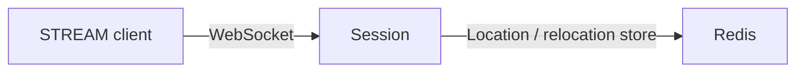

# MyGame .NET starter

This setup runs one Session node that accepts STREAM connections over WebSocket, with Redis for Location Store and relocation storage. It provides hosting, diagnostics, process control, and an e2e starting point. It contains no application Spot, Actor, Entry, authentication, subscriptions, or game packets.



## Prerequisites

Install Docker with Compose v2 and access to a Linux container daemon. Bash or PowerShell 7 runs the scripts. Docker builds use .NET SDK `8.0.415`, ASP.NET runtime `8.0.21`, and Docker CLI `28.5.1`; the image references are at the top of `Dockerfile`. Host debugging also requires the .NET 8 SDK.

`Directory.Packages.props` pins Framework and the STREAM connector to `0.30.1`. NuGet restores from nuget.org only. That version must be available before building this setup; do not add repository source references or a private feed.

## Build

Build the node and runner images from this directory.

```bash
./run-e2e.sh --build-only
```

The build command removes its image tags after checking the build; Docker retains reusable build layers. PowerShell provides the same command.

```powershell
pwsh -NoProfile -File ./run-e2e.ps1 -BuildOnly
```

Both commands build the projects listed in `server/MyGame.sln`.

## Local e2e

Run the default Docker scenario from this directory.

```bash
./run-e2e.sh
./run-e2e.sh --scenario connect
```

The `connect` scenario waits for node READY, connects and disposes one public STREAM connector, then checks drain markers and successful shutdown. PowerShell selects the same scenario.

```powershell
pwsh -NoProfile -File ./run-e2e.ps1
pwsh -NoProfile -File ./run-e2e.ps1 -Scenario connect
pwsh -NoProfile -File ./run-e2e.ps1 -CheckStructure
```

A successful run prints `✓ connect` and `Scenarios: 1/1 passed`. Cleanup failures return a nonzero exit code.

For host debugging, add `--local` or `-Local`; Redis still runs in Docker. Add `--no-build` or `-NoBuild` only after a local Debug build. The runner assigns unique Redis keys and Compose names, binds listeners to port zero, and reads published endpoints from READY. Logs and generated run settings are in `.logs/run-<id>/`; Docker build and cleanup logs are in `.logs/docker-<project>/`.

Validate the structure without starting Redis or the node.

```bash
./run-e2e.sh --check-structure
```

PowerShell uses the `-CheckStructure` switch. Changes to registrations, settings, structure, and scenarios must be made together; see [the development guide](AGENTS.md).

## Deployment sequence

Start Redis, set `RedisEndpoint` and a deployment-specific `KeyPrefix` in `server/config/session.json`, then start the published Session executable with `--config <path>`. The Docker `node` target runs `dotnet /app/session/MyGame.Session.dll --config /app/node.json`; mount your settings at that path and keep stdin open. Publish STREAM on a reachable interface when clients run outside the node's network namespace.

Wait for `READY <json>` before admitting clients. It contains the node ID and actual mesh and STREAM endpoints. This starter registers a RouteMesh listener for future node composition but registers no object server or game Entry. Add gameplay from a separately downloaded sample before using it as a game server.

After clients disconnect, write `drain` to stdin. Wait for `RELOCATION_REQUESTED`, `RELOCATED`, and `SAFE_TO_SHUTDOWN`, then write `shutdown` and verify exit code zero. `NodeProtocol` owns these markers. The starter checks an empty host drain; it does not demonstrate moving connected clients or game state to another node.

## 한국어 실행 안내

이 셋업은 STREAM 연결을 받는 Session node와 Redis를 실행한다. Docker 환경에서 Bash의 `./run-e2e.sh` 또는 PowerShell의 `pwsh -NoProfile -File ./run-e2e.ps1`을 실행하면 접속·종료와 drain·shutdown을 검사한다. Framework pin 0.30.1이 공개 NuGet에 게시되어 있어야 빌드할 수 있다.

게임 기능은 포함하지 않는다. [한국어 개발 지침](AGENTS.ko.md)에 따라 필요한 샘플을 별도로 받아 실행한 뒤 Spot·Actor·Entry 등을 추가한다. 기능을 추가할 때 구조 선언과 구조 검사, e2e 시나리오도 함께 확장한다.
