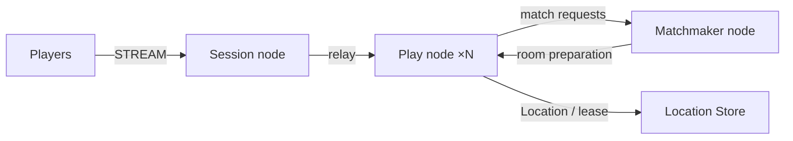

[English](README.md)

# MyGame board tables

네 명이 앉는 카드 테이블을 위한 Java 서버 템플릿입니다. Table User Spot이 좌석, 칩, 비공개 패, 차례와 정산을 소유합니다. Player Actor는 플레이어를 식별하고 바인딩된 Session에 메시지를 전달합니다. Table node는 계획된 호스트 이전 중에도 애플리케이션 상태를 유지합니다.



## 사전 요구 사항

- Compose v2가 포함된 Docker. Windows에서는 PowerShell 7도 필요합니다.
- Maven Central과 Redis 컨테이너 레지스트리에 대한 네트워크 접근.
- 게시된 ZLink Framework 0.34.0, STREAM connector 0.34.0, binding 1.26.0. 버전은 `build.gradle.kts`에서 관리합니다.

Gradle wrapper와 모든 서버 모듈이 포함되어 있습니다. 이 디렉터리를 복사해 독립적으로 빌드할 수 있습니다. Windows에서는 PowerShell 7에서 명령을 실행합니다. 실행 스크립트는 Gradle이 선택한 JDK를 사용하고 native access를 활성화합니다. Windows에서는 `run-server.cmd`와 `run-e2e.cmd`를 사용합니다. Windows는 기본 실행 정책에서 내려받은 ZIP의 스크립트를 막으므로, 이 파일들이 그 프로세스에만 `-ExecutionPolicy Bypass`를 적용해 PowerShell 스크립트를 실행하고 실행 동안 콘솔을 UTF-8로 바꿉니다.

## 빌드

Linux 또는 WSL:

```sh
./run-e2e.sh --build-only
```

Windows:

```powershell
.\run-e2e.cmd -BuildOnly
```

빌드는 공유 node 이미지와 Java e2e runner 이미지를 만듭니다.

## 로컬 서버

JDK 25를 설치하고 Docker를 시작합니다. 전용 터미널에서 서버를 실행합니다.

```sh
./run-server.sh
```

```powershell
.\run-server.cmd
```

실행 스크립트는 Redis, Play node A와 B, Matchmaker, Session을 시작합니다. 모든 node가 준비되면 콘솔에 `Server ready: ws://127.0.0.1:<port>`가 출력됩니다. 클라이언트가 연결된 동안 터미널을 열어 둡니다. Ctrl+C를 누르면 node를 중지하고 이번 실행의 Redis Compose 프로젝트를 삭제합니다.

다른 터미널에서 `./run-e2e.sh` 또는 `.\run-e2e.cmd`를 실행합니다. PowerShell 스크립트를 직접 실행하려면 `pwsh -NoProfile -ExecutionPolicy Bypass -File ./run-server.ps1`과 `pwsh -NoProfile -ExecutionPolicy Bypass -File ./run-e2e.ps1`을 사용합니다. `run-server`로 시작한 서버가 실행 중이면 e2e 실행은 해당 서버에 대해 테스트 클라이언트만 실행하고 서버를 유지합니다. 이때 `table`, `reconnect`, `match`, `match-cancel`을 실행합니다. `--scenario match` 또는 `-Scenario match`로 시나리오를 선택합니다. `--attach` 또는 `-Attach`를 추가하면 기존 서버가 반드시 있어야 합니다. `update`는 node를 교체하므로 서버가 실행 중이지 않고 e2e 실행이 자체 서버를 시작할 때만 실행됩니다.

## 클라이언트 연결

### 엔드포인트와 첫 패킷

`Server ready:` 줄에서 확인한 주소로 Session node의 `players` STREAM 리스너에 연결합니다. `server/config/session.json`은 `ws://127.0.0.1:0`(loopback의 WebSocket, 경로 `/`)을 설정하므로 실제 포트는 OS가 선택합니다. node 직접 실행 스크립트는 Session `READY` 레코드의 `streamEndpoint` 필드에서도 같은 주소를 읽을 수 있습니다.

기본 WebSocket 리스너는 웹 브라우저, Unity WebGL, Cocos Creator web을 포함해 같은 호스트 또는 네트워크 네임스페이스에서 연결할 수 있습니다. HTTPS 페이지에는 `wss://` 배포가 필요하며 기본 설정은 이를 제공하지 않습니다. 다른 호스트의 클라이언트를 위해서는 접근 가능한 리스너를 설정하고 해당 포트를 노출합니다.

두 첫 패킷 중 하나를 보내기 전에 push handler를 등록합니다.

- `FindMatch`는 Session에 대한 플레이어 ID를 만듭니다. 클라이언트는 `MatchQueued(ticketId)`를 받고, room이 준비되면 `MatchFound(ticketId, roomId, seat)`와 `TableView`를 받습니다. 대기 중인 ticket에는 `CancelMatch(ticketId)`를 보내고 `MatchCancelled`를 처리합니다.
- `JoinTableRequest(playerId, tableId)`는 이름이 지정된 Table에 참가합니다. 서버는 플레이어의 좌석이 담긴 `TableView` 또는 사유가 담긴 `ActionRejected`를 push합니다.

이 패킷은 `send(...).submit()`으로 보냅니다. 플레이어가 좌석에 앉은 뒤에는 `request(new SessionInfoRequest()).submit(SessionInfo.class)`로 Session 식별 정보를 읽습니다. 운영 환경에 배포할 때는 플레이어 ID를 바인딩하기 전에 인증을 추가합니다.

### Connector 설치

`build.gradle.kts`의 extra `frameworkVersion`과 같은 connector 릴리스를 사용합니다. `e2e/build.gradle.kts`는 이 값을 `systems.zlink:zlink-stream-connector`에 사용합니다. 아래 명령의 `<version>`은 고정된 해당 릴리스를 뜻합니다. 연결된 가이드에는 더 최신 릴리스가 설명되어 있을 수 있습니다. 모든 클라이언트는 이 템플릿의 패킷과 위에서 설명한 전송 방식을 사용해야 합니다. 엔진 sample의 패킷 이름은 적용되지 않습니다.

| 클라이언트 | Connector 설치 | 문서 가이드 |
| --- | --- | --- |
| Unity | Native/Editor: NuGetForUnity로 `Zlink.Stream.Connector`를 복원합니다. WebGL: `com.zlink.stream-connector.webgl` UPM Git 패키지를 추가하고 활성 대상의 connector 어셈블리만 포함합니다. [Unity README](https://github.com/zlink-systems/zlink/blob/main/framework/languages/engines/Unity/README.md)와 패키지 manifest를 참고합니다. | [.NET 엔진 통합](https://docs.zlink.systems/dotnet/guide/stream-connector/12-engine-integration/) |
| Unreal | `framework/languages/cpp/connector/engines/unreal`을 `Plugins/ZLinkStreamConnector`로 복사한 뒤 [Unreal README](https://github.com/zlink-systems/zlink/blob/main/framework/languages/engines/Unreal/README.md)의 설명에 따라 native connector를 `ThirdParty/ZLink` 아래에 패키징합니다. | [C++ 엔진 통합](https://docs.zlink.systems/cpp/guide/stream-connector/12-engine-integration/) |
| Godot | .NET: NuGet 패키지 `Zlink.Stream.Connector`를 추가하고 `dotnet restore`를 실행합니다. [C# README](https://github.com/zlink-systems/zlink/blob/main/framework/languages/engines/Godot/csharp/README.md)를 참고합니다. GDExtension: framework 사전 빌드와 일치하는 `godot-cpp`를 사용해 C++ Godot adapter를 빌드합니다. [C++ README](https://github.com/zlink-systems/zlink/blob/main/framework/languages/engines/Godot/cpp/README.md)를 참고합니다. .NET sample은 Web export를 지원하지 않습니다. | [.NET](https://docs.zlink.systems/dotnet/guide/stream-connector/12-engine-integration/), [C++](https://docs.zlink.systems/cpp/guide/stream-connector/12-engine-integration/) |
| Cocos Creator | Web 대상: `npm install @zlink-systems/stream-connector@<version>`. [Cocos Creator README](https://github.com/zlink-systems/zlink/blob/main/framework/languages/engines/CocosCreator/README.md)를 참고합니다. 이 패키지는 Creator native adapter를 제공하지 않습니다. | [TypeScript 엔진 통합](https://docs.zlink.systems/node/guide/stream-connector/12-engine-integration/) |
| Axmol | `framework/languages/cpp/connector/engines/axmol`을 `third_party/zlink_axmol_connector`로 복사하고 설치된 C++ framework 패키지의 `zlink::stream_connector`를 링크합니다. [Axmol README](https://github.com/zlink-systems/zlink/blob/main/framework/languages/engines/Axmol/README.md)를 참고합니다. | [C++ 엔진 통합](https://docs.zlink.systems/cpp/guide/stream-connector/12-engine-integration/) |
| Web browser (TypeScript connector) | `npm install @zlink-systems/stream-connector@<version>`. 브라우저 빌드에서 패키지 루트를 import합니다. 페이지의 보안 정책에 따라 `ws://` 또는 `wss://`를 사용합니다. | [TypeScript connector](https://docs.zlink.systems/node/guide/stream-connector/) |
| C++ | connector가 포함된 C++ framework 사전 빌드를 설치합니다. `find_package(zlink_stream_connector_cpp CONFIG REQUIRED)`를 사용하고 `zlink::stream_connector`를 링크합니다. | [C++ connector](https://docs.zlink.systems/cpp/guide/stream-connector/) |
| C#/.NET | `dotnet add package Zlink.Stream.Connector --version <version>` | [.NET connector](https://docs.zlink.systems/dotnet/guide/stream-connector/) |
| Java | Maven/Gradle 의존성 `systems.zlink:zlink-stream-connector:<version>`을 추가합니다. | [Java connector](https://docs.zlink.systems/java/guide/stream-connector/) |
| Kotlin | coroutine wrapper를 위해 `systems.zlink:zlink-stream-connector:<version>`과 `systems.zlink:zlink-framework-kotlin:<version>`을 추가합니다. | [Kotlin connector](https://docs.zlink.systems/kotlin/guide/stream-connector/) |
| Node | `npm install @zlink-systems/stream-connector@<version>`. 패키지 루트와 Node.js 22 이상을 사용합니다. | [Node connector](https://docs.zlink.systems/node/guide/stream-connector/) |

### Java 연결 예제

이 템플릿의 복사본에서 아래 코드를 `e2e/src/main/java/MyGame/e2e/ConnectOnce.java`로 저장하고 import 앞에 `package MyGame.e2e;`를 추가한 뒤 `./gradlew --no-daemon --max-workers=4 :e2e:installDist`를 실행합니다. 배포가 실행 중인 상태에서 해당 복사본의 디렉터리에서 `java --enable-native-access=ALL-UNNAMED -cp "e2e/build/install/e2e/lib/*" MyGame.e2e.ConnectOnce <actual-session-endpoint>`를 실행합니다. 실제 Session 엔드포인트를 첫 번째 인수로 전달합니다. 전송 전에 push handler를 등록합니다. 전체 흐름은 `e2e/src/main/java/MyGame/e2e/`를 참고합니다.

```java
import MyGame.*;
import systems.zlink.stream.connector.*;
import java.net.URI;
import java.time.Duration;
import java.util.concurrent.*;

public final class ConnectOnce {
    public static void main(String[] args) throws Exception {
        var uri = URI.create(args[0]);
        var d = ZLinkStreamConnectorOptions.createDefault(uri);
        var connector = ZLinkStreamConnectorFactory.create(
                new ZLinkStreamConnectorOptions(uri, ZLinkStreamDispatchMode.IMMEDIATE,
                        d.requestTimeout(), d.maxReconnectAttempts(), d.connectTimeout(),
                        d.maxSendPayloadSize(), d.heartbeatEnabled(), d.heartbeatInterval(),
                        d.heartbeatTimeout(), false, d.reconnectInitialDelay(),
                        d.reconnectMaxDelay(), d.reconnectBackoffFactor()));
        var received = new CompletableFuture<TableView>();
        try (var push = connector.on(TableView.class, message -> {
                    received.complete(message.payload());
                    return CompletableFuture.completedFuture(null);
                });
                var error = connector.onErrorReceived(event -> {
                    received.completeExceptionally(new IllegalStateException(event.toString()));
                    return CompletableFuture.completedFuture(null);
                });
                var disconnected = connector.onDisconnected(event -> {
                    received.completeExceptionally(new IllegalStateException(event.toString()));
                    return CompletableFuture.completedFuture(null);
                })) {
            try {
                connector.connect().submit().toCompletableFuture().join();
                connector.send(new JoinTableRequest("guide-player", "guide-table")).submit().toCompletableFuture().join();
                System.out.println(received.get(5, TimeUnit.SECONDS));
            } finally {
                connector.close().submit().toCompletableFuture().join();
            }
        }
    }
}
```

## 매치메이킹

Matchmaker는 SpotWide Pool `pool-board`를 실행합니다. `FindMatch`는 `MatchQueued(ticketId)`를 반환하고, `CancelMatch(ticketId)`는 취소된 ticket에 대해 사유가 `cancelled`인 `MatchCancelled`를 반환합니다. Pool은 ticket 도착 시와 500ms마다 가장 오래 기다린 ticket 두 개를 짝짓고 Table을 준비한 다음 두 Actor가 10초 이내에 입장을 보고하면 좌석을 확정합니다. 각 클라이언트는 `MatchFound(ticketId, roomId, seat)`와 `TableView`를 차례로 받고 기존 게임 메시지로 플레이할 수 있습니다. 대기 중인 ticket은 120초 후 만료됩니다. 연결이 끊어지면 대기 중인 ticket은 즉시 취소하고 예약된 ticket은 입장 기한까지 유지합니다.

`server/matchmaker`에는 메모리 내 queue와 `MatchRule` 매칭 정책이 있습니다. `MatchRule`을 바꾸면 대기 중인 플레이어의 매칭 방식을 변경할 수 있습니다. Pool은 ticket 전이와 할당 결정을 소유합니다. Table은 준비된 참가자를 확인하고 게임을 실행합니다.

## End-to-end 시나리오

Docker는 Java e2e runner와 모든 node 역할을 컨테이너에서 실행합니다. node는 runner의 네트워크 네임스페이스를 공유하고 기존 stdin/stdout 제어 프로토콜을 유지합니다. Docker 소켓은 runner만 마운트합니다. 각 실행은 자신의 컨테이너, 네트워크와 이미지 태그를 삭제하며 로그는 `.logs/` 아래에 남습니다.

로컬 프로세스 디버깅에는 JDK 25를 설치하고 `./run-e2e.sh --local` 또는 `.\run-e2e.cmd -Local`을 사용합니다. `--no-build` 또는 `-NoBuild`를 추가하면 로컬 빌드를 재사용합니다. Docker는 이미지 레이어 캐시를 사용합니다.

> **Base 이미지.** Dockerfile ARG 기본값은 Eclipse Temurin JDK/JRE 25.0.2+10과 Docker CLI 28.5.1로 고정되어 있습니다. 배포용 base 이미지를 도입할 때 이 기본값을 교체합니다.

Linux 또는 WSL:

```sh
./run-e2e.sh
./run-e2e.sh --scenario table,reconnect,match,match-cancel,update
```

Windows:

```powershell
.\run-e2e.cmd
.\run-e2e.cmd -Scenario table,reconnect,match,match-cancel,update
```

runner는 `zlink.structure.json`을 검증하고 격리된 배포가 필요하면 로컬 서버와 같은 Java server host를 사용합니다. 격리된 각 실행은 OS가 할당한 포트와 고유한 Redis 키 접두사를 사용합니다. server host는 적용된 설정과 각 node의 stdout, stderr, Framework message-flow 파일(`<node>.flow.log`)을 `.logs/run-<id>/` 아래에 보관합니다. 독립 실행 콘솔에는 서버와 게임 이벤트가 표시됩니다. 정리에 실패하면 종료 코드가 1이 됩니다.

| 시나리오 | 검증 내용 |
| --- | --- |
| `table` | 좌석, 비공개 카드, 서버 발신 패킷 거부, 차례가 아닌 베팅, 범위를 벗어난 값(`integer-out-of-range`), 칩 부족을 검증합니다. 각 거부는 `retryAfterMs: 0`을 포함하고 table 상태를 변경하지 않습니다. 정산은 모든 좌석에 대해 `cardCount: 0`을 보고하며 비공개 패 조회는 빈 목록을 반환합니다. |
| `reconnect` | Session ID가 바뀌어도 Actor ID/generation, 좌석, 칩, 비공개 카드와 대기 중인 차례가 유지됩니다. 정산은 모든 패를 비우며 이후 비공개 패 조회는 빈 목록을 반환합니다. |
| `match` | 대기열에 등록된 두 클라이언트가 같은 room에서 서로 다른 좌석을 받은 뒤 한 판을 완료합니다. |
| `match-cancel` | 대기열에 등록된 클라이언트가 ticket을 취소합니다. 이후 두 클라이언트가 매칭되어 한 판을 완료합니다. |
| `update` | drain, 다른 node에서의 정산, 원본 교체와 새 게임을 거치는 동안 Table 상태와 클라이언트 연결이 유지됩니다. 정산은 모든 패를 비우며 이후 비공개 패 조회는 빈 목록을 반환합니다. |

`./run-e2e.sh --check-structure` 또는 `.\run-e2e.cmd -CheckStructure`로 Redis나 node를 시작하지 않고 실제 구조 파일을 검증할 수 있습니다.

시나리오 실행 전에 runner는 server table의 `--check-domain` 모드를 실행합니다. 일곱 개의 도메인 경계를 확인하고 `Domain checks: 7/7 passed`를 보고한 뒤 `ActionRejected` JSON 계약을 검증합니다. `retryAfterMs`는 속성 이름이 lower camel case인 부호 있는 32비트 JSON 정수입니다. 칩, pot과 hand 번호는 64비트 정수로 유지됩니다.

## 알아 둘 Framework 동작

- **handler에서 DB 또는 파일 I/O 대기** — 일반 async terminal은 turn을 유지하지만 `Yield`는 같은 Spot의 다른 handler가 진행할 수 있게 합니다. [가이드](https://docs.zlink.systems/java/guide/server/32-execution-model/#io-worker-wait).
- **기한을 넘긴 생성** — `DeadlineExceeded`와 호출자 취소는 결과가 다릅니다. [가이드](https://docs.zlink.systems/java/guide/server/22-actor/#creation-deadline). [server/session/src/main/java/MyGame/session/GameSession.java:93](server/session/src/main/java/MyGame/session/GameSession.java#L93).
- **동시 로그인 다수** — 서로 다른 ID의 각 생성에는 Location Store 왕복이 필요하므로 기한을 설정할 때 예상 부하를 측정합니다. [가이드](https://docs.zlink.systems/java/guide/server/25-location/#creation-load).
- **부하 중 전송** — Send는 용량이 생길 때까지 기다리며 애플리케이션은 최종 결과를 받습니다. [가이드](https://docs.zlink.systems/java/guide/server/33-backpressure/#send-backpressure). [server/session/src/main/java/MyGame/session/GameSession.java:51](server/session/src/main/java/MyGame/session/GameSession.java#L51).
- **중복 로그인** — callback이 없으면 다른 Session의 bind를 수락합니다. 이를 방지하려면 Actor 중복 bind callback에서 거부합니다. [가이드](https://docs.zlink.systems/java/guide/server/39-session-binding/#duplicate-session-bind). 이 템플릿은 기본 동작을 유지합니다(새 Session 수락).
- **ObjectGeneration** — `ObjectGeneration`은 같은 ID의 논리적 인스턴스를 구분하며 데이터 버전이나 쓰기 권한이 아닙니다. [가이드](https://docs.zlink.systems/java/guide/server/34-activation-lifetime/#object-generation). [server/session/src/main/java/MyGame/session/GameSession.java:81](server/session/src/main/java/MyGame/session/GameSession.java#L81).
- **READY와 Serving** — Framework host는 runtime의 `Serving`을 관찰한 뒤 `READY`를 출력합니다. [가이드](https://docs.zlink.systems/java/guide/server/12-operations/#wait-for-serving). [server/shared/src/main/java/MyGame/Hosting.java:95](server/shared/src/main/java/MyGame/Hosting.java#L95); [server/shared/src/main/java/MyGame/Hosting.java:102](server/shared/src/main/java/MyGame/Hosting.java#L102).

## 알려진 문제

시나리오는 `build.gradle.kts`에 고정된 배포 패키지로 검증했습니다.

Message Follow는 명시적으로 30초로 설정되어 있습니다. `SAFE_TO_SHUTDOWN` 관찰 예산은 이 기간에 기존 relocation 예산을 더한 값입니다. Update는 교체 node의 `READY`를 기다린 다음 교체 node가 새 table을 호스팅하고 한 판을 완료하는지 검증합니다.

## 배포 순서

1. Redis를 준비하고 node 설정 파일에 배포별로 고유한 공유 키 접두사 하나를 사용합니다. 모든 node에서 접근할 수 있는 mesh 엔드포인트와 클라이언트가 접근할 수 있는 Session stream 엔드포인트를 설정합니다.
2. `server/table/build/install/table/bin/table`을 `server/config/play-a.json`과 `server/config/play-b.json` 각각에 대해 별도 프로세스로 시작합니다. Windows 실행 파일에는 `.bat` 접미사가 붙습니다.
3. `server/matchmaker/build/install/matchmaker/bin/matchmaker`를 `server/config/matchmaker.json`과 함께 시작합니다.
4. `server/session/build/install/session/bin/session`을 `server/config/session.json`과 함께 시작합니다. 프로세스는 Framework가 실제로 바인딩한 엔드포인트와 함께 `READY`를 게시합니다.
5. 선택한 Table 프로세스의 stdin에 `drain`을 보냅니다. `RELOCATION_REQUESTED`, `RELOCATED`, `SAFE_TO_SHUTDOWN`을 기다린 다음 `shutdown`을 보내고 `STOPPED`와 프로세스 종료를 기다립니다.
6. 같은 설정으로 교체 Table 프로세스를 시작합니다. 새 작업을 제출하기 전에 `READY`를 기다립니다.

운영 환경의 실행 스크립트는 설정 파일을 직접 사용합니다. server host는 구조에서 node ID와 설정 경로를 도출하고 실행별 복사본에서만 Redis, 키 접두사와 리스너 엔드포인트 값을 교체합니다. 애플리케이션 transfer에는 Framework의 라우팅, membership 또는 lease 상태가 포함되지 않습니다.

e2e runner는 public Table stable-type 제한을 통해 각 node의 선택적 `tableCapacity`를 선택된 시나리오 수로 설정합니다. 각 시나리오는 Table 하나를 유지하므로 runner는 `update`를 마지막에 실행합니다. update가 원본을 drain한 뒤에는 남은 node가 최대 용량에 도달하므로 교체 node만 새 table을 호스팅할 수 있습니다. 새 플레이어 두 명 모두 교체 node ID를 관찰해야 합니다. 용량을 생략하거나 0으로 설정하면 로컬 서버와 배포 용량에 제한이 없습니다. Entry 선언은 Table node에 속합니다. Matchmaker는 고정된 `pool-board` User Spot을 시작합니다.
