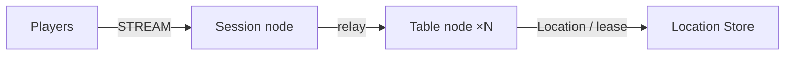

# MyGame board tables

A Java server template for four-seat card tables. Table User Spots own seats, chips, private hands, turns and settlement. Player Actors identify players and forward messages to their bound Sessions. Table nodes preserve application state during planned host relocation.



## Prerequisites

- Docker with Compose v2, and PowerShell 7 on Windows.
- Network access to Maven Central and the Redis container registry.
- Published ZLink Framework 0.32.0 and binding 1.23.0. Versions are owned by `build.gradle.kts`.

The Gradle wrapper and all server modules are included. Copy this directory to build it independently. On Windows, run the commands in PowerShell 7; launchers use the JDK selected by Gradle and enable native access.

## Build

Linux or WSL:

```sh
./run-e2e.sh --build-only
```

Windows:

```powershell
pwsh -NoProfile -File ./run-e2e.ps1 -BuildOnly
```

The build creates a shared node image and a Java e2e runner image.

## Client connection

### Endpoint and first packet

Connect to the Session node's `players` STREAM listener. `server/config/session.json` configures `tcp://127.0.0.1:0`: loopback with port `0` requesting an OS-selected port. `server/shared/src/main/java/MyGame/Hosting.java` prints `READY {"id":"...","meshEndpoint":"...","streamEndpoint":"..."}`; use its actual `streamEndpoint`, not port `0`. Mesh and Redis endpoints are not client endpoints.

This is TCP with no URL path. Web browsers, Unity WebGL and Cocos Creator web cannot connect to this default TCP listener. Those targets need a separately configured WebSocket listener and a reachable `ws://` or `wss://` endpoint. Loopback is reachable only from the same host/network namespace. The Docker e2e runner owns and removes its temporary deployment. For an external client, keep a deployment running, bind a reachable interface and port, expose the container port, and use the server's reachable host.

Send `JoinTableRequest(playerId, tableId)` first. A successful join pushes `TableView` with the seat and table state; `ActionRejected` reports rejection.

These first application operations use `send(...).submit()` and push handlers, not correlated request/reply. After joining and binding, `request(new SessionInfoRequest()).submit(SessionInfo.class)` returns Session identity. Do not request it before entry. Player IDs are not authentication credentials; this template has no production authentication, so validate identity before binding.

### Connector installation

Use the same connector release as `build.gradle.kts` extra `frameworkVersion`; `e2e/build.gradle.kts` uses that value for `systems.zlink:zlink-stream-connector`. In the commands below, `<version>` means that pinned release. The linked guides may describe newer releases. All clients must use this template's packets and the transport described above; engine sample packet names do not apply.

| Client                             | Connector installation                                                                                                                                                                                                                                                                                                                                                                                                                                                          | Documentation guide                                                                                                                                                          |
| ---------------------------------- | ------------------------------------------------------------------------------------------------------------------------------------------------------------------------------------------------------------------------------------------------------------------------------------------------------------------------------------------------------------------------------------------------------------------------------------------------------------------------------- | ---------------------------------------------------------------------------------------------------------------------------------------------------------------------------- |
| Unity                              | Native/Editor: restore `Zlink.Stream.Connector` with NuGetForUnity. WebGL: add the `com.zlink.stream-connector.webgl` UPM Git package; include only the connector assembly for the active target. See the [Unity README](https://github.com/zlink-systems/zlink/blob/main/framework/languages/engines/Unity/README.md) and its package manifest.                                                                                                                                | [.NET engine integration](https://docs.zlink.systems/dotnet/guide/stream-connector/12-engine-integration/)                                                                   |
| Unreal                             | Copy `framework/languages/cpp/connector/engines/unreal` into `Plugins/ZLinkStreamConnector`, then package the native connector under `ThirdParty/ZLink` as described in the [Unreal README](https://github.com/zlink-systems/zlink/blob/main/framework/languages/engines/Unreal/README.md).                                                                                                                                                                                     | [C++ engine integration](https://docs.zlink.systems/cpp/guide/stream-connector/12-engine-integration/)                                                                       |
| Godot                              | .NET: add the NuGet package `Zlink.Stream.Connector` and run `dotnet restore`; see the [C# README](https://github.com/zlink-systems/zlink/blob/main/framework/languages/engines/Godot/csharp/README.md). GDExtension: build the C++ Godot adapter against the framework prebuilt and matching `godot-cpp`; see the [C++ README](https://github.com/zlink-systems/zlink/blob/main/framework/languages/engines/Godot/cpp/README.md). The .NET sample does not support Web export. | [.NET](https://docs.zlink.systems/dotnet/guide/stream-connector/12-engine-integration/), [C++](https://docs.zlink.systems/cpp/guide/stream-connector/12-engine-integration/) |
| Cocos Creator                      | Web target: `npm install @zlink-systems/stream-connector@<version>`; see the [Cocos Creator README](https://github.com/zlink-systems/zlink/blob/main/framework/languages/engines/CocosCreator/README.md). This package does not provide a Creator native adapter.                                                                                                                                                                                                                  | [TypeScript engine integration](https://docs.zlink.systems/node/guide/stream-connector/12-engine-integration/)                                                               |
| Axmol                              | Copy `framework/languages/cpp/connector/engines/axmol` into `third_party/zlink_axmol_connector` and link `zlink::stream_connector` from the installed C++ framework package; see the [Axmol README](https://github.com/zlink-systems/zlink/blob/main/framework/languages/engines/Axmol/README.md).                                                                                                                                                                              | [C++ engine integration](https://docs.zlink.systems/cpp/guide/stream-connector/12-engine-integration/)                                                                       |
| Web browser (TypeScript connector) | `npm install @zlink-systems/stream-connector@<version>`; import the package root in the browser build. Use `ws://` or `wss://`, subject to the page's security policy.                                                                                                                                                                                                                                                                                                             | [TypeScript connector](https://docs.zlink.systems/node/guide/stream-connector/)                                                                                              |
| C++                                | Install the C++ framework prebuilt containing the connector; use `find_package(zlink_stream_connector_cpp CONFIG REQUIRED)` and link `zlink::stream_connector`.                                                                                                                                                                                                                                                                                                                 | [C++ connector](https://docs.zlink.systems/cpp/guide/stream-connector/)                                                                                                      |
| C#/.NET                            | `dotnet add package Zlink.Stream.Connector --version <version>`                                                                                                                                                                                                                                                                                                                                                                                                                    | [.NET connector](https://docs.zlink.systems/dotnet/guide/stream-connector/)                                                                                                  |
| Java                               | Add Maven/Gradle dependency `systems.zlink:zlink-stream-connector:<version>`.                                                                                                                                                                                                                                                                                                                                                                                                      | [Java connector](https://docs.zlink.systems/java/guide/stream-connector/)                                                                                                    |
| Kotlin                             | Add `systems.zlink:zlink-stream-connector:<version>` and `systems.zlink:zlink-framework-kotlin:<version>` for the coroutine wrapper.                                                                                                                                                                                                                                                                                                                                                  | [Kotlin connector](https://docs.zlink.systems/kotlin/guide/stream-connector/)                                                                                                |
| Node                               | `npm install @zlink-systems/stream-connector@<version>`; use the package root and Node.js 22 or later.                                                                                                                                                                                                                                                                                                                                                     | [Node connector](https://docs.zlink.systems/node/guide/stream-connector/)                                                                                                    |

### Java connection example

Save this as `e2e/src/main/java/MyGame/e2e/ConnectOnce.java` with `package MyGame.e2e;` before the imports in a copy of this template, then run `./gradlew :e2e:installDist`. Run `java --enable-native-access=ALL-UNNAMED -cp "e2e/build/install/e2e/lib/*" MyGame.e2e.ConnectOnce <actual-session-endpoint>` from that copy while its deployment remains running. Pass the actual Session endpoint as argument 1. Register push handlers before sending. See `e2e/src/main/java/MyGame/e2e/` for the complete flow.

```java
import MyGame.*;
import systems.zlink.stream.connector.*;
import java.net.URI;
import java.time.Duration;
import java.util.concurrent.*;

public final class ConnectOnce {
    public static void main(String[] args) throws Exception {
        var uri = URI.create(args[0]);
        var d = ZLinkStreamConnectorOptions.createDefault(uri);
        var connector = ZLinkStreamConnectorFactory.create(
                new ZLinkStreamConnectorOptions(uri, ZLinkStreamDispatchMode.IMMEDIATE,
                        d.requestTimeout(), d.maxReconnectAttempts(), d.connectTimeout(),
                        d.maxSendPayloadSize(), d.heartbeatEnabled(), d.heartbeatInterval(),
                        d.heartbeatTimeout(), false, d.reconnectInitialDelay(),
                        d.reconnectMaxDelay(), d.reconnectBackoffFactor()));
        var received = new CompletableFuture<TableView>();
        try (var push = connector.on(TableView.class, message -> {
                    received.complete(message.payload());
                    return CompletableFuture.completedFuture(null);
                });
                var error = connector.onErrorReceived(event -> {
                    received.completeExceptionally(new IllegalStateException(event.toString()));
                    return CompletableFuture.completedFuture(null);
                });
                var disconnected = connector.onDisconnected(event -> {
                    received.completeExceptionally(new IllegalStateException(event.toString()));
                    return CompletableFuture.completedFuture(null);
                })) {
            try {
                connector.connect().submit().toCompletableFuture().join();
                connector.send(new JoinTableRequest("guide-player", "guide-table")).submit().toCompletableFuture().join();
                System.out.println(received.get(5, TimeUnit.SECONDS));
            } finally {
                connector.close().submit().toCompletableFuture().join();
            }
        }
    }
}
```

## Docker e2e

Docker runs the Java e2e runner and every node role in containers. Nodes share the runner's network namespace and keep the existing stdin/stdout control protocol. Only the runner mounts the Docker socket. Each invocation removes its own containers, network and image tags; logs remain under `.logs/`.

For local process debugging, install JDK 25 and use `./run-e2e.sh --local` or `pwsh -NoProfile -File ./run-e2e.ps1 -Local`. Add `--no-build` or `-NoBuild` to reuse a local build. Docker uses its image layer cache.

> **Base images.** Dockerfile ARG defaults pin Eclipse Temurin JDK/JRE 25.0.2+10 and Docker CLI 28.5.1. Replace these defaults when adopting a deployment base image.

Linux or WSL:

```sh
./run-e2e.sh
./run-e2e.sh --scenario table,reconnect,update
```

Windows:

```powershell
pwsh -NoProfile -File ./run-e2e.ps1
pwsh -NoProfile -File ./run-e2e.ps1 -Scenario table,reconnect,update
```

The runner checks `zlink.structure.json`, starts an isolated Redis Compose project, starts Table A, Table B and Session, and validates received typed messages. Each run uses OS-assigned ports and a unique Redis key prefix. Its configuration files and node stdout/stderr are retained under `.logs/run-<id>/`. Node stderr contains the Framework's Normal message-flow diagnostics. Cleanup failures cause exit code 1.

| Scenario | Verification |
| --- | --- |
| `table` | Seats, private cards, rejection of server-originated packets, out-of-turn bets, out-of-range values (`integer-out-of-range`), and insufficient chips. Each rejection has `retryAfterMs: 0` and leaves table state unchanged. Settlement reports `cardCount: 0` for every seat; a private-hand query returns an empty list. |
| `reconnect` | The Session ID changes while the Actor ID/generation, seat, chips, private cards, and pending turn persist. Settlement clears every hand, and a later private-hand query returns an empty list. |
| `update` | Table state and client connections persist through drain, settlement on another node, source replacement, and a new hand. Settlement clears every hand, and a later private-hand query returns an empty list. |

Use `./run-e2e.sh --check-structure` or `pwsh -NoProfile -File ./run-e2e.ps1 -CheckStructure` to validate the actual structure files without starting Redis or nodes.

Before the scenarios, the runner executes the server table's `--check-domain` mode. It checks seven domain boundaries and reports `Domain checks: 7/7 passed`, then verifies the `ActionRejected` JSON contract. `retryAfterMs` is a signed 32-bit JSON integer with the lower camel case property name; chips, pot, and hand numbers remain 64-bit integers.

## Known issues

Validated against the published Framework 0.32.0 packages.

Message Follow is explicitly configured for 30 seconds. The `SAFE_TO_SHUTDOWN` observation budget is that period plus the existing relocation budget. Update waits for replacement `READY`, then asserts that the replacement hosts the new table and completes a hand.

## Deployment sequence

1. Provision Redis and use one shared, deployment-specific key prefix in the node configuration files. Set mesh endpoints reachable by all nodes and a client-reachable Session stream endpoint.
2. Start `server/table/build/install/table/bin/table` with `server/config/table-a.json` and `server/config/table-b.json`, each as a separate process. Windows launchers have a `.bat` suffix.
3. Start `server/session/build/install/session/bin/session` with `server/config/session.json`. The processes publish `READY` with the endpoints actually bound by Framework.
4. Send `drain` on the selected Table process's stdin. Wait for `RELOCATION_REQUESTED`, `RELOCATED` and `SAFE_TO_SHUTDOWN`, then send `shutdown` and wait for `STOPPED` and process exit.
5. Start the replacement Table process with the same configuration. Wait for `READY` before submitting new work.

Production launchers use the configuration files directly. The e2e runner derives its node IDs and configuration paths from the structure and replaces Redis, key-prefix and listener endpoint values only in its run-specific copies. Application transfer contains no Framework routing, membership or lease state.

The e2e runner sets each node's optional `tableCapacity` to the number of selected scenarios through the public Table stable-type limit. Each scenario retains one table. After update drains the source, the surviving node is at capacity, so only the replacement can host the new table. Both new players must observe the replacement node ID. Omitted or zero capacity leaves deployment capacity unlimited. Entry declarations describe the application Entry on Table nodes only; there are no fixed User Spots in this template.
