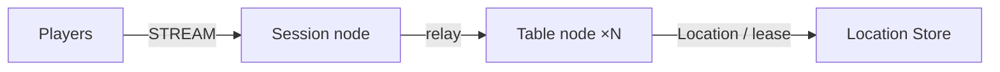

# MyGame board tables

A Java server template for four-seat card tables. Table User Spots own seats, chips, private hands, turns and settlement. Player Actors identify players and forward messages to their bound Sessions. Table nodes preserve application state during planned host relocation.



## Prerequisites

- Docker with Compose v2, and PowerShell 7 on Windows.
- Network access to Maven Central and the Redis container registry.
- Published ZLink Framework 0.30.2 and binding 1.20.0. Versions are owned by `build.gradle.kts`.

The Gradle wrapper and all server modules are included. Copy this directory to build it independently. On Windows, run the commands in PowerShell 7; launchers use the JDK selected by Gradle and enable native access.

## Build

Linux or WSL:

```sh
./run-e2e.sh --build-only
```

Windows:

```powershell
pwsh -NoProfile -File ./run-e2e.ps1 -BuildOnly
```

The build creates a shared node image and a Java e2e runner image.

## Docker e2e

Docker runs the Java e2e runner and every node role in containers. Nodes share the runner's network namespace and keep the existing stdin/stdout control protocol. Only the runner mounts the Docker socket. Each invocation removes its own containers, network and image tags; logs remain under `.logs/`.

For local process debugging, install JDK 25 and use `./run-e2e.sh --local` or `pwsh -NoProfile -File ./run-e2e.ps1 -Local`. Add `--no-build` or `-NoBuild` to reuse a local build. Docker uses its image layer cache.

> **Base images.** Dockerfile ARG defaults pin Eclipse Temurin JDK/JRE 25.0.2+10 and Docker CLI 28.5.1. Replace these defaults when adopting a deployment base image.

Linux or WSL:

```sh
./run-e2e.sh
./run-e2e.sh --scenario table,reconnect,update
```

Windows:

```powershell
pwsh -NoProfile -File ./run-e2e.ps1
pwsh -NoProfile -File ./run-e2e.ps1 -Scenario table,reconnect,update
```

The runner checks `zlink.structure.json`, starts an isolated Redis Compose project, starts Table A, Table B and Session, and validates received typed messages. Each run uses OS-assigned ports and a unique Redis key prefix. Its configuration files and node stdout/stderr are retained under `.logs/run-<id>/`. Node stderr contains the Framework's Normal message-flow diagnostics. Cleanup failures cause exit code 1.

| Scenario | Verification |
| --- | --- |
| `table` | Seats, private cards, rejection of server-originated packets, out-of-turn bets, out-of-range values (`integer-out-of-range`), and insufficient chips. Each rejection has `retryAfterMs: 0` and leaves table state unchanged. Settlement reports `cardCount: 0` for every seat; a private-hand query returns an empty list. |
| `reconnect` | The Session ID changes while the Actor ID/generation, seat, chips, private cards, and pending turn persist. Settlement clears every hand, and a later private-hand query returns an empty list. |
| `update` | Table state and client connections persist through drain, settlement on another node, source replacement, and a new hand. Settlement clears every hand, and a later private-hand query returns an empty list. |

Use `./run-e2e.sh --check-structure` or `pwsh -NoProfile -File ./run-e2e.ps1 -CheckStructure` to validate the actual structure files without starting Redis or nodes.

Before the scenarios, the runner executes the server table's `--check-domain` mode. It checks seven domain boundaries and reports `Domain checks: 7/7 passed`, then verifies the `ActionRejected` JSON contract. `retryAfterMs` is a signed 32-bit JSON integer with the lower camel case property name; chips, pot, and hand numbers remain 64-bit integers.

## Known issues

Validated against the published Framework 0.30.2 packages.

Message Follow is explicitly configured for 30 seconds. The `SAFE_TO_SHUTDOWN` observation budget is that period plus the existing relocation budget. Update waits for replacement `READY`, then asserts that the replacement hosts the new table and completes a hand.

## Deployment sequence

1. Provision Redis and use one shared, deployment-specific key prefix in the node configuration files. Set mesh endpoints reachable by all nodes and a client-reachable Session stream endpoint.
2. Start `server/table/build/install/table/bin/table` with `server/config/table-a.json` and `server/config/table-b.json`, each as a separate process. Windows launchers have a `.bat` suffix.
3. Start `server/session/build/install/session/bin/session` with `server/config/session.json`. The processes publish `READY` with the endpoints actually bound by Framework.
4. Send `drain` on the selected Table process's stdin. Wait for `RELOCATION_REQUESTED`, `RELOCATED` and `SAFE_TO_SHUTDOWN`, then send `shutdown` and wait for `STOPPED` and process exit.
5. Start the replacement Table process with the same configuration. Wait for `READY` before submitting new work.

Production launchers use the configuration files directly. The e2e runner derives its node IDs and configuration paths from the structure and replaces Redis, key-prefix and listener endpoint values only in its run-specific copies. Application transfer contains no Framework routing, membership or lease state.

The e2e runner sets each node's optional `tableCapacity` to the number of selected scenarios through the public Table stable-type limit. Each scenario retains one table. After update drains the source, the surviving node is at capacity, so only the replacement can host the new table. Both new players must observe the replacement node ID. Omitted or zero capacity leaves deployment capacity unlimited. Entry declarations describe the application Entry on Table nodes only; there are no fixed User Spots in this template.

## 한국어 실행 안내

기본 e2e는 runner와 node를 Docker에서 실행합니다. 로컬 process 디버깅에는 JDK 25를 준비하고 `--local` 또는 `-Local`을 지정합니다.

Docker Compose v2를 준비한 뒤 Linux·WSL에서는 `./run-e2e.sh`, Windows PowerShell 7에서는 `pwsh -NoProfile -File ./run-e2e.ps1`로 실행한다. runner는 시나리오 전에 Table server의 `--check-domain`을 실행해 `Domain checks: 7/7 passed`를 출력하고 `ActionRejected` JSON 계약을 검사한다. `retryAfterMs`는 lower camel case JSON 필드인 signed 32-bit 정수이며, 칩·pot·hand 번호는 64-bit 정수다. 이어서 독립 Redis와 Session·Table process를 기동하고 `table`, `reconnect`, `update` 시나리오를 검사한다. `table`은 client가 보낸 내부 packet과 잘못된 행동을 거부하고, 상한 초과는 `integer-out-of-range`로 응답하며 `retryAfterMs`가 0이고 상태가 유지되는지 확인한다. 정산 결과와 최종 view의 모든 좌석은 `cardCount`가 0이고, 정산 뒤 개인 패 조회는 빈 목록을 반환한다. `reconnect`와 `update`도 정산 및 빈 패 조회를 확인한다.

실행별 설정과 node 로그는 `.logs/run-<id>/`에 남는다. 운영 배포에서는 Redis를 먼저 준비하고 Table node를 기동한 뒤 Session node를 기동한다. Table node 교체 시에는 `drain`의 `SAFE_TO_SHUTDOWN`을 확인한 뒤 `shutdown`하고 같은 설정으로 대체 process를 기동한다. 도메인 규칙은 server가 입력을 검사하고 계산하며, 거부 응답 `ActionRejected`의 `retryAfterMs`는 현재 0이다.
