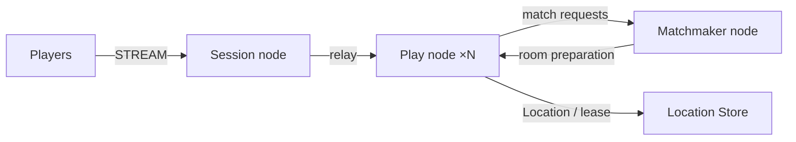

# MyGame board tables
[한국어](README.ko.md)

A Java server template for four-seat card tables. Table User Spots own seats, chips, private hands, turns and settlement. Player Actors identify players and forward messages to their bound Sessions. Table nodes preserve application state during planned host relocation.



## Prerequisites

- Docker with Compose v2, and PowerShell 7 on Windows.
- Network access to Maven Central and the Redis container registry.
- Published ZLink Framework 0.34.0, STREAM connector 0.34.0, and binding 1.26.0. Versions are owned by `build.gradle.kts`.

The Gradle wrapper and all server modules are included. Copy this directory to build it independently. On Windows, run the commands in PowerShell 7; launchers use the JDK selected by Gradle and enable native access. On Windows use `run-server.cmd` and `run-e2e.cmd`: they run the PowerShell scripts with `-ExecutionPolicy Bypass` for that one process, because Windows blocks scripts from a downloaded ZIP under the default policy, and switch the console to UTF-8 while they run.

## Build

Linux or WSL:

```sh
./run-e2e.sh --build-only
```

Windows:

```powershell
.\run-e2e.cmd -BuildOnly
```

The build creates a shared node image and a Java e2e runner image.

## Local server

Install JDK 25 and start Docker. Run the server in a dedicated terminal.

```sh
./run-server.sh
```

```powershell
.\run-server.cmd
```

The launcher starts Redis, Play nodes A and B, Matchmaker, and Session. When all nodes are ready, the console prints `Server ready: ws://127.0.0.1:<port>`. Keep the terminal open while clients are connected. Press Ctrl+C to stop the nodes and remove this run's Redis Compose project.

From another terminal, run `./run-e2e.sh` or `.\run-e2e.cmd`. To invoke the PowerShell scripts directly, use `pwsh -NoProfile -ExecutionPolicy Bypass -File ./run-server.ps1` and `pwsh -NoProfile -ExecutionPolicy Bypass -File ./run-e2e.ps1`. While a server started by `run-server` is running, the e2e run only runs the test clients against it and leaves it running; it runs `table`, `reconnect`, `match` and `match-cancel`. Select scenarios with `--scenario match` or `-Scenario match`. Add `--attach` or `-Attach` to require an existing server. `update` replaces a node, so it runs only when no server is running and the e2e run starts its own.

## Client connection

### Endpoint and first packet

Connect to the Session node’s `players` STREAM listener at the address from the `Server ready:` line. `server/config/session.json` configures `ws://127.0.0.1:0` (WebSocket on loopback, path `/`), so the OS picks the actual port. Direct node launchers can read the same address from the Session `READY` record's `streamEndpoint` field.

The default WebSocket listener serves clients on the same host or network namespace, including web browsers, Unity WebGL, and Cocos Creator web. An HTTPS page needs a `wss://` deployment, which the default configuration does not provide. For clients on other hosts, configure a reachable listener and expose its port.

Register push handlers before sending either first packet:

- `FindMatch` creates a player ID for the Session. The client receives `MatchQueued(ticketId)`, then `MatchFound(ticketId, roomId, seat)` and `TableView` when the room is ready. Send `CancelMatch(ticketId)` for a waiting ticket and handle `MatchCancelled`.
- `JoinTableRequest(playerId, tableId)` joins a named Table. The server pushes `TableView` with the player's seat or `ActionRejected` with the reason.

Send these packets using `send(...).submit()`. Once the player is seated, use `request(new SessionInfoRequest()).submit(SessionInfo.class)` to read Session identity. Add authentication before binding a player ID in a production deployment.

### Connector installation

Use the same connector release as `build.gradle.kts` extra `frameworkVersion`; `e2e/build.gradle.kts` uses that value for `systems.zlink:zlink-stream-connector`. In the commands below, `<version>` means that pinned release. The linked guides may describe newer releases. All clients must use this template's packets and the transport described above; engine sample packet names do not apply.

| Client                             | Connector installation                                                                                                                                                                                                                                                                                                                                                                                                                                                          | Documentation guide                                                                                                                                                          |
| ---------------------------------- | ------------------------------------------------------------------------------------------------------------------------------------------------------------------------------------------------------------------------------------------------------------------------------------------------------------------------------------------------------------------------------------------------------------------------------------------------------------------------------- | ---------------------------------------------------------------------------------------------------------------------------------------------------------------------------- |
| Unity                              | Native/Editor: restore `Zlink.Stream.Connector` with NuGetForUnity. WebGL: add the `com.zlink.stream-connector.webgl` UPM Git package; include only the connector assembly for the active target. See the [Unity README](https://github.com/zlink-systems/zlink/blob/main/framework/languages/engines/Unity/README.md) and its package manifest.                                                                                                                                | [.NET engine integration](https://docs.zlink.systems/dotnet/guide/stream-connector/12-engine-integration/)                                                                   |
| Unreal                             | Copy `framework/languages/cpp/connector/engines/unreal` into `Plugins/ZLinkStreamConnector`, then package the native connector under `ThirdParty/ZLink` as described in the [Unreal README](https://github.com/zlink-systems/zlink/blob/main/framework/languages/engines/Unreal/README.md).                                                                                                                                                                                     | [C++ engine integration](https://docs.zlink.systems/cpp/guide/stream-connector/12-engine-integration/)                                                                       |
| Godot                              | .NET: add the NuGet package `Zlink.Stream.Connector` and run `dotnet restore`; see the [C# README](https://github.com/zlink-systems/zlink/blob/main/framework/languages/engines/Godot/csharp/README.md). GDExtension: build the C++ Godot adapter against the framework prebuilt and matching `godot-cpp`; see the [C++ README](https://github.com/zlink-systems/zlink/blob/main/framework/languages/engines/Godot/cpp/README.md). The .NET sample does not support Web export. | [.NET](https://docs.zlink.systems/dotnet/guide/stream-connector/12-engine-integration/), [C++](https://docs.zlink.systems/cpp/guide/stream-connector/12-engine-integration/) |
| Cocos Creator                      | Web target: `npm install @zlink-systems/stream-connector@<version>`; see the [Cocos Creator README](https://github.com/zlink-systems/zlink/blob/main/framework/languages/engines/CocosCreator/README.md). This package does not provide a Creator native adapter.                                                                                                                                                                                                                  | [TypeScript engine integration](https://docs.zlink.systems/node/guide/stream-connector/12-engine-integration/)                                                               |
| Axmol                              | Copy `framework/languages/cpp/connector/engines/axmol` into `third_party/zlink_axmol_connector` and link `zlink::stream_connector` from the installed C++ framework package; see the [Axmol README](https://github.com/zlink-systems/zlink/blob/main/framework/languages/engines/Axmol/README.md).                                                                                                                                                                              | [C++ engine integration](https://docs.zlink.systems/cpp/guide/stream-connector/12-engine-integration/)                                                                       |
| Web browser (TypeScript connector) | `npm install @zlink-systems/stream-connector@<version>`; import the package root in the browser build. Use `ws://` or `wss://`, subject to the page's security policy.                                                                                                                                                                                                                                                                                                             | [TypeScript connector](https://docs.zlink.systems/node/guide/stream-connector/)                                                                                              |
| C++                                | Install the C++ framework prebuilt containing the connector; use `find_package(zlink_stream_connector_cpp CONFIG REQUIRED)` and link `zlink::stream_connector`.                                                                                                                                                                                                                                                                                                                 | [C++ connector](https://docs.zlink.systems/cpp/guide/stream-connector/)                                                                                                      |
| C#/.NET                            | `dotnet add package Zlink.Stream.Connector --version <version>`                                                                                                                                                                                                                                                                                                                                                                                                                    | [.NET connector](https://docs.zlink.systems/dotnet/guide/stream-connector/)                                                                                                  |
| Java                               | Add Maven/Gradle dependency `systems.zlink:zlink-stream-connector:<version>`.                                                                                                                                                                                                                                                                                                                                                                                                      | [Java connector](https://docs.zlink.systems/java/guide/stream-connector/)                                                                                                    |
| Kotlin                             | Add `systems.zlink:zlink-stream-connector:<version>` and `systems.zlink:zlink-framework-kotlin:<version>` for the coroutine wrapper.                                                                                                                                                                                                                                                                                                                                                  | [Kotlin connector](https://docs.zlink.systems/kotlin/guide/stream-connector/)                                                                                                |
| Node                               | `npm install @zlink-systems/stream-connector@<version>`; use the package root and Node.js 22 or later.                                                                                                                                                                                                                                                                                                                                                     | [Node connector](https://docs.zlink.systems/node/guide/stream-connector/)                                                                                                    |

### Java connection example

Save this as `e2e/src/main/java/MyGame/e2e/ConnectOnce.java` with `package MyGame.e2e;` before the imports in a copy of this template, then run `./gradlew --no-daemon --max-workers=4 :e2e:installDist`. Run `java --enable-native-access=ALL-UNNAMED -cp "e2e/build/install/e2e/lib/*" MyGame.e2e.ConnectOnce <actual-session-endpoint>` from that copy while its deployment remains running. Pass the actual Session endpoint as argument 1. Register push handlers before sending. See `e2e/src/main/java/MyGame/e2e/` for the complete flow.

```java
import MyGame.*;
import systems.zlink.stream.connector.*;
import java.net.URI;
import java.time.Duration;
import java.util.concurrent.*;

public final class ConnectOnce {
    public static void main(String[] args) throws Exception {
        var uri = URI.create(args[0]);
        var d = ZLinkStreamConnectorOptions.createDefault(uri);
        var connector = ZLinkStreamConnectorFactory.create(
                new ZLinkStreamConnectorOptions(uri, ZLinkStreamDispatchMode.IMMEDIATE,
                        d.requestTimeout(), d.maxReconnectAttempts(), d.connectTimeout(),
                        d.maxSendPayloadSize(), d.heartbeatEnabled(), d.heartbeatInterval(),
                        d.heartbeatTimeout(), false, d.reconnectInitialDelay(),
                        d.reconnectMaxDelay(), d.reconnectBackoffFactor()));
        var received = new CompletableFuture<TableView>();
        try (var push = connector.on(TableView.class, message -> {
                    received.complete(message.payload());
                    return CompletableFuture.completedFuture(null);
                });
                var error = connector.onErrorReceived(event -> {
                    received.completeExceptionally(new IllegalStateException(event.toString()));
                    return CompletableFuture.completedFuture(null);
                });
                var disconnected = connector.onDisconnected(event -> {
                    received.completeExceptionally(new IllegalStateException(event.toString()));
                    return CompletableFuture.completedFuture(null);
                })) {
            try {
                connector.connect().submit().toCompletableFuture().join();
                connector.send(new JoinTableRequest("guide-player", "guide-table")).submit().toCompletableFuture().join();
                System.out.println(received.get(5, TimeUnit.SECONDS));
            } finally {
                connector.close().submit().toCompletableFuture().join();
            }
        }
    }
}
```

## Matchmaking

Matchmaker runs the SpotWide Pool `pool-board`. `FindMatch` returns `MatchQueued(ticketId)`, and `CancelMatch(ticketId)` returns `MatchCancelled` with reason `cancelled` for a cancelled ticket. The Pool pairs the two longest-waiting tickets on arrival and every 500 ms, prepares a Table, and commits the seats after both Actors report entry within 10 seconds. Each client receives `MatchFound(ticketId, roomId, seat)` followed by `TableView` and can play with the existing game messages. A waiting ticket expires after 120 seconds. A disconnect cancels a waiting ticket immediately and leaves a reserved ticket to the entry deadline.

`server/matchmaker` contains the in-memory queue and the `MatchRule` pairing policy. Change `MatchRule` to change which waiting players are paired. The Pool owns ticket transitions and assignment decisions. The Table checks the prepared members and runs the game.

## End-to-end scenarios

Docker runs the Java e2e runner and every node role in containers. Nodes share the runner's network namespace and keep the existing stdin/stdout control protocol. Only the runner mounts the Docker socket. Each invocation removes its own containers, network and image tags; logs remain under `.logs/`.

For local process debugging, install JDK 25 and use `./run-e2e.sh --local` or `.\run-e2e.cmd -Local`. Add `--no-build` or `-NoBuild` to reuse a local build. Docker uses its image layer cache.

> **Base images.** Dockerfile ARG defaults pin Eclipse Temurin JDK/JRE 25.0.2+10 and Docker CLI 28.5.1. Replace these defaults when adopting a deployment base image.

Linux or WSL:

```sh
./run-e2e.sh
./run-e2e.sh --scenario table,reconnect,match,match-cancel,update
```

Windows:

```powershell
.\run-e2e.cmd
.\run-e2e.cmd -Scenario table,reconnect,match,match-cancel,update
```

The runner validates `zlink.structure.json` and uses the same Java server host as the local server when it needs an isolated deployment. Each isolated run uses OS-assigned ports and a unique Redis key prefix. The server host keeps effective settings and each node's stdout, stderr, and Framework message-flow file (`<node>.flow.log`) under `.logs/run-<id>/`. The standalone console shows server and game events. Cleanup failures cause exit code 1.

| Scenario | Verification |
| --- | --- |
| `table` | Seats, private cards, rejection of server-originated packets, out-of-turn bets, out-of-range values (`integer-out-of-range`), and insufficient chips. Each rejection has `retryAfterMs: 0` and leaves table state unchanged. Settlement reports `cardCount: 0` for every seat; a private-hand query returns an empty list. |
| `reconnect` | The Session ID changes while the Actor ID/generation, seat, chips, private cards, and pending turn persist. Settlement clears every hand, and a later private-hand query returns an empty list. |
| `match` | Two queued clients receive distinct seats in the same room, then complete a hand. |
| `match-cancel` | A queued client cancels its ticket. Two later clients match and complete a hand. |
| `update` | Table state and client connections persist through drain, settlement on another node, source replacement, and a new hand. Settlement clears every hand, and a later private-hand query returns an empty list. |

Use `./run-e2e.sh --check-structure` or `.\run-e2e.cmd -CheckStructure` to validate the actual structure files without starting Redis or nodes.

Before the scenarios, the runner executes the server table's `--check-domain` mode. It checks seven domain boundaries and reports `Domain checks: 7/7 passed`, then verifies the `ActionRejected` JSON contract. `retryAfterMs` is a signed 32-bit JSON integer with the lower camel case property name; chips, pot, and hand numbers remain 64-bit integers.

## Framework behavior to know

- **Waiting for DB or file I/O in a handler** — An ordinary async terminal retains the turn, while `Yield` lets other handlers on the same Spot proceed. [Guide](https://docs.zlink.systems/java/guide/server/32-execution-model/#io-worker-wait).
- **Creation that misses its deadline** — `DeadlineExceeded` and caller cancellation have distinct outcomes. [Guide](https://docs.zlink.systems/java/guide/server/22-actor/#creation-deadline). [server/session/src/main/java/MyGame/session/GameSession.java:93](server/session/src/main/java/MyGame/session/GameSession.java#L93).
- **Many logins at once** — Each creation for a different ID requires a Location Store round trip, so measure expected load when setting the deadline. [Guide](https://docs.zlink.systems/java/guide/server/25-location/#creation-load).
- **Sending under load** — Send waits for capacity, and the application sees the final result. [Guide](https://docs.zlink.systems/java/guide/server/33-backpressure/#send-backpressure). [server/session/src/main/java/MyGame/session/GameSession.java:51](server/session/src/main/java/MyGame/session/GameSession.java#L51).
- **Duplicate login** — Without a callback, a bind from another Session is accepted; reject it in the Actor duplicate-bind callback to prevent this. [Guide](https://docs.zlink.systems/java/guide/server/39-session-binding/#duplicate-session-bind). This template keeps the default (accepts the new Session).
- **ObjectGeneration** — `ObjectGeneration` distinguishes logical incarnations of the same ID; it is not a data version or write authority. [Guide](https://docs.zlink.systems/java/guide/server/34-activation-lifetime/#object-generation). [server/session/src/main/java/MyGame/session/GameSession.java:81](server/session/src/main/java/MyGame/session/GameSession.java#L81).
- **READY and Serving** — The Framework host prints `READY` after observing runtime `Serving`. [Guide](https://docs.zlink.systems/java/guide/server/12-operations/#wait-for-serving). [server/shared/src/main/java/MyGame/Hosting.java:95](server/shared/src/main/java/MyGame/Hosting.java#L95); [server/shared/src/main/java/MyGame/Hosting.java:102](server/shared/src/main/java/MyGame/Hosting.java#L102).

## Known issues

The scenarios were validated against the published packages pinned in `build.gradle.kts`.

Message Follow is explicitly configured for 30 seconds. The `SAFE_TO_SHUTDOWN` observation budget is that period plus the existing relocation budget. Update waits for replacement `READY`, then asserts that the replacement hosts the new table and completes a hand.

## Deployment sequence

1. Provision Redis and use one shared, deployment-specific key prefix in the node configuration files. Set mesh endpoints reachable by all nodes and a client-reachable Session stream endpoint.
2. Start `server/table/build/install/table/bin/table` with `server/config/play-a.json` and `server/config/play-b.json`, each as a separate process. Windows launchers have a `.bat` suffix.
3. Start `server/matchmaker/build/install/matchmaker/bin/matchmaker` with `server/config/matchmaker.json`.
4. Start `server/session/build/install/session/bin/session` with `server/config/session.json`. The processes publish `READY` with the endpoints actually bound by Framework.
5. Send `drain` on the selected Table process's stdin. Wait for `RELOCATION_REQUESTED`, `RELOCATED` and `SAFE_TO_SHUTDOWN`, then send `shutdown` and wait for `STOPPED` and process exit.
6. Start the replacement Table process with the same configuration. Wait for `READY` before submitting new work.

Production launchers use the configuration files directly. The server host derives its node IDs and configuration paths from the structure and replaces Redis, key-prefix and listener endpoint values only in its run-specific copies. Application transfer contains no Framework routing, membership or lease state.

The e2e runner sets each node's optional `tableCapacity` to the number of selected scenarios through the public Table stable-type limit. Each scenario retains one Table, so the runner executes `update` last. After update drains the source, the surviving node is at capacity, so only the replacement can host the new table. Both new players must observe the replacement node ID. Omitted or zero capacity leaves local server and deployment capacity unlimited. Entry declarations belong to Table nodes. Matchmaker starts the fixed `pool-board` User Spot.
