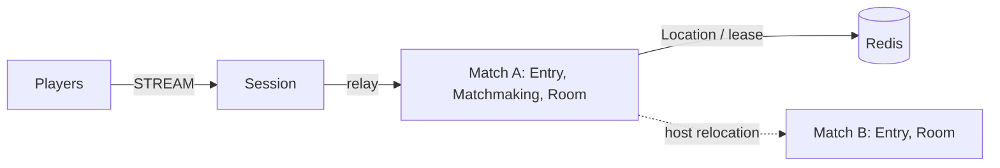

# my-game: match entry lobby (Java)

Two players queue by mode through Entry Spots and enter a dynamic Room User Spot. Matchmaking owns the queue and room sequence. Each Room owns positions, health, movement budgets, shot range, wall intersection, and match completion. Disconnected players resume the same Actor and Room; draining a Match host relocates the Room without reconnecting clients.



## Prerequisites

Docker Compose v2 with a running Docker daemon, and PowerShell 7 on Windows. The Gradle wrapper downloads Gradle. Public ZLink Framework 0.30.2 and binding 1.20.0 are centrally pinned in `build.gradle.kts`. A valid `zlink.license`, when required by the installed distribution, must be available to each node through its public license configuration.

## Build

```sh
./run-e2e.sh --build-only
```

```powershell
pwsh -NoProfile -File ./run-e2e.ps1 -BuildOnly
```

## Docker e2e

Docker runs the Java e2e runner and every node role in containers. Nodes share the runner's network namespace and keep the existing stdin/stdout control protocol. Only the runner mounts the Docker socket. Each invocation removes its own containers, network and image tags; logs remain under `.logs/`.

For local process debugging, install JDK 25 and use `./run-e2e.sh --local` or `pwsh -NoProfile -File ./run-e2e.ps1 -Local`. Add `--no-build` or `-NoBuild` to reuse a local build. Docker uses its image layer cache.

> **Base images.** Dockerfile ARG defaults pin Eclipse Temurin JDK/JRE 25.0.2+10 and Docker CLI 28.5.1. Replace these defaults when adopting a deployment base image.

```sh
./run-e2e.sh
./run-e2e.sh --scenario matchmaking,hit,wall,input,reconnect,update
./run-e2e.sh --check-structure
```

```powershell
pwsh -NoProfile -File ./run-e2e.ps1
pwsh -NoProfile -File ./run-e2e.ps1 -Scenario matchmaking,hit,wall,input,reconnect,update
pwsh -NoProfile -File ./run-e2e.ps1 -CheckStructure
```

The runner validates `zlink.structure.json`, creates Redis with a unique Compose project and OS-assigned port, then starts matchA, matchB and Session as separate processes. Each scenario owns independent nodes, Redis keys and logs in `.logs/run-<id>/`. It cleans up its own resources and fails on cleanup errors. `-CheckStructure` / `--check-structure` validates files without starting nodes. `./gradlew --no-daemon :server:match:test` checks 46 RoomState domain boundaries and application-state serialization.

| Scenario | Checks |
| --- | --- |
| matchmaking | Same-mode pairing, different-mode separation, initial room state and rejection of internal packets |
| hit | HP 100→75, upward and out-of-range misses, wall rejection, winner at HP 0 |
| wall | An intervening wall blocks damage; a wall behind the target permits a hit |
| input | Shared sequence, movement boundaries, movement budget, fire interval, unchanged rejected state and server-issued retry delays |
| reconnect | New Session retains Actor identity, Room, health, position and sequence; a finished match retains winner |
| update | Drain, relocation and SafeToShutdown, unchanged connections/bindings/game state, replacement READY and new room admission |

The e2e configuration limits each match host to one Room so the replacement has capacity for the new room. Deployment configuration uses `roomCapacity` independently of this test setting. Ports bind to zero and READY reports published listener endpoints. No client timer or retry compensates for a runtime failure.

## FPS rules and extension points

`QueueRequest` is the first client packet. This example accepts a claimed player ID; authenticate that identity before deployment. `GameSession` relays only QueueRequest, RoomViewRequest, MoveRequest, ShootRequest and SessionInfoRequest. Internal assignment and result packets are rejected as `packet-not-allowed`. Messages use the default typed Framework serializer.

Coordinates use `Vec3(X, Y, Z)` with Y up. `ArenaMap` defines bounds X/Z=0..100 and Y=0..10, two static AABBs, and ordered server spawn points. A player box is 1 wide, 2 high and 1 deep from its feet, with eye height 1.6. Feet remain at Y=0. Vertical movement is rejected as `vertical-move`; jumping and gravity are not implemented. Movement tests the feet-position segment against the closed wall boxes, including contact at the endpoint. It does not implement swept player-volume collision.

`MoveRequest(Delta, Sequence)` has a maximum step of 2 and speed budget of 10 units per second, capped at 2 since the last accepted movement. The first movement has the full budget. Nonfinite deltas, nonzero Delta.Y, oversized steps, map exits, wall intersections and budget overruns are rejected. `ShootRequest(AimDirection, Sequence)` normalizes finite nonzero aim, casts from the authoritative eye position up to 80 units, and chooses the closest wall or living player AABB. Wall ties and box contact block the ray. A hit causes 25 damage; accepted misses and wall-blocked shots still consume their sequence and 250 ms fire interval. There is no ammunition model. The Framework message model carries only finite JSON numbers, so nonfinite input reaches only the domain checks.

Move and Shoot share one increasing sequence. Rejections change neither position, HP, sequence nor movement/fire timing. `RetryAfterMs` is positive only for movement-budget or fire-interval rejection; clients can wait that reported duration and resend the same input. MoveResult and ShotResult acknowledge accepted actions; ActionRejected and ShotRejected report rejected inputs. RoomView includes positions, HP, last sequences, phase and winner so a reconnecting client can continue with its last sequence plus one. At zero HP the match finishes and later Move/Shoot inputs are rejected.

Hit detection uses current server state. There is no lag compensation, projectile simulation or client prediction. Extend `RoomState` for weapons and match rules, `Geometry` for level geometry and spawn selection, and shared typed contracts for client-facing actions. Keep cooldown, movement budget and hit decisions in `RoomState`. `RoomSnapshot` carries only remaining milliseconds for timing; it never transfers a process's absolute clock reading. Production uses a monotonic clock; tests provide a clock through the RoomState constructor.

Message Follow is configured explicitly to 30 seconds. After `RELOCATED`, the safe shutdown observation budget is the follow duration plus the existing relocation observation budget; the relocation operation deadline is unchanged.

## Deployment sequence

Wait for the bootstrap owner to report `READY` before starting another match host. Its public GetOrCreate completes while it is the only placement candidate, so the fixed Matchmaking Spot starts on its declared owner.

1. Provision Redis; assign a shared `keyPrefix` and reachable `redisEndpoint` to all node configurations.
2. Start matchA with `server/config/match-a.json`. Its `bootstrap` setting creates the fixed `matchmaking` User Spot before READY. Start matchB with `server/config/match-b.json`.
3. Start Session with `server/config/session.json`; connect clients to its READY `streamEndpoint`. The installed launchers are `server/match/build/install/match/bin/match` and `server/session/build/install/session/bin/session` (append `.bat` on Windows). Pass the configuration path as their sole argument.
4. Send `drain` to the match process hosting the room. Wait for RELOCATION_REQUESTED, RELOCATED and SAFE_TO_SHUTDOWN. Send `shutdown`, verify STOPPED and process exit, then start a replacement with the same configuration and wait for READY.

Framework owns Actor identity, Session binding, route and lease state, membership, completion and relocation. Application adapters capture only matchmaking queues/sequence and room combat state. Player has no application state. Extend combat in `RoomState`, matchmaking in `MatchmakingState`, and typed dispatch in `Actions`.

## 한국어 실행 안내

기본 e2e는 runner와 node를 Docker에서 실행합니다. 로컬 process 디버깅에는 JDK 25를 준비하고 `--local` 또는 `-Local`을 지정합니다. 시나리오를 지정하지 않으면 matchmaking, hit, wall, input, reconnect, update 순서로 실행합니다. 도메인 경계 46개는 `./gradlew --no-daemon :server:match:test`로 확인합니다.

`QueueRequest`가 첫 client packet이며 이 예제는 요청의 player ID를 사용합니다. 배포 전에는 인증된 identity를 연결해야 합니다. `GameSession`은 QueueRequest, RoomViewRequest, MoveRequest, ShootRequest, SessionInfoRequest만 중계합니다. 좌표는 Y축이 위이고, 발 위치는 Y=0입니다. 수직 이동은 `vertical-move`로 거부되며 점프와 중력은 구현하지 않습니다.

이동은 최대 2 단위이고, 마지막 수락 이동 뒤 경과 시간에 따라 초당 10 단위 예산을 받되 최대 2 단위로 제한합니다. 발사 사거리는 80, 피해는 25, 발사 간격은 250ms입니다. 벽과 플레이어 AABB의 가장 가까운 교차를 판정하며 동률이면 벽이 이깁니다. 거부 입력은 위치·HP·순번·이동 예산·발사 간격을 바꾸지 않습니다. `RetryAfterMs`를 받은 경우 서버가 전달한 시간 뒤 같은 입력을 다시 보낼 수 있습니다.

이동 예산, 발사 간격, 명중 판정은 `RoomState`가 소유합니다. 스냅샷은 프로세스의 절대 시각 대신 남은 시간을 저장합니다. Match host를 교체할 때는 해당 process에 `drain`을 보내고 `SAFE_TO_SHUTDOWN`까지 확인한 뒤 종료합니다. 같은 설정으로 대체 process를 시작하고 `READY`를 확인합니다. 로그는 `.logs/run-<id>/`에 남습니다.

Action sequences are signed 64-bit values encoded as decimal JSON strings. The accepted input range is 1..9007199254740991. Values above the upper bound are rejected as `integer-out-of-range` before stale-sequence checks; values at or below the last accepted sequence are `stale-sequence`. Rejections preserve all game state. `RetryAfterMs` remains a 32-bit JSON number.

입력 순번은 decimal JSON 문자열로 전달하는 signed 64-bit 값이며 수락 범위는 1..9007199254740991입니다. 상한 초과는 stale-sequence 판정 전에 `integer-out-of-range`로 거부하며, 마지막 수락 순번 이하는 `stale-sequence`로 거부합니다. 거부 시 게임 상태는 바뀌지 않습니다. `RetryAfterMs`는 32-bit JSON 숫자를 유지합니다.
