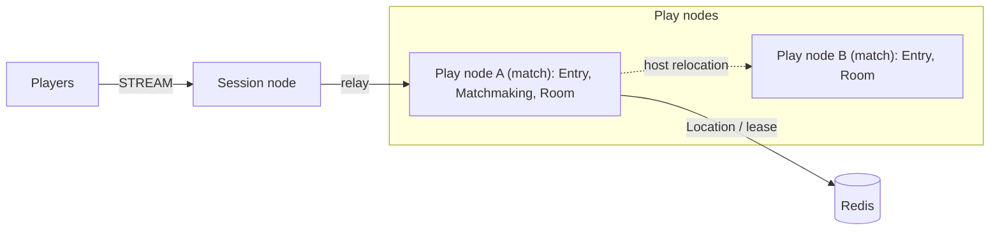

# my-game: match entry lobby (Java)

Two players queue by mode through Entry Spots and enter a dynamic Room User Spot. Matchmaking owns the queue and room sequence. Each Room owns positions, health, movement budgets, shot range, wall intersection, and match completion. Disconnected players resume the same Actor and Room; draining a play node (match) relocates the Room without reconnecting clients.



## Prerequisites

Docker Compose v2 with a running Docker daemon, and PowerShell 7 on Windows. The Gradle wrapper downloads Gradle. Public ZLink Framework 0.34.0 and binding 1.26.0 are centrally pinned in `build.gradle.kts`.

## Build

```sh
./run-e2e.sh --build-only
```

```powershell
pwsh -NoProfile -File ./run-e2e.ps1 -BuildOnly
```

## Client connection

### Endpoint and first packet

Connect to the Session node's `players` STREAM listener. `server/config/session.json` configures `tcp://127.0.0.1:0`: loopback with port `0` requesting an OS-selected port. `server/shared/src/main/java/MyGame/Hosting.java` prints `READY {"id":"...","meshEndpoint":"...","streamEndpoint":"..."}`; use its actual `streamEndpoint`, not port `0`. Mesh and Redis endpoints are not client endpoints.

This is TCP with no URL path. Web browsers, Unity WebGL and Cocos Creator web cannot connect to this default TCP listener. Those targets need a separately configured WebSocket listener and a reachable `ws://` or `wss://` endpoint. Loopback is reachable only from the same host/network namespace. The Docker e2e runner owns and removes its temporary deployment. For an external client, keep a deployment running, bind a reachable interface and port, expose the container port, and use the server's reachable host.

Send `QueueRequest(playerId, mode)` first. Queue two distinct players in the same mode to receive `MatchFound(roomId)` and `RoomView` pushes; one queued player cannot form a match. The example needs a second client queued in `ranked`.

These first application operations use `send(...).submit()` and push handlers, not correlated request/reply. After joining and binding, `request(new SessionInfoRequest()).submit(SessionInfo.class)` returns Session identity. Do not request it before entry. Player IDs are not authentication credentials; this template has no production authentication, so validate identity before binding.

### Connector installation

Use the same connector release as `build.gradle.kts` extra `frameworkVersion`; `e2e/build.gradle.kts` uses that value for `systems.zlink:zlink-stream-connector`. In the commands below, `<version>` means that pinned release. The linked guides may describe newer releases. All clients must use this template's packets and the transport described above; engine sample packet names do not apply.

| Client                             | Connector installation                                                                                                                                                                                                                                                                                                                                                                                                                                                          | Documentation guide                                                                                                                                                          |
| ---------------------------------- | ------------------------------------------------------------------------------------------------------------------------------------------------------------------------------------------------------------------------------------------------------------------------------------------------------------------------------------------------------------------------------------------------------------------------------------------------------------------------------- | ---------------------------------------------------------------------------------------------------------------------------------------------------------------------------- |
| Unity                              | Native/Editor: restore `Zlink.Stream.Connector` with NuGetForUnity. WebGL: add the `com.zlink.stream-connector.webgl` UPM Git package; include only the connector assembly for the active target. See the [Unity README](https://github.com/zlink-systems/zlink/blob/main/framework/languages/engines/Unity/README.md) and its package manifest.                                                                                                                                | [.NET engine integration](https://docs.zlink.systems/dotnet/guide/stream-connector/12-engine-integration/)                                                                   |
| Unreal                             | Copy `framework/languages/cpp/connector/engines/unreal` into `Plugins/ZLinkStreamConnector`, then package the native connector under `ThirdParty/ZLink` as described in the [Unreal README](https://github.com/zlink-systems/zlink/blob/main/framework/languages/engines/Unreal/README.md).                                                                                                                                                                                     | [C++ engine integration](https://docs.zlink.systems/cpp/guide/stream-connector/12-engine-integration/)                                                                       |
| Godot                              | .NET: add the NuGet package `Zlink.Stream.Connector` and run `dotnet restore`; see the [C# README](https://github.com/zlink-systems/zlink/blob/main/framework/languages/engines/Godot/csharp/README.md). GDExtension: build the C++ Godot adapter against the framework prebuilt and matching `godot-cpp`; see the [C++ README](https://github.com/zlink-systems/zlink/blob/main/framework/languages/engines/Godot/cpp/README.md). The .NET sample does not support Web export. | [.NET](https://docs.zlink.systems/dotnet/guide/stream-connector/12-engine-integration/), [C++](https://docs.zlink.systems/cpp/guide/stream-connector/12-engine-integration/) |
| Cocos Creator                      | Web target: `npm install @zlink-systems/stream-connector@<version>`; see the [Cocos Creator README](https://github.com/zlink-systems/zlink/blob/main/framework/languages/engines/CocosCreator/README.md). This package does not provide a Creator native adapter.                                                                                                                                                                                                                  | [TypeScript engine integration](https://docs.zlink.systems/node/guide/stream-connector/12-engine-integration/)                                                               |
| Axmol                              | Copy `framework/languages/cpp/connector/engines/axmol` into `third_party/zlink_axmol_connector` and link `zlink::stream_connector` from the installed C++ framework package; see the [Axmol README](https://github.com/zlink-systems/zlink/blob/main/framework/languages/engines/Axmol/README.md).                                                                                                                                                                              | [C++ engine integration](https://docs.zlink.systems/cpp/guide/stream-connector/12-engine-integration/)                                                                       |
| Web browser (TypeScript connector) | `npm install @zlink-systems/stream-connector@<version>`; import the package root in the browser build. Use `ws://` or `wss://`, subject to the page's security policy.                                                                                                                                                                                                                                                                                                             | [TypeScript connector](https://docs.zlink.systems/node/guide/stream-connector/)                                                                                              |
| C++                                | Install the C++ framework prebuilt containing the connector; use `find_package(zlink_stream_connector_cpp CONFIG REQUIRED)` and link `zlink::stream_connector`.                                                                                                                                                                                                                                                                                                                 | [C++ connector](https://docs.zlink.systems/cpp/guide/stream-connector/)                                                                                                      |
| C#/.NET                            | `dotnet add package Zlink.Stream.Connector --version <version>`                                                                                                                                                                                                                                                                                                                                                                                                                    | [.NET connector](https://docs.zlink.systems/dotnet/guide/stream-connector/)                                                                                                  |
| Java                               | Add Maven/Gradle dependency `systems.zlink:zlink-stream-connector:<version>`.                                                                                                                                                                                                                                                                                                                                                                                                      | [Java connector](https://docs.zlink.systems/java/guide/stream-connector/)                                                                                                    |
| Kotlin                             | Add `systems.zlink:zlink-stream-connector:<version>` and `systems.zlink:zlink-framework-kotlin:<version>` for the coroutine wrapper.                                                                                                                                                                                                                                                                                                                                                  | [Kotlin connector](https://docs.zlink.systems/kotlin/guide/stream-connector/)                                                                                                |
| Node                               | `npm install @zlink-systems/stream-connector@<version>`; use the package root and Node.js 22 or later.                                                                                                                                                                                                                                                                                                                                                     | [Node connector](https://docs.zlink.systems/node/guide/stream-connector/)                                                                                                    |

### Java connection example

Save this as `e2e/src/main/java/MyGame/e2e/ConnectOnce.java` with `package MyGame.e2e;` before the imports in a copy of this template, then run `./gradlew :e2e:installDist`. Run `java --enable-native-access=ALL-UNNAMED -cp "e2e/build/install/e2e/lib/*" MyGame.e2e.ConnectOnce <actual-session-endpoint>` from that copy while its deployment remains running. Pass the actual Session endpoint as argument 1. Register push handlers before sending. See `e2e/src/main/java/MyGame/e2e/` for the complete flow.

```java
import MyGame.*;
import systems.zlink.stream.connector.*;
import java.net.URI;
import java.time.Duration;
import java.util.concurrent.*;

public final class ConnectOnce {
    public static void main(String[] args) throws Exception {
        var uri = URI.create(args[0]);
        var d = ZLinkStreamConnectorOptions.createDefault(uri);
        var connector = ZLinkStreamConnectorFactory.create(
                new ZLinkStreamConnectorOptions(uri, ZLinkStreamDispatchMode.IMMEDIATE,
                        d.requestTimeout(), d.maxReconnectAttempts(), d.connectTimeout(),
                        d.maxSendPayloadSize(), d.heartbeatEnabled(), d.heartbeatInterval(),
                        d.heartbeatTimeout(), false, d.reconnectInitialDelay(),
                        d.reconnectMaxDelay(), d.reconnectBackoffFactor()));
        var received = new CompletableFuture<MatchFound>();
        try (var push = connector.on(MatchFound.class, message -> {
                    received.complete(message.payload());
                    return CompletableFuture.completedFuture(null);
                });
                var error = connector.onErrorReceived(event -> {
                    received.completeExceptionally(new IllegalStateException(event.toString()));
                    return CompletableFuture.completedFuture(null);
                });
                var disconnected = connector.onDisconnected(event -> {
                    received.completeExceptionally(new IllegalStateException(event.toString()));
                    return CompletableFuture.completedFuture(null);
                })) {
            try {
                connector.connect().submit().toCompletableFuture().join();
                connector.send(new QueueRequest("guide-player", "ranked")).submit().toCompletableFuture().join();
                System.out.println(received.get(5, TimeUnit.SECONDS));
            } finally {
                connector.close().submit().toCompletableFuture().join();
            }
        }
    }
}
```

## Docker e2e

Docker runs the Java e2e runner and every node role in containers. Nodes share the runner's network namespace and keep the existing stdin/stdout control protocol. Only the runner mounts the Docker socket. Each invocation removes its own containers, network and image tags; logs remain under `.logs/`.

For local process debugging, install JDK 25 and use `./run-e2e.sh --local` or `pwsh -NoProfile -File ./run-e2e.ps1 -Local`. Add `--no-build` or `-NoBuild` to reuse a local build. Docker uses its image layer cache.

> **Base images.** Dockerfile ARG defaults pin Eclipse Temurin JDK/JRE 25.0.2+10 and Docker CLI 28.5.1. Replace these defaults when adopting a deployment base image.

```sh
./run-e2e.sh
./run-e2e.sh --scenario matchmaking,hit,wall,input,reconnect,update
./run-e2e.sh --check-structure
```

```powershell
pwsh -NoProfile -File ./run-e2e.ps1
pwsh -NoProfile -File ./run-e2e.ps1 -Scenario matchmaking,hit,wall,input,reconnect,update
pwsh -NoProfile -File ./run-e2e.ps1 -CheckStructure
```

The runner validates `zlink.structure.json`, creates Redis with a unique Compose project and OS-assigned port, then starts matchA, matchB and Session as separate processes. Each scenario owns independent nodes, Redis keys and logs in `.logs/run-<id>/`. It cleans up its own resources and fails on cleanup errors. `-CheckStructure` / `--check-structure` validates files without starting nodes. `./gradlew --no-daemon :server:match:test` checks 46 RoomState domain boundaries and application-state serialization.

| Scenario | Checks |
| --- | --- |
| matchmaking | Same-mode pairing, different-mode separation, initial room state and rejection of internal packets |
| hit | HP 100→75, upward and out-of-range misses, wall rejection, winner at HP 0 |
| wall | An intervening wall blocks damage; a wall behind the target permits a hit |
| input | Shared sequence, movement boundaries, movement budget, fire interval, unchanged rejected state and server-issued retry delays |
| reconnect | New Session retains Actor identity, Room, health, position and sequence; a finished match retains winner |
| update | Drain, relocation and SafeToShutdown, unchanged connections/bindings/game state, replacement READY and new room admission |

The e2e configuration limits each play node (match) to one Room so the replacement has capacity for the new room. Deployment configuration uses `roomCapacity` independently of this test setting. Ports bind to zero and READY reports published listener endpoints. No client timer or retry compensates for a runtime failure.

## FPS rules and extension points

`QueueRequest` is the first client packet. This example accepts a claimed player ID; authenticate that identity before deployment. `GameSession` relays only QueueRequest, RoomViewRequest, MoveRequest, ShootRequest and SessionInfoRequest. Internal assignment and result packets are rejected as `packet-not-allowed`. Messages use the default typed Framework serializer.

Coordinates use `Vec3(X, Y, Z)` with Y up. `ArenaMap` defines bounds X/Z=0..100 and Y=0..10, two static AABBs, and ordered server spawn points. A player box is 1 wide, 2 high and 1 deep from its feet, with eye height 1.6. Feet remain at Y=0. Vertical movement is rejected as `vertical-move`; jumping and gravity are not implemented. Movement tests the feet-position segment against the closed wall boxes, including contact at the endpoint. It does not implement swept player-volume collision.

`MoveRequest(Delta, Sequence)` has a maximum step of 2 and speed budget of 10 units per second, capped at 2 since the last accepted movement. The first movement has the full budget. Nonfinite deltas, nonzero Delta.Y, oversized steps, map exits, wall intersections and budget overruns are rejected. `ShootRequest(AimDirection, Sequence)` normalizes finite nonzero aim, casts from the authoritative eye position up to 80 units, and chooses the closest wall or living player AABB. Wall ties and box contact block the ray. A hit causes 25 damage; accepted misses and wall-blocked shots still consume their sequence and 250 ms fire interval. There is no ammunition model. The Framework message model carries only finite JSON numbers, so nonfinite input reaches only the domain checks.

Move and Shoot share one increasing sequence. Rejections change neither position, HP, sequence nor movement/fire timing. `RetryAfterMs` is positive only for movement-budget or fire-interval rejection; clients can wait that reported duration and resend the same input. MoveResult and ShotResult acknowledge accepted actions; ActionRejected and ShotRejected report rejected inputs. RoomView includes positions, HP, last sequences, phase and winner so a reconnecting client can continue with its last sequence plus one. At zero HP the match finishes and later Move/Shoot inputs are rejected.

Hit detection uses current server state. There is no lag compensation, projectile simulation or client prediction. Extend `RoomState` for weapons and match rules, `Geometry` for level geometry and spawn selection, and shared typed contracts for client-facing actions. Keep cooldown, movement budget and hit decisions in `RoomState`. `RoomSnapshot` carries only remaining milliseconds for timing; it never transfers a process's absolute clock reading. Production uses a monotonic clock; tests provide a clock through the RoomState constructor.

Message Follow is configured explicitly to 30 seconds. After `RELOCATED`, the safe shutdown observation budget is the follow duration plus the existing relocation observation budget; the relocation operation deadline is unchanged.

## Framework behavior to know

- **Waiting for DB or file I/O in a handler** — An ordinary async terminal retains the turn, while `Yield` lets other handlers on the same Spot proceed. [Guide](https://docs.zlink.systems/java/guide/server/32-execution-model/#io-worker-wait).
- **Creation that misses its deadline** — `DeadlineExceeded` and caller cancellation have distinct outcomes. [Guide](https://docs.zlink.systems/java/guide/server/22-actor/#creation-deadline). [server/session/src/main/java/MyGame/session/GameSession.java:59](server/session/src/main/java/MyGame/session/GameSession.java).
- **Many logins at once** — Each creation for a different ID requires a Location Store round trip, so measure expected load when setting the deadline. [Guide](https://docs.zlink.systems/java/guide/server/25-location/#creation-load).
- **Sending under load** — Send waits for capacity, and the application sees the final result. [Guide](https://docs.zlink.systems/java/guide/server/33-backpressure/#send-backpressure). [server/session/src/main/java/MyGame/session/GameSession.java:49](server/session/src/main/java/MyGame/session/GameSession.java).
- **Duplicate login** — Without a callback, a bind from another Session is accepted; reject it in the Actor duplicate-bind callback to prevent this. [Guide](https://docs.zlink.systems/java/guide/server/39-session-binding/#duplicate-session-bind). This template keeps the default (accepts the new Session).
- **ObjectGeneration** — `ObjectGeneration` distinguishes logical incarnations of the same ID; it is not a data version or write authority. [Guide](https://docs.zlink.systems/java/guide/server/34-activation-lifetime/#object-generation). [server/session/src/main/java/MyGame/session/GameSession.java:85](server/session/src/main/java/MyGame/session/GameSession.java).
- **READY and Serving** — The Framework host prints `READY` after observing runtime `Serving`. [Guide](https://docs.zlink.systems/java/guide/server/12-operations/#wait-for-serving). [server/shared/src/main/java/MyGame/Hosting.java:93](server/shared/src/main/java/MyGame/Hosting.java); [server/shared/src/main/java/MyGame/Hosting.java:127](server/shared/src/main/java/MyGame/Hosting.java).

## Deployment sequence

Wait for the bootstrap owner to report `READY` before starting another play node (match). Its public GetOrCreate completes while it is the only placement candidate, so the fixed Matchmaking Spot starts on its declared owner.

1. Provision Redis; assign a shared `keyPrefix` and reachable `redisEndpoint` to all node configurations.
2. Start matchA with `server/config/match-a.json`. Its `bootstrap` setting creates the fixed `matchmaking` User Spot before READY. Start matchB with `server/config/match-b.json`.
3. Start Session with `server/config/session.json`; connect clients to its READY `streamEndpoint`. The installed launchers are `server/match/build/install/match/bin/match` and `server/session/build/install/session/bin/session` (append `.bat` on Windows). Pass the configuration path as their sole argument.
4. Send `drain` to the play node (match) hosting the room. Wait for RELOCATION_REQUESTED, RELOCATED and SAFE_TO_SHUTDOWN. Send `shutdown`, verify STOPPED and process exit, then start a replacement with the same configuration and wait for READY.

Framework owns Actor identity, Session binding, route and lease state, membership, completion and relocation. Application adapters capture only matchmaking queues/sequence and room combat state. Player has no application state. Extend combat in `RoomState`, matchmaking in `MatchmakingState`, and typed dispatch in `Actions`.
