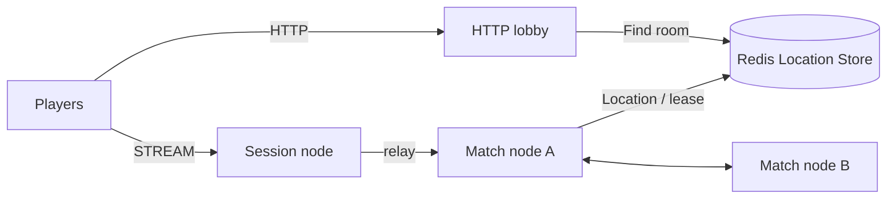

# my-game — HTTP lobby and match servers

This Java FPS template pairs players by mode through an HTTP lobby. `POST /match` returns the same GUID-based Room ID and Session endpoint to both matched players. The lobby creates a dynamic Room User Spot and sends its member list in `PrepareRoom`; the Room returns `RoomPrepared` before the lobby responds. `RoomRoster` admits only those members. Players connect to Session over STREAM and join the assigned Room. `RoomState` owns movement budgets, ray hit decisions, health, shared input sequences and match completion. Disconnected players resume the same Actor and Room; draining a Match host relocates ongoing matches without reconnecting clients.



## Prerequisites

Docker with Compose v2, and PowerShell 7 for Windows. The included Gradle wrapper downloads Gradle. Maven Central supplies Framework 0.30.2 and binding 1.20.0; versions are declared once in `build.gradle.kts`.

## Build

Bash:

```sh
./run-e2e.sh --build-only
```

PowerShell:

```powershell
pwsh -NoProfile -File ./run-e2e.ps1 -BuildOnly
```

## Docker e2e

Docker runs the Java e2e runner and every node role in containers. Nodes share the runner's network namespace and keep the existing stdin/stdout control protocol. Only the runner mounts the Docker socket. Each invocation removes its own containers, network and image tags; logs remain under `.logs/`.

For local process debugging, install JDK 25 and use `./run-e2e.sh --local` or `pwsh -NoProfile -File ./run-e2e.ps1 -Local`. Add `--no-build` or `-NoBuild` to reuse a local build. Docker uses its image layer cache.

> **Base images.** Dockerfile ARG defaults pin Eclipse Temurin JDK/JRE 25.0.2+10 and Docker CLI 28.5.1. Replace these defaults when adopting a deployment base image.

Bash:

```sh
./run-e2e.sh
./run-e2e.sh --scenario lobby,hit,wall,input,reconnect,update
./run-e2e.sh --check-structure
```

PowerShell:

```powershell
pwsh -NoProfile -File ./run-e2e.ps1
pwsh -NoProfile -File ./run-e2e.ps1 -Scenario lobby,hit,wall,input,reconnect,update
pwsh -NoProfile -File ./run-e2e.ps1 -CheckStructure
```

The runner validates `zlink.structure.json`, creates its own Redis Compose project with an OS-assigned loopback port, and starts Match, Session and Lobby processes. Each scenario uses a fresh cluster, unique Redis prefix and `.logs/run-<id>/` directory. Cleanup errors fail the run. The e2e configuration limits each Match host to one Room so the replacement has capacity for the new Room; deployment configuration sets `roomCapacity` independently. `./gradlew --no-daemon :server:match:test :server:lobby:test` runs the 45 RoomState domain boundaries, 19 lobby domain boundaries and application-state serialization checks.

| Scenario | Checks |
| --- | --- |
| lobby | Omitted mode defaults to duel; matched players receive the same Room and Session endpoint; modes use separate Rooms; an unlisted player is rejected before admission; client `PrepareRoom` packets are rejected before admission and during a match; lobby restart preserves an existing match and provisions a new Room ID |
| hit | HP 100→75, upward and out-of-range misses, wall rejection, winner at HP 0 |
| wall | An intervening wall blocks damage; a wall behind the target permits a hit |
| input | Shared sequence, movement boundaries, movement budget, fire interval, unchanged rejected state and server-issued retry delays |
| reconnect | A new Session retains Actor identity, Room, health, position and sequence; a finished match retains winner |
| update | Relocation and SafeToShutdown, unchanged connections/bindings/game state, external-player rejection, replacement READY and new Room admission |

## FPS rules and extension points

`POST /match` accepts `MatchRequest(PlayerId, Mode)` and pairs two requests for the same mode. An omitted mode defaults to `duel`. This example accepts a claimed player ID; authenticate that identity before deployment. The response contains `RoomId` and `SessionEndpoint`; the first normal STREAM packet is `JoinRoomRequest`. Session relays only JoinRoomRequest, RoomViewRequest, MoveRequest, ShootRequest and SessionInfoRequest. `PrepareRoom`, `RoomPrepared`, `HttpNodeReady`, internal assignment and result packets are rejected as `packet-not-allowed`. Messages use the default typed Framework serializer.

The Matchmaker creates each Room ID as `RoomPrefix` plus a hyphen-free 32-character UUID. It sends `PrepareRoom(MatchId, Members)` to the Room and waits for `RoomPrepared(MatchId)` before returning the HTTP response. `RoomRoster` is the sole owner of admitted members; repeating the same preparation is idempotent and a different member list is rejected. The Room snapshot contains both `Game` and `Roster`, so relocation preserves admission state.

Coordinates use `Vec3(X, Y, Z)` with Y up. `ArenaMap` defines bounds X/Z=0..100 and Y=0..10, two static AABBs, and ordered server spawn points. A player box is 1 wide, 2 high and 1 deep from its feet, with eye height 1.6. Feet remain at Y=0. Vertical movement is rejected as `vertical-move`; jumping and gravity are not implemented. Movement tests the feet-position segment against the closed wall boxes, including contact at the endpoint. It does not implement swept player-volume collision.

`MoveRequest(Delta, Sequence)` has a maximum step of 2 and speed budget of 10 units per second, capped at 2 since the last accepted movement. The first movement has the full budget. Nonfinite deltas, nonzero Delta.Y, oversized steps, map exits, wall intersections and budget overruns are rejected. `ShootRequest(AimDirection, Sequence)` normalizes finite nonzero aim, casts from the authoritative eye position up to 80 units, and chooses the closest wall or living player AABB. Wall ties and box contact block the ray. A hit causes 25 damage; accepted misses and wall-blocked shots still consume their sequence and 250 ms fire interval. There is no ammunition model. The Framework message model carries only finite JSON numbers, so nonfinite input reaches only the domain checks.

Move and Shoot share one increasing sequence. Rejections change neither position, HP, sequence nor movement/fire timing. `RetryAfterMs` is positive only for movement-budget or fire-interval rejection; clients can wait that reported duration and resend the same input. MoveResult and ShotResult acknowledge accepted actions; ActionRejected and ShotRejected report rejected inputs. RoomView includes positions, HP, last sequences, phase and winner so a reconnecting client can continue with its last sequence plus one. At zero HP the match finishes and later Move/Shoot inputs are rejected.

Hit detection uses current server state. There is no lag compensation, projectile simulation or client prediction. Extend `RoomState` for weapons and match rules, `Geometry` for level geometry and spawn selection, and shared typed contracts for client-facing actions. Keep cooldown, movement budget and hit decisions in `RoomState`. `RoomSnapshot` carries only remaining milliseconds for timing; it never transfers a process's absolute clock reading. Production uses a monotonic clock; tests provide a clock through the RoomState constructor.

## Deployment sequence

Start Redis, then both match processes using `server/config/match-a.json` and `match-b.json`. Start Session using `session.json`. Read its `READY` stream endpoint, write that value into the lobby configuration's `sessionEndpoint`, then start the lobby using `lobby.json`. Each installed application accepts its configuration path as its only argument. Configuration IDs match structure node IDs; endpoint port zero requests an OS-assigned port.

The match configuration `roomCapacity` sets the positive per-node Room stable-type limit. Deployment configurations allow multiple Rooms; the e2e runner uses one so the surviving host is full after relocation and the replacement must handle the next Room.

For a match host update, send `drain` to stdin and require `RELOCATION_REQUESTED`, `RELOCATED` and `SAFE_TO_SHUTDOWN`. Send `shutdown`, require `STOPPED` and exit zero, then start the replacement with the same configuration. The lobby remains outside host relocation. HTTP matchmaking holds the first POST response until another player requests the same mode; shutdown fails pending requests. The Netty HTTP adapter removes an unpaired request when its client disconnects, allowing the same player ID to request again. Cancellation does not change paired requests.

The Room domain is in `server/match/src/main/java/MyGame/match/domain/RoomState.java`. `RoomRoster` owns admission. HTTP and ZLink lobby adapters implement the application matching port. No player route, membership, lease or Actor reference is serialized by an application relocation adapter.

## 한국어 실행 안내

기본 e2e는 runner와 node를 Docker에서 실행합니다. 로컬 process 디버깅에는 JDK 25를 준비하고 `--local` 또는 `-Local`을 지정합니다. 시나리오를 지정하지 않으면 lobby, hit, wall, input, reconnect, update 순서로 실행합니다. 도메인 경계 45개와 HTTP 경계 19개는 `./gradlew --no-daemon :server:match:test :server:lobby:test`로 확인합니다.

HTTP `POST /match`는 mode가 생략되면 `duel`을 사용합니다. Matchmaker는 같은 mode의 두 요청을 매칭하고, 하이픈 없는 32자 UUID가 붙은 Room ID를 발급합니다. 룸이 멤버 명단으로 준비되어 `RoomPrepared`를 반환한 뒤에만 HTTP 응답을 보냅니다. `RoomRoster`가 입장을 판정하고 relocation snapshot에 게임 상태와 명단을 함께 저장합니다. Session의 첫 정상 STREAM packet은 `JoinRoomRequest`입니다. `PrepareRoom`, `RoomPrepared`, `HttpNodeReady`는 client 허용 목록에 없습니다.

좌표는 Y축이 위이고 발 위치는 Y=0입니다. 수직 이동은 `vertical-move`로 거부되며 점프와 중력은 구현하지 않습니다. 이동 최대 step은 2, 속도 예산은 초당 10 단위이며 최대 2 단위로 제한됩니다. 발사 사거리는 80, 피해는 25, 간격은 250ms입니다. 가장 가까운 벽 또는 플레이어 AABB를 선택하고 동률이면 벽이 이깁니다. 거부 입력은 위치·HP·순번·이동 예산·발사 간격을 바꾸지 않습니다. `RetryAfterMs`를 받은 경우 서버가 전달한 시간 뒤 같은 입력을 다시 보낼 수 있습니다.

Room 도메인은 `server/match/src/main/java/MyGame/match/domain/RoomState.java`, 입장 명단은 `RoomRoster.java`가 소유합니다. 배포 시 Session의 `READY` 출력에서 endpoint를 확인해 Lobby 설정에 넣습니다. Match host를 교체할 때는 `drain` 뒤 `SAFE_TO_SHUTDOWN`까지 확인하고 `shutdown`합니다. 로그는 `.logs/run-<id>/`에 보존합니다.
