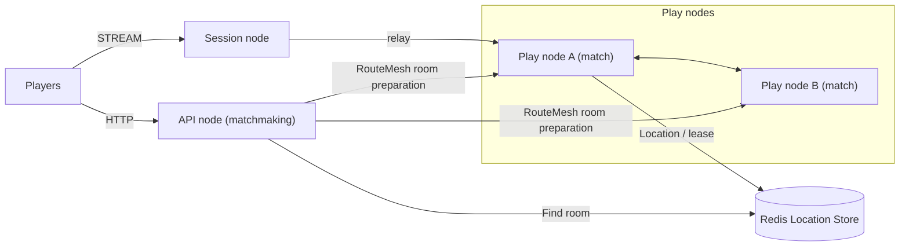

# my-game — API node and match servers

[한국어](README.ko.md)

This Java FPS template pairs players by mode through an API node. `POST /match` returns the same GUID-based Room ID and Session endpoint to both matched players. The API node creates a dynamic Room User Spot and sends its member list in `PrepareRoom`; the Room returns `RoomPrepared` before the API node responds. `RoomRoster` admits only those members. Players connect to Session over STREAM and join the assigned Room. `RoomState` owns movement budgets, ray hit decisions, health, shared input sequences and match completion. Disconnected players resume the same Actor and Room; draining a play node (match) relocates ongoing matches without reconnecting clients.



## Prerequisites

Docker with Compose v2, and PowerShell 7 for Windows. The included Gradle wrapper downloads Gradle. Maven Central supplies Framework 0.34.2 and binding 1.26.0; versions are declared once in `build.gradle.kts`.

## Build

Bash:

```sh
./run-e2e.sh --build-only
```

PowerShell:

```powershell
.\run-e2e.cmd -BuildOnly
```

## Local server

Install JDK 25 and keep Docker with Compose v2 running for Redis. Run the command from this project directory.

```sh
./run-server.sh
```

On Windows, install PowerShell 7 and run the CMD wrapper.

```powershell
.\run-server.cmd
```

The server builds the Java distributions, starts the nodes and Redis, and prints the WebSocket endpoint after `Server ready:`. Keep the terminal open. Press Ctrl+C to stop the nodes and Redis. A second server invocation is refused.

Run `./run-e2e.sh` or `.\run-e2e.cmd` in another terminal to use the running server. The runner detects `.logs/server.json` and prints `Using the running server`. With the server stopped, the default runner starts an isolated Docker stack. Attached runs skip `update` because it drains and replaces a play node. They also skip `lobby` because it restarts the API node.

Each run keeps effective node settings, node stdout and stderr, Framework message-flow logs (`*.flow.log`), and any failure details in `.logs/run-<id>/`. Local build output is in `.logs/build.log` and isolated Docker build and cleanup output is in `.logs/docker-*/`.

## Client connection

### Endpoint and first packet

Connect to the Session node's `players` STREAM listener. `server/config/session.json` configures `ws://127.0.0.1:0`: loopback with port `0` requesting an OS-selected port. `server/shared/src/main/java/MyGame/Hosting.java` prints `READY {"id":"...","meshEndpoint":"...","streamEndpoint":"..."}`; use its actual `streamEndpoint`, not port `0`. Mesh and Redis endpoints are not client endpoints. The API node default in `server/config/lobby.json` is `http://127.0.0.1:0`; use its `READY` JSON `httpEndpoint` plus `/match` for matchmaking.

The default WebSocket endpoint uses the root path (`/`) and supports browsers, Unity WebGL and Cocos Creator web. An HTTPS page needs a reachable `wss://` endpoint. Loopback is reachable only from the same host/network namespace. The Docker e2e runner owns and removes its temporary deployment. For an external client, keep a deployment running, bind a reachable interface and port, expose the container port, and use the server's reachable host.

First POST JSON `{"playerId":"...","mode":"ranked"}` to the API node's HTTP endpoint plus `/match`, as `Scenarios.java` does, for two distinct players in the same mode. Start both HTTP requests concurrently: the first waits for its partner before either response completes. Each HTTP result is `MatchResponse(roomId, sessionEndpoint)`. Connect to that returned Session endpoint and send `JoinRoomRequest(playerId, roomId)` first using the assigned player and room. Successful admission pushes `RoomView`; register `MatchFound` as well for the complete game flow. Set the API node's configuration `sessionEndpoint` to the real running Session endpoint; `CHANGE_ME` is not usable.

These first application operations use `send(...).submit()` and push handlers, not correlated request/reply. After joining and binding, `request(new SessionInfoRequest()).submit(SessionInfo.class)` returns Session identity. Do not request it before entry. Player IDs are not authentication credentials; this template has no production authentication, so validate identity before binding.

### Connector installation

Use the same connector release as `build.gradle.kts` extra `frameworkVersion`; `e2e/build.gradle.kts` uses that value for `systems.zlink:zlink-stream-connector`. In the commands below, `<version>` means that pinned release. The linked guides may describe newer releases. All clients must use this template's packets and the transport described above; engine sample packet names do not apply.

| Client                             | Connector installation                                                                                                                                                                                                                                                                                                                                                                                                                                                          | Documentation guide                                                                                                                                                          |
| ---------------------------------- | ------------------------------------------------------------------------------------------------------------------------------------------------------------------------------------------------------------------------------------------------------------------------------------------------------------------------------------------------------------------------------------------------------------------------------------------------------------------------------- | ---------------------------------------------------------------------------------------------------------------------------------------------------------------------------- |
| Unity                              | Native/Editor: restore `Zlink.Stream.Connector` with NuGetForUnity. WebGL: add the `com.zlink.stream-connector.webgl` UPM Git package; include only the connector assembly for the active target. See the [Unity README](https://github.com/zlink-systems/zlink/blob/main/framework/languages/engines/Unity/README.md) and its package manifest.                                                                                                                                | [.NET engine integration](https://docs.zlink.systems/dotnet/guide/stream-connector/12-engine-integration/)                                                                   |
| Unreal                             | Copy `framework/languages/cpp/connector/engines/unreal` into `Plugins/ZLinkStreamConnector`, then package the native connector under `ThirdParty/ZLink` as described in the [Unreal README](https://github.com/zlink-systems/zlink/blob/main/framework/languages/engines/Unreal/README.md).                                                                                                                                                                                     | [C++ engine integration](https://docs.zlink.systems/cpp/guide/stream-connector/12-engine-integration/)                                                                       |
| Godot                              | .NET: add the NuGet package `Zlink.Stream.Connector` and run `dotnet restore`; see the [C# README](https://github.com/zlink-systems/zlink/blob/main/framework/languages/engines/Godot/csharp/README.md). GDExtension: build the C++ Godot adapter against the framework prebuilt and matching `godot-cpp`; see the [C++ README](https://github.com/zlink-systems/zlink/blob/main/framework/languages/engines/Godot/cpp/README.md). The .NET sample does not support Web export. | [.NET](https://docs.zlink.systems/dotnet/guide/stream-connector/12-engine-integration/), [C++](https://docs.zlink.systems/cpp/guide/stream-connector/12-engine-integration/) |
| Cocos Creator                      | Web target: `npm install @zlink-systems/stream-connector@<version>`; see the [Cocos Creator README](https://github.com/zlink-systems/zlink/blob/main/framework/languages/engines/CocosCreator/README.md). This package does not provide a Creator native adapter.                                                                                                                                                                                                                  | [TypeScript engine integration](https://docs.zlink.systems/node/guide/stream-connector/12-engine-integration/)                                                               |
| Axmol                              | Copy `framework/languages/cpp/connector/engines/axmol` into `third_party/zlink_axmol_connector` and link `zlink::stream_connector` from the installed C++ framework package; see the [Axmol README](https://github.com/zlink-systems/zlink/blob/main/framework/languages/engines/Axmol/README.md).                                                                                                                                                                              | [C++ engine integration](https://docs.zlink.systems/cpp/guide/stream-connector/12-engine-integration/)                                                                       |
| Web browser (TypeScript connector) | `npm install @zlink-systems/stream-connector@<version>`; import the package root in the browser build. Use `ws://` or `wss://`, subject to the page's security policy.                                                                                                                                                                                                                                                                                                             | [TypeScript connector](https://docs.zlink.systems/node/guide/stream-connector/)                                                                                              |
| C++                                | Install the C++ framework prebuilt containing the connector; use `find_package(zlink_stream_connector_cpp CONFIG REQUIRED)` and link `zlink::stream_connector`.                                                                                                                                                                                                                                                                                                                 | [C++ connector](https://docs.zlink.systems/cpp/guide/stream-connector/)                                                                                                      |
| C#/.NET                            | `dotnet add package Zlink.Stream.Connector --version <version>`                                                                                                                                                                                                                                                                                                                                                                                                                    | [.NET connector](https://docs.zlink.systems/dotnet/guide/stream-connector/)                                                                                                  |
| Java                               | Add Maven/Gradle dependency `systems.zlink:zlink-stream-connector:<version>`.                                                                                                                                                                                                                                                                                                                                                                                                      | [Java connector](https://docs.zlink.systems/java/guide/stream-connector/)                                                                                                    |
| Kotlin                             | Add `systems.zlink:zlink-stream-connector:<version>` and `systems.zlink:zlink-framework-kotlin:<version>` for the coroutine wrapper.                                                                                                                                                                                                                                                                                                                                                  | [Kotlin connector](https://docs.zlink.systems/kotlin/guide/stream-connector/)                                                                                                |
| Node                               | `npm install @zlink-systems/stream-connector@<version>`; use the package root and Node.js 22 or later.                                                                                                                                                                                                                                                                                                                                                     | [Node connector](https://docs.zlink.systems/node/guide/stream-connector/)                                                                                                    |

### Java connection example

Save this as `e2e/src/main/java/MyGame/e2e/ConnectOnce.java` with `package MyGame.e2e;` before the imports in a copy of this template, then run `./gradlew :e2e:installDist`. Run `java --enable-native-access=ALL-UNNAMED -cp "e2e/build/install/e2e/lib/*" MyGame.e2e.ConnectOnce <actual-session-endpoint>` from that copy while its deployment remains running. Pass the actual Session endpoint as argument 1. Pass the player ID and room ID from the completed HTTP assignment as arguments 2 and 3. Complete the HTTP step for both players before running the stream example. Register push handlers before sending. See `e2e/src/main/java/MyGame/e2e/` for the complete flow.

```java
import MyGame.*;
import systems.zlink.stream.connector.*;
import java.net.URI;
import java.time.Duration;
import java.util.concurrent.*;

public final class ConnectOnce {
    public static void main(String[] args) throws Exception {
        var uri = URI.create(args[0]);
        var d = ZLinkStreamConnectorOptions.createDefault(uri);
        var connector = ZLinkStreamConnectorFactory.create(
                new ZLinkStreamConnectorOptions(uri, ZLinkStreamDispatchMode.IMMEDIATE,
                        d.requestTimeout(), d.maxReconnectAttempts(), d.connectTimeout(),
                        d.maxSendPayloadSize(), d.heartbeatEnabled(), d.heartbeatInterval(),
                        d.heartbeatTimeout(), false, d.reconnectInitialDelay(),
                        d.reconnectMaxDelay(), d.reconnectBackoffFactor()));
        var received = new CompletableFuture<RoomView>();
        try (var push = connector.on(RoomView.class, message -> {
                    received.complete(message.payload());
                    return CompletableFuture.completedFuture(null);
                });
                var error = connector.onErrorReceived(event -> {
                    received.completeExceptionally(new IllegalStateException(event.toString()));
                    return CompletableFuture.completedFuture(null);
                });
                var disconnected = connector.onDisconnected(event -> {
                    received.completeExceptionally(new IllegalStateException(event.toString()));
                    return CompletableFuture.completedFuture(null);
                })) {
            try {
                connector.connect().submit().toCompletableFuture().join();
                connector.send(new JoinRoomRequest(args[1], args[2])).submit().toCompletableFuture().join();
                System.out.println(received.get(5, TimeUnit.SECONDS));
            } finally {
                connector.close().submit().toCompletableFuture().join();
            }
        }
    }
}
```

## End-to-end scenarios

The following scenarios run in an isolated Docker stack when a local server is unavailable.

Docker runs the Java e2e runner and every node role in containers. Nodes share the runner's network namespace and keep the existing stdin/stdout control protocol. Only the runner mounts the Docker socket. Each invocation removes its own containers, network and image tags; logs remain under `.logs/`.

For local process debugging, install JDK 25 and use `./run-e2e.sh --local` or `.\run-e2e.cmd -Local`. Add `--no-build` or `-NoBuild` to reuse a local build. Docker uses its image layer cache.

> **Base images.** Dockerfile ARG defaults pin Eclipse Temurin JDK/JRE 25.0.2+10 and Docker CLI 28.5.1. Replace these defaults when adopting a deployment base image.

Bash:

```sh
./run-e2e.sh
./run-e2e.sh --scenario lobby,hit,wall,input,reconnect,update
./run-e2e.sh --check-structure
```

PowerShell:

```powershell
.\run-e2e.cmd
.\run-e2e.cmd -Scenario lobby,hit,wall,input,reconnect,update
.\run-e2e.cmd -CheckStructure
```

The runner validates `zlink.structure.json`, creates its own Redis Compose project with an OS-assigned loopback port, and starts Match, Session and the API node processes. Each scenario uses a fresh cluster, unique Redis prefix and `.logs/run-<id>/` directory. Cleanup errors fail the run. The e2e configuration limits each play node (match) to one Room so the replacement has capacity for the new Room; deployment configuration sets `roomCapacity` independently. `./gradlew --no-daemon --max-workers=4 :server:match:test :server:lobby:test` runs the 46 RoomState domain boundaries, 19 lobby domain boundaries and application-state serialization checks.

| Scenario | Checks |
| --- | --- |
| lobby | Omitted mode defaults to duel; matched players receive the same Room and Session endpoint; modes use separate Rooms; an unlisted player is rejected before admission; client `PrepareRoom` packets are rejected before admission and during a match; lobby restart preserves an existing match and provisions a new Room ID |
| hit | HP 100→75, upward and out-of-range misses, wall rejection, winner at HP 0 |
| wall | An intervening wall blocks damage; a wall behind the target permits a hit |
| input | Shared sequence, movement boundaries, movement budget, fire interval, unchanged rejected state and server-issued retry delays |
| reconnect | A new Session retains Actor identity, Room, health, position and sequence; a finished match retains winner |
| update | Relocation and SafeToShutdown, unchanged connections/bindings/game state, external-player rejection, replacement READY and new Room admission |

## FPS rules and extension points

`POST /match` accepts `MatchRequest(PlayerId, Mode)` and pairs two requests for the same mode. An omitted mode defaults to `duel`. This example accepts a claimed player ID; authenticate that identity before deployment. The response contains `RoomId` and `SessionEndpoint`; the first normal STREAM packet is `JoinRoomRequest`. Session relays only JoinRoomRequest, RoomViewRequest, MoveRequest, ShootRequest and SessionInfoRequest. `PrepareRoom`, `RoomPrepared`, `HttpNodeReady`, internal assignment and result packets are rejected as `packet-not-allowed`. Messages use the default typed Framework serializer.

The Matchmaker creates each Room ID as `RoomPrefix` plus a hyphen-free 32-character UUID. It sends `PrepareRoom(MatchId, Members)` to the Room and waits for `RoomPrepared(MatchId)` before returning the HTTP response. `RoomRoster` is the sole owner of admitted members; repeating the same preparation is idempotent and a different member list is rejected. The Room snapshot contains both `Game` and `Roster`, so relocation preserves admission state.

Coordinates use `Vec3(X, Y, Z)` with Y up. `ArenaMap` defines bounds X/Z=0..100 and Y=0..10, two static AABBs, and ordered server spawn points. A player box is 1 wide, 2 high and 1 deep from its feet, with eye height 1.6. Feet remain at Y=0. Vertical movement is rejected as `vertical-move`; jumping and gravity are not implemented. Movement tests the feet-position segment against the closed wall boxes, including contact at the endpoint. It does not implement swept player-volume collision.

`MoveRequest(Delta, Sequence)` has a maximum step of 2 and speed budget of 10 units per second, capped at 2 since the last accepted movement. The first movement has the full budget. Nonfinite deltas, nonzero Delta.Y, oversized steps, map exits, wall intersections and budget overruns are rejected. `ShootRequest(AimDirection, Sequence)` normalizes finite nonzero aim, casts from the authoritative eye position up to 80 units, and chooses the closest wall or living player AABB. Wall ties and box contact block the ray. A hit causes 25 damage; accepted misses and wall-blocked shots still consume their sequence and 250 ms fire interval. There is no ammunition model. The Framework message model carries only finite JSON numbers, so nonfinite input reaches only the domain checks.

Move and Shoot share one increasing sequence. Rejections change neither position, HP, sequence nor movement/fire timing. `RetryAfterMs` is positive only for movement-budget or fire-interval rejection; clients can wait that reported duration and resend the same input. MoveResult and ShotResult acknowledge accepted actions; ActionRejected and ShotRejected report rejected inputs. RoomView includes positions, HP, last sequences, phase and winner so a reconnecting client can continue with its last sequence plus one. At zero HP the match finishes and later Move/Shoot inputs are rejected.

Hit detection uses current server state. There is no lag compensation, projectile simulation or client prediction. Extend `RoomState` for weapons and match rules, `Geometry` for level geometry and spawn selection, and shared typed contracts for client-facing actions. Keep cooldown, movement budget and hit decisions in `RoomState`. `RoomSnapshot` carries only remaining milliseconds for timing; it never transfers a process's absolute clock reading. Production uses a monotonic clock; tests provide a clock through the RoomState constructor.

## Framework behavior to know

- **Waiting for DB or file I/O in a handler** — An ordinary async terminal retains the turn, while `Yield` lets other handlers on the same Spot proceed. [Guide](https://docs.zlink.systems/java/guide/server/32-execution-model/#io-worker-wait).
- **Creation that misses its deadline** — `DeadlineExceeded` and caller cancellation have distinct outcomes. [Guide](https://docs.zlink.systems/java/guide/server/22-actor/#creation-deadline). [server/session/src/main/java/MyGame/session/GameSession.java:60](server/session/src/main/java/MyGame/session/GameSession.java).
- **Many logins at once** — Each creation for a different ID requires a Location Store round trip, so measure expected load when setting the deadline. [Guide](https://docs.zlink.systems/java/guide/server/25-location/#creation-load).
- **Sending under load** — Send waits for capacity, and the application sees the final result. [Guide](https://docs.zlink.systems/java/guide/server/33-backpressure/#send-backpressure). [server/session/src/main/java/MyGame/session/GameSession.java:49](server/session/src/main/java/MyGame/session/GameSession.java).
- **Duplicate login** — Without a callback, a bind from another Session is accepted; reject it in the Actor duplicate-bind callback to prevent this. [Guide](https://docs.zlink.systems/java/guide/server/39-session-binding/#duplicate-session-bind). This template keeps the default (accepts the new Session).
- **ObjectGeneration** — `ObjectGeneration` distinguishes logical incarnations of the same ID; it is not a data version or write authority. [Guide](https://docs.zlink.systems/java/guide/server/34-activation-lifetime/#object-generation). [server/session/src/main/java/MyGame/session/GameSession.java:86](server/session/src/main/java/MyGame/session/GameSession.java).
- **READY and Serving** — The Framework host prints `READY` after observing runtime `Serving`. [Guide](https://docs.zlink.systems/java/guide/server/12-operations/#wait-for-serving). [server/shared/src/main/java/MyGame/Hosting.java:97](server/shared/src/main/java/MyGame/Hosting.java); [server/shared/src/main/java/MyGame/Hosting.java:121](server/shared/src/main/java/MyGame/Hosting.java).

## Deployment sequence

Start Redis, then both play nodes (match) using `server/config/match-a.json` and `match-b.json`. Start the session node using `session.json`. Read its `READY` stream endpoint, write that value into the API node configuration's `sessionEndpoint`, then start the API node using `lobby.json`. Each installed application accepts its configuration path as its only argument. Configuration IDs match structure node IDs; endpoint port zero requests an OS-assigned port.

The match configuration `roomCapacity` sets the positive per-node Room stable-type limit. Deployment configurations allow multiple Rooms; the e2e runner uses one so the surviving host is full after relocation and the replacement must handle the next Room.

For a play node (match) update, send `drain` to stdin and require `RELOCATION_REQUESTED`, `RELOCATED` and `SAFE_TO_SHUTDOWN`. Send `shutdown`, require `STOPPED` and exit zero, then start the replacement with the same configuration. The API node remains outside host relocation. HTTP matchmaking holds the first POST response until another player requests the same mode; shutdown fails pending requests. The Netty HTTP adapter removes an unpaired request when its client disconnects, allowing the same player ID to request again. Cancellation does not change paired requests.

The Room domain is in `server/match/src/main/java/MyGame/match/domain/RoomState.java`. `RoomRoster` owns admission. HTTP and ZLink lobby adapters implement the application matching port. No player route, membership, lease or Actor reference is serialized by an application relocation adapter.

## Known issues

Drain confirmation takes about 30 seconds, so a turn clock may expire during the wait. For an update scenario in a game with turn clocks, finish the round before relocating it. Verify that relocation preserves the remaining time in a domain check with a controlled clock.
