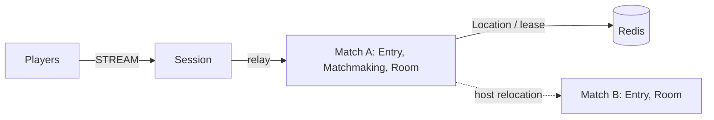

# my-game: match entry lobby (Java)

Two players queue by mode through an Entry Spot and enter a dynamic Room User Spot. Matchmaking owns the queue and room sequence. Each Room owns positions, health, shot range, closed wall intersection, and the winner. The same source serves action-entry-lobby and fps-entry-lobby.



## Prerequisites

Docker Compose v2 with a running Docker daemon, and PowerShell 7 on Windows. The Gradle wrapper downloads Gradle. Public ZLink Framework 0.30.2 and binding 1.20.0 are centrally pinned in `build.gradle.kts`. A valid `zlink.license`, when required by the installed distribution, must be available to each node through its public license configuration.

## Build

```sh
./run-e2e.sh --build-only
```

```powershell
pwsh -NoProfile -File ./run-e2e.ps1 -BuildOnly
```

## Docker e2e

Docker runs the Java e2e runner and every node role in containers. Nodes share the runner's network namespace and keep the existing stdin/stdout control protocol. Only the runner mounts the Docker socket. Each invocation removes its own containers, network and image tags; logs remain under `.logs/`.

For local process debugging, install JDK 25 and use `./run-e2e.sh --local` or `pwsh -NoProfile -File ./run-e2e.ps1 -Local`. Add `--no-build` or `-NoBuild` to reuse a local build. Docker uses its image layer cache.

> **Base images.** Dockerfile ARG defaults pin Eclipse Temurin JDK/JRE 25.0.2+10 and Docker CLI 28.5.1. Replace these defaults when adopting a deployment base image.

```sh
./run-e2e.sh
./run-e2e.sh --scenario hit,wall,input,reconnect,update
./run-e2e.sh --check-structure
```

```powershell
pwsh -NoProfile -File ./run-e2e.ps1
pwsh -NoProfile -File ./run-e2e.ps1 -Scenario hit,wall,input,reconnect,update
pwsh -NoProfile -File ./run-e2e.ps1 -CheckStructure
```

The runner validates `zlink.structure.json`, creates Redis with a unique Compose project and OS-assigned port, then starts matchA, matchB and Session as separate processes. Each scenario owns independent nodes, Redis keys and logs in `.logs/run-<id>/`. It cleans up its own resources and fails on cleanup errors. `-CheckStructure` / `--check-structure` validates files without starting nodes. `./gradlew --no-daemon :server:match:test` checks domain boundaries and application-state serialization.

| Scenario | Checks |
| --- | --- |
| hit | Matchmaking, client `RoomAssignment` rejection, HP 75 after a hit, wall and range rejection without damage, absent target, HP zero and winner |
| wall | Wall contact and crossing block movement and shots; walking below the wall endpoint reaches the other side for a clear shot |
| input | Duplicate and reversed sequences, `MaxStep`, map and wall bounds, move/fire cooldown responses, unchanged state after rejection, and retry after the server-provided delay |
| reconnect | A new Session retains Actor identity and the Room's position, HP, last sequence, phase and winner during and after the match |
| update | Drain, relocation and SafeToShutdown, unchanged connections/bindings/game state, Stopped, replacement READY, new room on replacement |

The e2e configuration limits each match host to one Room so the replacement has capacity for the new room. Deployment configuration uses `roomCapacity` independently of this test setting. Ports bind to zero and READY reports published listener endpoints.

`QueueRequest` is the first client packet. The Session relays only `QueueRequest`, `RoomViewRequest`, `MoveRequest`, `ShootRequest`, and `SessionInfoRequest`; internal packets receive `ActionRejected("packet-not-allowed", 0)`. The example accepts a claimed player ID; replace this boundary with authenticated identity before deployment. Requests use typed messages and the default Framework serializer. The Framework message model carries only finite JSON numbers, so nonfinite input reaches only the domain checks.

`RoomState` owns movement, shooting, action sequence, cooldown, and winner decisions. It sets players at `(40, 10)` and `(60, 10)`. `MoveRequest` carries displacement in `dx` and `dy`, and the server checks finite values, `MaxStep` 2.0, map bounds `[0, 100]` on each axis, the closed wall segment at `x=50, y=20..60`, and the movement budget `min(MaxStep, MaxSpeed × elapsed)` with `MaxSpeed` 10 units per second. Shots use server positions and have a 250 ms fire interval. Contract integers are limited to `9,007,199,254,740,991`; requests and results outside that range are rejected. Only accepted moves and shots advance `lastSequence`; rejected actions preserve Room state. `ActionRejected` carries `reason` and `retryAfterMs`; only time-limited rejections have a positive delay, and clients wait for that returned value before retrying the same request. `RoomView` includes each player's `lastSequence`, the room `phase`, and `winner`. Relocation snapshots store remaining cooldown and movement-budget time in milliseconds, not process timestamps. `DomainTest` exercises domain boundaries without sending nonfinite values over the wire.

Message Follow is configured explicitly to 30 seconds. After `RELOCATED`, the safe shutdown observation budget is the follow duration plus the existing relocation observation budget; the relocation operation deadline is unchanged.

## Known issues

Validated against the published Framework 0.30.2 packages.

## Deployment sequence

Wait for the bootstrap owner to report `READY` before starting another match host. Its public GetOrCreate completes while it is the only placement candidate, so the fixed Matchmaking Spot starts on its declared owner.

1. Provision Redis; assign a shared `keyPrefix` and reachable `redisEndpoint` to all node configurations.
2. Start matchA with `server/config/match-a.json`. Its `bootstrap` setting creates the fixed `matchmaking` User Spot before READY. Start matchB with `server/config/match-b.json`.
3. Start Session with `server/config/session.json`; connect clients to its READY `streamEndpoint`. The installed launchers are `server/match/build/install/match/bin/match` and `server/session/build/install/session/bin/session` (append `.bat` on Windows). Pass the configuration path as their sole argument.
4. Send `drain` to the match process hosting the room. Wait for RELOCATION_REQUESTED, RELOCATED and SAFE_TO_SHUTDOWN. Send `shutdown`, verify STOPPED and process exit, then start a replacement with the same configuration and wait for READY.

Framework owns Actor identity, Session binding, route and lease state, membership, completion and relocation. Application adapters capture only matchmaking queues/sequence and room combat state. Player has no application state. Extend combat in `RoomState`, matchmaking in `MatchmakingState`, and typed dispatch in `Actions`.

## 한국어 실행 안내

기본 e2e는 runner와 node를 Docker에서 실행합니다. 로컬 process 디버깅에는 JDK 25를 준비하고 `--local` 또는 `-Local`을 지정합니다.

Docker Compose를 준비한 뒤 위의 운영체제별 Build 및 Docker e2e 명령을 실행합니다. runner는 실행마다 Redis key prefix와 Compose project를 새로 만들고, OS가 배정한 포트를 사용합니다. 로그는 `.logs/run-<id>/`에 보존되며 정리 실패도 검증 실패로 처리합니다.

기본 시나리오는 `hit`, `wall`, `input`, `reconnect`, `update` 순서입니다. `hit`은 매칭·명중·사격 거부·승자를, `wall`은 벽의 이동·사격 차단과 끝을 돌아가는 경로를, `input`은 순번·이동·쿨다운 거부와 상태 불변을, `reconnect`는 진행 중·종료 뒤의 순번·phase·winner 복원을, `update`는 relocation과 대체 node 동작을 확인합니다. `./gradlew --no-daemon :server:match:test`는 단조 시계 기준의 domain 경계를 검사합니다.

대기열은 Matchmaking User Spot, 위치·HP·명중·승자 판정은 Room User Spot이 소유합니다. 운영 중 교체할 때는 해당 match process에 `drain`을 보내고 `SAFE_TO_SHUTDOWN`까지 확인한 뒤 `shutdown`으로 종료합니다. 같은 설정으로 대체 process를 시작하고 `READY`를 확인합니다.
