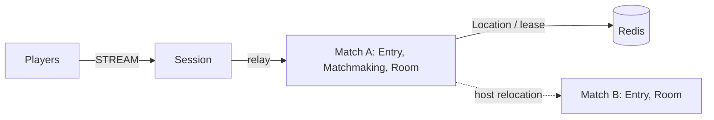

# my-game: match entry lobby (Java)

Two players queue by mode through an Entry Spot and enter a dynamic Room User Spot. Matchmaking owns the queue and room sequence. Each Room owns positions, health, shot range, closed wall intersection, and the winner. The same source serves action-entry-lobby and fps-entry-lobby.



## Prerequisites

JDK 25, Docker Compose v2 with a running Docker daemon, and PowerShell 7 on Windows. The Gradle wrapper downloads Gradle. Public ZLink Framework 0.30.1 and binding 1.19.0 are centrally pinned in `build.gradle.kts`. A valid `zlink.license`, when required by the installed distribution, must be available to each node through its public license configuration.

## Build

```sh
./gradlew --no-daemon installDist
```

```powershell
./gradlew.bat --no-daemon installDist
```

## Local e2e

```sh
./run-e2e.sh
./run-e2e.sh --scenario hit,reconnect,update
```

```powershell
pwsh -NoProfile -File ./run-e2e.ps1
pwsh -NoProfile -File ./run-e2e.ps1 -Scenario hit,reconnect,update
```

The runner validates `zlink.structure.json`, creates Redis with a unique Compose project and OS-assigned port, then starts matchA, matchB and Session as separate processes. Each scenario owns independent nodes, Redis keys and logs in `.logs/run-<id>/`. It cleans up its own resources and fails on cleanup errors. `-CheckStructure` / `--check-structure` validates files without starting nodes. `./gradlew --no-daemon :server:match:test` checks domain boundaries and application-state serialization.

| Scenario | Checks |
| --- | --- |
| hit | Same room, HP 100→75, wall and range rejection without health changes, no-target rejection, winner at HP 0 |
| reconnect | New Session with the same Actor generation, room, health and positions; continued combat |
| update | Drain, relocation and SafeToShutdown, unchanged connections/bindings/game state, Stopped, replacement READY, new room on replacement |

The e2e configuration limits each match host to one Room so the replacement has capacity for the new room. Deployment configuration uses `roomCapacity` independently of this test setting. Ports bind to zero and READY reports published listener endpoints. No client timer or retry compensates for a runtime failure.

## Known issues

Public 0.30.0 validation reaches READY but cross-node deferred Actor join to Matchmaking fails with DATA_LOST ([#1729](https://github.com/zlink-systems/zlink/issues/1729)). On Linux, one update run reached RELOCATED but did not observe SafeToShutdown within the host deadline ([#1740](https://github.com/zlink-systems/zlink/issues/1740)). The template keeps the public 0.30.1 version; its candidate feed is required to finish `hit,reconnect,update` verification. The template does not compensate for these Framework failures.

## Deployment sequence

1. Provision Redis; assign a shared `keyPrefix` and reachable `redisEndpoint` to all node configurations.
2. Start matchA with `server/config/match-a.json`. Its `bootstrap` setting creates the fixed `matchmaking` User Spot before READY. Start matchB with `server/config/match-b.json`.
3. Start Session with `server/config/session.json`; connect clients to its READY `streamEndpoint`. The installed launchers are `server/match/build/install/match/bin/match` and `server/session/build/install/session/bin/session` (append `.bat` on Windows). Pass the configuration path as their sole argument.
4. Send `drain` to the match process hosting the room. Wait for RELOCATION_REQUESTED, RELOCATED and SAFE_TO_SHUTDOWN. Send `shutdown`, verify STOPPED and process exit, then start a replacement with the same configuration and wait for READY.

Framework owns Actor identity, Session binding, route and lease state, membership, completion and relocation. Application adapters capture only matchmaking queues/sequence and room combat state. Player has no application state. Extend combat in `RoomState`, matchmaking in `MatchmakingState`, and typed dispatch in `Actions`.

## 한국어 실행 안내

JDK 25와 Docker Compose를 준비한 뒤 위의 운영체제별 Build 및 Local e2e 명령을 실행합니다. runner는 실행마다 Redis key prefix와 Compose project를 새로 만들고, OS가 배정한 포트를 사용합니다. 로그는 `.logs/run-<id>/`에 보존되며 정리 실패도 검증 실패로 처리합니다.

대기열은 Matchmaking User Spot, 위치·HP·명중·승자 판정은 Room User Spot이 소유합니다. 운영 중 교체할 때는 해당 match process에 `drain`을 보내고 `SAFE_TO_SHUTDOWN`까지 확인한 뒤 `shutdown`으로 종료합니다. 같은 설정으로 대체 process를 시작하고 `READY`를 확인합니다.
