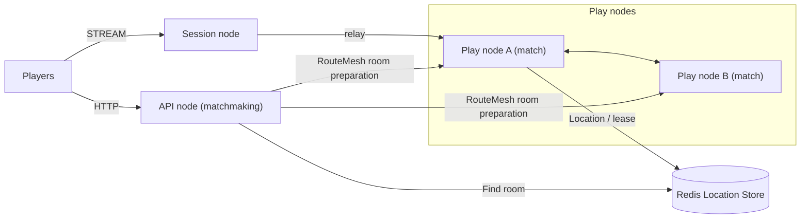

# my-game — Matchmaking API node and match servers

This Java template pairs two players through HTTP and runs their duel through ZLink STREAM. The API node creates a dynamic Room, sends its matched roster for preparation, and returns the assignment after receiving `RoomPrepared`. `RoomState` owns game state and decisions; `RoomRoster` owns member admission; `Player` owns its Framework Actor context.



## Prerequisites

Docker with Compose v2, and PowerShell 7 for Windows. The included Gradle wrapper downloads Gradle. Maven Central supplies Framework 0.34.2 and binding 1.26.0; versions are declared once in `build.gradle.kts`.

## Build

Bash:

```sh
./run-e2e.sh --build-only
```

PowerShell:

```powershell
pwsh -NoProfile -File ./run-e2e.ps1 -BuildOnly
```

## Client connection

### Endpoint and first packet

Connect to the Session node's `players` STREAM listener. `server/config/session.json` configures `tcp://127.0.0.1:0`: loopback with port `0` requesting an OS-selected port. `server/shared/src/main/java/MyGame/Hosting.java` prints `READY {"id":"...","meshEndpoint":"...","streamEndpoint":"..."}`; use its actual `streamEndpoint`, not port `0`. Mesh and Redis endpoints are not client endpoints. The API node default in `server/config/lobby.json` is `http://127.0.0.1:0`; use its `READY` JSON `httpEndpoint` plus `/match` for matchmaking.

This is TCP with no URL path. Web browsers, Unity WebGL and Cocos Creator web cannot connect to this default TCP listener. Those targets need a separately configured WebSocket listener and a reachable `ws://` or `wss://` endpoint. Loopback is reachable only from the same host/network namespace. The Docker e2e runner owns and removes its temporary deployment. For an external client, keep a deployment running, bind a reachable interface and port, expose the container port, and use the server's reachable host.

First POST JSON `{"playerId":"...","mode":"duel"}` to the API node's HTTP endpoint plus `/match`, as `Scenarios.java` does, for two distinct players in the same mode. Start both HTTP requests concurrently: the first waits for its partner before either response completes. Each HTTP result is `MatchResponse(roomId, sessionEndpoint)`. Connect to that returned Session endpoint and send `JoinRoomRequest(playerId, roomId)` first using the assigned player and room. Successful admission pushes `RoomView`. Set the API node's configuration `sessionEndpoint` to the real running Session endpoint; `CHANGE_ME` is not usable.

These first application operations use `send(...).submit()` and push handlers, not correlated request/reply. After joining and binding, `request(new SessionInfoRequest()).submit(SessionInfo.class)` returns Session identity. Do not request it before entry. Player IDs are not authentication credentials; this template has no production authentication, so validate identity before binding.

### Connector installation

Use the same connector release as `build.gradle.kts` extra `frameworkVersion`; `e2e/build.gradle.kts` uses that value for `systems.zlink:zlink-stream-connector`. In the commands below, `<version>` means that pinned release. The linked guides may describe newer releases. All clients must use this template's packets and the transport described above; engine sample packet names do not apply.

| Client                             | Connector installation                                                                                                                                                                                                                                                                                                                                                                                                                                                          | Documentation guide                                                                                                                                                          |
| ---------------------------------- | ------------------------------------------------------------------------------------------------------------------------------------------------------------------------------------------------------------------------------------------------------------------------------------------------------------------------------------------------------------------------------------------------------------------------------------------------------------------------------- | ---------------------------------------------------------------------------------------------------------------------------------------------------------------------------- |
| Unity                              | Native/Editor: restore `Zlink.Stream.Connector` with NuGetForUnity. WebGL: add the `com.zlink.stream-connector.webgl` UPM Git package; include only the connector assembly for the active target. See the [Unity README](https://github.com/zlink-systems/zlink/blob/main/framework/languages/engines/Unity/README.md) and its package manifest.                                                                                                                                | [.NET engine integration](https://docs.zlink.systems/dotnet/guide/stream-connector/12-engine-integration/)                                                                   |
| Unreal                             | Copy `framework/languages/cpp/connector/engines/unreal` into `Plugins/ZLinkStreamConnector`, then package the native connector under `ThirdParty/ZLink` as described in the [Unreal README](https://github.com/zlink-systems/zlink/blob/main/framework/languages/engines/Unreal/README.md).                                                                                                                                                                                     | [C++ engine integration](https://docs.zlink.systems/cpp/guide/stream-connector/12-engine-integration/)                                                                       |
| Godot                              | .NET: add the NuGet package `Zlink.Stream.Connector` and run `dotnet restore`; see the [C# README](https://github.com/zlink-systems/zlink/blob/main/framework/languages/engines/Godot/csharp/README.md). GDExtension: build the C++ Godot adapter against the framework prebuilt and matching `godot-cpp`; see the [C++ README](https://github.com/zlink-systems/zlink/blob/main/framework/languages/engines/Godot/cpp/README.md). The .NET sample does not support Web export. | [.NET](https://docs.zlink.systems/dotnet/guide/stream-connector/12-engine-integration/), [C++](https://docs.zlink.systems/cpp/guide/stream-connector/12-engine-integration/) |
| Cocos Creator                      | Web target: `npm install @zlink-systems/stream-connector@<version>`; see the [Cocos Creator README](https://github.com/zlink-systems/zlink/blob/main/framework/languages/engines/CocosCreator/README.md). This package does not provide a Creator native adapter.                                                                                                                                                                                                                  | [TypeScript engine integration](https://docs.zlink.systems/node/guide/stream-connector/12-engine-integration/)                                                               |
| Axmol                              | Copy `framework/languages/cpp/connector/engines/axmol` into `third_party/zlink_axmol_connector` and link `zlink::stream_connector` from the installed C++ framework package; see the [Axmol README](https://github.com/zlink-systems/zlink/blob/main/framework/languages/engines/Axmol/README.md).                                                                                                                                                                              | [C++ engine integration](https://docs.zlink.systems/cpp/guide/stream-connector/12-engine-integration/)                                                                       |
| Web browser (TypeScript connector) | `npm install @zlink-systems/stream-connector@<version>`; import the package root in the browser build. Use `ws://` or `wss://`, subject to the page's security policy.                                                                                                                                                                                                                                                                                                             | [TypeScript connector](https://docs.zlink.systems/node/guide/stream-connector/)                                                                                              |
| C++                                | Install the C++ framework prebuilt containing the connector; use `find_package(zlink_stream_connector_cpp CONFIG REQUIRED)` and link `zlink::stream_connector`.                                                                                                                                                                                                                                                                                                                 | [C++ connector](https://docs.zlink.systems/cpp/guide/stream-connector/)                                                                                                      |
| C#/.NET                            | `dotnet add package Zlink.Stream.Connector --version <version>`                                                                                                                                                                                                                                                                                                                                                                                                                    | [.NET connector](https://docs.zlink.systems/dotnet/guide/stream-connector/)                                                                                                  |
| Java                               | Add Maven/Gradle dependency `systems.zlink:zlink-stream-connector:<version>`.                                                                                                                                                                                                                                                                                                                                                                                                      | [Java connector](https://docs.zlink.systems/java/guide/stream-connector/)                                                                                                    |
| Kotlin                             | Add `systems.zlink:zlink-stream-connector:<version>` and `systems.zlink:zlink-framework-kotlin:<version>` for the coroutine wrapper.                                                                                                                                                                                                                                                                                                                                                  | [Kotlin connector](https://docs.zlink.systems/kotlin/guide/stream-connector/)                                                                                                |
| Node                               | `npm install @zlink-systems/stream-connector@<version>`; use the package root and Node.js 22 or later.                                                                                                                                                                                                                                                                                                                                                     | [Node connector](https://docs.zlink.systems/node/guide/stream-connector/)                                                                                                    |

### Java connection example

Save this as `e2e/src/main/java/MyGame/e2e/ConnectOnce.java` with `package MyGame.e2e;` before the imports in a copy of this template, then run `./gradlew :e2e:installDist`. Run `java --enable-native-access=ALL-UNNAMED -cp "e2e/build/install/e2e/lib/*" MyGame.e2e.ConnectOnce <actual-session-endpoint>` from that copy while its deployment remains running. Pass the actual Session endpoint as argument 1. Pass the player ID and room ID from the completed HTTP assignment as arguments 2 and 3. Complete the HTTP step for both players before running the stream example. Register push handlers before sending. See `e2e/src/main/java/MyGame/e2e/` for the complete flow.

```java
import MyGame.*;
import systems.zlink.stream.connector.*;
import java.net.URI;
import java.time.Duration;
import java.util.concurrent.*;

public final class ConnectOnce {
    public static void main(String[] args) throws Exception {
        var uri = URI.create(args[0]);
        var d = ZLinkStreamConnectorOptions.createDefault(uri);
        var connector = ZLinkStreamConnectorFactory.create(
                new ZLinkStreamConnectorOptions(uri, ZLinkStreamDispatchMode.IMMEDIATE,
                        d.requestTimeout(), d.maxReconnectAttempts(), d.connectTimeout(),
                        d.maxSendPayloadSize(), d.heartbeatEnabled(), d.heartbeatInterval(),
                        d.heartbeatTimeout(), false, d.reconnectInitialDelay(),
                        d.reconnectMaxDelay(), d.reconnectBackoffFactor()));
        var received = new CompletableFuture<RoomView>();
        try (var push = connector.on(RoomView.class, message -> {
                    received.complete(message.payload());
                    return CompletableFuture.completedFuture(null);
                });
                var error = connector.onErrorReceived(event -> {
                    received.completeExceptionally(new IllegalStateException(event.toString()));
                    return CompletableFuture.completedFuture(null);
                });
                var disconnected = connector.onDisconnected(event -> {
                    received.completeExceptionally(new IllegalStateException(event.toString()));
                    return CompletableFuture.completedFuture(null);
                })) {
            try {
                connector.connect().submit().toCompletableFuture().join();
                connector.send(new JoinRoomRequest(args[1], args[2])).submit().toCompletableFuture().join();
                System.out.println(received.get(5, TimeUnit.SECONDS));
            } finally {
                connector.close().submit().toCompletableFuture().join();
            }
        }
    }
}
```

## Docker e2e

Docker runs the Java e2e runner and every node role in containers. Nodes share the runner's network namespace and keep the existing stdin/stdout control protocol. Only the runner mounts the Docker socket. Each invocation removes its own containers, network and image tags; logs remain under `.logs/`.

For local process debugging, install JDK 25 and use `./run-e2e.sh --local` or `pwsh -NoProfile -File ./run-e2e.ps1 -Local`. Add `--no-build` or `-NoBuild` to reuse a local build. Docker uses its image layer cache.

> **Base images.** Dockerfile ARG defaults pin Eclipse Temurin JDK/JRE 25.0.2+10 and Docker CLI 28.5.1. Replace these defaults when adopting a deployment base image.

Bash:

```sh
./run-e2e.sh
./run-e2e.sh --scenario lobby,hit,wall,input,reconnect,update
./run-e2e.sh --check-structure
./run-e2e.sh --check-domain
```

PowerShell:

```powershell
pwsh -NoProfile -File ./run-e2e.ps1
pwsh -NoProfile -File ./run-e2e.ps1 -Scenario lobby,hit,wall,input,reconnect,update
pwsh -NoProfile -File ./run-e2e.ps1 -CheckStructure
pwsh -NoProfile -File ./run-e2e.ps1 -CheckDomain
```

The runner validates `zlink.structure.json`, runs game and wire checks during the build and 19 HTTP domain checks before scenarios, creates its own Redis Compose project with an OS-assigned loopback port, and starts match, session, and lobby processes. Each scenario uses a fresh cluster, unique Redis prefix and `.logs/run-<id>/` directory. Cleanup errors fail the run. The build reports game and wire test results; the runner prints HTTP check counts and `Scenarios: n/n passed`.

| Scenario | Observed behavior |
| --- | --- |
| `lobby` | Omitting `mode` selects `duel`; the outsider is rejected before either matched player enters the prepared Room. The players then receive the same assignment. A client `PrepareRoom` packet receives `packet-not-allowed`, and restarting the API node produces a new Room ID. |
| `hit` | Accepted shots change HP and sequence; out-of-range, missing-target, and any observed `fire-too-soon` rejections preserve the Room view. If the server reports `fire-too-soon`, the client waits only for the response's `RetryAfterMs` before retrying. The scenario checks the final `phase` and `winner`; domain checks cover the cooldown boundary deterministically. |
| `wall` | Shots from either side of the wall are rejected without changing HP or sequence. The same players hit across the clear lane below the wall. |
| `input` | Accepted and rejected movement requests are sent consecutively before waiting for replies, followed by consecutive shot requests. `MoveResult` and `ShotResult` identify accepted actions; `move-budget` and `fire-too-soon` preserve accepted state and sequence. Retrying the same request after the server's `RetryAfterMs` succeeds. Oversized, stale, out-of-map, wall-crossing and over-limit sequences are also rejected without state changes. |
| `reconnect` | Reconnecting after a finished match restores player sequence, `phase`, `winner`, HP, and Actor identity. |
| `update` | Relocation restores `{game, roster}` and its remaining timers; an outsider remains rejected. The replacement process becomes ready and accepts a new Room. |

## Framework behavior to know

- **Waiting for DB or file I/O in a handler** — An ordinary async terminal retains the turn, while `Yield` lets other handlers on the same Spot proceed. [Guide](https://docs.zlink.systems/java/guide/server/32-execution-model/#io-worker-wait).
- **Creation that misses its deadline** — `DeadlineExceeded` and caller cancellation have distinct outcomes. [Guide](https://docs.zlink.systems/java/guide/server/22-actor/#creation-deadline). [server/session/src/main/java/MyGame/session/GameSession.java:68](server/session/src/main/java/MyGame/session/GameSession.java).
- **Many logins at once** — Each creation for a different ID requires a Location Store round trip, so measure expected load when setting the deadline. [Guide](https://docs.zlink.systems/java/guide/server/25-location/#creation-load).
- **Sending under load** — Send waits for capacity, and the application sees the final result. [Guide](https://docs.zlink.systems/java/guide/server/33-backpressure/#send-backpressure). [server/session/src/main/java/MyGame/session/GameSession.java:49](server/session/src/main/java/MyGame/session/GameSession.java).
- **Duplicate login** — Without a callback, a bind from another Session is accepted; reject it in the Actor duplicate-bind callback to prevent this. [Guide](https://docs.zlink.systems/java/guide/server/39-session-binding/#duplicate-session-bind). This template keeps the default (accepts the new Session).
- **ObjectGeneration** — `ObjectGeneration` distinguishes logical incarnations of the same ID; it is not a data version or write authority. [Guide](https://docs.zlink.systems/java/guide/server/34-activation-lifetime/#object-generation). [server/session/src/main/java/MyGame/session/GameSession.java:58](server/session/src/main/java/MyGame/session/GameSession.java).
- **READY and Serving** — The Framework host prints `READY` after observing runtime `Serving`. [Guide](https://docs.zlink.systems/java/guide/server/12-operations/#wait-for-serving). [server/shared/src/main/java/MyGame/Hosting.java:97](server/shared/src/main/java/MyGame/Hosting.java); [server/shared/src/main/java/MyGame/Hosting.java:121](server/shared/src/main/java/MyGame/Hosting.java).

## Known issues

Validated against the published Framework 0.34.2 packages.

## Deployment sequence

Start Redis, then both play nodes (match) using `server/config/match-a.json` and `match-b.json`. Start the session node using `session.json`. Read its `READY` stream endpoint, write that value into the API node configuration's `sessionEndpoint`, then start the API node using `lobby.json`. Each installed application accepts its configuration path as its only argument. Configuration IDs match structure node IDs; endpoint port zero requests an OS-assigned port.

The match configuration `roomCapacity` sets the positive per-node Room stable-type limit. Deployment configurations allow multiple Rooms; the e2e runner uses one so the surviving host is full after relocation and the replacement must handle the next Room.

For a play node (match) update, send `drain` to stdin and require `RELOCATION_REQUESTED`, `RELOCATED` and `SAFE_TO_SHUTDOWN`. Send `shutdown`, require `STOPPED` and exit zero, then start the replacement with the same configuration. The API node remains outside host relocation. HTTP matchmaking holds the first POST response until another player requests the same mode; shutdown fails pending requests. The Netty HTTP adapter removes an unpaired request when its client disconnects, allowing the same player ID to request again. Cancellation does not change paired requests.

The Room domain is in `server/match/.../domain/RoomState.java`. HTTP and ZLink lobby adapters implement the application matching port. No player route, membership, lease or Actor reference is serialized by an application relocation adapter.
