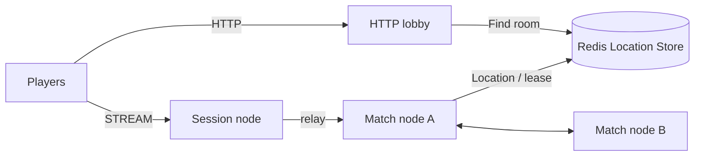

# my-game — HTTP lobby and match servers

This Java template pairs two players through HTTP and runs their duel through ZLink STREAM. The lobby prepares a dynamic Room through the public object client before returning its ID and the Session endpoint. Room owns combat state; Player owns its Framework Actor context.



## Prerequisites

Docker with Compose v2, and PowerShell 7 for Windows. The included Gradle wrapper downloads Gradle. Maven Central supplies Framework 0.30.1 and binding 1.19.0; versions are declared once in `build.gradle.kts`.

## Build

Bash:

```sh
./run-e2e.sh --build-only
```

PowerShell:

```powershell
pwsh -NoProfile -File ./run-e2e.ps1 -BuildOnly
```

## Docker e2e

Docker runs the Java e2e runner and every node role in containers. Nodes share the runner's network namespace and keep the existing stdin/stdout control protocol. Only the runner mounts the Docker socket. Each invocation removes its own containers, network and image tags; logs remain under `.logs/`.

For local process debugging, install JDK 25 and use `./run-e2e.sh --local` or `pwsh -NoProfile -File ./run-e2e.ps1 -Local`. Add `--no-build` or `-NoBuild` to reuse a local build. Docker uses its image layer cache.

> **Base images.** Dockerfile ARG defaults pin Eclipse Temurin JDK/JRE 25.0.1+8 and Docker CLI 28.5.1. Replace these defaults when adopting a deployment base image.


Bash:

```sh
./run-e2e.sh
./run-e2e.sh --scenario lobby,hit,reconnect,update
```

PowerShell:

```powershell
pwsh -NoProfile -File ./run-e2e.ps1
pwsh -NoProfile -File ./run-e2e.ps1 -Scenario lobby,hit,reconnect,update
```

The runner validates `zlink.structure.json`, creates its own Redis Compose project with an OS-assigned loopback port, and starts match, session, and lobby processes. Each scenario uses a fresh cluster, unique Redis prefix and `.logs/run-<id>/` directory. Cleanup errors fail the run. `lobby` checks equal HTTP assignments and both Room participants; `hit` checks damage, wall and range rejection, missing targets and the winner; `reconnect` checks Actor identity and HP; `update` checks relocation, unchanged SessionInfo and Room state, graceful shutdown, replacement readiness and new Room admission on the replacement node.

## Known issues

Framework 0.30.1 is pending publication. Verification against 0.30.0 reproduced Java deferred JoinSpot DATA_LOST ([#1729](https://github.com/zlink-systems/zlink/issues/1729)), blocking the first Room admission. The template does not compensate for Framework failures. Preserve node stderr, including message-flow diagnostics, when reporting a failure.

## Deployment sequence

Start Redis, then both match processes using `server/config/match-a.json` and `match-b.json`. Start Session using `session.json`. Read its `READY` stream endpoint, write that value into the lobby configuration's `sessionEndpoint`, then start the lobby using `lobby.json`. Each installed application accepts its configuration path as its only argument. Configuration IDs match structure node IDs; endpoint port zero requests an OS-assigned port.

The match configuration `roomCapacity` sets the positive per-node Room stable-type limit. Deployment configurations allow multiple Rooms; the e2e runner uses one so the surviving host is full after relocation and the replacement must handle the next Room.

For a match host update, send `drain` to stdin and require `RELOCATION_REQUESTED`, `RELOCATED` and `SAFE_TO_SHUTDOWN`. Send `shutdown`, require `STOPPED` and exit zero, then start the replacement with the same configuration. The lobby remains outside host relocation. HTTP matchmaking holds the first POST response until another player requests the same mode; shutdown fails pending requests. The Netty HTTP adapter removes an unpaired request when its client disconnects, allowing the same player ID to request again. Cancellation does not change paired requests.

The Room domain is in `server/match/.../domain/RoomState.java`. HTTP and ZLink lobby adapters implement the application matching port. No player route, membership, lease or Actor reference is serialized by an application relocation adapter.

## 한국어 실행 안내

기본 e2e는 runner와 node를 Docker에서 실행합니다. 로컬 process 디버깅에는 JDK 25를 준비하고 `--local` 또는 `-Local`을 지정합니다.

Docker Compose를 설치한 뒤 위 Build 명령으로 빌드합니다. Windows에서는 PowerShell 7을 사용합니다. e2e runner는 실행마다 별도 Redis project와 key prefix를 만들고 임시 포트를 사용하며, 로그를 `.logs/run-<id>/`에 보존합니다.

HTTP 로비는 같은 mode의 두 요청을 모아 Room을 준비한 뒤 Session endpoint를 반환합니다. 배포 시 Session의 READY 출력에서 실제 endpoint를 확인하여 로비 설정에 넣습니다. match node 교체는 drain 완료와 SAFE_TO_SHUTDOWN을 확인한 뒤 shutdown 순서로 수행합니다.
