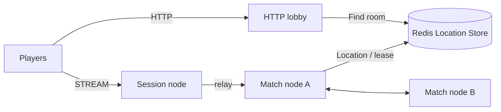

# my-game — HTTP lobby and match servers

This Java template pairs two players through HTTP and runs their duel through ZLink STREAM. The lobby creates a dynamic Room, sends its matched roster for preparation, and returns the assignment after receiving `RoomPrepared`. `RoomState` owns game state and decisions; `RoomRoster` owns member admission; `Player` owns its Framework Actor context.



## Prerequisites

Docker with Compose v2, and PowerShell 7 for Windows. The included Gradle wrapper downloads Gradle. Maven Central supplies Framework 0.32.0 and binding 1.22.0; versions are declared once in `build.gradle.kts`.

## Build

Bash:

```sh
./run-e2e.sh --build-only
```

PowerShell:

```powershell
pwsh -NoProfile -File ./run-e2e.ps1 -BuildOnly
```

## Docker e2e

Docker runs the Java e2e runner and every node role in containers. Nodes share the runner's network namespace and keep the existing stdin/stdout control protocol. Only the runner mounts the Docker socket. Each invocation removes its own containers, network and image tags; logs remain under `.logs/`.

For local process debugging, install JDK 25 and use `./run-e2e.sh --local` or `pwsh -NoProfile -File ./run-e2e.ps1 -Local`. Add `--no-build` or `-NoBuild` to reuse a local build. Docker uses its image layer cache.

> **Base images.** Dockerfile ARG defaults pin Eclipse Temurin JDK/JRE 25.0.2+10 and Docker CLI 28.5.1. Replace these defaults when adopting a deployment base image.

Bash:

```sh
./run-e2e.sh
./run-e2e.sh --scenario lobby,hit,wall,input,reconnect,update
./run-e2e.sh --check-structure
./run-e2e.sh --check-domain
```

PowerShell:

```powershell
pwsh -NoProfile -File ./run-e2e.ps1
pwsh -NoProfile -File ./run-e2e.ps1 -Scenario lobby,hit,wall,input,reconnect,update
pwsh -NoProfile -File ./run-e2e.ps1 -CheckStructure
pwsh -NoProfile -File ./run-e2e.ps1 -CheckDomain
```

The runner validates `zlink.structure.json`, runs game and wire checks during the build and 19 HTTP domain checks before scenarios, creates its own Redis Compose project with an OS-assigned loopback port, and starts match, session, and lobby processes. Each scenario uses a fresh cluster, unique Redis prefix and `.logs/run-<id>/` directory. Cleanup errors fail the run. The build reports game and wire test results; the runner prints HTTP check counts and `Scenarios: n/n passed`.

| Scenario | Observed behavior |
| --- | --- |
| `lobby` | Omitting `mode` selects `duel`; the outsider is rejected before either matched player enters the prepared Room. The players then receive the same assignment. A client `PrepareRoom` packet receives `packet-not-allowed`, and restarting the lobby produces a new Room ID. |
| `hit` | Accepted shots change HP and sequence; out-of-range, missing-target, and any observed `fire-too-soon` rejections preserve the Room view. If the server reports `fire-too-soon`, the client waits only for the response's `RetryAfterMs` before retrying. The scenario checks the final `phase` and `winner`; domain checks cover the cooldown boundary deterministically. |
| `wall` | Shots from either side of the wall are rejected without changing HP or sequence. The same players hit across the clear lane below the wall. |
| `input` | Accepted and rejected movement requests are sent consecutively before waiting for replies, followed by consecutive shot requests. `MoveResult` and `ShotResult` identify accepted actions; `move-budget` and `fire-too-soon` preserve accepted state and sequence. Retrying the same request after the server's `RetryAfterMs` succeeds. Oversized, stale, out-of-map, wall-crossing and over-limit sequences are also rejected without state changes. |
| `reconnect` | Reconnecting after a finished match restores player sequence, `phase`, `winner`, HP, and Actor identity. |
| `update` | Relocation restores `{game, roster}` and its remaining timers; an outsider remains rejected. The replacement process becomes ready and accepts a new Room. |

## Known issues

Validated against the published Framework 0.32.0 packages.

## Deployment sequence

Start Redis, then both match processes using `server/config/match-a.json` and `match-b.json`. Start Session using `session.json`. Read its `READY` stream endpoint, write that value into the lobby configuration's `sessionEndpoint`, then start the lobby using `lobby.json`. Each installed application accepts its configuration path as its only argument. Configuration IDs match structure node IDs; endpoint port zero requests an OS-assigned port.

The match configuration `roomCapacity` sets the positive per-node Room stable-type limit. Deployment configurations allow multiple Rooms; the e2e runner uses one so the surviving host is full after relocation and the replacement must handle the next Room.

For a match host update, send `drain` to stdin and require `RELOCATION_REQUESTED`, `RELOCATED` and `SAFE_TO_SHUTDOWN`. Send `shutdown`, require `STOPPED` and exit zero, then start the replacement with the same configuration. The lobby remains outside host relocation. HTTP matchmaking holds the first POST response until another player requests the same mode; shutdown fails pending requests. The Netty HTTP adapter removes an unpaired request when its client disconnects, allowing the same player ID to request again. Cancellation does not change paired requests.

The Room domain is in `server/match/.../domain/RoomState.java`. HTTP and ZLink lobby adapters implement the application matching port. No player route, membership, lease or Actor reference is serialized by an application relocation adapter.
