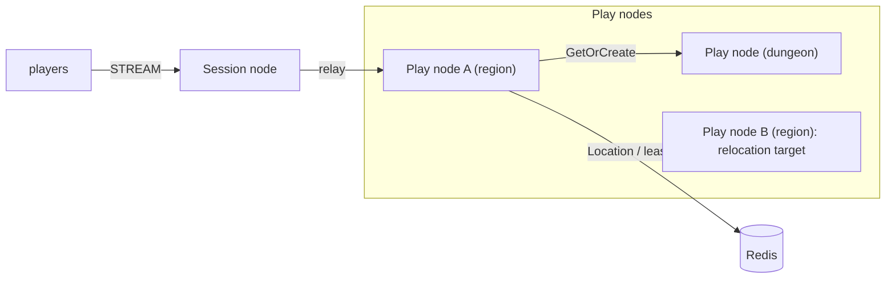

# MyGame MMO 메가서버

[English](README.md)

하나의 서버 클러스터가 정원이 정해진 Region 복제본을 운영합니다. Entry가 입장 가능한 첫 Region을 선택합니다. Region은 참가자와 위치를 소유하고 Instance는 동적 Dungeon을 호스팅합니다.

이 템플릿은 동작하는 참고 프로젝트입니다. 새 게임을 만들 때는 새 프로젝트를 만들고 이 템플릿의 구조와 규칙을 참고해 그 게임에 맞는 노드, Spot, Actor, 메시지를 설계합니다. 템플릿의 이름을 바꾸거나 이 자리에서 수정해 새 게임으로 전환하지 않습니다.



## 준비와 빌드

Docker와 Compose v2로 Linux 컨테이너를 실행합니다. Windows에서는 PowerShell 7이 필요합니다. 로컬 Java 프로세스를 띄우려면 JDK 25를 설치합니다. Gradle Wrapper가 Maven Central에서 의존성을 받습니다. Framework와 binding 버전은 `build.gradle.kts`를 따릅니다.

```sh
./run-e2e.sh --build-only
./gradlew --no-daemon --max-workers=4 installDist
```

```powershell
.\run-e2e.cmd -BuildOnly
```

빌드 검사가 끝나면 실행용 Docker 이미지 태그는 정리되며 재사용 가능한 빌드 레이어는 Docker에 남습니다.

## 로컬 서버

프로젝트 루트에서 실행합니다. Redis는 Docker에서 실행합니다.

```sh
./run-server.sh
```

```powershell
.\run-server.cmd
```

Java 배포본을 빌드한 후 Redis와 노드를 시작합니다. `Server ready:` 뒤에 나온 WebSocket 주소로 클라이언트를 접속시킵니다. 서버는 전경에서 실행되며 Ctrl+C로 노드와 Redis를 종료합니다. 같은 프로젝트에서 이미 서버가 실행 중이면 두 번째 시작을 거부합니다.

별도 터미널에서 `./run-e2e.sh` 또는 `.\run-e2e.cmd`를 실행합니다. 서버가 실행 중이면 `.logs/server.json`으로 주소를 찾고 `Using the running server`를 출력한 뒤 연결합니다. 서버가 멈춰 있으면 격리된 Docker 환경을 시작합니다. 자동 연결 시 play 노드의 drain과 교체가 필요한 `update`를 건너뜁니다.

Region 자동 연결 시나리오는 새로 시작한 로컬 서버에서 실행합니다. 연결을 끊은 Actor가 Region 소속을 유지하며 시나리오는 정확한 참가 인원을 검사합니다.

실행별 `.logs/run-<id>/`에 실제 노드 설정, 노드별 stdout·stderr, Framework message-flow(`*.flow.log`), 시나리오 실패 상세가 남습니다. 로컬 빌드 로그는 `.logs/build.log`, Docker 빌드와 정리 로그는 `.logs/docker-*/`에 남습니다.

## 클라이언트 연결

Session의 `players` STREAM 리스너에 접속합니다. 기본 설정은 `ws://127.0.0.1:0`이며 포트 0은 운영체제가 가용 포트를 고르게 합니다. `READY`의 `streamEndpoint`가 실제 주소입니다. 브라우저, Unity WebGL, Cocos Creator 웹 클라이언트는 WebSocket 루트 경로(`/`)를 사용할 수 있습니다. HTTPS 페이지에서는 접근 가능한 `wss://` 주소를 사용합니다.

루프백 주소는 같은 호스트나 네트워크 네임스페이스에서 사용할 수 있습니다. 배포 시 접근 가능한 인터페이스에 바인딩하고 클라이언트에 포트를 노출합니다. RouteMesh와 Redis에는 서버 내부 주소를 사용합니다.

### 첫 패킷

`EnterRegionRequest(playerId, region)`의 region 값은 `forest` 또는 `desert`입니다. 입장 시 `RegionView(regionId, nodeId, players)`가 푸시되고 거부 시 `RegionUnavailable` 또는 `ActionRejected`가 도착합니다.

입장은 `send(...).submit()`과 미리 등록한 푸시 핸들러로 처리합니다. 입장과 바인딩 뒤에만 `request(new SessionInfoRequest()).submit(SessionInfo.class)`로 Session 식별 정보를 조회할 수 있습니다.

첫 패킷은 `EnterRegionRequest`입니다. Region 상태와 입장 실패 응답을 처리할 핸들러를 먼저 등록합니다. 템플릿에서 클라이언트가 주장하는 식별자를 사용하므로 배포 전에 인증을 적용합니다.

| 클라이언트 | 커넥터 설치 |
| --- | --- |
| Unity | Native/Editor는 NuGetForUnity에서 `Zlink.Stream.Connector`를 복원합니다. WebGL은 `com.zlink.stream-connector.webgl` UPM Git 패키지를 사용합니다. |
| Unreal | `ZLinkStreamConnector` 플러그인과 대응하는 네이티브 라이브러리를 패키징합니다. |
| Godot | .NET은 NuGet `Zlink.Stream.Connector`를 사용합니다. GDExtension은 C++ 어댑터를 호환되는 `godot-cpp`로 빌드합니다. |
| Cocos Creator | 웹에서 `npm install @zlink-systems/stream-connector@<version>`을 실행합니다. |
| Axmol | `zlink_axmol_connector` 어댑터를 가져오고 `zlink::stream_connector`에 연결합니다. |
| C++ | Framework prebuilt의 `zlink_stream_connector_cpp` 패키지를 사용합니다. |
| C#/.NET | `dotnet add package Zlink.Stream.Connector --version <version>` |
| Java | `systems.zlink:zlink-stream-connector:<version>` |
| Kotlin | Java 커넥터와 코루틴 래퍼 `systems.zlink:zlink-framework-kotlin:<version>`을 사용합니다. |
| Node.js 및 브라우저 | `npm install @zlink-systems/stream-connector@<version>` 후 패키지 루트를 사용합니다. Node.js 22 이상을 사용합니다. |

### Java 접속 예제

```java
import MyGame.*;
import systems.zlink.stream.connector.*;
import java.net.URI;
import java.time.Duration;
import java.util.concurrent.*;

public final class ConnectOnce {
    public static void main(String[] args) throws Exception {
        var uri = URI.create(args[0]);
        var d = ZLinkStreamConnectorOptions.createDefault(uri);
        var connector = ZLinkStreamConnectorFactory.create(
                new ZLinkStreamConnectorOptions(uri, ZLinkStreamDispatchMode.IMMEDIATE,
                        d.requestTimeout(), d.maxReconnectAttempts(), d.connectTimeout(),
                        d.maxSendPayloadSize(), d.heartbeatEnabled(), d.heartbeatInterval(),
                        d.heartbeatTimeout(), false, d.reconnectInitialDelay(),
                        d.reconnectMaxDelay(), d.reconnectBackoffFactor()));
        var received = new CompletableFuture<RegionView>();
        try (var push = connector.on(RegionView.class, message -> {
                    received.complete(message.payload());
                    return CompletableFuture.completedFuture(null);
                });
                var error = connector.onErrorReceived(event -> {
                    received.completeExceptionally(new IllegalStateException(event.toString()));
                    return CompletableFuture.completedFuture(null);
                });
                var disconnected = connector.onDisconnected(event -> {
                    received.completeExceptionally(new IllegalStateException(event.toString()));
                    return CompletableFuture.completedFuture(null);
                })) {
            try {
                connector.connect().submit().toCompletableFuture().join();
                connector.send(new EnterRegionRequest("guide-player", "forest")).submit().toCompletableFuture().join();
                System.out.println(received.get(5, TimeUnit.SECONDS));
            } finally {
                connector.close().submit().toCompletableFuture().join();
            }
        }
    }
}
```

## E2E 시나리오

```sh
./run-e2e.sh
./run-e2e.sh --scenario region,movement,dungeon,reconnect,update
./run-e2e.sh --check-structure
```

```powershell
.\run-e2e.cmd
.\run-e2e.cmd -Scenario region,movement,dungeon,reconnect,update
.\run-e2e.cmd -CheckStructure
```

| 시나리오 | 검사 |
| --- | --- |
| `region` | Region 정원, 복제본 격리와 꽉 찬 Region의 입장 거부를 확인합니다. |
| `movement` | 이동 순서, 중복 입력 거부, Region별 상태 격리를 확인합니다. |
| `dungeon` | 파티의 Dungeon 입장과 Run ID·명단·단계 등 공유 상태를 확인합니다. |
| `reconnect` | 재접속 후 새 Session에서 Actor 식별자와 게임 상태를 확인합니다. |
| `update` | 노드 drain과 상태 재배치, 기존 Session 유지, 교체 노드의 새 요청 처리를 확인합니다. |

실행기는 선택한 시나리오별로 제목과 통과·실패를 출력하고 마지막 줄에 `Scenarios: k/n passed`를 표시합니다. 실패 시 상세 로그 경로를 함께 출력합니다. 구조만 검사할 때는 `--check-structure`를 사용합니다. 호스트 프로세스 디버깅은 서버를 종료한 후 `--local` 또는 `-Local`로 실행합니다. `--no-build` 또는 `-NoBuild`로 기존 배포본을 재사용할 수 있습니다. 격리 실행은 고유한 Redis 키와 가용 포트를 사용하며 실행기 소유 리소스를 종료 시 정리합니다.

도메인 검사만 실행하려면 `./run-e2e.sh --check-domain` 또는 `.\run-e2e.cmd --check-domain`을 사용합니다.

## Region과 Dungeon

Region이 참가자 명단과 위치를 저장합니다. 정원 초과 시 Entry가 같은 Region의 다른 복제본을 시도합니다. 입장할 곳이 없으면 Region 상태를 바꾸지 않고 실패를 반환합니다. Instance가 Dungeon User Spot을 생성하며 Region 입장과 Dungeon 이동은 같은 Session에서 이어집니다.

## Framework 동작

- 일반 비동기 작업을 기다리는 동안 해당 handler turn은 유지됩니다. 같은 Spot의 다른 핸들러가 진행되어야 하는 I/O에는 Framework의 `Yield`를 사용합니다. [실행 모델](https://docs.zlink.systems/java/guide/server/32-execution-model/#io-worker-wait)
- Actor 생성의 `DeadlineExceeded`와 호출자 취소는 서로 다른 결과입니다. 서로 다른 ID가 한꺼번에 생성되면 ID마다 Location Store 왕복이 필요합니다. [Actor 생성](https://docs.zlink.systems/java/guide/server/22-actor/#creation-deadline)
- 전송 용량이 찼을 때 send는 용량을 기다리고 최종 결과를 반환합니다. [Backpressure](https://docs.zlink.systems/java/guide/server/33-backpressure/#send-backpressure)
- 중복 로그인에서 기본 바인딩 동작을 바꾸려면 Actor의 중복 바인딩 콜백을 사용합니다. `ObjectGeneration`은 동일 ID의 활성화 세대를 구분합니다. [Session 바인딩](https://docs.zlink.systems/java/guide/server/39-session-binding/#duplicate-session-bind)
- 호스트는 Framework가 `Serving` 상태에 도달하면 `READY`와 실제 리스너 주소를 출력합니다. [운영 가이드](https://docs.zlink.systems/java/guide/server/12-operations/#wait-for-serving)

## 릴리스와 진단

Framework 0.34.0과 binding 1.26.0을 사용합니다. 실패하면 첫 노드 stderr와 message-flow 기록을 보존합니다.

## 배포 순서

Redis, Region 노드, Instance, Session 순서로 시작합니다. Region별 배치와 정원은 노드 설정이 소유합니다. 각 노드에 실제 접속 가능한 Redis 주소와 배포용 키 접두어를 지정합니다. 각 역할의 `server/<role>/build/install/<role>/bin/` 실행기에 설정 파일을 전달합니다. Windows 실행기 확장자는 `.bat`입니다.

계획된 교체 시 노드 표준 입력에 `drain`을 보내고 `RELOCATION_REQUESTED`, `RELOCATED`, `SAFE_TO_SHUTDOWN`을 확인합니다. `shutdown` 뒤 `STOPPED`와 정상 종료를 확인한 다음 교체 노드를 시작합니다.

등록과 구조 검사 변경 지침은 [개발 가이드](AGENTS.md)를 참고합니다.
