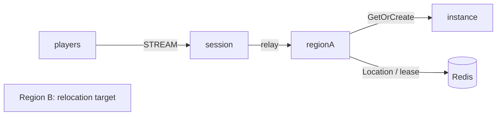

# my-game — Java MMO megaserver

This template runs a single server cluster with capacity-limited Region instances. Entry chooses the first Region instance that accepts a player. Each Region owns membership and positions; Player Actors own no application state.



## Prerequisites

Docker with Compose v2, and PowerShell 7 on Windows. Gradle is included. Maven Central supplies Framework 0.34.0 and binding 1.26.0, pinned centrally in `build.gradle.kts`.

## Build

From this directory on Linux:

```sh
./run-e2e.sh --build-only
```

On Windows:

```powershell
pwsh -NoProfile -File ./run-e2e.ps1 -BuildOnly
```

## Client connection

### Endpoint and first packet

Connect to the Session node's `players` STREAM listener. `server/config/session.json` configures `tcp://127.0.0.1:0`: loopback with port `0` requesting an OS-selected port. `server/shared/src/main/java/MyGame/Hosting.java` prints `READY {"id":"...","meshEndpoint":"...","streamEndpoint":"..."}`; use its actual `streamEndpoint`, not port `0`. Mesh and Redis endpoints are not client endpoints.

This is TCP with no URL path. Web browsers, Unity WebGL and Cocos Creator web cannot connect to this default TCP listener. Those targets need a separately configured WebSocket listener and a reachable `ws://` or `wss://` endpoint. Loopback is reachable only from the same host/network namespace. The Docker e2e runner owns and removes its temporary deployment. For an external client, keep a deployment running, bind a reachable interface and port, expose the container port, and use the server's reachable host.

Send `EnterRegionRequest(playerId, region)` first, using `forest` or `desert`. Successful admission pushes `RegionView(regionId, nodeId, players)`; `RegionUnavailable` or `ActionRejected` reports refusal.

These first application operations use `send(...).submit()` and push handlers, not correlated request/reply. After joining and binding, `request(new SessionInfoRequest()).submit(SessionInfo.class)` returns Session identity. Do not request it before entry. Player IDs are not authentication credentials; this template has no production authentication, so validate identity before binding.

### Connector installation

Use the same connector release as `build.gradle.kts` extra `frameworkVersion`; `e2e/build.gradle.kts` uses that value for `systems.zlink:zlink-stream-connector`. In the commands below, `<version>` means that pinned release. The linked guides may describe newer releases. All clients must use this template's packets and the transport described above; engine sample packet names do not apply.

| Client                             | Connector installation                                                                                                                                                                                                                                                                                                                                                                                                                                                          | Documentation guide                                                                                                                                                          |
| ---------------------------------- | ------------------------------------------------------------------------------------------------------------------------------------------------------------------------------------------------------------------------------------------------------------------------------------------------------------------------------------------------------------------------------------------------------------------------------------------------------------------------------- | ---------------------------------------------------------------------------------------------------------------------------------------------------------------------------- |
| Unity                              | Native/Editor: restore `Zlink.Stream.Connector` with NuGetForUnity. WebGL: add the `com.zlink.stream-connector.webgl` UPM Git package; include only the connector assembly for the active target. See the [Unity README](https://github.com/zlink-systems/zlink/blob/main/framework/languages/engines/Unity/README.md) and its package manifest.                                                                                                                                | [.NET engine integration](https://docs.zlink.systems/dotnet/guide/stream-connector/12-engine-integration/)                                                                   |
| Unreal                             | Copy `framework/languages/cpp/connector/engines/unreal` into `Plugins/ZLinkStreamConnector`, then package the native connector under `ThirdParty/ZLink` as described in the [Unreal README](https://github.com/zlink-systems/zlink/blob/main/framework/languages/engines/Unreal/README.md).                                                                                                                                                                                     | [C++ engine integration](https://docs.zlink.systems/cpp/guide/stream-connector/12-engine-integration/)                                                                       |
| Godot                              | .NET: add the NuGet package `Zlink.Stream.Connector` and run `dotnet restore`; see the [C# README](https://github.com/zlink-systems/zlink/blob/main/framework/languages/engines/Godot/csharp/README.md). GDExtension: build the C++ Godot adapter against the framework prebuilt and matching `godot-cpp`; see the [C++ README](https://github.com/zlink-systems/zlink/blob/main/framework/languages/engines/Godot/cpp/README.md). The .NET sample does not support Web export. | [.NET](https://docs.zlink.systems/dotnet/guide/stream-connector/12-engine-integration/), [C++](https://docs.zlink.systems/cpp/guide/stream-connector/12-engine-integration/) |
| Cocos Creator                      | Web target: `npm install @zlink-systems/stream-connector@<version>`; see the [Cocos Creator README](https://github.com/zlink-systems/zlink/blob/main/framework/languages/engines/CocosCreator/README.md). This package does not provide a Creator native adapter.                                                                                                                                                                                                                  | [TypeScript engine integration](https://docs.zlink.systems/node/guide/stream-connector/12-engine-integration/)                                                               |
| Axmol                              | Copy `framework/languages/cpp/connector/engines/axmol` into `third_party/zlink_axmol_connector` and link `zlink::stream_connector` from the installed C++ framework package; see the [Axmol README](https://github.com/zlink-systems/zlink/blob/main/framework/languages/engines/Axmol/README.md).                                                                                                                                                                              | [C++ engine integration](https://docs.zlink.systems/cpp/guide/stream-connector/12-engine-integration/)                                                                       |
| Web browser (TypeScript connector) | `npm install @zlink-systems/stream-connector@<version>`; import the package root in the browser build. Use `ws://` or `wss://`, subject to the page's security policy.                                                                                                                                                                                                                                                                                                             | [TypeScript connector](https://docs.zlink.systems/node/guide/stream-connector/)                                                                                              |
| C++                                | Install the C++ framework prebuilt containing the connector; use `find_package(zlink_stream_connector_cpp CONFIG REQUIRED)` and link `zlink::stream_connector`.                                                                                                                                                                                                                                                                                                                 | [C++ connector](https://docs.zlink.systems/cpp/guide/stream-connector/)                                                                                                      |
| C#/.NET                            | `dotnet add package Zlink.Stream.Connector --version <version>`                                                                                                                                                                                                                                                                                                                                                                                                                    | [.NET connector](https://docs.zlink.systems/dotnet/guide/stream-connector/)                                                                                                  |
| Java                               | Add Maven/Gradle dependency `systems.zlink:zlink-stream-connector:<version>`.                                                                                                                                                                                                                                                                                                                                                                                                      | [Java connector](https://docs.zlink.systems/java/guide/stream-connector/)                                                                                                    |
| Kotlin                             | Add `systems.zlink:zlink-stream-connector:<version>` and `systems.zlink:zlink-framework-kotlin:<version>` for the coroutine wrapper.                                                                                                                                                                                                                                                                                                                                                  | [Kotlin connector](https://docs.zlink.systems/kotlin/guide/stream-connector/)                                                                                                |
| Node                               | `npm install @zlink-systems/stream-connector@<version>`; use the package root and Node.js 22 or later.                                                                                                                                                                                                                                                                                                                                                     | [Node connector](https://docs.zlink.systems/node/guide/stream-connector/)                                                                                                    |

### Java connection example

Save this as `e2e/src/main/java/MyGame/e2e/ConnectOnce.java` with `package MyGame.e2e;` before the imports in a copy of this template, then run `./gradlew :e2e:installDist`. Run `java --enable-native-access=ALL-UNNAMED -cp "e2e/build/install/e2e/lib/*" MyGame.e2e.ConnectOnce <actual-session-endpoint>` from that copy while its deployment remains running. Pass the actual Session endpoint as argument 1. Register push handlers before sending. See `e2e/src/main/java/MyGame/e2e/` for the complete flow.

```java
import MyGame.*;
import systems.zlink.stream.connector.*;
import java.net.URI;
import java.time.Duration;
import java.util.concurrent.*;

public final class ConnectOnce {
    public static void main(String[] args) throws Exception {
        var uri = URI.create(args[0]);
        var d = ZLinkStreamConnectorOptions.createDefault(uri);
        var connector = ZLinkStreamConnectorFactory.create(
                new ZLinkStreamConnectorOptions(uri, ZLinkStreamDispatchMode.IMMEDIATE,
                        d.requestTimeout(), d.maxReconnectAttempts(), d.connectTimeout(),
                        d.maxSendPayloadSize(), d.heartbeatEnabled(), d.heartbeatInterval(),
                        d.heartbeatTimeout(), false, d.reconnectInitialDelay(),
                        d.reconnectMaxDelay(), d.reconnectBackoffFactor()));
        var received = new CompletableFuture<RegionView>();
        try (var push = connector.on(RegionView.class, message -> {
                    received.complete(message.payload());
                    return CompletableFuture.completedFuture(null);
                });
                var error = connector.onErrorReceived(event -> {
                    received.completeExceptionally(new IllegalStateException(event.toString()));
                    return CompletableFuture.completedFuture(null);
                });
                var disconnected = connector.onDisconnected(event -> {
                    received.completeExceptionally(new IllegalStateException(event.toString()));
                    return CompletableFuture.completedFuture(null);
                })) {
            try {
                connector.connect().submit().toCompletableFuture().join();
                connector.send(new EnterRegionRequest("guide-player", "forest")).submit().toCompletableFuture().join();
                System.out.println(received.get(5, TimeUnit.SECONDS));
            } finally {
                connector.close().submit().toCompletableFuture().join();
            }
        }
    }
}
```

## Docker e2e

Docker runs the Java e2e runner and every node role in containers. Nodes share the runner's network namespace and keep the existing stdin/stdout control protocol. Only the runner mounts the Docker socket. Each invocation removes its own containers, network and image tags; logs remain under `.logs/`.

For local process debugging, install JDK 25 and use `./run-e2e.sh --local` or `pwsh -NoProfile -File ./run-e2e.ps1 -Local`. Add `--no-build` or `-NoBuild` to reuse a local build. Docker uses its image layer cache.

> **Base images.** Dockerfile ARG defaults pin Eclipse Temurin JDK/JRE 25.0.2+10 and Docker CLI 28.5.1. Replace these defaults when adopting a deployment base image.

```sh
./run-e2e.sh
./run-e2e.sh --scenario region,movement,dungeon,reconnect,update
./run-e2e.sh --check-structure
```

```powershell
pwsh -NoProfile -File ./run-e2e.ps1
pwsh -NoProfile -File ./run-e2e.ps1 -Scenario region,movement,dungeon,reconnect,update
pwsh -NoProfile -File ./run-e2e.ps1 -CheckStructure
```

The runner checks `zlink.structure.json`, creates its own Redis Compose project and key prefix, starts each role, executes the selected scenarios, and removes only its processes and project. Logs and generated configuration are retained in `.logs/run-<id>/`.

| Scenario | Assertions |
| --- | --- |
| region | Two replicas fill; the next player receives capacity-exhausted, unknown regions and internal packets are rejected, and Sessions stay connected |
| movement | Server accepts Delta and Sequence, rejects budget exhaustion without state change, and accepts after RetryAfterMs; broadcasts remain isolated |
| dungeon | A Dungeon User Spot opens on the instance node |
| reconnect | A new physical Session binds the same Actor generation and retains Region and position |
| update | Drain preserves both clients and Region state; shutdown reaches Stopped; the replacement accepts a new Region |

`Capacity` defaults to 2 in the supplied configuration (`capacity` in Java JSON). Scenarios share p1, p2, and p3 in forest-1 and forest-2. The supplied `regionLimit` is 2 per node; after draining a Region node the survivor hosts both instances, so a new desert Region is placed on the replacement. Movement uses server-authoritative deltas (MaxStep 10, bounds 0..100, speed 50/s) and increasing 64-bit sequences bounded to 2^53-1. Allowed regions are forest and desert; each region has at most two replicas. Domain checks run before nodes and separately with `--check-domain` or `-CheckDomain`. A disconnected Session retains Region membership until explicit leave.

## Framework behavior to know

- **Waiting for DB or file I/O in a handler** — An ordinary async terminal retains the turn, while `Yield` lets other handlers on the same Spot proceed. [Guide](https://docs.zlink.systems/java/guide/server/32-execution-model/#io-worker-wait).
- **Creation that misses its deadline** — `DeadlineExceeded` and caller cancellation have distinct outcomes. [Guide](https://docs.zlink.systems/java/guide/server/22-actor/#creation-deadline). [server/session/src/main/java/MyGame/session/infrastructure/zlink/GameSession.java:56](server/session/src/main/java/MyGame/session/infrastructure/zlink/GameSession.java).
- **Many logins at once** — Each creation for a different ID requires a Location Store round trip, so measure expected load when setting the deadline. [Guide](https://docs.zlink.systems/java/guide/server/25-location/#creation-load).
- **Sending under load** — Send waits for capacity, and the application sees the final result. [Guide](https://docs.zlink.systems/java/guide/server/33-backpressure/#send-backpressure). [server/session/src/main/java/MyGame/session/infrastructure/zlink/GameSession.java:41](server/session/src/main/java/MyGame/session/infrastructure/zlink/GameSession.java).
- **Duplicate login** — Without a callback, a bind from another Session is accepted; reject it in the Actor duplicate-bind callback to prevent this. [Guide](https://docs.zlink.systems/java/guide/server/39-session-binding/#duplicate-session-bind). This template keeps the default (accepts the new Session).
- **ObjectGeneration** — `ObjectGeneration` distinguishes logical incarnations of the same ID; it is not a data version or write authority. [Guide](https://docs.zlink.systems/java/guide/server/34-activation-lifetime/#object-generation). [server/session/src/main/java/MyGame/session/infrastructure/zlink/GameSession.java:49](server/session/src/main/java/MyGame/session/infrastructure/zlink/GameSession.java).
- **READY and Serving** — The Framework host prints `READY` after observing runtime `Serving`. [Guide](https://docs.zlink.systems/java/guide/server/12-operations/#wait-for-serving). [server/shared/src/main/java/MyGame/Hosting.java:93](server/shared/src/main/java/MyGame/Hosting.java); [server/shared/src/main/java/MyGame/Hosting.java:115](server/shared/src/main/java/MyGame/Hosting.java).

## Known issues

Validated against the published Framework 0.34.0 packages.

## Deployment sequence

Start Redis, both Region processes, the instance process, and the Session process. Their entry points are `MyGame.region.Program`, `MyGame.instance.Program`, and `MyGame.session.Program`; supply the corresponding `server/config/<id>.json` path. Configure Redis, unique node IDs, a common key prefix, and listener endpoints before deployment. The supplied loopback port-zero settings are for local e2e; READY reports the Framework-published bound endpoints.

Send `drain` to a Region process. Wait for `RELOCATION_REQUESTED`, `RELOCATED`, and `SAFE_TO_SHUTDOWN`. Send `shutdown`, wait for `STOPPED` and process exit, then start the replacement with the same configuration. Region relocation stores only player IDs and position/sequence values; Framework preserves routes, membership, leases, and Session binding.

The e2e fixture limits each Region node to two Region Spots and keeps forest-1 and forest-2 occupied before drain. After relocation the survivor is full. Once the replacement reports `READY`, a new desert Region must be served by that replacement. Existing Region state and Session identity checks remain required. Only Region nodes register the application Entry and its first admission handler, so only those nodes declare an Entry in `zlink.structure.json`.

Message Follow is explicitly set to 30 seconds. The `SAFE_TO_SHUTDOWN` observation budget is the follow duration plus the existing relocation budget; the relocation operation deadline is unchanged.
