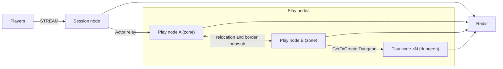

# my-game

[한국어](README.ko.md)

A Java seamless MMORPG template using public ZLink Framework 0.34.0 packages. Session processes bind players to Actors; Zone processes host a six-zone world; Instance processes create Dungeon User Spots on demand. Player Actors retain movement state across cross-node joins and planned host relocation.



## Prerequisites

Docker with Compose v2, and PowerShell 7 on Windows. Local debugging additionally requires JDK 25; Gradle is provided by the wrapper. Published Maven Central packages are used; no repository checkout is required. The binding version is pinned with the Framework version in `build.gradle.kts`.

## Build

```sh
./run-e2e.sh --build-only
```

```powershell
.\run-e2e.cmd -BuildOnly
```

## Local server

Install JDK 25 and keep Docker with Compose v2 running for Redis. Run the command from this project directory.

```sh
./run-server.sh
```

On Windows, install PowerShell 7 and run the CMD wrapper.

```powershell
.\run-server.cmd
```

The server builds the Java distributions, starts the nodes and Redis, and prints the WebSocket endpoint after `Server ready:`. Keep the terminal open. Press Ctrl+C to stop the nodes and Redis. A second server invocation is refused.

Run `./run-e2e.sh` or `.\run-e2e.cmd` in another terminal to use the running server. The runner detects `.logs/server.json` and prints `Using the running server`. With the server stopped, the default runner starts an isolated Docker stack. Attached runs skip `update` because it drains and replaces a play node.

Each run keeps effective node settings, node stdout and stderr, Framework message-flow logs (`*.flow.log`), and any failure details in `.logs/run-<id>/`. Local build output is in `.logs/build.log` and isolated Docker build and cleanup output is in `.logs/docker-*/`.

## Client connection

### Endpoint and first packet

Connect to the Session node's `players` STREAM listener. `server/config/session.json` configures `ws://127.0.0.1:0`: loopback with port `0` requesting an OS-selected port. `server/shared/src/main/java/MyGame/Hosting.java` prints `READY {"id":"...","meshEndpoint":"...","streamEndpoint":"..."}`; use its actual `streamEndpoint`, not port `0`. Mesh and Redis endpoints are not client endpoints.

The default WebSocket endpoint uses the root path (`/`) and supports browsers, Unity WebGL and Cocos Creator web. An HTTPS page needs a reachable `wss://` endpoint. Loopback is reachable only from the same host/network namespace. The Docker e2e runner owns and removes its temporary deployment. For an external client, keep a deployment running, bind a reachable interface and port, expose the container port, and use the server's reachable host.

Send `JoinWorldRequest(playerId, x)` first. Successful entry pushes `WorldState(zoneId, nodeId, x, sequence)`. Movement and zone transitions continue on this Session; `ActionRejected` reports a rejected action.

These first application operations use `send(...).submit()` and push handlers, not correlated request/reply. After joining and binding, `request(new SessionInfoRequest()).submit(SessionInfo.class)` returns Session identity. Do not request it before entry. Player IDs are not authentication credentials; this template has no production authentication, so validate identity before binding.

### Connector installation

Use the same connector release as `build.gradle.kts` extra `frameworkVersion`; `e2e/build.gradle.kts` uses that value for `systems.zlink:zlink-stream-connector`. In the commands below, `<version>` means that pinned release. The linked guides may describe newer releases. All clients must use this template's packets and the transport described above; engine sample packet names do not apply.

| Client                             | Connector installation                                                                                                                                                                                                                                                                                                                                                                                                                                                          | Documentation guide                                                                                                                                                          |
| ---------------------------------- | ------------------------------------------------------------------------------------------------------------------------------------------------------------------------------------------------------------------------------------------------------------------------------------------------------------------------------------------------------------------------------------------------------------------------------------------------------------------------------- | ---------------------------------------------------------------------------------------------------------------------------------------------------------------------------- |
| Unity                              | Native/Editor: restore `Zlink.Stream.Connector` with NuGetForUnity. WebGL: add the `com.zlink.stream-connector.webgl` UPM Git package; include only the connector assembly for the active target. See the [Unity README](https://github.com/zlink-systems/zlink/blob/main/framework/languages/engines/Unity/README.md) and its package manifest.                                                                                                                                | [.NET engine integration](https://docs.zlink.systems/dotnet/guide/stream-connector/12-engine-integration/)                                                                   |
| Unreal                             | Copy `framework/languages/cpp/connector/engines/unreal` into `Plugins/ZLinkStreamConnector`, then package the native connector under `ThirdParty/ZLink` as described in the [Unreal README](https://github.com/zlink-systems/zlink/blob/main/framework/languages/engines/Unreal/README.md).                                                                                                                                                                                     | [C++ engine integration](https://docs.zlink.systems/cpp/guide/stream-connector/12-engine-integration/)                                                                       |
| Godot                              | .NET: add the NuGet package `Zlink.Stream.Connector` and run `dotnet restore`; see the [C# README](https://github.com/zlink-systems/zlink/blob/main/framework/languages/engines/Godot/csharp/README.md). GDExtension: build the C++ Godot adapter against the framework prebuilt and matching `godot-cpp`; see the [C++ README](https://github.com/zlink-systems/zlink/blob/main/framework/languages/engines/Godot/cpp/README.md). The .NET sample does not support Web export. | [.NET](https://docs.zlink.systems/dotnet/guide/stream-connector/12-engine-integration/), [C++](https://docs.zlink.systems/cpp/guide/stream-connector/12-engine-integration/) |
| Cocos Creator                      | Web target: `npm install @zlink-systems/stream-connector@<version>`; see the [Cocos Creator README](https://github.com/zlink-systems/zlink/blob/main/framework/languages/engines/CocosCreator/README.md). This package does not provide a Creator native adapter.                                                                                                                                                                                                                  | [TypeScript engine integration](https://docs.zlink.systems/node/guide/stream-connector/12-engine-integration/)                                                               |
| Axmol                              | Copy `framework/languages/cpp/connector/engines/axmol` into `third_party/zlink_axmol_connector` and link `zlink::stream_connector` from the installed C++ framework package; see the [Axmol README](https://github.com/zlink-systems/zlink/blob/main/framework/languages/engines/Axmol/README.md).                                                                                                                                                                              | [C++ engine integration](https://docs.zlink.systems/cpp/guide/stream-connector/12-engine-integration/)                                                                       |
| Web browser (TypeScript connector) | `npm install @zlink-systems/stream-connector@<version>`; import the package root in the browser build. Use `ws://` or `wss://`, subject to the page's security policy.                                                                                                                                                                                                                                                                                                             | [TypeScript connector](https://docs.zlink.systems/node/guide/stream-connector/)                                                                                              |
| C++                                | Install the C++ framework prebuilt containing the connector; use `find_package(zlink_stream_connector_cpp CONFIG REQUIRED)` and link `zlink::stream_connector`.                                                                                                                                                                                                                                                                                                                 | [C++ connector](https://docs.zlink.systems/cpp/guide/stream-connector/)                                                                                                      |
| C#/.NET                            | `dotnet add package Zlink.Stream.Connector --version <version>`                                                                                                                                                                                                                                                                                                                                                                                                                    | [.NET connector](https://docs.zlink.systems/dotnet/guide/stream-connector/)                                                                                                  |
| Java                               | Add Maven/Gradle dependency `systems.zlink:zlink-stream-connector:<version>`.                                                                                                                                                                                                                                                                                                                                                                                                      | [Java connector](https://docs.zlink.systems/java/guide/stream-connector/)                                                                                                    |
| Kotlin                             | Add `systems.zlink:zlink-stream-connector:<version>` and `systems.zlink:zlink-framework-kotlin:<version>` for the coroutine wrapper.                                                                                                                                                                                                                                                                                                                                                  | [Kotlin connector](https://docs.zlink.systems/kotlin/guide/stream-connector/)                                                                                                |
| Node                               | `npm install @zlink-systems/stream-connector@<version>`; use the package root and Node.js 22 or later.                                                                                                                                                                                                                                                                                                                                                     | [Node connector](https://docs.zlink.systems/node/guide/stream-connector/)                                                                                                    |

### Java connection example

Save this as `e2e/src/main/java/MyGame/e2e/ConnectOnce.java` with `package MyGame.e2e;` before the imports in a copy of this template, then run `./gradlew :e2e:installDist`. Run `java --enable-native-access=ALL-UNNAMED -cp "e2e/build/install/e2e/lib/*" MyGame.e2e.ConnectOnce <actual-session-endpoint>` from that copy while its deployment remains running. Pass the actual Session endpoint as argument 1. Register push handlers before sending. See `e2e/src/main/java/MyGame/e2e/` for the complete flow.

```java
import MyGame.*;
import systems.zlink.stream.connector.*;
import java.net.URI;
import java.time.Duration;
import java.util.concurrent.*;

public final class ConnectOnce {
    public static void main(String[] args) throws Exception {
        var uri = URI.create(args[0]);
        var d = ZLinkStreamConnectorOptions.createDefault(uri);
        var connector = ZLinkStreamConnectorFactory.create(
                new ZLinkStreamConnectorOptions(uri, ZLinkStreamDispatchMode.IMMEDIATE,
                        d.requestTimeout(), d.maxReconnectAttempts(), d.connectTimeout(),
                        d.maxSendPayloadSize(), d.heartbeatEnabled(), d.heartbeatInterval(),
                        d.heartbeatTimeout(), false, d.reconnectInitialDelay(),
                        d.reconnectMaxDelay(), d.reconnectBackoffFactor()));
        var received = new CompletableFuture<WorldState>();
        try (var push = connector.on(WorldState.class, message -> {
                    received.complete(message.payload());
                    return CompletableFuture.completedFuture(null);
                });
                var error = connector.onErrorReceived(event -> {
                    received.completeExceptionally(new IllegalStateException(event.toString()));
                    return CompletableFuture.completedFuture(null);
                });
                var disconnected = connector.onDisconnected(event -> {
                    received.completeExceptionally(new IllegalStateException(event.toString()));
                    return CompletableFuture.completedFuture(null);
                })) {
            try {
                connector.connect().submit().toCompletableFuture().join();
                connector.send(new JoinWorldRequest("guide-player", 0)).submit().toCompletableFuture().join();
                System.out.println(received.get(5, TimeUnit.SECONDS));
            } finally {
                connector.close().submit().toCompletableFuture().join();
            }
        }
    }
}
```

## End-to-end scenarios

The following scenarios run in an isolated Docker stack when a local server is unavailable.

```sh
./run-e2e.sh
./run-e2e.sh --scenario cross,border,reconnect
```

```powershell
.\run-e2e.cmd
.\run-e2e.cmd -Scenario cross,border,reconnect
```

Docker builds a shared node image and a runner image. The containerized runner validates the structure, starts each role and runs the selected scenarios. Nodes share its network namespace and retain stdin/stdout lifecycle control. The Docker socket is mounted only in the runner. Redis and Framework listeners bind ephemeral loopback ports. Each run has a unique Redis prefix and `.logs/run-<id>/` directory. Normal message-flow diagnostics go to node stderr. Cleanup failures cause a nonzero exit code.

| Scenario | Assertion |
| --- | --- |
| cross | Server-validated delta movement crosses the Zone boundary after rejecting an oversized step, an exhausted movement budget and a world-boundary move without changing state; Dungeon creation continues. |
| border | Same-Zone observers receive appearance and movement pushes; adjacent observers receive `out-of-range` when a player moves into the Zone interior beyond the border band, `left-zone` when a player crosses a Zone boundary, and `disconnected` when a player disconnects. |
| reconnect | A new physical Session rebinds the same Actor and preserves position, sequence and logical Zone. |
| update | Movement continues during Zone A drain; relocation signals complete; Session and Actor identity persist after replacement; fresh work remains available. |

For local process debugging, use `./run-e2e.sh --local` or `.\run-e2e.cmd -Local`. Add `--no-build` or `-NoBuild` to reuse a local build. Docker runs reuse image layers automatically. Each run removes its own containers, network and image tags; shared build cache remains available.

The Dockerfile owns pinned Eclipse Temurin JDK/JRE 25.0.2+10 bases and Docker CLI 28.5.1. Replace its image ARG defaults when adopting a deployment base image. Logs remain under `.logs/` on the host.

Structure-only validation: `./run-e2e.sh --check-structure` or `.\run-e2e.cmd -CheckStructure`. Domain boundary checks: `./run-e2e.sh --check-domain` or `.\run-e2e.cmd -CheckDomain`.

## Framework behavior to know

- **Waiting for DB or file I/O in a handler** — An ordinary async terminal retains the turn, while `Yield` lets other handlers on the same Spot proceed. [Guide](https://docs.zlink.systems/java/guide/server/32-execution-model/#io-worker-wait).
- **Creation that misses its deadline** — `DeadlineExceeded` and caller cancellation have distinct outcomes. [Guide](https://docs.zlink.systems/java/guide/server/22-actor/#creation-deadline). [server/session/src/main/java/MyGame/session/GameSession.java:63](server/session/src/main/java/MyGame/session/GameSession.java).
- **Many logins at once** — Each creation for a different ID requires a Location Store round trip, so measure expected load when setting the deadline. [Guide](https://docs.zlink.systems/java/guide/server/25-location/#creation-load).
- **Sending under load** — Send waits for capacity, and the application sees the final result. [Guide](https://docs.zlink.systems/java/guide/server/33-backpressure/#send-backpressure). [server/session/src/main/java/MyGame/session/GameSession.java:45](server/session/src/main/java/MyGame/session/GameSession.java).
- **Duplicate login** — Without a callback, a bind from another Session is accepted; reject it in the Actor duplicate-bind callback to prevent this. [Guide](https://docs.zlink.systems/java/guide/server/39-session-binding/#duplicate-session-bind). This template keeps the default (accepts the new Session).
- **ObjectGeneration** — `ObjectGeneration` distinguishes logical incarnations of the same ID; it is not a data version or write authority. [Guide](https://docs.zlink.systems/java/guide/server/34-activation-lifetime/#object-generation). [server/session/src/main/java/MyGame/session/GameSession.java:48](server/session/src/main/java/MyGame/session/GameSession.java).
- **READY and Serving** — The Framework host prints `READY` after observing runtime `Serving`. [Guide](https://docs.zlink.systems/java/guide/server/12-operations/#wait-for-serving). [server/shared/src/main/java/MyGame/Hosting.java:94](server/shared/src/main/java/MyGame/Hosting.java); [server/shared/src/main/java/MyGame/Hosting.java:128](server/shared/src/main/java/MyGame/Hosting.java).

## Known issues

Drain confirmation takes about 30 seconds, so a turn clock may expire during the wait. For an update scenario in a game with turn clocks, finish the round before relocating it. Verify that relocation preserves the remaining time in a domain check with a controlled clock.

Validated against the published Framework 0.34.0 packages.

Preserve the first node stderr and message-flow records when a scenario fails; do not alter join timing or assertions.

Message Follow is explicitly configured to 30 seconds in shared hosting. The wait for `SAFE_TO_SHUTDOWN` is derived from that period plus the existing host relocation budget. Packet deadlines and the relocation operation budget remain unchanged.

## Deployment sequence

Configure Redis and a unique prefix in `server/config`. Start Zone A and bootstrap zone-1..3 before Zone B bootstraps zone-4..6; start Instance, then the session node. Every role has its own `MyGame.<role>.Program` entrypoint, executed from its installed distribution with its configuration path. READY reports the actual Framework listener endpoints.

Send `drain` to Zone A stdin. Keep gameplay active while observing `RELOCATION_REQUESTED`, `RELOCATED`, and `SAFE_TO_SHUTDOWN`. Send `shutdown` and verify `STOPPED` and successful process exit. Start the replacement with the same identity, capacity and configuration. Like every play node (zone), it runs `getOrCreate` for all configured Zones at startup: Zones already moved to the relocation target end as existing and remain there, and only the closed first Zone is created on the replacement. The runner performs this sequence and exercises new player creation after replacement.

Fixed Zones are bootstrapped serially: Zone A fills its three-Spot capacity before Zone B starts. This makes the declared initial owners deterministic through public stable-type capacity. During e2e, Zone B has capacity for all but one world Zone. Before update drains Zone A, `vacate-zone` closes the unused first Zone through the public Spot manager. The remaining Zones fill Zone B; the replacement Zone A recreates the first Zone through its startup `getOrCreate`; a fresh player then joins it, and the test verifies its host and continued movement. Existing relocated players remain on Zone B.
