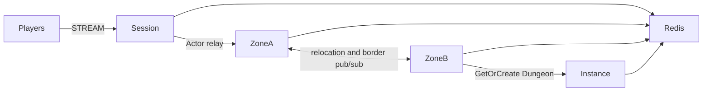

# my-game

A Java seamless MMORPG template using public ZLink Framework 0.30.2 packages. Session processes bind players to Actors; Zone processes host a six-zone world; Instance processes create Dungeon User Spots on demand. Player Actors retain movement state across cross-node joins and planned host relocation.



## Prerequisites

Docker with Compose v2, and PowerShell 7 on Windows. Local debugging additionally requires JDK 25; Gradle is provided by the wrapper. Published Maven Central packages are used; no repository checkout is required. The binding version is pinned with the Framework version in `build.gradle.kts`.

## Build

```sh
./run-e2e.sh --build-only
```

```powershell
pwsh -NoProfile -File ./run-e2e.ps1 -BuildOnly
```

## Docker e2e

```sh
./run-e2e.sh
./run-e2e.sh --scenario cross,border,reconnect
```

```powershell
pwsh -NoProfile -File ./run-e2e.ps1
pwsh -NoProfile -File ./run-e2e.ps1 -Scenario cross,border,reconnect
```

Docker builds a shared node image and a runner image. The containerized runner validates the structure, starts each role and runs the selected scenarios. Nodes share its network namespace and retain stdin/stdout lifecycle control. The Docker socket is mounted only in the runner. Redis and Framework listeners bind ephemeral loopback ports. Each run has a unique Redis prefix and `.logs/run-<id>/` directory. Normal message-flow diagnostics go to node stderr. Cleanup failures cause a nonzero exit code.

| Scenario | Assertion |
| --- | --- |
| cross | Movement from zone-3 on Zone A to zone-4 on Zone B preserves Actor identity and Session; movement and Dungeon creation continue. |
| border | An observer on zone-4 receives zone-3's authoritative border update across physical nodes. |
| reconnect | A new physical Session rebinds the same Actor and preserves position, sequence and logical Zone. |
| update | Movement continues during Zone A drain; relocation signals complete; Session and Actor identity persist after replacement; fresh work remains available. |

For local process debugging, use `./run-e2e.sh --local` or `pwsh -NoProfile -File ./run-e2e.ps1 -Local`. Add `--no-build` or `-NoBuild` to reuse a local build. Docker runs reuse image layers automatically. Each run removes its own containers, network and image tags; shared build cache remains available.

The Dockerfile owns pinned Eclipse Temurin JDK/JRE 25.0.2+10 bases and Docker CLI 28.5.1. Replace its image ARG defaults when adopting a deployment base image. Logs remain under `.logs/` on the host.

Structure-only validation: `./run-e2e.sh --check-structure` or `pwsh -NoProfile -File ./run-e2e.ps1 -CheckStructure`.

## Known issues

Validated against the published Framework 0.30.2 packages.

Preserve the first node stderr and message-flow records when a scenario fails; do not alter join timing or assertions.

Message Follow is explicitly configured to 30 seconds in shared hosting. The wait for `SAFE_TO_SHUTDOWN` is derived from that period plus the existing host relocation budget. Packet deadlines and the relocation operation budget remain unchanged.

## Deployment sequence

Configure Redis and a unique prefix in `server/config`. Start Zone A and bootstrap zone-1..3 before Zone B bootstraps zone-4..6; start Instance, then Session. Every role has its own `MyGame.<role>.Program` entrypoint, executed from its installed distribution with its configuration path. READY reports the actual Framework listener endpoints.

Send `drain` to Zone A stdin. Keep gameplay active while observing `RELOCATION_REQUESTED`, `RELOCATED`, and `SAFE_TO_SHUTDOWN`. Send `shutdown` and verify `STOPPED` and successful process exit. Start the replacement with the same identity, capacity and configuration. Like every Zone node, it runs `getOrCreate` for all configured Zones at startup: Zones already moved to the relocation target end as existing and remain there, and only the closed first Zone is created on the replacement. The runner performs this sequence and exercises new player creation after replacement.

Fixed Zones are bootstrapped serially: Zone A fills its three-Spot capacity before Zone B starts. This makes the declared initial owners deterministic through public stable-type capacity. During e2e, Zone B has capacity for all but one world Zone. Before update drains Zone A, `vacate-zone` closes the unused first Zone through the public Spot manager. The remaining Zones fill Zone B; the replacement Zone A recreates the first Zone through its startup `getOrCreate`; a fresh player then joins it, and the test verifies its host and continued movement. Existing relocated players remain on Zone B.

## 한국어 실행 안내

Docker Compose v2를 준비한 뒤 위 Build 명령과 Docker e2e 명령을 실행합니다. 로컬 process 디버깅에는 JDK 25를 준비하고 `--local` 또는 `-Local`을 지정합니다. Windows에서는 PowerShell 7을 사용합니다. 기본 실행은 `cross`, `border`, `reconnect`, `update`를 검증하며, 시나리오 선택 명령으로 필요한 범위만 실행할 수 있습니다.

실행별 설정과 node 로그는 `.logs/run-<id>/`에 기록됩니다. Zone A의 drain이 끝나면 Session 연결과 Actor identity를 확인하고 기존 process를 종료합니다. 대체 process는 같은 node identity, capacity와 설정으로 시작하며 시작할 때 설정된 모든 Zone에 `getOrCreate`를 실행합니다. 이미 이전한 Zone은 기존 Zone으로 끝나 Framework Location Store의 소유가 유지되고, 닫힌 첫 Zone만 대체 process에 새로 만들어집니다.
