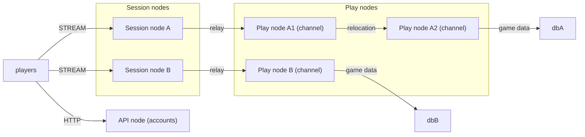

# MyGame world and channel servers

[한국어](README.ko.md)

This Java template separates two MMORPG worlds into independent meshes and Redis stores. The accounts API node publishes the world list over HTTP. Session nodes relay typed STREAM messages to Player Actors. `GoldBalance` owns each player's gold and earn timing; each Zone owns the IDs of its connected players.



## Prerequisites

Docker with Compose v2, and PowerShell 7 on Windows. Gradle 9.3 is included. Dependencies come from Maven Central; Framework 0.34.0 and binding 1.26.0 are pinned in `build.gradle.kts`. No repository checkout is required.

## Build

Bash:
```sh
./run-e2e.sh --build-only
```
PowerShell:
```powershell
.\run-e2e.cmd -BuildOnly
```

## Local server

Install JDK 25 and keep Docker with Compose v2 running for Redis. Run the command from this project directory.

```sh
./run-server.sh
```

On Windows, install PowerShell 7 and run the CMD wrapper.

```powershell
.\run-server.cmd
```

The server builds the Java distributions, starts the nodes and Redis, and prints the WebSocket endpoint after `Server ready:`. Keep the terminal open. Press Ctrl+C to stop the nodes and Redis. A second server invocation is refused.

Run `./run-e2e.sh` or `.\run-e2e.cmd` in another terminal to use the running server. The runner detects `.logs/server.json` and prints `Using the running server`. With the server stopped, the default runner starts an isolated Docker stack. Attached runs skip `update` because it drains and replaces a play node.

Each run keeps effective node settings, node stdout and stderr, Framework message-flow logs (`*.flow.log`), and any failure details in `.logs/run-<id>/`. Local build output is in `.logs/build.log` and isolated Docker build and cleanup output is in `.logs/docker-*/`.

## Client connection

### Endpoint and first packet

Connect to the Session node's `players` STREAM listener. `server/config/sessionA.json` and `server/config/sessionB.json` configure `ws://127.0.0.1:0`: loopback with port `0` requesting an OS-selected port. `server/shared/src/main/java/MyGame/Hosting.java` prints `READY {"id":"...","meshEndpoint":"...","streamEndpoint":"..."}`; use its actual `streamEndpoint`, not port `0`. Mesh and Redis endpoints are not client endpoints. The Accounts default in `server/config/accounts.json` is `http://127.0.0.1:0`; use its `READY` JSON `httpEndpoint` plus `/worlds`.

This is WebSocket with no application path (URL root `/`). Browser, Unity WebGL and Cocos Creator web clients can use it; an HTTPS page requires a secure `wss://` deployment, which these defaults do not provide. Loopback is reachable only from the same host/network namespace. The Docker e2e runner owns and removes its temporary deployment. For an external client, keep a deployment running, bind a reachable interface and port, expose the container port, and use the server's reachable host.

First GET the Accounts HTTP endpoint plus `/worlds`. Its JSON array contains `WorldInfo(worldId, name, sessionEndpoint)`. Select a world and connect to its returned `sessionEndpoint`; configure the Accounts world list with real Session endpoints, since the source configuration contains port-zero placeholders. Send `EnterWorldRequest(playerId)` first. Entry pushes `PlayerView(worldId, channel, nodeId, gold)`; `ChannelView` is another gameplay push and `ActionRejected` reports rejected actions.

These first application operations use `send(...).submit()` and push handlers, not correlated request/reply. After joining and binding, `request(new SessionInfoRequest()).submit(SessionInfo.class)` returns Session identity. Do not request it before entry. Player IDs are not authentication credentials; this template has no production authentication, so validate identity before binding.

### Connector installation

Use the same connector release as `build.gradle.kts` extra `frameworkVersion`; `e2e/build.gradle.kts` uses that value for `systems.zlink:zlink-stream-connector`. In the commands below, `<version>` means that pinned release. The linked guides may describe newer releases. All clients must use this template's packets and the transport described above; engine sample packet names do not apply.

| Client                             | Connector installation                                                                                                                                                                                                                                                                                                                                                                                                                                                          | Documentation guide                                                                                                                                                          |
| ---------------------------------- | ------------------------------------------------------------------------------------------------------------------------------------------------------------------------------------------------------------------------------------------------------------------------------------------------------------------------------------------------------------------------------------------------------------------------------------------------------------------------------- | ---------------------------------------------------------------------------------------------------------------------------------------------------------------------------- |
| Unity                              | Native/Editor: restore `Zlink.Stream.Connector` with NuGetForUnity. WebGL: add the `com.zlink.stream-connector.webgl` UPM Git package; include only the connector assembly for the active target. See the [Unity README](https://github.com/zlink-systems/zlink/blob/main/framework/languages/engines/Unity/README.md) and its package manifest.                                                                                                                                | [.NET engine integration](https://docs.zlink.systems/dotnet/guide/stream-connector/12-engine-integration/)                                                                   |
| Unreal                             | Copy `framework/languages/cpp/connector/engines/unreal` into `Plugins/ZLinkStreamConnector`, then package the native connector under `ThirdParty/ZLink` as described in the [Unreal README](https://github.com/zlink-systems/zlink/blob/main/framework/languages/engines/Unreal/README.md).                                                                                                                                                                                     | [C++ engine integration](https://docs.zlink.systems/cpp/guide/stream-connector/12-engine-integration/)                                                                       |
| Godot                              | .NET: add the NuGet package `Zlink.Stream.Connector` and run `dotnet restore`; see the [C# README](https://github.com/zlink-systems/zlink/blob/main/framework/languages/engines/Godot/csharp/README.md). GDExtension: build the C++ Godot adapter against the framework prebuilt and matching `godot-cpp`; see the [C++ README](https://github.com/zlink-systems/zlink/blob/main/framework/languages/engines/Godot/cpp/README.md). The .NET sample does not support Web export. | [.NET](https://docs.zlink.systems/dotnet/guide/stream-connector/12-engine-integration/), [C++](https://docs.zlink.systems/cpp/guide/stream-connector/12-engine-integration/) |
| Cocos Creator                      | Web target: `npm install @zlink-systems/stream-connector@<version>`; see the [Cocos Creator README](https://github.com/zlink-systems/zlink/blob/main/framework/languages/engines/CocosCreator/README.md). This package does not provide a Creator native adapter.                                                                                                                                                                                                                  | [TypeScript engine integration](https://docs.zlink.systems/node/guide/stream-connector/12-engine-integration/)                                                               |
| Axmol                              | Copy `framework/languages/cpp/connector/engines/axmol` into `third_party/zlink_axmol_connector` and link `zlink::stream_connector` from the installed C++ framework package; see the [Axmol README](https://github.com/zlink-systems/zlink/blob/main/framework/languages/engines/Axmol/README.md).                                                                                                                                                                              | [C++ engine integration](https://docs.zlink.systems/cpp/guide/stream-connector/12-engine-integration/)                                                                       |
| Web browser (TypeScript connector) | `npm install @zlink-systems/stream-connector@<version>`; import the package root in the browser build. Use `ws://` or `wss://`, subject to the page's security policy.                                                                                                                                                                                                                                                                                                             | [TypeScript connector](https://docs.zlink.systems/node/guide/stream-connector/)                                                                                              |
| C++                                | Install the C++ framework prebuilt containing the connector; use `find_package(zlink_stream_connector_cpp CONFIG REQUIRED)` and link `zlink::stream_connector`.                                                                                                                                                                                                                                                                                                                 | [C++ connector](https://docs.zlink.systems/cpp/guide/stream-connector/)                                                                                                      |
| C#/.NET                            | `dotnet add package Zlink.Stream.Connector --version <version>`                                                                                                                                                                                                                                                                                                                                                                                                                    | [.NET connector](https://docs.zlink.systems/dotnet/guide/stream-connector/)                                                                                                  |
| Java                               | Add Maven/Gradle dependency `systems.zlink:zlink-stream-connector:<version>`.                                                                                                                                                                                                                                                                                                                                                                                                      | [Java connector](https://docs.zlink.systems/java/guide/stream-connector/)                                                                                                    |
| Kotlin                             | Add `systems.zlink:zlink-stream-connector:<version>` and `systems.zlink:zlink-framework-kotlin:<version>` for the coroutine wrapper.                                                                                                                                                                                                                                                                                                                                                  | [Kotlin connector](https://docs.zlink.systems/kotlin/guide/stream-connector/)                                                                                                |
| Node                               | `npm install @zlink-systems/stream-connector@<version>`; use the package root and Node.js 22 or later.                                                                                                                                                                                                                                                                                                                                                     | [Node connector](https://docs.zlink.systems/node/guide/stream-connector/)                                                                                                    |

### Java connection example

Save this as `e2e/src/main/java/MyGame/e2e/ConnectOnce.java` with `package MyGame.e2e;` before the imports in a copy of this template, then run `./gradlew :e2e:installDist`. Run `java --enable-native-access=ALL-UNNAMED -cp "e2e/build/install/e2e/lib/*" MyGame.e2e.ConnectOnce <actual-session-endpoint>` from that copy while its deployment remains running. Pass the actual Session endpoint as argument 1. Register push handlers before sending. See `e2e/src/main/java/MyGame/e2e/` for the complete flow.

```java
import MyGame.*;
import systems.zlink.stream.connector.*;
import java.net.URI;
import java.time.Duration;
import java.util.concurrent.*;

public final class ConnectOnce {
    public static void main(String[] args) throws Exception {
        var uri = URI.create(args[0]);
        var d = ZLinkStreamConnectorOptions.createDefault(uri);
        var connector = ZLinkStreamConnectorFactory.create(
                new ZLinkStreamConnectorOptions(uri, ZLinkStreamDispatchMode.IMMEDIATE,
                        d.requestTimeout(), d.maxReconnectAttempts(), d.connectTimeout(),
                        d.maxSendPayloadSize(), d.heartbeatEnabled(), d.heartbeatInterval(),
                        d.heartbeatTimeout(), false, d.reconnectInitialDelay(),
                        d.reconnectMaxDelay(), d.reconnectBackoffFactor()));
        var received = new CompletableFuture<PlayerView>();
        try (var push = connector.on(PlayerView.class, message -> {
                    received.complete(message.payload());
                    return CompletableFuture.completedFuture(null);
                });
                var error = connector.onErrorReceived(event -> {
                    received.completeExceptionally(new IllegalStateException(event.toString()));
                    return CompletableFuture.completedFuture(null);
                });
                var disconnected = connector.onDisconnected(event -> {
                    received.completeExceptionally(new IllegalStateException(event.toString()));
                    return CompletableFuture.completedFuture(null);
                })) {
            try {
                connector.connect().submit().toCompletableFuture().join();
                connector.send(new EnterWorldRequest("guide-player")).submit().toCompletableFuture().join();
                System.out.println(received.get(5, TimeUnit.SECONDS));
            } finally {
                connector.close().submit().toCompletableFuture().join();
            }
        }
    }
}
```

## End-to-end scenarios

The following scenarios run in an isolated Docker stack when a local server is unavailable.

Docker runs the Java e2e runner and every node role in containers. Nodes share the runner's network namespace and keep the existing stdin/stdout control protocol. Only the runner mounts the Docker socket. Each invocation removes its own containers, network and image tags; logs remain under `.logs/`.

For local process debugging, install JDK 25 and use `./run-e2e.sh --local` or `.\run-e2e.cmd -Local`. Add `--no-build` or `-NoBuild` to reuse a local build. Docker uses its image layer cache.

> **Base images.** Dockerfile ARG defaults pin Eclipse Temurin JDK/JRE 25.0.2+10 and Docker CLI 28.5.1. Replace these defaults when adopting a deployment base image.

Bash:
```sh
./run-e2e.sh
./run-e2e.sh --scenario worlds,channel,reconnect,update
./run-e2e.sh --check-structure
```
PowerShell:
```powershell
.\run-e2e.cmd
.\run-e2e.cmd -Scenario worlds,channel,reconnect,update
.\run-e2e.cmd -CheckStructure
```

The runner checks `zlink.structure.json`, starts its own two Redis containers and six application processes, and records logs under `.logs/run-<id>/`. Ports, Compose project names, and Redis key prefixes are unique per run. Cleanup failures fail the run. `--check-structure` (PowerShell `-CheckStructure`) validates files without starting infrastructure.

| Scenario | Assertions |
| --- | --- |
| worlds | HTTP world endpoints; fixed gold reward, cooldown rejection and server retry delay; equal player IDs have independent gold in A and B |
| channel | Same-Zone visibility, cross-Zone isolation, move and disconnect removal; oversized channel requests return `integer-out-of-range` without changing membership; channel move preserves connection, SessionInfo, and gold; internal packets return `packet-not-allowed` |
| reconnect | A new connection retains Actor identity, channel, and gold |
| update | Drain channelA1; preserve both worlds and the relocated Zone player list; stop and replace it; verify a new Zone and Player work on the replacement |

## Framework behavior to know

- **Waiting for DB or file I/O in a handler** — An ordinary async terminal retains the turn, while `Yield` lets other handlers on the same Spot proceed. [Guide](https://docs.zlink.systems/java/guide/server/32-execution-model/#io-worker-wait). [server/channel/src/main/java/MyGame/channel/Player.java:45](server/channel/src/main/java/MyGame/channel/Player.java).
- **Creation that misses its deadline** — `DeadlineExceeded` and caller cancellation have distinct outcomes. [Guide](https://docs.zlink.systems/java/guide/server/22-actor/#creation-deadline). [server/session/src/main/java/MyGame/session/GameSession.java:68](server/session/src/main/java/MyGame/session/GameSession.java).
- **Many logins at once** — Each creation for a different ID requires a Location Store round trip, so measure expected load when setting the deadline. [Guide](https://docs.zlink.systems/java/guide/server/25-location/#creation-load).
- **Sending under load** — Send waits for capacity, and the application sees the final result. [Guide](https://docs.zlink.systems/java/guide/server/33-backpressure/#send-backpressure). [server/session/src/main/java/MyGame/session/GameSession.java:52](server/session/src/main/java/MyGame/session/GameSession.java).
- **Duplicate login** — Without a callback, a bind from another Session is accepted; reject it in the Actor duplicate-bind callback to prevent this. [Guide](https://docs.zlink.systems/java/guide/server/39-session-binding/#duplicate-session-bind). This template keeps the default (accepts the new Session).
- **ObjectGeneration** — `ObjectGeneration` distinguishes logical incarnations of the same ID; it is not a data version or write authority. [Guide](https://docs.zlink.systems/java/guide/server/34-activation-lifetime/#object-generation). [server/session/src/main/java/MyGame/session/GameSession.java:61](server/session/src/main/java/MyGame/session/GameSession.java).
- **READY and Serving** — The Framework host prints `READY` after observing runtime `Serving`; the Accounts process prints `READY` without a Framework runtime. [Guide](https://docs.zlink.systems/java/guide/server/12-operations/#wait-for-serving). [server/shared/src/main/java/MyGame/Hosting.java:105](server/shared/src/main/java/MyGame/Hosting.java); [server/shared/src/main/java/MyGame/Hosting.java:134](server/shared/src/main/java/MyGame/Hosting.java); [server/accounts/src/main/java/MyGame/accounts/Program.java:34](server/accounts/src/main/java/MyGame/accounts/Program.java); [server/accounts/src/main/java/MyGame/accounts/Program.java:37](server/accounts/src/main/java/MyGame/accounts/Program.java). The accounts HTTP process prints `READY` after its server starts, without observing Framework runtime `Serving`:  .

## Known issues

Validated against the published Framework 0.34.0 packages.

## Deployment sequence

Start dbA and dbB, then channelA1, channelA2, and channelB in that order so each initially creates its configured fixed Zone. Start sessionA and sessionB next. Their `READY` lines publish the actual STREAM endpoints; set those values in the accounts configuration before starting accounts. Run a role with `java --enable-native-access=ALL-UNNAMED -cp 'server/<role>/build/install/<role>/lib/*' MyGame.<role>.Program server/config/<id>.json`.

World A uses mesh `my-game-world-a` and dbA; world B uses `my-game-world-b` and dbB. Keep the Redis endpoint and key prefix consistent within a world. Application data uses `<keyPrefix>player:<id>`; Framework Location and Relocation data use separate suffixes. Player IDs are supplied by this example client; a production Session must authenticate them.

For a channel update, send `drain` on its stdin and wait for `RELOCATION_REQUESTED`, `RELOCATED`, and `SAFE_TO_SHUTDOWN`. Then send `shutdown`, require `STOPPED` and a successful process exit, and start its replacement with the same configuration. Channel servers register both Player and Zone relocation adapters. The replacement does not reclaim relocated Zones: existing Location Store authority remains authoritative.

ChannelA1 has a one-Zone capacity and starts before channelA2, whose capacity is two.
This places each fixed Zone on its declared initial owner and leaves room for drain.
After replacement, update sends `create-update-zone` and waits for `UPDATE_ZONE_CREATED`.
The command creates verification Zone `field@3` through the public Spot manager.
ChannelA2 already holds two Zones, so the replacement must host the new Zone.
A new Player joins it and earns gold; the test checks channelA1 in both responses.
Existing Players remain in their relocated Zones. The replacement uses the same configuration.
`ZoneTransfer` saves the connected player ID list in the Zone relocation snapshot and restores it on the target host. A channel move keeps the client Session bound while the Player Actor changes Zones, so the list follows Zone membership callbacks.
Message Follow is explicitly 30 seconds; the safe shutdown observation budget is
derived from that duration and the existing operation budget.
