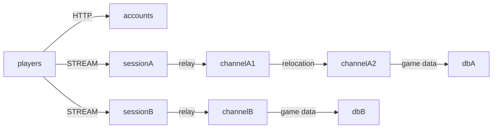

# MyGame world and channel servers

This Java template separates two MMORPG worlds into independent meshes and Redis stores. Accounts publishes the world list over HTTP. Session nodes relay typed STREAM messages to Player Actors. Each Actor owns its gold; Zone Spots identify channels and retain no application state.



## Prerequisites

Docker with Compose v2, and PowerShell 7 on Windows. Gradle 9.3 is included. Dependencies come from Maven Central; Framework 0.30.1 and binding 1.19.1 are pinned in `build.gradle.kts`. No repository checkout is required.

## Build

Bash:
```sh
./run-e2e.sh --build-only
```
PowerShell:
```powershell
pwsh -NoProfile -File ./run-e2e.ps1 -BuildOnly
```

## Docker e2e

Docker runs the Java e2e runner and every node role in containers. Nodes share the runner's network namespace and keep the existing stdin/stdout control protocol. Only the runner mounts the Docker socket. Each invocation removes its own containers, network and image tags; logs remain under `.logs/`.

For local process debugging, install JDK 25 and use `./run-e2e.sh --local` or `pwsh -NoProfile -File ./run-e2e.ps1 -Local`. Add `--no-build` or `-NoBuild` to reuse a local build. Docker uses its image layer cache.

> **Base images.** Dockerfile ARG defaults pin Eclipse Temurin JDK/JRE 25.0.2+10 and Docker CLI 28.5.1. Replace these defaults when adopting a deployment base image.


Bash:
```sh
./run-e2e.sh
./run-e2e.sh --scenario worlds,channel,reconnect,update
./run-e2e.sh --check-structure
```
PowerShell:
```powershell
pwsh -NoProfile -File ./run-e2e.ps1
pwsh -NoProfile -File ./run-e2e.ps1 -Scenario worlds,channel,reconnect,update
pwsh -NoProfile -File ./run-e2e.ps1 -CheckStructure
```

The runner checks `zlink.structure.json`, starts its own two Redis containers and six application processes, and records logs under `.logs/run-<id>/`. Ports, Compose project names, and Redis key prefixes are unique per run. Cleanup failures fail the run. `--check-structure` (PowerShell `-CheckStructure`) validates files without starting infrastructure.

| Scenario | Assertions |
| --- | --- |
| worlds | HTTP world endpoints; equal player IDs have independent gold in A and B |
| channel | Channel 1 to 2 preserves connection, SessionInfo, and gold |
| reconnect | A new connection retains Actor identity, channel, and gold |
| update | Drain channelA1; preserve both worlds; stop and replace it; verify a new Zone and Player work on the replacement |

## Known issues

Framework 0.30.1 publication is pending. Validation against 0.30.0 uses a separate copy. Cross-node deferred Actor Join fails with `DATA_LOST: target rejected canonical relocation: 35` ([#1729](https://github.com/zlink-systems/zlink/issues/1729)). This blocks channel transfer, reconnect after transfer, and update verification. Initial entry can also require this path when Actor placement selects a different channel node. After `RELOCATED`, the source may never publish `safeToShutdown=true` ([#1740](https://github.com/zlink-systems/zlink/issues/1740)). The template retains the public join path and its assertions.

## Deployment sequence

Start dbA and dbB, then channelA1, channelA2, and channelB in that order so each initially creates its configured fixed Zone. Start sessionA and sessionB next. Their `READY` lines publish the actual STREAM endpoints; set those values in the accounts configuration before starting accounts. Run a role with `java --enable-native-access=ALL-UNNAMED -cp 'server/<role>/build/install/<role>/lib/*' MyGame.<role>.Program server/config/<id>.json`.

World A uses mesh `my-game-world-a` and dbA; world B uses `my-game-world-b` and dbB. Keep the Redis endpoint and key prefix consistent within a world. Application data uses `<keyPrefix>player:<id>`; Framework Location and Relocation data use separate suffixes. Player IDs are supplied by this example client; a production Session must authenticate them.

For a channel update, send `drain` on its stdin and wait for `RELOCATION_REQUESTED`, `RELOCATED`, and `SAFE_TO_SHUTDOWN`. Then send `shutdown`, require `STOPPED` and a successful process exit, and start its replacement with the same configuration. Channel servers register both Player and Zone relocation adapters. The replacement does not reclaim relocated Zones: existing Location Store authority remains authoritative.

ChannelA1 has a one-Zone capacity and starts before channelA2, whose capacity is two.
This places each fixed Zone on its declared initial owner and leaves room for drain.
After replacement, update sends `create-update-zone` and waits for `UPDATE_ZONE_CREATED`.
The command creates verification Zone `field@3` through the public Spot manager.
ChannelA2 already holds two Zones, so the replacement must host the new Zone.
A new Player joins it and earns gold; the test checks channelA1 in both responses.
Existing Players remain in their relocated Zones. The replacement uses the same configuration.
Message Follow is explicitly 30 seconds; the safe shutdown observation budget is
derived from that duration and the existing operation budget.

## 한국어 실행 안내

기본 e2e는 runner와 node를 Docker에서 실행합니다. 로컬 process 디버깅에는 JDK 25를 준비하고 `--local` 또는 `-Local`을 지정합니다.

Docker Compose v2를 준비한 뒤 위 Build 명령을 실행합니다. Docker e2e 명령은 실행마다 Redis 두 개와 node process를 생성하며, 결과와 message-flow 로그를 `.logs/run-<id>/`에 보관합니다.

월드별 Redis와 mesh를 분리하며 Player Actor가 gold를 소유합니다. 채널 변경과 host relocation의 연결 유지는 공개 Framework API에 맡깁니다. 공개 패키지 결함으로 실패한 경우 Known issues와 node stderr를 확인하며, 재시도나 대기 시간 변경으로 실패를 숨기지 않습니다.
