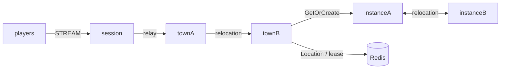

# my-game

A Java MORPG template with two fixed town channels and dynamic party dungeons. Town owns channel membership and parties. Dungeon owns its prepared roster and stage; Entry owns no game state.



## Prerequisites

Docker with Compose v2, and PowerShell 7 on Windows. Gradle Wrapper is included. Public Framework packages are pinned to 0.30.2 and the binding to 1.20.0 in `build.gradle.kts`.

## Build

```sh
./run-e2e.sh --build-only
```

```powershell
pwsh -NoProfile -File ./run-e2e.ps1 -BuildOnly
```

The domain boundary checks use the existing JUnit test modules. With JDK 25, run them with:

```sh
./gradlew --no-daemon :server:town:test :server:instance:test
```

## Docker e2e

Docker runs the Java e2e runner and every node role in containers. Nodes share the runner's network namespace and keep the existing stdin/stdout control protocol. Only the runner mounts the Docker socket. Each invocation removes its own containers, network and image tags; logs remain under `.logs/`.

For local process debugging, install JDK 25 and use `./run-e2e.sh --local` or `pwsh -NoProfile -File ./run-e2e.ps1 -Local`. Add `--no-build` or `-NoBuild` to reuse a local build. Docker uses its image layer cache.

> **Base images.** Dockerfile ARG defaults pin Eclipse Temurin JDK/JRE 25.0.2+10 and Docker CLI 28.5.1. Replace these defaults when adopting a deployment base image.

```sh
./run-e2e.sh
./run-e2e.sh --scenario channel,dungeon,reconnect,update
./run-e2e.sh --check-structure
```

```powershell
pwsh -NoProfile -File ./run-e2e.ps1
pwsh -NoProfile -File ./run-e2e.ps1 -Scenario channel,dungeon,reconnect,update
pwsh -NoProfile -File ./run-e2e.ps1 -CheckStructure
```

The runner validates `zlink.structure.json`, creates one isolated Redis Compose project per scenario, launches the node roles, and retains logs and effective configuration under `.logs/run-<id>/`. Listeners bind port zero; Redis uses an ephemeral loopback port. Cleanup failures fail the run.

| Scenario | Observation |
| --- | --- |
| `channel` | Reject an out-of-range channel without changing town state; remove a forming party when its member changes channel; retain the Session binding. |
| `dungeon` | Check server-issued PartyId and RunId, duplicate entry requests, matching Active views, nonleader and internal-packet rejection with unchanged state, run-in-progress rejection, FinalStage completion, and distinct runs for parties in town-1 and town-2. |
| `reconnect` | Reconnect the second player and compare Actor generation, Dungeon RunId, Phase, Stage, and roster under a new Session. |
| `update` | Drain and replace the Dungeon host, preserve the run and both Session identities, then accept a distinct run from the other town channel. |

For structure checks only, pass `--check-structure` to the shell runner or `-CheckStructure` to PowerShell. Checks examine real files and permit additional valid composition declarations.

## Known issues

Validated against the published Framework 0.30.2 packages.

## Deployment sequence

Bootstrap Town providers sequentially and wait for each READY before starting the next. Each provider's public Town stable-type capacity must equal its configured fixed Town count; the structure checker enforces this. Earlier providers are full and later providers are absent, making each fixed Town's declared initial owner deterministic. Entry declarations describe the application Entry registered by Town and Instance, excluding Framework default Entries.

Start Redis, townA, townB, both instance nodes, and then the Session node. Wait for each node to print READY before starting the next; each town bootstraps its configured fixed Town Spot before READY. Configure unique node IDs and Redis key prefixes in `server/config/`. Start each role using its installed distribution under `server/<role>/build/install/<role>/bin/`, supplying the corresponding configuration path. Instance nodes register `Dungeon` with capacity one and the shared application Entry.

Each process prints `READY` with actual listener endpoints. Send `drain` on standard input to request planned maintenance. Wait for `RELOCATION_REQUESTED`, `RELOCATED`, and `SAFE_TO_SHUTDOWN`; send `shutdown` and require `STOPPED` before replacing the process with the same configuration. Town and Dungeon adapters preserve application state only; Framework owns memberships, routes, leases, queues, and relocation progress.

The first party member is the leader. A party accepts at most four distinct players from its town channel. `CreatePartyRequest` has no ID input: the server issues PartyIds as `party-` plus 32 lowercase hexadecimal characters. A leader starts a run with a similarly formatted RunId; each dungeon is named `dungeon-<runId>`. Run phases are `Forming`, `Preparing`, `Entering`, `Active`, and `Completed`. A member leaving during Forming is removed from the party; after preparation begins, the run roster stays recorded. Only the leader can enter the dungeon. Dungeon preparation is idempotent for the same RunId, owner Town, and roster. Pushes use Actor IDs, and Actor delivery handlers forward the typed payload to the bound Session. `SessionInfo` reads Actor identity from the Session binding rather than game state.

All Object Servers that register Player factories also register the shared Entry and first-admission handler, including both Instance nodes. Entry admission joins the requested fixed Town channel. Each Instance declares its dynamic Dungeon factory in `zlink.structure.json`.

The e2e configuration uses one Dungeon slot per Instance. After drain, the surviving Instance is full, so only the replacement can accept the fresh Dungeon. The structure checker enforces this configuration. Message Follow remains 30 seconds; the SafeToShutdown observation budget is derived from that duration plus the existing relocation operation budget.

## 한국어 실행 안내

기본 e2e는 runner와 node를 Docker에서 실행합니다. 로컬 process 디버깅에는 JDK 25를 준비하고 `--local` 또는 `-Local`을 지정합니다.

Docker Compose v2를 준비한 뒤 위 Build 명령으로 빌드합니다. `run-e2e.sh` 또는 `run-e2e.ps1`을 실행하면 구조 검사, Redis와 node 기동, 시나리오 실행, 자원 정리를 순서대로 수행합니다. 실행 설정과 로그는 `.logs/run-<id>/`에 보존합니다.

`channel`은 범위 밖 채널 거부와 Forming 파티의 해체, `dungeon`은 서버 발급 ID·중복 요청·거부 뒤 상태 불변·완료 전이와 다른 채널의 파티 분리를, `reconnect`는 Actor와 RunId·Phase·Stage·명단 유지를, `update`는 instance node 교체와 다른 채널의 새 run 수락을 검증합니다. 도메인 경계는 JUnit test `./gradlew --no-daemon :server:town:test :server:instance:test`로 검사합니다. 기본 실행은 네 시나리오를 모두 수행합니다.
