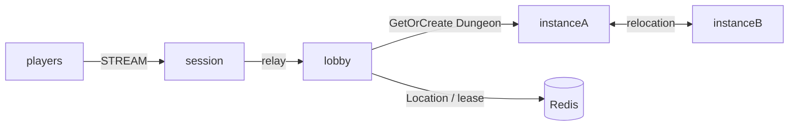

# my-game

A Java MORPG template with a lobby, parties, and dungeon instances. The Party User Spot owns membership and readiness; the Dungeon User Spot owns its prepared roster and stage. The Entry Spot has no persistent game state.



The Lobby and Instance roles (`lobby`, `instanceA`, and `instanceB`) explicitly register the shared stateless application Entry and initial party-admission handlers. The structure declares Entry only for those application registrations; Framework infrastructure Entry instances are not declared. Party state remains in the Lobby Party User Spot. Message Follow is explicitly 30 seconds; the safe-shutdown observation budget adds that duration to the existing host-operation budget. Each instance admits one Dungeon, so the relocated Dungeon fills the surviving instance and fresh work must use the replacement.

## Prerequisites

Docker with Compose v2, and PowerShell 7 on Windows. Gradle Wrapper is included. Public Framework packages are pinned to 0.30.2 and the binding to 1.20.0 in `build.gradle.kts`.

## Build

```sh
./run-e2e.sh --build-only
```

```powershell
pwsh -NoProfile -File ./run-e2e.ps1 -BuildOnly
```

## Docker e2e

Docker runs the Java e2e runner and every node role in containers. Nodes share the runner's network namespace and keep the existing stdin/stdout control protocol. Only the runner mounts the Docker socket. Each invocation removes its own containers, network and image tags; logs remain under `.logs/`.

For local process debugging, install JDK 25 and use `./run-e2e.sh --local` or `pwsh -NoProfile -File ./run-e2e.ps1 -Local`. Add `--no-build` or `-NoBuild` to reuse a local build. Docker uses its image layer cache.

> **Base images.** Dockerfile ARG defaults pin Eclipse Temurin JDK/JRE 25.0.2+10 and Docker CLI 28.5.1. Replace these defaults when adopting a deployment base image.

```sh
./run-e2e.sh
./run-e2e.sh --scenario party,reconnect,update
./run-e2e.sh --check-structure
```

```powershell
pwsh -NoProfile -File ./run-e2e.ps1
pwsh -NoProfile -File ./run-e2e.ps1 -Scenario party,reconnect,update
pwsh -NoProfile -File ./run-e2e.ps1 -CheckStructure
```

The runner validates `zlink.structure.json`, creates one isolated Redis Compose project per scenario, launches the node roles, and retains logs and effective configuration under `.logs/run-<id>/`. Listeners bind port zero; Redis uses an ephemeral loopback port. Cleanup failures fail the run.

- `party`: create and join a two-player party, reject entry with `not-ready`, ready both members, enter the same dungeon at stage zero, and advance together.
- `reconnect`: reconnect the second player; check the same Actor generation, dungeon, roster, and stage with a new Session.
- `update`: drain the actual dungeon host, observe relocation and safe shutdown, retain both Sessions and game state, replace the host, and verify a new dungeon uses its free capacity.

For structure checks only, pass `--check-structure` to the shell runner or `-CheckStructure` to PowerShell. Checks examine real files and permit additional valid composition declarations.

## Known issues

Validated against the published Framework 0.30.2 packages.

## Deployment sequence

Start Redis, the lobby, both instance nodes, and then the Session node. Configure unique node IDs and Redis key prefixes in `server/config/`. Start each role using its installed distribution under `server/<role>/build/install/<role>/bin/`, supplying the corresponding configuration path. Instance nodes register `Dungeon` with capacity one; they also register the shared stateless Entry Spot.

Each process prints `READY` with actual listener endpoints. Send `drain` on standard input to request planned maintenance. Wait for `RELOCATION_REQUESTED`, `RELOCATED`, and `SAFE_TO_SHUTDOWN`; send `shutdown` and require `STOPPED` before replacing the process with the same configuration. Party and Dungeon adapters preserve application state only; Framework owns memberships, routes, leases, queues, and relocation progress.

The first party member is the leader. A party accepts at most four distinct players. The leader may enter only after every member is ready. Dungeon preparation fixes the party roster before travel. Pushes use Actor IDs, and Actor delivery handlers forward the typed payload to the bound Session. `SessionInfo` reads Actor identity from the Session binding rather than game state.

## 한국어 실행 안내

기본 e2e는 runner와 node를 Docker에서 실행합니다. 로컬 process 디버깅에는 JDK 25를 준비하고 `--local` 또는 `-Local`을 지정합니다.

Docker Compose v2를 준비한 뒤 위 Build 명령으로 빌드합니다. `run-e2e.sh` 또는 `run-e2e.ps1`을 실행하면 구조 검사, Redis와 node 기동, 시나리오 실행, 자원 정리를 순서대로 수행합니다. 실행 설정과 로그는 `.logs/run-<id>/`에 보존합니다.

`party`는 준비 여부와 던전 입장을, `reconnect`는 Actor와 게임 상태 유지를, `update`는 instance node의 relocation과 교체를 검증합니다. 기본 실행은 세 시나리오를 모두 수행합니다.
