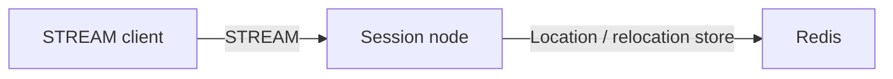

# MyGame Java starter

[한국어](README.ko.md)

This setup runs one Session node that accepts STREAM connections, with Redis for the Location Store and relocation storage. It provides hosting, diagnostics, process control, and an e2e starting point. It contains no application Spot, Actor, Entry, authentication, subscriptions, or game packets.



## Prerequisites

Install Docker with Compose v2 and access to a Linux container daemon. Bash or PowerShell 7 runs the scripts. Docker builds use Eclipse Temurin JDK and JRE `25.0.2+10` and Docker CLI `28.5.1`; the image references are at the top of `Dockerfile`. Network access to Maven Central and the Redis container registry is required. Host debugging also requires JDK 25.

`build.gradle.kts` pins Framework `0.34.0` and binding `1.26.0`. Gradle resolves them from Maven Central only. Do not add repository source references or a private repository.

The Gradle wrapper and both server modules are included. Copy this directory to build it independently.

`Hosting.configure` registers the Redis Location Store explicitly with `options.addLocationStore` once per node. A Spring Store bean alone does not register it with Framework. Keep this single call when adding application registrations.

## Build

Build the node and runner images from this directory.

```sh
./run-e2e.sh --build-only
```

The build command removes its image tags after checking the build; Docker retains reusable build layers. PowerShell provides the same command.

```powershell
.\run-e2e.cmd -BuildOnly
```

Both commands build the modules listed in `settings.gradle.kts`.

## Local server

Install JDK 25 and keep Docker with Compose v2 running for Redis. Run the command from this project directory.

```sh
./run-server.sh
```

On Windows, install PowerShell 7 and run the CMD wrapper.

```powershell
.\run-server.cmd
```

The server builds the Java distributions, starts the nodes and Redis, and prints the WebSocket endpoint after `Server ready:`. Keep the terminal open. Press Ctrl+C to stop the nodes and Redis. A second server invocation is refused.

Run `./run-e2e.sh` or `.\run-e2e.cmd` in another terminal to use the running server. The runner detects `.logs/server.json` and prints `Using the running server`. With the server stopped, the default runner starts an isolated Docker stack. In attached mode, `connect` tests the WebSocket connection and skips the drain step so the Session node stays available.

Each run keeps effective node settings, node stdout and stderr, Framework message-flow logs (`*.flow.log`), and any failure details in `.logs/run-<id>/`. Local build output is in `.logs/build.log` and isolated Docker build and cleanup output is in `.logs/docker-*/`.

## Client connection

### Endpoint and first packet

Connect to the Session node's `players` STREAM listener. `server/config/session.json` configures `ws://127.0.0.1:0`: loopback with port `0` requesting an OS-selected port. `server/shared/src/main/java/MyGame/Hosting.java` prints `READY {"id":"...","meshEndpoint":"...","streamEndpoint":"..."}`; use its actual `streamEndpoint`, not port `0`. Mesh and Redis endpoints are not client endpoints.

The default WebSocket endpoint uses the root path (`/`) and supports browsers, Unity WebGL and Cocos Creator web. An HTTPS page needs a reachable `wss://` endpoint. Loopback is reachable only from the same host/network namespace. The Docker e2e runner owns and removes its temporary deployment. For an external client, keep a deployment running, bind a reachable interface and port, expose the container port, and use the server's reachable host.

The starter defines no game packets or application handshake. `PlayerSession.onDispatch` fails with `No application packets are registered yet.` for application packets. The e2e scenario only connects and closes the public connector; the example does the same. Add typed contracts and Session handlers before sending gameplay.

### Connector installation

Use the same connector release as `build.gradle.kts` extra `frameworkVersion`; `e2e/build.gradle.kts` uses that value for `systems.zlink:zlink-stream-connector`. In the commands below, `<version>` means that pinned release. The linked guides may describe newer releases. All clients must use this template's packets and the transport described above; engine sample packet names do not apply.

| Client                             | Connector installation                                                                                                                                                                                                                                                                                                                                                                                                                                                          | Documentation guide                                                                                                                                                          |
| ---------------------------------- | ------------------------------------------------------------------------------------------------------------------------------------------------------------------------------------------------------------------------------------------------------------------------------------------------------------------------------------------------------------------------------------------------------------------------------------------------------------------------------- | ---------------------------------------------------------------------------------------------------------------------------------------------------------------------------- |
| Unity                              | Native/Editor: restore `Zlink.Stream.Connector` with NuGetForUnity. WebGL: add the `com.zlink.stream-connector.webgl` UPM Git package; include only the connector assembly for the active target. See the [Unity README](https://github.com/zlink-systems/zlink/blob/main/framework/languages/engines/Unity/README.md) and its package manifest.                                                                                                                                | [.NET engine integration](https://docs.zlink.systems/dotnet/guide/stream-connector/12-engine-integration/)                                                                   |
| Unreal                             | Copy `framework/languages/cpp/connector/engines/unreal` into `Plugins/ZLinkStreamConnector`, then package the native connector under `ThirdParty/ZLink` as described in the [Unreal README](https://github.com/zlink-systems/zlink/blob/main/framework/languages/engines/Unreal/README.md).                                                                                                                                                                                     | [C++ engine integration](https://docs.zlink.systems/cpp/guide/stream-connector/12-engine-integration/)                                                                       |
| Godot                              | .NET: add the NuGet package `Zlink.Stream.Connector` and run `dotnet restore`; see the [C# README](https://github.com/zlink-systems/zlink/blob/main/framework/languages/engines/Godot/csharp/README.md). GDExtension: build the C++ Godot adapter against the framework prebuilt and matching `godot-cpp`; see the [C++ README](https://github.com/zlink-systems/zlink/blob/main/framework/languages/engines/Godot/cpp/README.md). The .NET sample does not support Web export. | [.NET](https://docs.zlink.systems/dotnet/guide/stream-connector/12-engine-integration/), [C++](https://docs.zlink.systems/cpp/guide/stream-connector/12-engine-integration/) |
| Cocos Creator                      | Web target: `npm install @zlink-systems/stream-connector@<version>`; see the [Cocos Creator README](https://github.com/zlink-systems/zlink/blob/main/framework/languages/engines/CocosCreator/README.md). This package does not provide a Creator native adapter.                                                                                                                                                                                                                  | [TypeScript engine integration](https://docs.zlink.systems/node/guide/stream-connector/12-engine-integration/)                                                               |
| Axmol                              | Copy `framework/languages/cpp/connector/engines/axmol` into `third_party/zlink_axmol_connector` and link `zlink::stream_connector` from the installed C++ framework package; see the [Axmol README](https://github.com/zlink-systems/zlink/blob/main/framework/languages/engines/Axmol/README.md).                                                                                                                                                                              | [C++ engine integration](https://docs.zlink.systems/cpp/guide/stream-connector/12-engine-integration/)                                                                       |
| Web browser (TypeScript connector) | `npm install @zlink-systems/stream-connector@<version>`; import the package root in the browser build. Use `ws://` or `wss://`, subject to the page's security policy.                                                                                                                                                                                                                                                                                                             | [TypeScript connector](https://docs.zlink.systems/node/guide/stream-connector/)                                                                                              |
| C++                                | Install the C++ framework prebuilt containing the connector; use `find_package(zlink_stream_connector_cpp CONFIG REQUIRED)` and link `zlink::stream_connector`.                                                                                                                                                                                                                                                                                                                 | [C++ connector](https://docs.zlink.systems/cpp/guide/stream-connector/)                                                                                                      |
| C#/.NET                            | `dotnet add package Zlink.Stream.Connector --version <version>`                                                                                                                                                                                                                                                                                                                                                                                                                    | [.NET connector](https://docs.zlink.systems/dotnet/guide/stream-connector/)                                                                                                  |
| Java                               | Add Maven/Gradle dependency `systems.zlink:zlink-stream-connector:<version>`.                                                                                                                                                                                                                                                                                                                                                                                                      | [Java connector](https://docs.zlink.systems/java/guide/stream-connector/)                                                                                                    |
| Kotlin                             | Add `systems.zlink:zlink-stream-connector:<version>` and `systems.zlink:zlink-framework-kotlin:<version>` for the coroutine wrapper.                                                                                                                                                                                                                                                                                                                                                  | [Kotlin connector](https://docs.zlink.systems/kotlin/guide/stream-connector/)                                                                                                |
| Node                               | `npm install @zlink-systems/stream-connector@<version>`; use the package root and Node.js 22 or later.                                                                                                                                                                                                                                                                                                                                                     | [Node connector](https://docs.zlink.systems/node/guide/stream-connector/)                                                                                                    |

### Java connection example

Save this as `e2e/src/main/java/MyGame/e2e/ConnectOnce.java` with `package MyGame.e2e;` before the imports in a copy of this template, then run `./gradlew :e2e:installDist`. Run `java --enable-native-access=ALL-UNNAMED -cp "e2e/build/install/e2e/lib/*" MyGame.e2e.ConnectOnce <actual-session-endpoint>` from that copy while its deployment remains running. Pass the actual Session endpoint as argument 1. See `e2e/src/main/java/MyGame/e2e/` for the complete flow.

```java
import MyGame.*;
import systems.zlink.stream.connector.*;
import java.net.URI;
import java.time.Duration;
import java.util.concurrent.*;

public final class ConnectOnce {
    public static void main(String[] args) throws Exception {
        var uri = URI.create(args[0]);
        var d = ZLinkStreamConnectorOptions.createDefault(uri);
        var connector = ZLinkStreamConnectorFactory.create(
                new ZLinkStreamConnectorOptions(uri, ZLinkStreamDispatchMode.IMMEDIATE,
                        d.requestTimeout(), d.maxReconnectAttempts(), d.connectTimeout(),
                        d.maxSendPayloadSize(), d.heartbeatEnabled(), d.heartbeatInterval(),
                        d.heartbeatTimeout(), false, d.reconnectInitialDelay(),
                        d.reconnectMaxDelay(), d.reconnectBackoffFactor()));
        try {
            connector.connect().submit().toCompletableFuture().join();
            System.out.println("Connected; no application packets are defined");
        } finally {
            connector.close().submit().toCompletableFuture().join();
        }
    }
}
```

## End-to-end scenarios

The following scenarios run in an isolated Docker stack when a local server is unavailable.

Run the scenario from this directory.

```sh
./run-e2e.sh
./run-e2e.sh --scenario connect
```

The `connect` scenario waits for node READY, connects and closes one public STREAM connector, then checks the drain markers in isolated mode. The runner verifies a successful shutdown while it cleans up. PowerShell selects the same scenario.

```powershell
.\run-e2e.cmd
.\run-e2e.cmd -Scenario connect
```

A successful run prints `✓ connect` and `Scenarios: 1/1 passed`. Cleanup failures return a nonzero exit code.

For host debugging, add `--local` or `-Local`; Redis still runs in Docker. Add `--no-build` or `-NoBuild` to reuse a local build. The runner assigns unique Redis keys and Compose names, binds listeners to port zero, and reads published endpoints from READY. Logs and generated run settings are in `.logs/run-<id>/`; Docker build and cleanup logs are in `.logs/docker-<project>/`.

Validate the structure without starting Redis or the node.

```sh
./run-e2e.sh --check-structure
```

```powershell
.\run-e2e.cmd -CheckStructure
```

Changes to registrations, settings, structure, and scenarios must be made together; see [the development guide](AGENTS.md).

## Framework behavior to know

- **Waiting for DB or file I/O in a handler** — An ordinary async terminal retains the turn, while `Yield` lets other handlers on the same Spot proceed. [Guide](https://docs.zlink.systems/java/guide/server/32-execution-model/#io-worker-wait).
- **Creation that misses its deadline** — `DeadlineExceeded` and caller cancellation have distinct outcomes. [Guide](https://docs.zlink.systems/java/guide/server/22-actor/#creation-deadline).
- **Many logins at once** — Each creation for a different ID requires a Location Store round trip, so measure expected load when setting the deadline. [Guide](https://docs.zlink.systems/java/guide/server/25-location/#creation-load).
- **Sending under load** — Send waits for capacity, and the application sees the final result. [Guide](https://docs.zlink.systems/java/guide/server/33-backpressure/#send-backpressure).
- **Duplicate login** — Without a callback, a bind from another Session is accepted; reject it in the Actor duplicate-bind callback to prevent this. [Guide](https://docs.zlink.systems/java/guide/server/39-session-binding/#duplicate-session-bind). This template has no Actor or duplicate-bind callback.
- **ObjectGeneration** — `ObjectGeneration` distinguishes logical incarnations of the same ID; it is not a data version or write authority. [Guide](https://docs.zlink.systems/java/guide/server/34-activation-lifetime/#object-generation).
- **READY and Serving** — The Framework host prints `READY` after observing runtime `Serving`. [Guide](https://docs.zlink.systems/java/guide/server/12-operations/#wait-for-serving). [server/shared/src/main/java/MyGame/Hosting.java:93](server/shared/src/main/java/MyGame/Hosting.java); [server/shared/src/main/java/MyGame/Hosting.java:112](server/shared/src/main/java/MyGame/Hosting.java).

## Known issues

Validated against the published Framework 0.34.0 packages.

## Deployment sequence

Start Redis, set `redisEndpoint` and a deployment-specific `keyPrefix` in `server/config/session.json`, then start `server/session/build/install/session/bin/session server/config/session.json` (`session.bat` on Windows). Keep stdin open. Publish STREAM on a reachable interface when clients run outside the node's network namespace.

Wait for `READY <json>` before admitting clients. It contains the node ID and the mesh and STREAM endpoints actually bound by Framework. This starter registers a RouteMesh listener for future node composition but registers no object server or game Entry. Add gameplay from a separately downloaded sample before deploying a play node.

After clients disconnect, write `drain` to stdin. Wait for `RELOCATION_REQUESTED`, `RELOCATED`, and `SAFE_TO_SHUTDOWN`, then write `shutdown`, wait for `STOPPED`, and verify exit code zero. `Control` owns these markers. The starter checks an empty host drain; it does not demonstrate moving connected clients or game state to another node.
