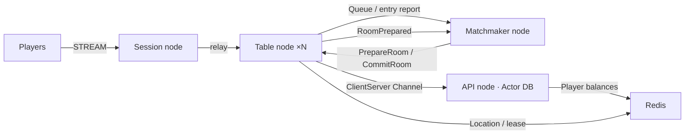

[English](README.md)

# MyGame 보드 테이블

네 명이 앉는 카드 테이블을 위한 Kotlin 서버 템플릿입니다. Session node는 STREAM 연결을 받고 Player Actor에 바인딩해 메시지를 전달합니다. Table User Spot은 좌석, 칩, 카드와 차례를 관리합니다. Player Actor는 자신의 매칭 티켓을 보관하고, Matchmaker node의 Pool Spot은 매칭을 결정합니다. Play node는 ClientServer Channel로 API node를 호출합니다. Player Actor는 착석 전에 칩을 한 번 읽습니다. Table Spot은 모든 좌석의 정산 잔액을 한 번에 Redis에 저장한 뒤 판 결과를 보냅니다. 게임 규칙을 추가할 위치는 [AGENTS.md](AGENTS.md)를 참고합니다.



## 사전 요구 사항

Compose v2와 Linux 컨테이너를 지원하는 Docker, Maven Central과 Gradle Plugin Portal에 대한 네트워크 접근이 필요합니다. 로컬 서버나 e2e 클라이언트를 실행하려면 JDK 25를 설치합니다. Windows의 `.cmd` 실행 파일은 PowerShell 7을 사용합니다. 실행 정책은 해당 PowerShell 프로세스에만 적용하고, 종료하면 콘솔 코드 페이지를 복원합니다. Gradle wrapper가 포함되어 있으며, `build.gradle.kts`에서 ZLink Framework, STREAM connector, Java binding의 버전을 고정합니다. [패키지 버전](AGENTS.md#project-overview)

## 빌드

Linux 또는 WSL에서 실행합니다.

```sh
./run-e2e.sh --build-only
```

Windows에서 실행합니다.

```powershell
.\run-e2e.cmd -BuildOnly
```

## 로컬 서버 실행

Docker를 시작하고 전용 터미널에서 서버를 실행합니다.

```sh
./run-server.sh
```

```powershell
.\run-server.cmd
```

스크립트는 서버를 빌드하고 Redis, API node, 두 Table node, Matchmaker, Session을 시작합니다. 모든 node가 준비되면 `Server ready: ws://127.0.0.1:<port>` 줄에 Session STREAM 주소가 표시됩니다. 같은 터미널에서 Ctrl+C를 누르면 node를 종료하고 해당 실행의 Redis Compose 프로젝트를 삭제합니다.

다른 터미널에서 `./run-e2e.sh` 또는 `.\run-e2e.cmd`를 실행합니다. 스크립트는 `.logs/server.json`에서 실행 중인 서버를 찾아 `table`, `reconnect`, `match`, `match-cancel`을 실행합니다. `--scenario match` 또는 `-Scenario match`로 시나리오를 선택할 수 있습니다. `update`와 `persist`는 Play node를 교체하므로 격리 실행에서만 동작합니다. 두 시나리오를 실행하려면 먼저 로컬 서버를 종료합니다.

## 클라이언트 연결

### 엔드포인트와 첫 패킷

`Server ready:` 줄 또는 Session node의 `READY <json>` 레코드에 있는 `streamEndpoint` 필드를 사용합니다. `server/config/session.json`의 기본값은 `ws://127.0.0.1:0`입니다. OS가 포트를 선택하고 WebSocket 경로는 `/`입니다. 같은 호스트의 브라우저, Unity WebGL, Cocos Creator web에서 연결할 수 있습니다. HTTPS 페이지는 `wss://`가 필요하며, 원격 클라이언트에는 외부에서 접근할 수 있는 리스너가 필요합니다.

전송 전에 push handler를 등록합니다.

`JoinTableRequest(playerId, tableId)`로 지정한 테이블에 참가합니다. 좌석 배정에 성공하면 `TableView`, 거절되면 `ActionRejected`를 받습니다.

매칭 대기열에 등록하려면 빈 `FindMatch`를 보냅니다. 첫 패킷이면 Session이 플레이어 ID를 생성합니다. `MatchQueued`에서 티켓 ID를 받고, `CancelMatch`에 그 ID를 넣어 대기를 취소할 수 있습니다. Pool은 가장 오래 기다린 두 명을 짝지어 배정을 준비 중으로 기록합니다. Play node의 `room-provisioner-board` Instance Spot에 `PrepareRoom`을 보냅니다. RoomProvisioner는 Table User Spot을 생성하고 `PrepareRoom`을 전달합니다. Table은 Pool에 `RoomPrepared`를 보내고 Pool은 새 turn에서 결과를 처리합니다. 두 Actor가 입장 성공을 보고하면 Pool이 좌석을 확정합니다. 각 플레이어는 `MatchFound`와 `TableView`를 차례로 받은 뒤 기존 게임 메시지를 사용합니다. 입장 제한은 10초입니다. 대기 티켓은 120초 후 만료되고, 대기 중 연결이 끊기면 최대 15초의 유예가 적용됩니다.

입장 후 `connector.kotlin().request<SessionInfo>(SessionInfoRequest()).await()`를 호출하면 요청에 대응하는 `SessionInfo` 응답을 받습니다. 첫 게임 요청은 `send(...).await()`로 보내고 결과는 push로 받습니다. 운영 배포에서는 Actor 바인딩 전에 플레이어 ID를 인증합니다.

### Connector 설치

`build.gradle.kts`의 `extra["frameworkVersion"]`과 같은 connector 릴리스를 사용합니다. `e2e/build.gradle.kts`는 이 값을 `systems.zlink:zlink-stream-connector`에 사용합니다. 아래 `<version>`을 고정 버전으로 바꿉니다. 엔진별 설치 절차는 링크된 README를 참고합니다. 클라이언트는 이 템플릿의 패킷을 사용합니다.

| 클라이언트 | Connector 설치 | 문서 가이드 |
| --- | --- | --- |
| Unity | Native/Editor: NuGetForUnity로 `Zlink.Stream.Connector`를 복원합니다. WebGL: `com.zlink.stream-connector.webgl` UPM Git 패키지를 추가하고 활성 대상의 connector 어셈블리만 포함합니다. [Unity README](https://github.com/zlink-systems/zlink/blob/main/framework/languages/engines/Unity/README.md)와 패키지 manifest를 참고합니다. | [.NET 엔진 통합](https://docs.zlink.systems/dotnet/guide/stream-connector/12-engine-integration/) |
| Unreal | `framework/languages/cpp/connector/engines/unreal`을 `Plugins/ZLinkStreamConnector`로 복사한 뒤 [Unreal README](https://github.com/zlink-systems/zlink/blob/main/framework/languages/engines/Unreal/README.md)의 설명에 따라 native connector를 `ThirdParty/ZLink` 아래에 패키징합니다. | [C++ 엔진 통합](https://docs.zlink.systems/cpp/guide/stream-connector/12-engine-integration/) |
| Godot | .NET: NuGet 패키지 `Zlink.Stream.Connector`를 추가하고 `dotnet restore`를 실행합니다. [C# README](https://github.com/zlink-systems/zlink/blob/main/framework/languages/engines/Godot/csharp/README.md)를 참고합니다. GDExtension: framework 사전 빌드와 일치하는 `godot-cpp`를 사용해 C++ Godot adapter를 빌드합니다. [C++ README](https://github.com/zlink-systems/zlink/blob/main/framework/languages/engines/Godot/cpp/README.md)를 참고합니다. .NET sample은 Web export를 지원하지 않습니다. | [.NET](https://docs.zlink.systems/dotnet/guide/stream-connector/12-engine-integration/), [C++](https://docs.zlink.systems/cpp/guide/stream-connector/12-engine-integration/) |
| Cocos Creator | Web 대상: `npm install @zlink-systems/stream-connector@<version>`. [Cocos Creator README](https://github.com/zlink-systems/zlink/blob/main/framework/languages/engines/CocosCreator/README.md)를 참고합니다. 이 패키지는 Creator native adapter를 제공하지 않습니다. | [TypeScript 엔진 통합](https://docs.zlink.systems/node/guide/stream-connector/12-engine-integration/) |
| Axmol | `framework/languages/cpp/connector/engines/axmol`을 `third_party/zlink_axmol_connector`로 복사하고 설치된 C++ framework 패키지의 `zlink::stream_connector`를 링크합니다. [Axmol README](https://github.com/zlink-systems/zlink/blob/main/framework/languages/engines/Axmol/README.md)를 참고합니다. | [C++ 엔진 통합](https://docs.zlink.systems/cpp/guide/stream-connector/12-engine-integration/) |
| Web browser (TypeScript connector) | `npm install @zlink-systems/stream-connector@<version>`. 브라우저 빌드에서 패키지 루트를 import합니다. 페이지의 보안 정책에 따라 `ws://` 또는 `wss://`를 사용합니다. | [TypeScript connector](https://docs.zlink.systems/node/guide/stream-connector/) |
| C++ | connector가 포함된 C++ framework 사전 빌드를 설치합니다. `find_package(zlink_stream_connector_cpp CONFIG REQUIRED)`를 사용하고 `zlink::stream_connector`를 링크합니다. | [C++ connector](https://docs.zlink.systems/cpp/guide/stream-connector/) |
| C#/.NET | `dotnet add package Zlink.Stream.Connector --version <version>` | [.NET connector](https://docs.zlink.systems/dotnet/guide/stream-connector/) |
| Java | Maven/Gradle 의존성 `systems.zlink:zlink-stream-connector:<version>`을 추가합니다. | [Java connector](https://docs.zlink.systems/java/guide/stream-connector/) |
| Kotlin | coroutine wrapper를 위해 `systems.zlink:zlink-stream-connector:<version>`과 `systems.zlink:zlink-framework-kotlin:<version>`을 추가합니다. | [Kotlin connector](https://docs.zlink.systems/kotlin/guide/stream-connector/) |
| Node | `npm install @zlink-systems/stream-connector@<version>`. 패키지 루트와 Node.js 22 이상을 사용합니다. | [Node connector](https://docs.zlink.systems/node/guide/stream-connector/) |

### Kotlin 연결 예제

`e2e/src/main/kotlin/MyGame/e2e/Client.kt`와 같은 공개 connector와 Kotlin coroutine wrapper를 사용합니다. 템플릿 복사본의 `e2e/src/main/kotlin/MyGame/e2e/ConnectOnce.kt`로 저장한 뒤 `./gradlew --no-daemon --max-workers=4 :e2e:compileKotlin`으로 컴파일합니다. 서버가 실행 중일 때 애플리케이션 coroutine에서 이 suspend 함수를 호출합니다.

```kotlin
package MyGame.e2e

import MyGame.*
import java.net.URI
import java.time.Duration
import java.util.concurrent.CompletableFuture
import kotlinx.coroutines.CompletableDeferred
import kotlinx.coroutines.withTimeout
import systems.zlink.framework.kotlin.*
import systems.zlink.stream.connector.*

suspend fun connectOnce(endpoint: String, playerId: String) {
    val d = ZLinkStreamConnectorOptions.createDefault(URI(endpoint))
    val connector = ZLinkStreamConnectorFactory.create(
        ZLinkStreamConnectorOptions(
            URI(endpoint), ZLinkStreamDispatchMode.IMMEDIATE, Duration.ofSeconds(5),
            d.maxReconnectAttempts(), d.connectTimeout(), d.maxSendPayloadSize(),
            d.heartbeatEnabled(), d.heartbeatInterval(), d.heartbeatTimeout(), false,
            d.reconnectInitialDelay(), d.reconnectMaxDelay(), d.reconnectBackoffFactor(),
        )
    )
    val response = CompletableDeferred<TableView>()
    val registrations = listOf(
        connector.on(TableView::class.java) { message ->
            response.complete(message.payload())
            CompletableFuture.completedFuture(null)
        },
        connector.on(ActionRejected::class.java) { message ->
            response.completeExceptionally(IllegalStateException(message.payload().toString()))
            CompletableFuture.completedFuture(null)
        },
        connector.onErrorReceived { event ->
            response.completeExceptionally(IllegalStateException(event.toString()))
            CompletableFuture.completedFuture(null)
        },
        connector.onDisconnected { event ->
            response.completeExceptionally(IllegalStateException(event.toString()))
            CompletableFuture.completedFuture(null)
        },
    )
    try {
        connector.kotlin().connect().await()
        connector.kotlin().send(JoinTableRequest(playerId, "guide-table")).await()
        println(withTimeout(5_000) { response.await() })
    } finally {
        try { connector.kotlin().close().await() }
        finally { registrations.forEach { it.close() } }
    }
}
```

## 격리 e2e

로컬 서버가 실행 중이지 않으면 `run-e2e`가 격리 환경을 시작합니다. Docker는 모든 역할이 공유하는 node 이미지와 runner 이미지를 빌드합니다. Dockerfile의 ARG가 Eclipse Temurin JDK/JRE 이미지를 고정합니다. runner는 Docker 소켓을 통해 동일한 네트워크 네임스페이스에 node 컨테이너를 띄워 loopback 리스너와 표준 입출력 제어를 유지합니다. 실행이 끝나면 해당 컨테이너, 네트워크, 이미지 태그를 삭제하고 로그는 `.logs/`에 남깁니다. 정리 실패 시 종료 코드는 1입니다.

호스트 프로세스를 디버깅하려면 `./run-e2e.sh --local` 또는 `.\run-e2e.cmd -Local`을 사용합니다. 로컬 모드는 JDK 25와 Compose Redis를 사용합니다. 시나리오 및 구조 검사 옵션은 두 모드 모두에서 사용할 수 있습니다.

```sh
./run-e2e.sh
./run-e2e.sh --scenario table,reconnect,match,match-cancel,update,persist
./run-e2e.sh --check-structure
```

```powershell
.\run-e2e.cmd
.\run-e2e.cmd -Scenario table,reconnect,match,match-cancel,update,persist
.\run-e2e.cmd -CheckStructure
```

콘솔에 시나리오별 제목과 결과, 마지막 통과 합계가 표시됩니다. runner는 구조를 검사한 뒤 고유한 Compose 프로젝트에서 Redis와 API node, 두 Table node, Matchmaker, Session을 시작합니다. Redis, API 채널, mesh, STREAM 포트는 OS가 선택합니다. 실행별 키 접두사, 설정, 표준 출력과 표준 오류, 메시지 흐름 기록은 `.logs/run-<id>/`에 남습니다. 실행이 시작한 프로세스와 Compose 프로젝트만 정리합니다. 시나리오나 정리가 실패하면 종료 코드는 1입니다.

| 시나리오 | 검증하는 동작 |
| --- | --- |
| `table` | 좌석 배정, 비공개 패, 서버 발신 패킷 거절, 차례 위반, 정수 범위 위반(`integer-out-of-range`), 칩 부족을 검증합니다. 거절 시 `retryAfterMs: 0`이며 테이블 상태가 유지됩니다. 정산 후 모든 좌석의 `cardCount`가 0이며 비공개 패 조회는 빈 목록을 반환합니다. |
| `reconnect` | `SessionInfo`의 `sessionId`가 바뀌고 `actorId`와 `objectGeneration`은 유지됩니다. 좌석, 패, 차례가 유지되며, 정산 후 비공개 패 조회는 빈 목록을 반환합니다. |
| `match` | 대기 중인 두 플레이어가 같은 방의 서로 다른 좌석을 받고 한 판을 정산합니다. |
| `match-cancel` | 대기 중인 플레이어가 티켓을 취소하고 `cancelled`를 받습니다. 뒤이어 두 플레이어가 매칭됩니다. |
| `update` | drain 전후에 두 클라이언트의 `SessionInfo`가 유지됩니다. 다른 node에서 정산하고 원래 node를 교체하는 동안 테이블 상태가 보존됩니다. 정산 후 비공개 패 조회는 빈 목록을 반환합니다. |
| `persist` | API node와 Redis를 유지한 채 Play 프로세스를 교체합니다. 같은 player ID로 만든 새 Actor가 정산 잔액을 읽습니다. |

`SessionInfo`는 Session ID와 바인딩된 Actor의 ID 및 세대를 전달합니다. `TableView`는 테이블 상태를 전달합니다. Session node가 `SessionInfoRequest`에 응답합니다. 요청 처리기는 요청한 Actor의 Session으로 응답을 보내고, 다른 플레이어에게 상태를 전달할 때는 공개 Actor send API를 사용합니다.

## 구성과 확장

`server/shared`는 메시지, 상수, 설정, 공통 시작 코드를 제공합니다. `server/session`은 STREAM과 Actor 바인딩, 메시지 전달을 담당합니다. `server/table`은 게임 로직, Entry Spot, 이전 어댑터를 제공합니다. `server/matchmaker`는 메모리에 대기열을 유지하는 `pool-board` Pool Spot을 실행합니다. 짝 선정 규칙을 바꾸려면 `MatchRule.kt`를 수정합니다. `server/api`는 `player-data` 채널에서 `LoadPlayer`와 `CommitRound`를 처리합니다. Redis는 배포 접두사 아래 `players:` 키에 잔액과 판별 커밋 기록을 저장합니다. 같은 배포 접두사에서 판 번호가 처음부터 시작하는 새 테이블을 만들 때는 새 테이블 ID를 사용합니다. `e2e`는 공개 STREAM connector 클라이언트와 프로세스 실행기를 제공합니다. 메시지는 기본 typed JSON serializer로 처리합니다. Spring Boot는 Framework 부트스트랩과 생성자 주입을 제공하며 HTTP 서버를 시작하지 않습니다.

Table Spot은 기본 `SPOT_WIDE` execution gate에서 상태 변경을 처리합니다. Table 어댑터는 애플리케이션 상태를 JSON으로 저장하고, Player 어댑터는 칩과 현재 매칭 상태를 저장합니다. Actor의 식별자, 세대, 멤버십과 Session 경로는 Framework가 이전합니다.

Message Follow는 30초로 설정합니다. `SAFE_TO_SHUTDOWN` 관찰 시간은 이 기간과 이전 제한 시간을 합한 값입니다. `update`는 교체 node의 `READY`를 기다린 뒤 새 테이블이 교체 node에 배치되어 한 판을 끝내는지 확인합니다.

## Framework 동작

- **처리기에서 DB나 파일 I/O를 기다리는 경우**. 일반 비동기 호출은 실행 권한을 유지합니다. `Yield`를 사용하면 같은 Spot의 다른 처리기가 실행될 수 있습니다. [실행 모델](https://docs.zlink.systems/kotlin/guide/server/32-execution-model/#io-worker-wait)
- **생성 시간 초과**. `DeadlineExceeded`와 호출자 취소는 서로 다른 결과입니다. [Actor 생성](https://docs.zlink.systems/kotlin/guide/server/22-actor/#creation-deadline)
- **동시 로그인**. 서로 다른 ID를 생성할 때마다 Location Store 왕복이 발생합니다. 예상 부하를 측정해 제한 시간을 정합니다. [생성 부하](https://docs.zlink.systems/kotlin/guide/server/25-location/#creation-load)
- **부하 중 전송**. Send는 처리 용량이 생길 때까지 기다리고, 애플리케이션은 최종 결과를 받습니다. [Send backpressure](https://docs.zlink.systems/kotlin/guide/server/33-backpressure/#send-backpressure)
- **중복 로그인**. 이 템플릿은 기본 설정에 따라 새 Session의 바인딩을 받아들입니다. 거부하려면 Actor의 중복 바인딩 콜백에 거부 규칙을 추가합니다. [중복 Session 바인딩](https://docs.zlink.systems/kotlin/guide/server/39-session-binding/#duplicate-session-bind)
- **ObjectGeneration**. 같은 ID로 생성된 논리적 인스턴스를 구분하는 값입니다. [활성화와 수명](https://docs.zlink.systems/kotlin/guide/server/34-activation-lifetime/#object-generation)
- **READY와 Serving**. Framework 호스트는 런타임의 `Serving` 상태를 관찰한 뒤 `READY`를 출력합니다. [운영 가이드](https://docs.zlink.systems/kotlin/guide/server/12-operations/#wait-for-serving)

## 배포 순서

Redis를 준비한 뒤 `server/config/*.json`에 대상 환경의 엔드포인트와 공통 키 접두사를 설정합니다. API node와 Table node A와 B, Matchmaker를 먼저 시작하고 각각의 `READY`를 확인한 뒤 Session을 시작합니다. 설정과 구조 파일의 node ID는 일치해야 합니다. 같은 ID로 교체 프로세스를 시작해도 Framework는 새로운 라우팅 식별자를 부여합니다.

JDK 25에서 다음과 같이 각 node를 실행합니다.

```sh
java --enable-native-access=ALL-UNNAMED -cp 'server/api/build/install/api/lib/*' MyGame.api.ProgramKt server/config/api.json
java --enable-native-access=ALL-UNNAMED -cp 'server/table/build/install/table/lib/*' MyGame.table.ProgramKt server/config/table-a.json
java --enable-native-access=ALL-UNNAMED -cp 'server/table/build/install/table/lib/*' MyGame.table.ProgramKt server/config/table-b.json
java --enable-native-access=ALL-UNNAMED -cp 'server/matchmaker/build/install/matchmaker/lib/*' MyGame.matchmaker.ProgramKt server/config/matchmaker.json
java --enable-native-access=ALL-UNNAMED -cp 'server/session/build/install/session/lib/*' MyGame.session.ProgramKt server/config/session.json
```

Table 프로세스의 표준 입력에 `drain`을 보내면 `RELOCATION_REQUESTED`, `RELOCATED`, `SAFE_TO_SHUTDOWN`이 순서대로 출력됩니다. `SAFE_TO_SHUTDOWN`은 런타임 상태를 확인한 뒤 출력됩니다. 이후 `shutdown`을 보내 `STOPPED`를 확인하고, 같은 설정으로 교체 프로세스를 시작합니다. `READY`에는 실제 리스너 엔드포인트가 표시됩니다.

Windows runner는 Gradle이 선택한 JDK 25를 직접 실행합니다. `lib/*` classpath는 cmd 길이 제한을 피합니다. 수동 실행에서는 JDK 25의 `java.exe`를 사용하고 classpath 와일드카드를 인용 부호로 감싼 뒤 `--enable-native-access=ALL-UNNAMED`를 사용합니다.

격리 e2e는 공개 Table stable-type 한도를 사용하여 각 node의 `tableCapacity`를 해당 배포에서 실행할 시나리오 수로 설정합니다. 시나리오마다 테이블 하나가 남습니다. `update`가 원래 node를 drain한 뒤에는 남은 node가 한도에 도달하므로 교체 node에서 새 테이블을 생성합니다. 두 플레이어가 모두 교체 node ID를 확인해야 합니다. 배포 설정에서 값을 생략하거나 0으로 두면 용량을 제한하지 않습니다. Entry Spot은 Table node에 있으며 Matchmaker는 고정된 `pool-board` Instance Spot을 시작합니다.

runner는 격리 시나리오 전에 Table 서버의 `--check-domain` 모드를 실행합니다. 도메인 경계 일곱 개를 확인해 `Domain checks: 7/7 passed`를 출력하고 `ActionRejected`의 JSON 계약을 검증합니다. `retryAfterMs`는 lower camel case 키를 갖는 부호 있는 32비트 정수입니다. 칩, 팟, 핸드 번호는 64비트 정수입니다.
