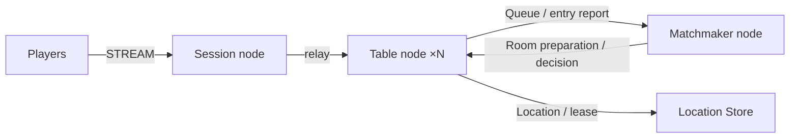

[한국어](README.ko.md)

# MyGame board tables

This project is a four-player board table server written in Kotlin. The Session node accepts STREAM connections, binds each connection to a Player Actor, and relays messages. The Table User Spot owns seats, chips, cards, and turns. The Player Actor tracks its own matchmaking ticket. The Matchmaker node hosts the Pool Spot and owns matchmaking decisions. Add game rules at the extension points described in [AGENTS.md](AGENTS.md).



## Prerequisites

Docker with Compose v2 and Linux containers, network access to Maven Central and the Gradle Plugin Portal, and PowerShell 7 on Windows. Install JDK 25 to run the server or the e2e client locally. The Windows `.cmd` launchers use PowerShell 7 with a process-scoped execution policy and restore the previous console code page on exit. The Gradle wrapper is included. `build.gradle.kts` pins the public ZLink Framework, STREAM connector, and Java binding packages. [Pinned package versions](AGENTS.md#project-overview)

## Build

Linux/WSL:

```sh
./run-e2e.sh --build-only
```

Windows:

```powershell
.\run-e2e.cmd -BuildOnly
```

## Run the local server

Start Docker, then run the server in its own terminal.

```sh
./run-server.sh
```

```powershell
.\run-server.cmd
```

The launcher builds the server and starts Redis, both Table nodes, Matchmaker, and Session. Once all nodes are ready, use the Session STREAM address printed on the `Server ready: ws://127.0.0.1:<port>` line. Press Ctrl+C in that terminal to stop its nodes and remove its Redis Compose project.

From another terminal, run `./run-e2e.sh` or `.\run-e2e.cmd`. The script discovers the running server through `.logs/server.json` and runs `table`, `reconnect`, `match`, and `match-cancel` against it. Select scenarios with `--scenario match` or `-Scenario match`. The `update` scenario drains and replaces a node and runs only in an isolated e2e run. Stop the foreground server before selecting `update`.

## Client connection

### Endpoint and first packet

Use the Session address from `Server ready:` or the `streamEndpoint` field of the Session node's `READY <json>` record. The default is `ws://127.0.0.1:0` in `server/config/session.json`. The OS chooses the port, and the WebSocket uses path `/`. Browsers, Unity WebGL, and Cocos Creator web can connect from the same host. HTTPS pages require `wss://`; remote clients need an externally reachable listener.

Loopback is reachable only inside the same host/network namespace. Keep a deployment running for external clients, bind to a reachable interface and port, and expose that port from containers. The Docker e2e deployment is temporary and is removed after the run. Mesh listeners and Redis are not game-client endpoints.

Send `JoinTableRequest(playerId, tableId)` to join a specific table. Successful seating produces a `TableView` push. `ActionRejected` reports rejection.

Send an empty `FindMatch` to join the matchmaking queue. The Session assigns a player ID when this is the first packet. `MatchQueued` returns a ticket ID, which the client can pass to `CancelMatch`. The Pool pairs the two longest-waiting players, prepares a new Table, and commits their seats after both Actors report successful entry. Each player receives `MatchFound` followed by `TableView` and uses the existing game messages at that table. The Pool allows 10 seconds for both Actors to enter. Waiting tickets expire after 120 seconds, and a disconnected waiting ticket has up to 15 seconds of grace.

After admission, `SessionInfoRequest` uses `connector.kotlin().request<SessionInfo>(SessionInfoRequest()).await()` for a correlated `SessionInfo` reply. The first game operation above uses `send(...).await()` and server pushes. This template does not authenticate player identity; add identity validation before Actor binding for production.

### Connector installation

Use the same connector release as this template pins in `build.gradle.kts`, `extra["frameworkVersion"]`; `e2e/build.gradle.kts` uses that key for `systems.zlink:zlink-stream-connector`. Replace `<version>` below with that pinned version. Engine installation instructions are in the linked repository READMEs; all clients use this template's packets.

| Client                             | Connector installation                                                                                                                                                                                                                                                                                                                                                                                                                                                          | Documentation guide                                                                                                                                                          |
| ---------------------------------- | ------------------------------------------------------------------------------------------------------------------------------------------------------------------------------------------------------------------------------------------------------------------------------------------------------------------------------------------------------------------------------------------------------------------------------------------------------------------------------- | ---------------------------------------------------------------------------------------------------------------------------------------------------------------------------- |
| Unity                              | Native/Editor: restore `Zlink.Stream.Connector` with NuGetForUnity. WebGL: add the `com.zlink.stream-connector.webgl` UPM Git package; include only the connector assembly for the active target. See the [Unity README](https://github.com/zlink-systems/zlink/blob/main/framework/languages/engines/Unity/README.md) and its package manifest.                                                                                                                                | [.NET engine integration](https://docs.zlink.systems/dotnet/guide/stream-connector/12-engine-integration/)                                                                   |
| Unreal                             | Copy `framework/languages/cpp/connector/engines/unreal` into `Plugins/ZLinkStreamConnector`, then package the native connector under `ThirdParty/ZLink` as described in the [Unreal README](https://github.com/zlink-systems/zlink/blob/main/framework/languages/engines/Unreal/README.md).                                                                                                                                                                                     | [C++ engine integration](https://docs.zlink.systems/cpp/guide/stream-connector/12-engine-integration/)                                                                       |
| Godot                              | .NET: add the NuGet package `Zlink.Stream.Connector` and run `dotnet restore`; see the [C# README](https://github.com/zlink-systems/zlink/blob/main/framework/languages/engines/Godot/csharp/README.md). GDExtension: build the C++ Godot adapter against the framework prebuilt and matching `godot-cpp`; see the [C++ README](https://github.com/zlink-systems/zlink/blob/main/framework/languages/engines/Godot/cpp/README.md). The .NET sample does not support Web export. | [.NET](https://docs.zlink.systems/dotnet/guide/stream-connector/12-engine-integration/), [C++](https://docs.zlink.systems/cpp/guide/stream-connector/12-engine-integration/) |
| Cocos Creator                      | Web target: `npm install @zlink-systems/stream-connector@<version>`; see the [Cocos Creator README](https://github.com/zlink-systems/zlink/blob/main/framework/languages/engines/CocosCreator/README.md). This package does not provide a Creator native adapter.                                                                                                                                                                                                                  | [TypeScript engine integration](https://docs.zlink.systems/node/guide/stream-connector/12-engine-integration/)                                                               |
| Axmol                              | Copy `framework/languages/cpp/connector/engines/axmol` into `third_party/zlink_axmol_connector` and link `zlink::stream_connector` from the installed C++ framework package; see the [Axmol README](https://github.com/zlink-systems/zlink/blob/main/framework/languages/engines/Axmol/README.md).                                                                                                                                                                              | [C++ engine integration](https://docs.zlink.systems/cpp/guide/stream-connector/12-engine-integration/)                                                                       |
| Web browser (TypeScript connector) | `npm install @zlink-systems/stream-connector@<version>`; import the package root in the browser build. Use `ws://` or `wss://`, subject to the page's security policy.                                                                                                                                                                                                                                                                                                             | [TypeScript connector](https://docs.zlink.systems/node/guide/stream-connector/)                                                                                              |
| C++                                | Install the C++ framework prebuilt containing the connector; use `find_package(zlink_stream_connector_cpp CONFIG REQUIRED)` and link `zlink::stream_connector`.                                                                                                                                                                                                                                                                                                                 | [C++ connector](https://docs.zlink.systems/cpp/guide/stream-connector/)                                                                                                      |
| C#/.NET                            | `dotnet add package Zlink.Stream.Connector --version <version>`                                                                                                                                                                                                                                                                                                                                                                                                                    | [.NET connector](https://docs.zlink.systems/dotnet/guide/stream-connector/)                                                                                                  |
| Java                               | Add Maven/Gradle dependency `systems.zlink:zlink-stream-connector:<version>`.                                                                                                                                                                                                                                                                                                                                                                                                      | [Java connector](https://docs.zlink.systems/java/guide/stream-connector/)                                                                                                    |
| Kotlin                             | Add `systems.zlink:zlink-stream-connector:<version>` and `systems.zlink:zlink-framework-kotlin:<version>` for the coroutine wrapper.                                                                                                                                                                                                                                                                                                                                                  | [Kotlin connector](https://docs.zlink.systems/kotlin/guide/stream-connector/)                                                                                                |
| Node                               | `npm install @zlink-systems/stream-connector@<version>`; use the package root and Node.js 22 or later.                                                                                                                                                                                                                                                                                                                                                     | [Node connector](https://docs.zlink.systems/node/guide/stream-connector/)                                                                                                    |

### Kotlin connection example

The example uses the same public connector and Kotlin coroutine wrapper as `e2e/src/main/kotlin/MyGame/e2e/Client.kt`. Save it as `e2e/src/main/kotlin/MyGame/e2e/ConnectOnce.kt` in a copy of the template. It defines a suspending function to call from your application coroutine while the deployment is running; compile it with `./gradlew --no-daemon --max-workers=4 :e2e:compileKotlin`.

```kotlin
package MyGame.e2e

import MyGame.*
import java.net.URI
import java.time.Duration
import java.util.concurrent.CompletableFuture
import kotlinx.coroutines.CompletableDeferred
import kotlinx.coroutines.withTimeout
import systems.zlink.framework.kotlin.*
import systems.zlink.stream.connector.*

suspend fun connectOnce(endpoint: String, playerId: String) {
    val d = ZLinkStreamConnectorOptions.createDefault(URI(endpoint))
    val connector = ZLinkStreamConnectorFactory.create(
        ZLinkStreamConnectorOptions(
            URI(endpoint), ZLinkStreamDispatchMode.IMMEDIATE, Duration.ofSeconds(5),
            d.maxReconnectAttempts(), d.connectTimeout(), d.maxSendPayloadSize(),
            d.heartbeatEnabled(), d.heartbeatInterval(), d.heartbeatTimeout(), false,
            d.reconnectInitialDelay(), d.reconnectMaxDelay(), d.reconnectBackoffFactor(),
        )
    )
    val response = CompletableDeferred<TableView>()
    val registrations = listOf(
        connector.on(TableView::class.java) { message ->
            response.complete(message.payload())
            CompletableFuture.completedFuture(null)
        },
        connector.on(ActionRejected::class.java) { message ->
            response.completeExceptionally(IllegalStateException(message.payload().toString()))
            CompletableFuture.completedFuture(null)
        },
        connector.onErrorReceived { event ->
            response.completeExceptionally(IllegalStateException(event.toString()))
            CompletableFuture.completedFuture(null)
        },
        connector.onDisconnected { event ->
            response.completeExceptionally(IllegalStateException(event.toString()))
            CompletableFuture.completedFuture(null)
        },
    )
    try {
        connector.kotlin().connect().await()
        connector.kotlin().send(JoinTableRequest(playerId, "guide-table")).await()
        println(withTimeout(5_000) { response.await() })
    } finally {
        try { connector.kotlin().close().await() }
        finally { registrations.forEach { it.close() } }
    }
}
```

## Isolated e2e

When no foreground server is running, `run-e2e` starts an isolated run. Docker builds a shared node image for all roles and a runner image. The pinned Eclipse Temurin JDK/JRE bases are defined by the Dockerfile ARGs. The runner uses the Docker socket to create sibling nodes sharing its network namespace, preserving loopback listeners and stdin/stdout control. Each invocation removes its containers, network and image tags; cleanup errors return exit 1. Logs remain in `.logs/`.

For local process debugging, run `./run-e2e.sh --local` or `.\run-e2e.cmd -Local`. Local mode uses JDK 25 and Compose Redis. Scenario and structure options work in both modes.

```sh
./run-e2e.sh
./run-e2e.sh --scenario table,reconnect,match,match-cancel,update
./run-e2e.sh --check-structure
```

```powershell
.\run-e2e.cmd
.\run-e2e.cmd -Scenario table,reconnect,match,match-cancel,update
.\run-e2e.cmd -CheckStructure
```

The console prints a header and result for each scenario and a final pass count. The runner checks the structure, then starts Redis in a uniquely named Compose project, two Table nodes, a Matchmaker node, and the Session node. The OS assigns the Redis, mesh, and STREAM ports. Each run keeps its key prefix, configuration, stdout, stderr, and message flow records under `.logs/run-<id>/`. Cleanup stops only the processes and the Compose project that the run created. The exit code is 1 when a scenario or the cleanup fails.

| Scenario | Observable behavior |
| --- | --- |
| `table` | Seat assignment, private cards, rejection of server-originated packets, out-of-turn bets, out-of-range values (`integer-out-of-range`), and insufficient chips. Each rejection has `retryAfterMs: 0` and leaves table state unchanged. Settlement reports `cardCount: 0` for every seat; a private-hand query returns an empty list. |
| `reconnect` | The `SessionInfo` sessionId changes while actorId and objectGeneration stay the same. Seat, cards, and turn persist; settlement clears every hand and a later private-hand query returns an empty list. |
| `match` | Two queued players receive the same room ID and distinct seats, then settle a hand. |
| `match-cancel` | A queued player cancels with reason `cancelled`. Two subsequent players match. |
| `update` | Both clients keep their `SessionInfo` before and after drain. Table state persists through settlement on another node and source replacement; settlement clears every hand, and a later private-hand query returns an empty list. |

`SessionInfo` carries the Session ID and the ID and generation of the bound Actor. `TableView` carries only the table state. The Session node answers `SessionInfoRequest`. A request handler sends its response to the requesting Actor's bound session; other state pushes use the public Actor send API.

## Structure and extension

`server/shared` provides messages, constants, configuration, and the common bootstrap. `server/session` provides STREAM, Actor binding, and relay. `server/table` provides the game, the Entry Spot, and the relocation adapters. `server/matchmaker` hosts the in-memory Pool Spot `pool-board`. Edit `MatchRule.kt` to change how the Pool chooses a pair. `e2e` provides the public stream connector client and the process runner. The project uses the default typed JSON serializer. Spring Boot supplies the public Framework bootstrap and constructor injection and does not run an HTTP server.

The Table Spot uses the default SPOT_WIDE execution gate. State changes are not protected by a separate lock or queue. The Table adapter stores only application state as JSON, and the Player adapter stores the current ticket and assignment. The Framework transfers Actor identity, generation, membership, and session routes.

Message Follow is explicitly configured for 30 seconds. The `SAFE_TO_SHUTDOWN` observation budget is that period plus the existing relocation budget. Update waits for replacement `READY`, then asserts that the replacement hosts the new table and completes a hand.

## Framework behavior to know

- **Waiting for DB or file I/O in a handler** — An ordinary async terminal retains the turn, while `Yield` lets other handlers on the same Spot proceed. [Guide](https://docs.zlink.systems/kotlin/guide/server/32-execution-model/#io-worker-wait).
- **Creation that misses its deadline** — `DeadlineExceeded` and caller cancellation have distinct outcomes. [Guide](https://docs.zlink.systems/kotlin/guide/server/22-actor/#creation-deadline). [server/session/src/main/kotlin/MyGame/session/Program.kt:86](server/session/src/main/kotlin/MyGame/session/Program.kt).
- **Many logins at once** — Each creation for a different ID requires a Location Store round trip, so measure expected load when setting the deadline. [Guide](https://docs.zlink.systems/kotlin/guide/server/25-location/#creation-load).
- **Sending under load** — Send waits for capacity, and the application sees the final result. [Guide](https://docs.zlink.systems/kotlin/guide/server/33-backpressure/#send-backpressure). [server/session/src/main/kotlin/MyGame/session/Program.kt:60](server/session/src/main/kotlin/MyGame/session/Program.kt).
- **Duplicate login** — Without a callback, a bind from another Session is accepted; reject it in the Actor duplicate-bind callback to prevent this. [Guide](https://docs.zlink.systems/kotlin/guide/server/39-session-binding/#duplicate-session-bind). This template keeps the default (accepts the new Session).
- **ObjectGeneration** — `ObjectGeneration` distinguishes logical incarnations of the same ID; it is not a data version or write authority. [Guide](https://docs.zlink.systems/kotlin/guide/server/34-activation-lifetime/#object-generation). [server/session/src/main/kotlin/MyGame/session/Program.kt:75](server/session/src/main/kotlin/MyGame/session/Program.kt).
- **READY and Serving** — The Framework host prints `READY` after observing runtime `Serving`. [Guide](https://docs.zlink.systems/kotlin/guide/server/12-operations/#wait-for-serving). [server/shared/src/main/kotlin/MyGame/Hosting.kt:132](server/shared/src/main/kotlin/MyGame/Hosting.kt); [server/shared/src/main/kotlin/MyGame/Hosting.kt:146](server/shared/src/main/kotlin/MyGame/Hosting.kt).

## Deployment sequence

Prepare Redis, then set the endpoints and the shared key prefix in `server/config/*.json` for the target environment. Start Table nodes A and B and the Matchmaker node, wait for `READY` from each, then start the Session node. Node IDs must match between the configuration and the structure file. Starting a replacement process with the same ID still gives it a new routing identity from the Framework.

Example server commands (JDK 25):

```sh
java --enable-native-access=ALL-UNNAMED -cp 'server/table/build/install/table/lib/*' MyGame.table.ProgramKt server/config/table-a.json
java --enable-native-access=ALL-UNNAMED -cp 'server/table/build/install/table/lib/*' MyGame.table.ProgramKt server/config/table-b.json
java --enable-native-access=ALL-UNNAMED -cp 'server/matchmaker/build/install/matchmaker/lib/*' MyGame.matchmaker.ProgramKt server/config/matchmaker.json
java --enable-native-access=ALL-UNNAMED -cp 'server/session/build/install/session/lib/*' MyGame.session.ProgramKt server/config/session.json
```

Writing `drain` to a Table process's stdin produces `RELOCATION_REQUESTED`, `RELOCATED`, and `SAFE_TO_SHUTDOWN` in that order. The process prints `SAFE_TO_SHUTDOWN` after confirming it from runtime observation. Then send `shutdown`, wait for `STOPPED`, and start a replacement process with the same configuration. `READY` includes the actual listener endpoint.

The Windows runner starts the JDK 25 that Gradle selected directly. The `lib/*` classpath avoids the cmd classpath length limit. For manual runs, use the JDK 25 `java.exe`, quote the classpath wildcard, and keep the `--enable-native-access=ALL-UNNAMED` argument.

The e2e runner sets each node's optional `tableCapacity` to the number of selected scenarios through the public Table stable-type limit. Each scenario retains one table. After update drains the source, the surviving node is at capacity, so only the replacement can host the new table. Both new players must observe the replacement node ID. Omitted or zero capacity leaves deployment capacity unlimited. Entry Spots belong to the Table nodes. Matchmaker starts the fixed `pool-board` Instance Spot.

Before the scenarios, the runner executes the server table's `--check-domain` mode. It checks seven domain boundaries and reports `Domain checks: 7/7 passed`, then verifies the `ActionRejected` JSON contract. `retryAfterMs` is a signed 32-bit JSON integer with the lower camel case property name; chips, pot, and hand numbers remain 64-bit integers.
