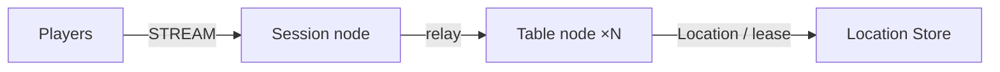

# MyGame board tables

This project is a four-player board table server written in Kotlin. The Session node accepts STREAM connections, binds each connection to a Player Actor, and relays messages. The Table User Spot owns seats, chips, cards, and turns. The Player Actor keeps no copy of game state. Add game rules at the extension points described in [AGENTS.md](AGENTS.md).



## Prerequisites

- JDK 17 or later, enough to start Gradle. The Gradle 9.3.0 wrapper and the Foojay resolver download the JDK 25 that compilation and execution require.
- Docker Compose v2 and a Docker daemon that supports Linux containers.
- PowerShell 7 on Windows.
- Network access to Maven Central, the Gradle Plugin Portal, the JDK distribution server, and a Docker registry for the first build and run.

The project uses Framework 0.30.0 and binding 1.19.0 as public Maven packages. The versions are set in the root `build.gradle.kts`. The project references neither repository sources nor a local package feed, so this directory can be copied and used on its own.

## Build

Linux/WSL:

```sh
./gradlew --no-daemon installDist
```

Windows:

```powershell
./gradlew.bat --no-daemon installDist
```

## Local e2e

```sh
./run-e2e.sh
./run-e2e.sh --scenario table,reconnect,update
./run-e2e.sh --check-structure
```

```powershell
pwsh -NoProfile -File ./run-e2e.ps1
pwsh -NoProfile -File ./run-e2e.ps1 -Scenario table,reconnect,update
pwsh -NoProfile -File ./run-e2e.ps1 -CheckStructure
```

The runner checks the structure, then starts Redis in a uniquely named Compose project, two Table nodes, and the Session node. The OS assigns the Redis, mesh, and STREAM ports. Each run keeps its key prefix, configuration, stdout, stderr, and message flow records under `.logs/run-<id>/`. Cleanup stops only the processes and the Compose project that the run created. The exit code is 1 when a scenario or the cleanup fails.

| Scenario | Observable behavior |
| --- | --- |
| `table` | Seat assignment, private cards, rejection of an out-of-turn action, betting, settlement, and chip conservation. |
| `reconnect` | The `SessionInfo` sessionId changes while actorId and objectGeneration stay the same. Seat, cards, and turn are preserved, and the other client stays connected. |
| `update` | Both clients keep their `SessionInfo` before and after drain. The hand in progress keeps its state and connections, the source node is stopped and replaced, and a new hand settles. |

`SessionInfo` carries the Session ID and the ID and generation of the bound Actor. `TableView` carries only the table state. The Session node answers `SessionInfoRequest`. A request handler sends its response to the requesting Actor's bound session; other state pushes use the public Actor send API.

## Structure and extension

`server/shared` provides messages, constants, configuration, and the common bootstrap. `server/session` provides STREAM, Actor binding, and relay. `server/table` provides the game, the Entry Spot, and the relocation adapter. `e2e` provides the public stream connector client and the process runner. The project uses the default typed JSON serializer. Spring Boot supplies the public Framework bootstrap and constructor injection and does not run an HTTP server.

The Table Spot uses the default SPOT_WIDE execution gate. State changes are not protected by a separate lock or queue. The Table adapter stores only application state as JSON, and the Player adapter's application state is empty. The Framework transfers Actor identity, generation, membership, and session routes.

Message Follow is explicitly configured for 30 seconds. The `SAFE_TO_SHUTDOWN` observation budget is that period plus the existing relocation budget. Update waits for replacement `READY`, then completes a hand at a new table; normal placement may select either live Table node.

## Deployment sequence

Prepare Redis, then set the endpoints and the shared key prefix in `server/config/*.json` for the target environment. Start Table nodes A and B first and wait for `READY`, then start the Session node. Node IDs must match between the configuration and the structure file. Starting a replacement process with the same ID still gives it a new routing identity from the Framework.

Example server commands (JDK 25):

```sh
java --enable-native-access=ALL-UNNAMED -cp 'server/table/build/install/table/lib/*' MyGame.table.ProgramKt server/config/table-a.json
java --enable-native-access=ALL-UNNAMED -cp 'server/table/build/install/table/lib/*' MyGame.table.ProgramKt server/config/table-b.json
java --enable-native-access=ALL-UNNAMED -cp 'server/session/build/install/session/lib/*' MyGame.session.ProgramKt server/config/session.json
```

Writing `drain` to a Table process's stdin produces `RELOCATION_REQUESTED`, `RELOCATED`, and `SAFE_TO_SHUTDOWN` in that order. The process prints `SAFE_TO_SHUTDOWN` after confirming it from runtime observation. Then send `shutdown`, wait for `STOPPED`, and start a replacement process with the same configuration. `READY` includes the actual listener endpoint.

The Windows runner starts the JDK 25 that Gradle selected directly. The `lib/*` classpath avoids the cmd classpath length limit. For manual runs, use the JDK 25 `java.exe`, quote the classpath wildcard, and keep the `--enable-native-access=ALL-UNNAMED` argument.

## 한국어 실행 안내

이 프로젝트는 Session node 하나와 Table node 두 개, Redis를 실행하는 4인 보드 테이블 서버입니다. `run-e2e.sh` 또는 `run-e2e.ps1`을 실행하면 구조를 검사하고 `table`, `reconnect`, `update` 시나리오로 좌석·카드·베팅·재연결·노드 교체의 실제 동작을 확인합니다. 시나리오 실패나 정리 실패가 있으면 종료 코드는 1입니다.

시나리오를 고르려면 `./run-e2e.sh --scenario table,reconnect,update`(Windows는 `-Scenario`)를 사용합니다. 포트는 실행마다 OS가 배정하며, runner는 자신이 만든 process와 Compose project만 정리합니다.

로그, 설정, message flow 기록은 `.logs/run-<id>/`에 남습니다. 실패하면 이 폴더의 첫 오류부터 확인하십시오. 게임 규칙을 추가할 위치와 공개 API 사용 규칙은 `AGENTS.md`를 따릅니다.
