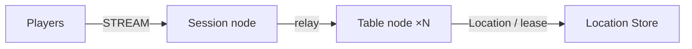

# MyGame board tables

This project is a four-player board table server written in Kotlin. The Session node accepts STREAM connections, binds each connection to a Player Actor, and relays messages. The Table User Spot owns seats, chips, cards, and turns. The Player Actor keeps no copy of game state. Add game rules at the extension points described in [AGENTS.md](AGENTS.md).



## Prerequisites

Docker with Compose v2 and Linux containers, network access to Maven Central and the Gradle Plugin Portal, and PowerShell 7 on Windows. JDK 25 is required only for local process debugging. The Gradle wrapper is included; public package versions are pinned in `build.gradle.kts`.

## Build

Linux/WSL:

```sh
./run-e2e.sh --build-only
```

Windows:

```powershell
pwsh -NoProfile -File ./run-e2e.ps1 -BuildOnly
```

## Docker e2e

Docker builds a shared node image for all roles and a runner image. The pinned Eclipse Temurin JDK/JRE bases are defined by the Dockerfile ARGs. The runner uses the Docker socket to create sibling nodes sharing its network namespace, preserving loopback listeners and stdin/stdout control. Each invocation removes its containers, network and image tags; cleanup errors return exit 1. Logs remain in `.logs/`.

For local process debugging, run `./run-e2e.sh --local` or `pwsh -NoProfile -File ./run-e2e.ps1 -Local`. Local mode uses JDK 25 and Compose Redis. Scenario and structure options work in both modes.

```sh
./run-e2e.sh
./run-e2e.sh --scenario table,reconnect,update
./run-e2e.sh --check-structure
```

```powershell
pwsh -NoProfile -File ./run-e2e.ps1
pwsh -NoProfile -File ./run-e2e.ps1 -Scenario table,reconnect,update
pwsh -NoProfile -File ./run-e2e.ps1 -CheckStructure
```

The runner checks the structure, then starts Redis in a uniquely named Compose project, two Table nodes, and the Session node. The OS assigns the Redis, mesh, and STREAM ports. Each run keeps its key prefix, configuration, stdout, stderr, and message flow records under `.logs/run-<id>/`. Cleanup stops only the processes and the Compose project that the run created. The exit code is 1 when a scenario or the cleanup fails.

| Scenario | Observable behavior |
| --- | --- |
| `table` | Seat assignment, private cards, rejection of server-originated packets, out-of-turn bets, out-of-range values (`integer-out-of-range`), and insufficient chips. Each rejection has `retryAfterMs: 0` and leaves table state unchanged. Settlement reports `cardCount: 0` for every seat; a private-hand query returns an empty list. |
| `reconnect` | The `SessionInfo` sessionId changes while actorId and objectGeneration stay the same. Seat, cards, and turn persist; settlement clears every hand and a later private-hand query returns an empty list. |
| `update` | Both clients keep their `SessionInfo` before and after drain. Table state persists through settlement on another node and source replacement; settlement clears every hand, and a later private-hand query returns an empty list. |

`SessionInfo` carries the Session ID and the ID and generation of the bound Actor. `TableView` carries only the table state. The Session node answers `SessionInfoRequest`. A request handler sends its response to the requesting Actor's bound session; other state pushes use the public Actor send API.

## Structure and extension

`server/shared` provides messages, constants, configuration, and the common bootstrap. `server/session` provides STREAM, Actor binding, and relay. `server/table` provides the game, the Entry Spot, and the relocation adapter. `e2e` provides the public stream connector client and the process runner. The project uses the default typed JSON serializer. Spring Boot supplies the public Framework bootstrap and constructor injection and does not run an HTTP server.

The Table Spot uses the default SPOT_WIDE execution gate. State changes are not protected by a separate lock or queue. The Table adapter stores only application state as JSON, and the Player adapter's application state is empty. The Framework transfers Actor identity, generation, membership, and session routes.

Message Follow is explicitly configured for 30 seconds. The `SAFE_TO_SHUTDOWN` observation budget is that period plus the existing relocation budget. Update waits for replacement `READY`, then asserts that the replacement hosts the new table and completes a hand.

## Deployment sequence

Prepare Redis, then set the endpoints and the shared key prefix in `server/config/*.json` for the target environment. Start Table nodes A and B first and wait for `READY`, then start the Session node. Node IDs must match between the configuration and the structure file. Starting a replacement process with the same ID still gives it a new routing identity from the Framework.

Example server commands (JDK 25):

```sh
java --enable-native-access=ALL-UNNAMED -cp 'server/table/build/install/table/lib/*' MyGame.table.ProgramKt server/config/table-a.json
java --enable-native-access=ALL-UNNAMED -cp 'server/table/build/install/table/lib/*' MyGame.table.ProgramKt server/config/table-b.json
java --enable-native-access=ALL-UNNAMED -cp 'server/session/build/install/session/lib/*' MyGame.session.ProgramKt server/config/session.json
```

Writing `drain` to a Table process's stdin produces `RELOCATION_REQUESTED`, `RELOCATED`, and `SAFE_TO_SHUTDOWN` in that order. The process prints `SAFE_TO_SHUTDOWN` after confirming it from runtime observation. Then send `shutdown`, wait for `STOPPED`, and start a replacement process with the same configuration. `READY` includes the actual listener endpoint.

The Windows runner starts the JDK 25 that Gradle selected directly. The `lib/*` classpath avoids the cmd classpath length limit. For manual runs, use the JDK 25 `java.exe`, quote the classpath wildcard, and keep the `--enable-native-access=ALL-UNNAMED` argument.

The e2e runner sets each node's optional `tableCapacity` to the number of selected scenarios through the public Table stable-type limit. Each scenario retains one table. After update drains the source, the surviving node is at capacity, so only the replacement can host the new table. Both new players must observe the replacement node ID. Omitted or zero capacity leaves deployment capacity unlimited. Entry declarations describe the application Entry on Table nodes only; there are no fixed User Spots in this template.

Before the scenarios, the runner executes the server table's `--check-domain` mode. It checks seven domain boundaries and reports `Domain checks: 7/7 passed`, then verifies the `ActionRejected` JSON contract. `retryAfterMs` is a signed 32-bit JSON integer with the lower camel case property name; chips, pot, and hand numbers remain 64-bit integers.

## 한국어 실행 안내

기본 e2e는 Docker에서 실행합니다. 로컬 process 디버깅은 JDK 25를 준비하고 `--local` 또는 `-Local`로 실행합니다. 이 프로젝트는 Session node 하나와 Table node 두 개, Redis를 실행하는 4인 보드 테이블 서버입니다. runner는 시나리오 전에 Table server의 `--check-domain`을 실행해 `Domain checks: 7/7 passed`를 출력하고 `ActionRejected` JSON 계약을 검사합니다. `retryAfterMs`는 lower camel case JSON 필드인 signed 32-bit 정수이며, 칩·pot·hand 번호는 64-bit 정수입니다. 이어서 구조를 검사하고 `table`, `reconnect`, `update` 시나리오로 좌석·카드·베팅·재연결·노드 교체의 실제 동작을 확인합니다. `table`은 내부 packet과 잘못된 행동을 거부하고, 상한 초과는 `integer-out-of-range`로 응답하며 `retryAfterMs`가 0이고 상태가 유지되는지 확인합니다. 정산 직후 모든 좌석의 `cardCount`가 0이고, 이후 개인 패 조회가 빈 목록을 반환하는지도 확인합니다. `reconnect`와 `update`는 상태 보존 뒤 정산과 빈 패 조회를 확인합니다. 시나리오나 정리 실패 시 종료 코드는 1입니다.

시나리오를 고르려면 `./run-e2e.sh --scenario table,reconnect,update`(Windows는 `-Scenario`)를 사용합니다. 포트는 실행마다 OS가 배정하며, runner는 자신이 만든 process와 Compose project만 정리합니다.

로그, 설정, message flow 기록은 `.logs/run-<id>/`에 남습니다. 실패하면 이 폴더의 첫 오류부터 확인하십시오. 도메인 규칙은 server가 검사하고 계산하며, 현재 거부 응답 `ActionRejected`의 `retryAfterMs`는 0입니다. 게임 규칙을 추가할 위치와 공개 API 사용 규칙은 `AGENTS.md`를 따릅니다.
