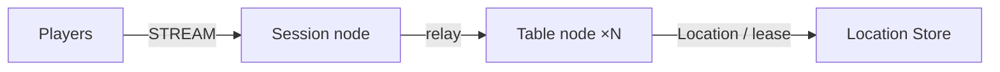

# MyGame board tables

Kotlin으로 작성한 4인 보드 테이블 서버입니다. Session node가 STREAM 연결을 받고 Player Actor에 bind한 뒤 메시지를 relay합니다. Table User Spot이 좌석·칩·카드·차례를 소유합니다. Player Actor에는 게임 상태의 사본을 두지 않습니다.



## 준비물

JDK 17 이상으로 Gradle을 시작할 수 있어야 합니다. Gradle 9.3.0 wrapper와 Foojay resolver가 컴파일·실행에 필요한 JDK 25를 내려받습니다. Docker Compose v2와 Linux container를 지원하는 Docker daemon, Windows에서는 PowerShell 7이 필요합니다. 첫 빌드와 실행에는 Maven Central·Gradle Plugin Portal·JDK 배포 서버·Docker registry에 접근할 수 있어야 합니다.

Framework 0.30.0과 binding 1.19.0을 공개 Maven package로 사용합니다. 버전은 루트 `build.gradle.kts`에서 지정합니다. 저장소 소스나 로컬 package feed를 참조하지 않으므로 이 디렉터리만 복사하여 사용할 수 있습니다.

## Build

Linux/WSL:

```sh
./gradlew --no-daemon installDist
```

Windows:

```powershell
./gradlew.bat --no-daemon installDist
```

## Local e2e

```sh
./run-e2e.sh
./run-e2e.sh --scenario table,reconnect,update
./run-e2e.sh --check-structure
```

```powershell
pwsh -NoProfile -File ./run-e2e.ps1
pwsh -NoProfile -File ./run-e2e.ps1 -Scenario table,reconnect,update
pwsh -NoProfile -File ./run-e2e.ps1 -CheckStructure
```

runner는 구조를 검사한 다음 고유 Compose project의 Redis와 Table node 두 개, Session node를 시작합니다. Redis·mesh·STREAM 포트는 OS가 배정합니다. 실행별 key prefix·설정·stdout·stderr·message flow 기록은 `.logs/run-<id>/`에 보존합니다. 정리 단계에서는 그 실행이 생성한 process와 Compose project만 종료합니다. 시나리오 실패 또는 정리 실패 시 종료 코드는 1입니다.

| 시나리오 | 확인하는 동작 |
| --- | --- |
| `table` | 좌석 배정, 비공개 카드, 잘못된 차례 거부, 베팅, 결산과 칩 보존 |
| `reconnect` | `SessionInfo`의 sessionId 변경과 actorId·objectGeneration 유지, 좌석·카드·차례 유지, 다른 client 연결 유지 |
| `update` | drain 전후 두 client의 `SessionInfo` 유지, 진행 중인 판의 상태·연결 유지, source 종료·교체, 새 판 결산 |

`SessionInfo`는 Session ID와 bind된 Actor의 ID·generation을 담고, `TableView`는 테이블 상태만 담습니다. `SessionInfoRequest`는 Session node가 답합니다. 요청 handler의 응답은 요청 Actor의 bound session으로 보내고, 그 밖의 상태 push는 공개 Actor send API를 사용합니다.

## 구성과 확장

`server/shared`는 메시지·상수·설정과 공통 bootstrap, `server/session`은 STREAM·Actor bind·relay, `server/table`은 게임·Entry Spot·relocation adapter, `e2e`는 공개 stream connector client와 process runner를 제공합니다. 기본 typed JSON serializer를 사용합니다. Spring Boot는 공개 Framework bootstrap과 생성자 주입을 담당하며 HTTP server를 실행하지 않습니다.

Table Spot은 기본 SPOT_WIDE execution gate를 사용합니다. 상태 변경을 별도 lock이나 queue로 보호하지 않습니다. Table adapter는 application 상태만 JSON으로 저장하고 Player adapter의 application 상태는 비어 있습니다. Framework가 Actor identity·generation·membership·session route를 이전합니다.

## 배포 순서와 node 제어

Redis를 준비한 뒤 `server/config/*.json`의 endpoint와 공통 key prefix를 배포 환경에 맞게 설정합니다. Table node A·B를 먼저 시작하고 `READY`를 확인한 다음 Session node를 시작합니다. node Id는 설정과 구조 파일 사이에 일치해야 합니다. 같은 Id로 대체 process를 시작해도 Framework가 새 routing identity를 발급합니다.

서버 실행 예시(JDK 25):

```sh
java --enable-native-access=ALL-UNNAMED -cp 'server/table/build/install/table/lib/*' MyGame.table.ProgramKt server/config/table-a.json
java --enable-native-access=ALL-UNNAMED -cp 'server/table/build/install/table/lib/*' MyGame.table.ProgramKt server/config/table-b.json
java --enable-native-access=ALL-UNNAMED -cp 'server/session/build/install/session/lib/*' MyGame.session.ProgramKt server/config/session.json
```

Table process의 stdin에 `drain`을 쓰면 `RELOCATION_REQUESTED`, `RELOCATED`, `SAFE_TO_SHUTDOWN`을 순서대로 확인할 수 있습니다. `SAFE_TO_SHUTDOWN`은 runtime observation에서 확인한 뒤 출력합니다. 그다음 `shutdown`을 보내 `STOPPED`를 확인하고 같은 설정으로 대체 process를 시작합니다. `READY`에는 실제 listener endpoint가 포함됩니다.

Windows runner는 Gradle이 선택한 JDK 25를 직접 실행합니다. `lib/*` classpath를 사용하므로 cmd의 classpath 길이 제한을 피합니다. 수동 실행에서는 JDK 25의 `java.exe`를 사용하고 classpath wildcard를 따옴표로 감쌉니다. `--enable-native-access=ALL-UNNAMED` 인자를 유지합니다.
