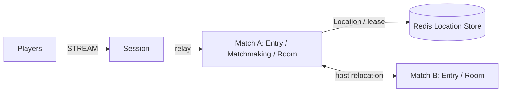

# MyGame FPS entry lobby

This Kotlin FPS template pairs players by mode through a fixed Matchmaking User Spot. Entry Spots forward admission; dynamic Room User Spots own positions, HP, action sequences, and the winner. Session binding owns Actor identity. Disconnected players resume the same Actor and Room; draining a Match host relocates ongoing matches without reconnecting clients.



## Prerequisites

Docker with Compose v2 and Linux containers, network access to Maven Central and the Gradle Plugin Portal, and PowerShell 7 on Windows. JDK 25 is required only for local process debugging. The Gradle wrapper is included; public package versions are pinned in `build.gradle.kts`.

## Build

Run from this project root.

```sh
./run-e2e.sh --build-only
```

PowerShell:

```powershell
pwsh -NoProfile -File ./run-e2e.ps1 -BuildOnly
```

## Local e2e

The Docker runner builds a shared node image and a runner image. It creates sibling nodes that share its network namespace, preserving loopback listeners and stdin/stdout control. Each invocation removes its containers, network, and image tags; cleanup errors return exit code 1. Logs remain in `.logs/`.

For host-process debugging, run `./run-e2e.sh --local` or `pwsh -NoProfile -File ./run-e2e.ps1 -Local`. Local mode uses JDK 25 and Compose Redis. Scenario and structure options work in both modes.

```sh
./run-e2e.sh
./run-e2e.sh --scenario matchmaking,hit,wall,input,reconnect,update
./run-e2e.sh --check-structure
```

```powershell
pwsh -NoProfile -File ./run-e2e.ps1
pwsh -NoProfile -File ./run-e2e.ps1 -Scenario matchmaking,hit,wall,input,reconnect,update
pwsh -NoProfile -File ./run-e2e.ps1 -CheckStructure
```

| Scenario | Observations |
| --- | --- |
| matchmaking | Requests in different modes receive separate Rooms; same-mode requests receive the same Room. |
| hit | A hit deals 25 damage; upward and out-of-range shots miss; four hits finish the match and identify the winner. |
| wall | An intervening wall blocks damage; a wall behind the target permits a hit. |
| input | Shared sequence, movement boundaries, movement budget, fire interval, unchanged rejected state, and server-issued retry delays. |
| reconnect | A new Session retains the same Actor, Room, position, HP, and last sequence; reconnecting after match completion retains the winner. |
| update | Relocation completes, the old host shuts down safely, the connection and Room state remain unchanged, and the replacement accepts a new Room. |

Each scenario uses its own Redis Compose project, ephemeral loopback ports, key prefix, and node processes. Configuration and stdout/stderr logs remain in `.logs/run-<id>/`. Framework message-flow diagnostics run at Normal and write to stderr. Cleanup failures fail the run. `RoomStateTest.kt` contains the 46 game-domain boundary checks and runs with `./gradlew --no-daemon :server:match:test`.

Message Follow is configured explicitly to 30 seconds. After `RELOCATED`, the safe-shutdown observation budget is the follow duration plus the existing relocation observation budget; the relocation operation deadline is unchanged.

## Deployment sequence

Wait for the bootstrap owner to report `READY` before starting another Match host. Its public GetOrCreate completes while it is the only placement candidate, so the fixed Matchmaking Spot starts on its declared owner.

Start Redis, then Match A with `bootstrap: true`, Match B, and Session. Each node has a separate entry point; both Match nodes use the Match application. Set production endpoints and a deployment-specific Redis key prefix in `server/config/`. The e2e runner overrides Redis addressing and the prefix for each run, sets Room capacity to one per Match host, and obtains actual port-zero endpoints from `READY`. The capacity setting lets the update scenario verify that the replacement accepts a new Room while the surviving host retains the relocated Room.

For planned maintenance, send `drain` to the Room host's stdin and wait for `RELOCATION_REQUESTED`, `RELOCATED`, and `SAFE_TO_SHUTDOWN`. Send `shutdown`, wait for `STOPPED`, and start the replacement with the same configuration; bootstrap uses GetOrCreate and accepts the existing Matchmaking object on the surviving host. The runner performs this sequence through the public relocation API.

## FPS rules and extension points

`QueueRequest` is the first client packet. An omitted mode defaults to `duel`. This example accepts a claimed player ID; replace this boundary with authenticated identity before deployment. Session relays only `QueueRequest`, `RoomViewRequest`, `MoveRequest`, `ShootRequest`, and `SessionInfoRequest`. Internal assignment and result packets are rejected as `packet-not-allowed`. Messages use the default typed Framework serializer.

Coordinates use `Vec3(x, y, z)` with Y up. `ArenaMap` defines X/Z bounds 0 through 100 and Y bounds 0 through 10, two static AABBs, and two ordered spawn points. A player hit box is 1 wide, 2 high, and 1 deep from the feet, with eye height 1.6. Feet remain at Y=0. Vertical movement is rejected as `vertical-move`; jumping and gravity are not implemented. Movement tests the feet-position segment against closed wall boxes, including contact at the endpoint. It does not implement swept player-volume collision.

`MoveRequest(delta, sequence)` has a maximum step of 2 and a speed budget of 10 units per second, capped at 2 since the last accepted movement. First movement has the full budget. Non-finite deltas, nonzero `delta.y`, oversized steps, map exits, wall intersections, and budget overruns are rejected. `ShootRequest(aimDirection, sequence)` normalizes finite nonzero aim, casts from the authoritative eye position up to 80 units, and chooses the closest wall or living player AABB. Wall ties and box contact block the ray. A hit causes 25 damage; accepted misses and wall-blocked shots still consume their sequence and 250 ms fire interval. There is no ammunition model. The Framework message model carries only finite JSON numbers, so nonfinite input reaches only the domain checks.

Move and Shoot share one increasing sequence. Rejections change neither position, HP, sequence, nor movement/fire timing. `retryAfterMs` is positive only for movement-budget or fire-interval rejection; clients wait that reported duration and resend the same input. `MoveResult` and `ShotResult` acknowledge accepted actions; rejection packets report rejected inputs. `RoomView` includes all positions, HP, last sequences, phase, and winner so a fresh client can continue with its last sequence plus one. At zero HP the match finishes and later Move/Shoot inputs are rejected.

Hit detection uses current server state. There is no lag compensation, projectile simulation, or client prediction. Extend `RoomState` for weapons and match rules, `Geometry.kt` for level geometry and spawn selection, and the shared contracts for client-facing actions. Keep cooldown, movement budget, and hit decisions in `RoomState`. `RoomSnapshot` carries only remaining milliseconds for timing; it never transfers a process's absolute clock reading.

## 한국어 실행 안내

기본 e2e는 Docker에서 실행합니다. 로컬 process 디버깅은 JDK 25를 준비하고 `--local` 또는 `-Local`로 실행합니다. Windows에서는 PowerShell 7을 사용합니다. runner는 시나리오마다 별도 Redis Compose project와 key prefix를 만들고 임시 port를 사용하며, 실행 설정과 message-flow 기록을 `.logs/run-<id>/`에 보존합니다.

대기열과 Room 배정은 고정 Matchmaking User Spot이 소유하며, Entry Spot은 플레이어를 해당 Spot으로 보냅니다. RoomState가 위치·HP·phase·winner·공유 순번·이동 예산·발사 간격·명중 판정을 소유합니다. 이동 최대 길이는 2, 속도 예산은 초당 10이며 수락된 이동 뒤 최대 2까지 회복합니다. 사거리는 80, 피해량은 25, HP는 100, 발사 간격은 250 ms입니다. 발 위치 Y는 0이며 수직 이동은 `vertical-move`로 거부합니다. 점프·중력·지연 보정·투사체·클라이언트 예측은 없습니다. 벽과 플레이어 상자 면 접촉은 교차이며 같은 거리면 벽을 선택합니다. Snapshot에는 process 절대 시각 대신 남은 ms를 저장합니다.

46개 게임 도메인 경계 검사는 `./gradlew --no-daemon :server:match:test`로 실행합니다. 갱신할 때는 Room host에 `drain`을 보내고 `SAFE_TO_SHUTDOWN`을 확인한 뒤 종료합니다. 대체 process는 같은 설정으로 시작하며 bootstrap의 GetOrCreate가 기존 Matchmaking object를 사용합니다.

Action sequences are signed 64-bit values encoded as decimal JSON strings. The accepted input range is 1..9007199254740991. Values above the upper bound are rejected as `integer-out-of-range` before stale-sequence checks; values at or below the last accepted sequence are `stale-sequence`. Rejections preserve all game state. `RetryAfterMs` remains a 32-bit JSON number.

입력 순번은 decimal JSON 문자열로 전달하는 signed 64-bit 값이며 수락 범위는 1..9007199254740991입니다. 상한 초과는 stale-sequence 판정 전에 `integer-out-of-range`로 거부하며, 마지막 수락 순번 이하는 `stale-sequence`로 거부합니다. 거부 시 게임 상태는 바뀌지 않습니다. `RetryAfterMs`는 32-bit JSON 숫자를 유지합니다.
