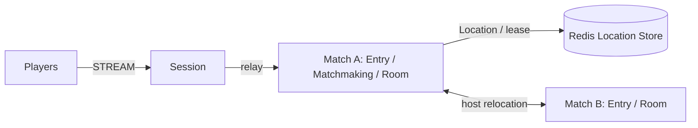

# MyGame FPS entry lobby

This Kotlin FPS template pairs players by mode through a fixed Matchmaking User Spot. Entry Spots forward admission; dynamic Room User Spots own positions, HP, action sequences, and the winner. Session binding owns Actor identity. Disconnected players resume the same Actor and Room; draining a Match host relocates ongoing matches without reconnecting clients.



## Prerequisites

Docker with Compose v2 and Linux containers, network access to Maven Central and the Gradle Plugin Portal, and PowerShell 7 on Windows. JDK 25 is required only for local process debugging. The Gradle wrapper is included; public package versions are pinned in `build.gradle.kts`.

## Build

Run from this project root.

```sh
./run-e2e.sh --build-only
```

PowerShell:

```powershell
pwsh -NoProfile -File ./run-e2e.ps1 -BuildOnly
```

## Client connection

### Endpoint and first packet

The Session client STREAM listener defaults to `tcp://127.0.0.1:0` in `server/config/session.json`. Port `0` asks the OS for a free port; use the actual `streamEndpoint` in the process line `READY <json>`, which also contains `id` and `meshEndpoint`. TCP has no URL path. Web browsers, Unity WebGL, and Cocos Creator web cannot connect to this default TCP listener; they require a separately configured WebSocket deployment.

Loopback is reachable only inside the same host/network namespace. Keep a deployment running for external clients, bind to a reachable interface and port, and expose that port from containers. The Docker e2e deployment is temporary and is removed after the run. Mesh listeners and Redis are not game-client endpoints.

Send `QueueRequest(playerId, mode)` first (`mode` defaults to `duel`). Matching requires another player in the same mode; `MatchFound(roomId)` and `RoomView` are pushes, not correlated replies.

After admission, `SessionInfoRequest` uses `connector.kotlin().request<SessionInfo>(SessionInfoRequest()).await()` for a correlated `SessionInfo` reply. The first game operation above uses `send(...).await()` and server pushes. This template does not authenticate player identity; add identity validation before Actor binding for production.

### Connector installation

Use the same connector release as this template pins in `build.gradle.kts`, `extra["frameworkVersion"]`; `e2e/build.gradle.kts` uses that key for `systems.zlink:zlink-stream-connector`. Replace `<version>` below with that pinned version. Engine installation instructions are in the linked repository READMEs; all clients use this template's packets.

| Client                             | Connector installation                                                                                                                                                                                                                                                                                                                                                                                                                                                          | Documentation guide                                                                                                                                                          |
| ---------------------------------- | ------------------------------------------------------------------------------------------------------------------------------------------------------------------------------------------------------------------------------------------------------------------------------------------------------------------------------------------------------------------------------------------------------------------------------------------------------------------------------- | ---------------------------------------------------------------------------------------------------------------------------------------------------------------------------- |
| Unity                              | Native/Editor: restore `Zlink.Stream.Connector` with NuGetForUnity. WebGL: add the `com.zlink.stream-connector.webgl` UPM Git package; include only the connector assembly for the active target. See the [Unity README](https://github.com/zlink-systems/zlink/blob/main/framework/languages/engines/Unity/README.md) and its package manifest.                                                                                                                                | [.NET engine integration](https://docs.zlink.systems/dotnet/guide/stream-connector/12-engine-integration/)                                                                   |
| Unreal                             | Copy `framework/languages/cpp/connector/engines/unreal` into `Plugins/ZLinkStreamConnector`, then package the native connector under `ThirdParty/ZLink` as described in the [Unreal README](https://github.com/zlink-systems/zlink/blob/main/framework/languages/engines/Unreal/README.md).                                                                                                                                                                                     | [C++ engine integration](https://docs.zlink.systems/cpp/guide/stream-connector/12-engine-integration/)                                                                       |
| Godot                              | .NET: add the NuGet package `Zlink.Stream.Connector` and run `dotnet restore`; see the [C# README](https://github.com/zlink-systems/zlink/blob/main/framework/languages/engines/Godot/csharp/README.md). GDExtension: build the C++ Godot adapter against the framework prebuilt and matching `godot-cpp`; see the [C++ README](https://github.com/zlink-systems/zlink/blob/main/framework/languages/engines/Godot/cpp/README.md). The .NET sample does not support Web export. | [.NET](https://docs.zlink.systems/dotnet/guide/stream-connector/12-engine-integration/), [C++](https://docs.zlink.systems/cpp/guide/stream-connector/12-engine-integration/) |
| Cocos Creator                      | Web target: `npm install @zlink-systems/stream-connector@<version>`; see the [Cocos Creator README](https://github.com/zlink-systems/zlink/blob/main/framework/languages/engines/CocosCreator/README.md). This package does not provide a Creator native adapter.                                                                                                                                                                                                                  | [TypeScript engine integration](https://docs.zlink.systems/node/guide/stream-connector/12-engine-integration/)                                                               |
| Axmol                              | Copy `framework/languages/cpp/connector/engines/axmol` into `third_party/zlink_axmol_connector` and link `zlink::stream_connector` from the installed C++ framework package; see the [Axmol README](https://github.com/zlink-systems/zlink/blob/main/framework/languages/engines/Axmol/README.md).                                                                                                                                                                              | [C++ engine integration](https://docs.zlink.systems/cpp/guide/stream-connector/12-engine-integration/)                                                                       |
| Web browser (TypeScript connector) | `npm install @zlink-systems/stream-connector@<version>`; import the package root in the browser build. Use `ws://` or `wss://`, subject to the page's security policy.                                                                                                                                                                                                                                                                                                             | [TypeScript connector](https://docs.zlink.systems/node/guide/stream-connector/)                                                                                              |
| C++                                | Install the C++ framework prebuilt containing the connector; use `find_package(zlink_stream_connector_cpp CONFIG REQUIRED)` and link `zlink::stream_connector`.                                                                                                                                                                                                                                                                                                                 | [C++ connector](https://docs.zlink.systems/cpp/guide/stream-connector/)                                                                                                      |
| C#/.NET                            | `dotnet add package Zlink.Stream.Connector --version <version>`                                                                                                                                                                                                                                                                                                                                                                                                                    | [.NET connector](https://docs.zlink.systems/dotnet/guide/stream-connector/)                                                                                                  |
| Java                               | Add Maven/Gradle dependency `systems.zlink:zlink-stream-connector:<version>`.                                                                                                                                                                                                                                                                                                                                                                                                      | [Java connector](https://docs.zlink.systems/java/guide/stream-connector/)                                                                                                    |
| Kotlin                             | Add `systems.zlink:zlink-stream-connector:<version>` and `systems.zlink:zlink-framework-kotlin:<version>` for the coroutine wrapper.                                                                                                                                                                                                                                                                                                                                                  | [Kotlin connector](https://docs.zlink.systems/kotlin/guide/stream-connector/)                                                                                                |
| Node                               | `npm install @zlink-systems/stream-connector@<version>`; use the package root and Node.js 22 or later.                                                                                                                                                                                                                                                                                                                                                     | [Node connector](https://docs.zlink.systems/node/guide/stream-connector/)                                                                                                    |

### Kotlin connection example

The example uses the same public connector and Kotlin coroutine wrapper as `e2e/src/main/kotlin/MyGame/e2e/Client.kt`. Save it as `e2e/src/main/kotlin/MyGame/e2e/ConnectOnce.kt` in a copy of the template. It defines a suspending function to call from your application coroutine while the deployment is running; compile it with `./gradlew :e2e:compileKotlin`. Call it for two distinct player IDs concurrently to complete matchmaking.

```kotlin
package MyGame.e2e

import MyGame.*
import java.net.URI
import java.time.Duration
import java.util.concurrent.CompletableFuture
import kotlinx.coroutines.CompletableDeferred
import kotlinx.coroutines.withTimeout
import systems.zlink.framework.kotlin.*
import systems.zlink.stream.connector.*

suspend fun connectOnce(endpoint: String, playerId: String) {
    val d = ZLinkStreamConnectorOptions.createDefault(URI(endpoint))
    val connector = ZLinkStreamConnectorFactory.create(
        ZLinkStreamConnectorOptions(
            URI(endpoint), ZLinkStreamDispatchMode.IMMEDIATE, Duration.ofSeconds(5),
            d.maxReconnectAttempts(), d.connectTimeout(), d.maxSendPayloadSize(),
            d.heartbeatEnabled(), d.heartbeatInterval(), d.heartbeatTimeout(), false,
            d.reconnectInitialDelay(), d.reconnectMaxDelay(), d.reconnectBackoffFactor(),
        )
    )
    val response = CompletableDeferred<MatchFound>()
    val registrations = listOf(
        connector.on(MatchFound::class.java) { message ->
            response.complete(message.payload())
            CompletableFuture.completedFuture(null)
        },
        connector.on(ActionRejected::class.java) { message ->
            response.completeExceptionally(IllegalStateException(message.payload().toString()))
            CompletableFuture.completedFuture(null)
        },
        connector.onErrorReceived { event ->
            response.completeExceptionally(IllegalStateException(event.toString()))
            CompletableFuture.completedFuture(null)
        },
        connector.onDisconnected { event ->
            response.completeExceptionally(IllegalStateException(event.toString()))
            CompletableFuture.completedFuture(null)
        },
    )
    try {
        connector.kotlin().connect().await()
        connector.kotlin().send(QueueRequest(playerId, Names.DEFAULT_MODE)).await()
        println(withTimeout(5_000) { response.await() })
    } finally {
        try { connector.kotlin().close().await() }
        finally { registrations.forEach { it.close() } }
    }
}
```

## Local e2e

The Docker runner builds a shared node image and a runner image. It creates sibling nodes that share its network namespace, preserving loopback listeners and stdin/stdout control. Each invocation removes its containers, network, and image tags; cleanup errors return exit code 1. Logs remain in `.logs/`.

For host-process debugging, run `./run-e2e.sh --local` or `pwsh -NoProfile -File ./run-e2e.ps1 -Local`. Local mode uses JDK 25 and Compose Redis. Scenario and structure options work in both modes.

```sh
./run-e2e.sh
./run-e2e.sh --scenario matchmaking,hit,wall,input,reconnect,update
./run-e2e.sh --check-structure
```

```powershell
pwsh -NoProfile -File ./run-e2e.ps1
pwsh -NoProfile -File ./run-e2e.ps1 -Scenario matchmaking,hit,wall,input,reconnect,update
pwsh -NoProfile -File ./run-e2e.ps1 -CheckStructure
```

| Scenario | Observations |
| --- | --- |
| matchmaking | Requests in different modes receive separate Rooms; same-mode requests receive the same Room. |
| hit | A hit deals 25 damage; upward and out-of-range shots miss; four hits finish the match and identify the winner. |
| wall | An intervening wall blocks damage; a wall behind the target permits a hit. |
| input | Shared sequence, movement boundaries, movement budget, fire interval, unchanged rejected state, and server-issued retry delays. |
| reconnect | A new Session retains the same Actor, Room, position, HP, and last sequence; reconnecting after match completion retains the winner. |
| update | Relocation completes, the old host shuts down safely, the connection and Room state remain unchanged, and the replacement accepts a new Room. |

Each scenario uses its own Redis Compose project, ephemeral loopback ports, key prefix, and node processes. Configuration and stdout/stderr logs remain in `.logs/run-<id>/`. Framework message-flow diagnostics run at Normal and write to stderr. Cleanup failures fail the run. `RoomStateTest.kt` contains the 46 game-domain boundary checks and runs with `./gradlew --no-daemon :server:match:test`.

Message Follow is configured explicitly to 30 seconds. After `RELOCATED`, the safe-shutdown observation budget is the follow duration plus the existing relocation observation budget; the relocation operation deadline is unchanged.

## Deployment sequence

Wait for the bootstrap owner to report `READY` before starting another Match host. Its public GetOrCreate completes while it is the only placement candidate, so the fixed Matchmaking Spot starts on its declared owner.

Start Redis, then Match A with `bootstrap: true`, Match B, and Session. Each node has a separate entry point; both Match nodes use the Match application. Set production endpoints and a deployment-specific Redis key prefix in `server/config/`. The e2e runner overrides Redis addressing and the prefix for each run, sets Room capacity to one per Match host, and obtains actual port-zero endpoints from `READY`. The capacity setting lets the update scenario verify that the replacement accepts a new Room while the surviving host retains the relocated Room.

For planned maintenance, send `drain` to the Room host's stdin and wait for `RELOCATION_REQUESTED`, `RELOCATED`, and `SAFE_TO_SHUTDOWN`. Send `shutdown`, wait for `STOPPED`, and start the replacement with the same configuration; bootstrap uses GetOrCreate and accepts the existing Matchmaking object on the surviving host. The runner performs this sequence through the public relocation API.

## FPS rules and extension points

`QueueRequest` is the first client packet. An omitted mode defaults to `duel`. This example accepts a claimed player ID; replace this boundary with authenticated identity before deployment. Session relays only `QueueRequest`, `RoomViewRequest`, `MoveRequest`, `ShootRequest`, and `SessionInfoRequest`. Internal assignment and result packets are rejected as `packet-not-allowed`. Messages use the default typed Framework serializer.

Coordinates use `Vec3(x, y, z)` with Y up. `ArenaMap` defines X/Z bounds 0 through 100 and Y bounds 0 through 10, two static AABBs, and two ordered spawn points. A player hit box is 1 wide, 2 high, and 1 deep from the feet, with eye height 1.6. Feet remain at Y=0. Vertical movement is rejected as `vertical-move`; jumping and gravity are not implemented. Movement tests the feet-position segment against closed wall boxes, including contact at the endpoint. It does not implement swept player-volume collision.

`MoveRequest(delta, sequence)` has a maximum step of 2 and a speed budget of 10 units per second, capped at 2 since the last accepted movement. First movement has the full budget. Non-finite deltas, nonzero `delta.y`, oversized steps, map exits, wall intersections, and budget overruns are rejected. `ShootRequest(aimDirection, sequence)` normalizes finite nonzero aim, casts from the authoritative eye position up to 80 units, and chooses the closest wall or living player AABB. Wall ties and box contact block the ray. A hit causes 25 damage; accepted misses and wall-blocked shots still consume their sequence and 250 ms fire interval. There is no ammunition model. The Framework message model carries only finite JSON numbers, so nonfinite input reaches only the domain checks.

Move and Shoot share one increasing sequence. Rejections change neither position, HP, sequence, nor movement/fire timing. `retryAfterMs` is positive only for movement-budget or fire-interval rejection; clients wait that reported duration and resend the same input. `MoveResult` and `ShotResult` acknowledge accepted actions; rejection packets report rejected inputs. `RoomView` includes all positions, HP, last sequences, phase, and winner so a fresh client can continue with its last sequence plus one. At zero HP the match finishes and later Move/Shoot inputs are rejected.

Hit detection uses current server state. There is no lag compensation, projectile simulation, or client prediction. Extend `RoomState` for weapons and match rules, `Geometry.kt` for level geometry and spawn selection, and the shared contracts for client-facing actions. Keep cooldown, movement budget, and hit decisions in `RoomState`. `RoomSnapshot` carries only remaining milliseconds for timing; it never transfers a process's absolute clock reading.
