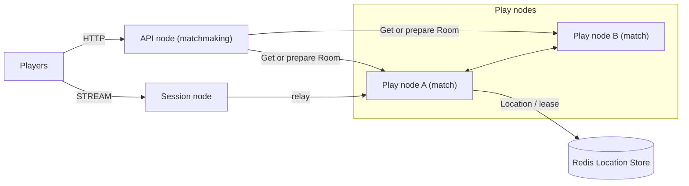

# MyGame FPS API node

This Kotlin FPS template pairs players by mode through an API node. `POST /match` returns the same UUID-based Room ID and Session endpoint to both matched players. The API node creates a dynamic Room User Spot, sends its member list in `PrepareRoom`, and waits for `RoomPrepared` before returning. `RoomRoster` admits only those members. Players connect to Session over STREAM and join the assigned Room. The RouteMesh name is `my-game-arena` (`Names.MESH`). `RoomState` owns movement budgets, ray hit decisions, health, shared input sequences, and match completion. Disconnected players resume the same Actor and Room; draining a play node (match) relocates ongoing matches without reconnecting clients.



[한국어](README.ko.md)

This template is a reference. To build a new game, create a new project and design its nodes, Spots, Actors and messages for that game, using this template's structure and rules as reference; do not rename or edit this template in place into the game.

## Prerequisites

Docker with Compose v2 and Linux containers, network access to Maven Central and the Gradle Plugin Portal, and PowerShell 7 on Windows. JDK 25 is required only for local process debugging. The included Gradle wrapper builds the project. Public Framework and connector versions are pinned in `build.gradle.kts`.

## Build

Run from this project root.

```sh
./run-e2e.sh --build-only
```

PowerShell:

```powershell
.\run-e2e.cmd -BuildOnly
```

## Local server and e2e

Run the first command from this directory to build and start Redis and the application nodes. Run the second command from a separate terminal to connect the scenarios to that deployment. When the server is ready, `Server ready` shows the WebSocket address for game clients. Press Ctrl+C in the server terminal to stop its processes and Redis. On Windows the `.cmd` files use PowerShell 7 (`pwsh`).

```bash
./run-server.sh
./run-e2e.sh
```

```powershell
.\run-server.cmd
.\run-e2e.cmd
```

With no running server, `run-e2e` creates and removes an isolated Docker deployment. The `lobby` and `update` scenarios start or replace nodes and require an isolated run. Use `--isolated` (`-Isolated` on Windows) to force isolation while a server is running.

The local server uses the configured Room capacity. Isolated scenarios can set a smaller capacity to verify placement and node replacement.

The server publishes its endpoints in `.logs/server.json`. Each run keeps node stdout, stderr, Framework message-flow records and failure details under `.logs/run-<id>/`. For an attached run, find the node logs under the directory printed by `run-server` and the scenario details under the directory printed by `run-e2e`. Docker build and cleanup logs are under `.logs/docker-<project>/`.

## Client connection

### Endpoint and first packet

The Session client STREAM listener defaults to `ws://127.0.0.1:0` in `server/config/session.json`. Port `0` asks the OS for a free port; use the actual `streamEndpoint` in the process line `READY <json>`, which also contains `id` and `meshEndpoint`. Use the WebSocket address printed by `run-server` for browser clients. The API node defaults to `http://127.0.0.1:0` in `server/config/lobby.json`; its READY JSON provides `httpEndpoint`. Replace `sessionEndpoint` ending in `CHANGE_ME` with the actual Session endpoint before starting Lobby; `e2e/src/main/kotlin/MyGame/e2e/Nodes.kt` performs that wiring for its temporary deployment.

Loopback is reachable only inside the same host/network namespace. Keep a deployment running for external clients, bind to a reachable interface and port, and expose that port from containers. The Docker e2e deployment is temporary and is removed after the run. Mesh listeners and Redis are not game-client endpoints.

First submit `POST /match` to the API node's HTTP endpoint with JSON `playerId` and optional `mode` (`duel`). Submit both players concurrently: matchmaking waits for a pair. The `MatchResponse` contains `roomId` and `sessionEndpoint`. Connect to that endpoint, then send `JoinRoomRequest(playerId, roomId)`. Only assigned players may join. Admission first pushes `MatchFound(roomId)` and publishes `RoomView`; `ActionRejected` reports rejection. The example waits for `RoomView`; the e2e client also registers `MatchFound` for the complete flow.

After admission, `SessionInfoRequest` uses `connector.kotlin().request<SessionInfo>(SessionInfoRequest()).await()` for a correlated `SessionInfo` reply. The first game operation above uses `send(...).await()` and server pushes. This template does not authenticate player identity; add identity validation before Actor binding for production.

### Connector installation

Use the same connector release as this template pins in `build.gradle.kts`, `extra["frameworkVersion"]`; `e2e/build.gradle.kts` uses that key for `systems.zlink:zlink-stream-connector`. Replace `<version>` below with that pinned version. Engine installation instructions are in the linked repository READMEs; all clients use this template's packets.

| Client                             | Connector installation                                                                                                                                                                                                                                                                                                                                                                                                                                                          | Documentation guide                                                                                                                                                          |
| ---------------------------------- | ------------------------------------------------------------------------------------------------------------------------------------------------------------------------------------------------------------------------------------------------------------------------------------------------------------------------------------------------------------------------------------------------------------------------------------------------------------------------------- | ---------------------------------------------------------------------------------------------------------------------------------------------------------------------------- |
| Unity                              | Native/Editor: restore `Zlink.Stream.Connector` with NuGetForUnity. WebGL: add the `com.zlink.stream-connector.webgl` UPM Git package; include only the connector assembly for the active target. See the [Unity README](https://github.com/zlink-systems/zlink/blob/main/framework/languages/engines/Unity/README.md) and its package manifest.                                                                                                                                | [.NET engine integration](https://docs.zlink.systems/dotnet/guide/stream-connector/12-engine-integration/)                                                                   |
| Unreal                             | Copy `framework/languages/cpp/connector/engines/unreal` into `Plugins/ZLinkStreamConnector`, then package the native connector under `ThirdParty/ZLink` as described in the [Unreal README](https://github.com/zlink-systems/zlink/blob/main/framework/languages/engines/Unreal/README.md).                                                                                                                                                                                     | [C++ engine integration](https://docs.zlink.systems/cpp/guide/stream-connector/12-engine-integration/)                                                                       |
| Godot                              | .NET: add the NuGet package `Zlink.Stream.Connector` and run `dotnet restore`; see the [C# README](https://github.com/zlink-systems/zlink/blob/main/framework/languages/engines/Godot/csharp/README.md). GDExtension: build the C++ Godot adapter against the framework prebuilt and matching `godot-cpp`; see the [C++ README](https://github.com/zlink-systems/zlink/blob/main/framework/languages/engines/Godot/cpp/README.md). The .NET sample does not support Web export. | [.NET](https://docs.zlink.systems/dotnet/guide/stream-connector/12-engine-integration/), [C++](https://docs.zlink.systems/cpp/guide/stream-connector/12-engine-integration/) |
| Cocos Creator                      | Web target: `npm install @zlink-systems/stream-connector@<version>`; see the [Cocos Creator README](https://github.com/zlink-systems/zlink/blob/main/framework/languages/engines/CocosCreator/README.md). This package does not provide a Creator native adapter.                                                                                                                                                                                                                  | [TypeScript engine integration](https://docs.zlink.systems/node/guide/stream-connector/12-engine-integration/)                                                               |
| Axmol                              | Copy `framework/languages/cpp/connector/engines/axmol` into `third_party/zlink_axmol_connector` and link `zlink::stream_connector` from the installed C++ framework package; see the [Axmol README](https://github.com/zlink-systems/zlink/blob/main/framework/languages/engines/Axmol/README.md).                                                                                                                                                                              | [C++ engine integration](https://docs.zlink.systems/cpp/guide/stream-connector/12-engine-integration/)                                                                       |
| Web browser (TypeScript connector) | `npm install @zlink-systems/stream-connector@<version>`; import the package root in the browser build. Use `ws://` or `wss://`, subject to the page's security policy.                                                                                                                                                                                                                                                                                                             | [TypeScript connector](https://docs.zlink.systems/node/guide/stream-connector/)                                                                                              |
| C++                                | Install the C++ framework prebuilt containing the connector; use `find_package(zlink_stream_connector_cpp CONFIG REQUIRED)` and link `zlink::stream_connector`.                                                                                                                                                                                                                                                                                                                 | [C++ connector](https://docs.zlink.systems/cpp/guide/stream-connector/)                                                                                                      |
| C#/.NET                            | `dotnet add package Zlink.Stream.Connector --version <version>`                                                                                                                                                                                                                                                                                                                                                                                                                    | [.NET connector](https://docs.zlink.systems/dotnet/guide/stream-connector/)                                                                                                  |
| Java                               | Add Maven/Gradle dependency `systems.zlink:zlink-stream-connector:<version>`.                                                                                                                                                                                                                                                                                                                                                                                                      | [Java connector](https://docs.zlink.systems/java/guide/stream-connector/)                                                                                                    |
| Kotlin                             | Add `systems.zlink:zlink-stream-connector:<version>` and `systems.zlink:zlink-framework-kotlin:<version>` for the coroutine wrapper.                                                                                                                                                                                                                                                                                                                                                  | [Kotlin connector](https://docs.zlink.systems/kotlin/guide/stream-connector/)                                                                                                |
| Node                               | `npm install @zlink-systems/stream-connector@<version>`; use the package root and Node.js 22 or later.                                                                                                                                                                                                                                                                                                                                                     | [Node connector](https://docs.zlink.systems/node/guide/stream-connector/)                                                                                                    |

### Kotlin connection example

The example uses the same public connector and Kotlin coroutine wrapper as `e2e/src/main/kotlin/MyGame/e2e/Client.kt`. Save it as `e2e/src/main/kotlin/MyGame/e2e/ConnectOnce.kt` in a copy of the template. It defines a suspending function to call from your application coroutine while the deployment is running; compile it with `./gradlew :e2e:compileKotlin`. Complete the HTTP matchmaking step above first, then pass the assigned endpoint, player ID, and room ID.

```kotlin
package MyGame.e2e

import MyGame.*
import java.net.URI
import java.time.Duration
import java.util.concurrent.CompletableFuture
import kotlinx.coroutines.CompletableDeferred
import kotlinx.coroutines.withTimeout
import systems.zlink.framework.kotlin.*
import systems.zlink.stream.connector.*

suspend fun connectOnce(endpoint: String, playerId: String, roomId: String) {
    val d = ZLinkStreamConnectorOptions.createDefault(URI(endpoint))
    val connector = ZLinkStreamConnectorFactory.create(
        ZLinkStreamConnectorOptions(
            URI(endpoint), ZLinkStreamDispatchMode.IMMEDIATE, Duration.ofSeconds(5),
            d.maxReconnectAttempts(), d.connectTimeout(), d.maxSendPayloadSize(),
            d.heartbeatEnabled(), d.heartbeatInterval(), d.heartbeatTimeout(), false,
            d.reconnectInitialDelay(), d.reconnectMaxDelay(), d.reconnectBackoffFactor(),
        )
    )
    val response = CompletableDeferred<RoomView>()
    val registrations = listOf(
        connector.on(RoomView::class.java) { message ->
            response.complete(message.payload())
            CompletableFuture.completedFuture(null)
        },
        connector.on(ActionRejected::class.java) { message ->
            response.completeExceptionally(IllegalStateException(message.payload().toString()))
            CompletableFuture.completedFuture(null)
        },
        connector.onErrorReceived { event ->
            response.completeExceptionally(IllegalStateException(event.toString()))
            CompletableFuture.completedFuture(null)
        },
        connector.onDisconnected { event ->
            response.completeExceptionally(IllegalStateException(event.toString()))
            CompletableFuture.completedFuture(null)
        },
    )
    try {
        connector.kotlin().connect().await()
        connector.kotlin().send(JoinRoomRequest(playerId, roomId)).await()
        println(withTimeout(5_000) { response.await() })
    } finally {
        try { connector.kotlin().close().await() }
        finally { registrations.forEach { it.close() } }
    }
}
```

## Scenario selection and validation

The runner checks the structure, starts its own Redis Compose project and node processes, and records stdout, stderr, and message-flow diagnostics in `.logs/run-<id>/`. Redis and node listeners use OS-assigned ports; Redis keys use a unique run prefix. Each scenario uses fresh node containers and an independent Redis key prefix. Cleanup failures return exit code 1.

```sh
./run-e2e.sh
./run-e2e.sh --scenario lobby,hit,wall,input,reconnect,update
./run-e2e.sh --check-structure
```

```powershell
.\run-e2e.cmd
.\run-e2e.cmd -Scenario lobby,hit,wall,input,reconnect,update
.\run-e2e.cmd -CheckStructure
```

For host-process debugging, install JDK 25 and add `--local` or `-Local`. After a local build, add `--no-build` or `-NoBuild` to skip compilation.

| Scenario | Observations |
| --- | --- |
| lobby | An omitted mode defaults to `duel`; matched players receive the same Room and Session endpoint; modes use separate Rooms; an unlisted player and client `PrepareRoom` packets are rejected; a lobby restart preserves the existing match and provisions a new Room ID. |
| hit | A hit deals 25 damage; upward and out-of-range shots miss; four hits finish the match and identify the winner. |
| wall | An intervening wall blocks damage; a wall behind the target permits a hit. |
| input | Shared sequence, movement boundaries, movement budget, fire interval, unchanged rejected state, and server-issued retry delays. |
| reconnect | A new client retains Actor, Room, position, HP, and last sequence; reconnecting after match completion retains the winner. |
| update | An unlisted player is rejected; relocation completes, the old host shuts down safely, the connection and Room state remain unchanged, and the replacement accepts a new Room. |

`RoomStateTest.kt` contains the 46 game-domain boundary checks. `LobbyDomainTest.kt` contains the 19 API node boundary checks. They run with the `server:match` and `server:lobby` Gradle test tasks.

## FPS rules and extension points

`POST /match` accepts `MatchRequest(playerId, mode)` and pairs two requests for the same mode. An omitted mode defaults to `duel`. This example accepts a claimed player ID; replace this boundary with authenticated identity before deployment. The response contains `roomId` and `sessionEndpoint`; the first STREAM packet is `JoinRoomRequest`. Session relays only `JoinRoomRequest`, `RoomViewRequest`, `MoveRequest`, `ShootRequest`, and `SessionInfoRequest`. `PrepareRoom`, `RoomPrepared`, `HttpNodeReady`, internal assignment, and result packets are rejected as `packet-not-allowed`. Messages use the default typed Framework serializer.

The API node creates each Room ID at matching time from `RoomPrefix` and a UUID rendered as 32 hexadecimal characters without hyphens. It sends `PrepareRoom(matchId, members)` to the Room and completes the HTTP response only after receiving `RoomPrepared(matchId)`. `RoomRoster` owns the membership list and admission decision. Repeating preparation with the same roster is idempotent; a different roster is rejected. A player absent from the prepared roster is rejected from admission as `admission-rejected`. A client cannot prepare a Room.

Coordinates use `Vec3(x, y, z)` with Y up. `ArenaMap` defines X/Z bounds 0 through 100 and Y bounds 0 through 10, two static AABBs, and two ordered spawn points. A player hit box is 1 wide, 2 high, and 1 deep from the feet, with eye height 1.6. Feet remain at Y=0. Vertical movement is rejected as `vertical-move`; jumping and gravity are not implemented. Movement tests the feet-position segment against closed wall boxes, including contact at the endpoint. It does not implement swept player-volume collision.

`MoveRequest(delta, sequence)` has a maximum step of 2 and a speed budget of 10 units per second, capped at 2 since the last accepted movement. First movement has the full budget. Non-finite deltas, nonzero `delta.y`, oversized steps, map exits, wall intersections, and budget overruns are rejected. `ShootRequest(aimDirection, sequence)` normalizes finite nonzero aim, casts from the authoritative eye position up to 80 units, and chooses the closest wall or living player AABB. Wall ties and box contact block the ray. A hit causes 25 damage; accepted misses and wall-blocked shots still consume their sequence and 250 ms fire interval. There is no ammunition model. The Framework message model carries only finite JSON numbers, so nonfinite input reaches only the domain checks.

Move and Shoot share one increasing sequence. Rejections change neither position, HP, sequence, nor movement/fire timing. `retryAfterMs` is positive only for movement-budget or fire-interval rejection; clients wait that reported duration and resend the same input. `MoveResult` and `ShotResult` acknowledge accepted actions; `ActionRejected` reports rejected inputs. `RoomView` includes all positions, HP, last sequences, phase, and winner so a fresh client can continue with its last sequence plus one. At zero HP the match finishes and later Move/Shoot inputs are rejected.

Hit detection uses current server state. There is no lag compensation, projectile simulation, or client prediction. Extend `RoomState` for weapons and match rules, `Geometry.kt` for level geometry and spawn selection, and the shared contracts for client-facing actions. Keep cooldown, movement budget, and hit decisions in `RoomState`. `RoomSnapshot` carries only remaining milliseconds for timing; it never transfers a process's absolute clock reading. `HttpRoomSnapshot` stores the game and roster snapshots together.

Message Follow is configured explicitly to 30 seconds. After `RELOCATED`, the safe-shutdown observation budget is the follow duration plus the existing relocation observation budget; the relocation operation deadline is unchanged.

## Framework behavior to know

- **Waiting for DB or file I/O in a handler** — An ordinary async terminal retains the turn, while `Yield` lets other handlers on the same Spot proceed. [Guide](https://docs.zlink.systems/kotlin/guide/server/32-execution-model/#io-worker-wait).
- **Creation that misses its deadline** — `DeadlineExceeded` and caller cancellation have distinct outcomes. [Guide](https://docs.zlink.systems/kotlin/guide/server/22-actor/#creation-deadline). [server/session/src/main/kotlin/MyGame/session/Program.kt:63](server/session/src/main/kotlin/MyGame/session/Program.kt).
- **Many logins at once** — Each creation for a different ID requires a Location Store round trip, so measure expected load when setting the deadline. [Guide](https://docs.zlink.systems/kotlin/guide/server/25-location/#creation-load).
- **Sending under load** — Send waits for capacity, and the application sees the final result. [Guide](https://docs.zlink.systems/kotlin/guide/server/33-backpressure/#send-backpressure). [server/session/src/main/kotlin/MyGame/session/Program.kt:98](server/session/src/main/kotlin/MyGame/session/Program.kt).
- **Duplicate login** — Without a callback, a bind from another Session is accepted; reject it in the Actor duplicate-bind callback to prevent this. [Guide](https://docs.zlink.systems/kotlin/guide/server/39-session-binding/#duplicate-session-bind). This template keeps the default (accepts the new Session).
- **ObjectGeneration** — `ObjectGeneration` distinguishes logical incarnations of the same ID; it is not a data version or write authority. [Guide](https://docs.zlink.systems/kotlin/guide/server/34-activation-lifetime/#object-generation). [server/session/src/main/kotlin/MyGame/session/Program.kt:85](server/session/src/main/kotlin/MyGame/session/Program.kt).
- **READY and Serving** — The Framework host prints `READY` after observing runtime `Serving`. [Guide](https://docs.zlink.systems/kotlin/guide/server/12-operations/#wait-for-serving). [server/shared/src/main/kotlin/MyGame/Hosting.kt:134](server/shared/src/main/kotlin/MyGame/Hosting.kt); [server/shared/src/main/kotlin/MyGame/Hosting.kt:149](server/shared/src/main/kotlin/MyGame/Hosting.kt).

## Deployment sequence

Start Redis, then both play nodes (match) using `server/config/match-a.json` and `match-b.json`. Start the session node using `session.json`. Read the actual Session endpoint from its `READY` output, put it in the API node configuration's `sessionEndpoint`, and start the API node using `lobby.json`. Each installed application accepts its configuration path as its only argument. Configuration IDs match the structure node IDs; endpoint port zero requests an OS-assigned port.

The Match configuration `roomCapacity` sets the positive per-node Room stable-type limit. Deployment configurations allow multiple Rooms. The e2e runner uses a capacity of two for `lobby`, which keeps the duel and ranked Rooms in place while the restarted Lobby provisions a new Room. Other scenarios use a capacity of one so the surviving host is full after relocation and the replacement must handle the next Room.

For a play node (match) update, send `drain` to stdin and require `RELOCATION_REQUESTED`, `RELOCATED`, and `SAFE_TO_SHUTDOWN`. Send `shutdown`, require `STOPPED` and exit zero, then start the replacement with the same configuration. The API node remains outside host relocation. HTTP matchmaking holds the first POST response until another player requests the same mode; shutdown fails pending requests. The HTTP adapter removes an unpaired request when its client disconnects, allowing the same player ID to request again. Cancellation does not change paired requests.
