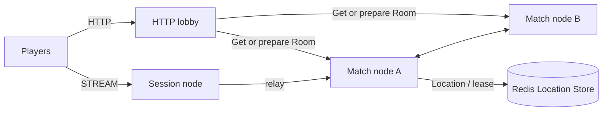

# MyGame FPS HTTP lobby

This Kotlin FPS template pairs players by mode through an HTTP lobby. `POST /match` returns the same UUID-based Room ID and Session endpoint to both matched players. The lobby creates a dynamic Room User Spot, sends its member list in `PrepareRoom`, and waits for `RoomPrepared` before returning. `RoomRoster` admits only those members. Players connect to Session over STREAM and join the assigned Room. The RouteMesh name is `my-game-arena` (`Names.MESH`). `RoomState` owns movement budgets, ray hit decisions, health, shared input sequences, and match completion. Disconnected players resume the same Actor and Room; draining a Match host relocates ongoing matches without reconnecting clients.



## Prerequisites

Docker with Compose v2 and Linux containers, network access to Maven Central and the Gradle Plugin Portal, and PowerShell 7 on Windows. JDK 25 is required only for local process debugging. The included Gradle wrapper builds the project. Public Framework and connector versions are pinned in `build.gradle.kts`.

## Build

Run from this project root.

```sh
./run-e2e.sh --build-only
```

PowerShell:

```powershell
pwsh -NoProfile -File ./run-e2e.ps1 -BuildOnly
```

## Local e2e

The runner checks the structure, starts its own Redis Compose project and node processes, and records stdout, stderr, and message-flow diagnostics in `.logs/run-<id>/`. Redis and node listeners use OS-assigned ports; Redis keys use a unique run prefix. Each scenario uses fresh node containers and an independent Redis key prefix. Cleanup failures return exit code 1.

```sh
./run-e2e.sh
./run-e2e.sh --scenario lobby,hit,wall,input,reconnect,update
./run-e2e.sh --check-structure
```

```powershell
pwsh -NoProfile -File ./run-e2e.ps1
pwsh -NoProfile -File ./run-e2e.ps1 -Scenario lobby,hit,wall,input,reconnect,update
pwsh -NoProfile -File ./run-e2e.ps1 -CheckStructure
```

For host-process debugging, install JDK 25 and add `--local` or `-Local`. After a local build, add `--no-build` or `-NoBuild` to skip compilation.

| Scenario | Observations |
| --- | --- |
| lobby | An omitted mode defaults to `duel`; matched players receive the same Room and Session endpoint; modes use separate Rooms; an unlisted player and client `PrepareRoom` packets are rejected; a lobby restart preserves the existing match and provisions a new Room ID. |
| hit | A hit deals 25 damage; upward and out-of-range shots miss; four hits finish the match and identify the winner. |
| wall | An intervening wall blocks damage; a wall behind the target permits a hit. |
| input | Shared sequence, movement boundaries, movement budget, fire interval, unchanged rejected state, and server-issued retry delays. |
| reconnect | A new client retains Actor, Room, position, HP, and last sequence; reconnecting after match completion retains the winner. |
| update | An unlisted player is rejected; relocation completes, the old host shuts down safely, the connection and Room state remain unchanged, and the replacement accepts a new Room. |

`RoomStateTest.kt` contains the 46 game-domain boundary checks. `LobbyDomainTest.kt` contains the 19 HTTP lobby boundary checks. They run with the `server:match` and `server:lobby` Gradle test tasks.

## FPS rules and extension points

`POST /match` accepts `MatchRequest(playerId, mode)` and pairs two requests for the same mode. An omitted mode defaults to `duel`. This example accepts a claimed player ID; replace this boundary with authenticated identity before deployment. The response contains `roomId` and `sessionEndpoint`; the first STREAM packet is `JoinRoomRequest`. Session relays only `JoinRoomRequest`, `RoomViewRequest`, `MoveRequest`, `ShootRequest`, and `SessionInfoRequest`. `PrepareRoom`, `RoomPrepared`, `HttpNodeReady`, internal assignment, and result packets are rejected as `packet-not-allowed`. Messages use the default typed Framework serializer.

The lobby creates each Room ID at matching time from `RoomPrefix` and a UUID rendered as 32 hexadecimal characters without hyphens. It sends `PrepareRoom(matchId, members)` to the Room and completes the HTTP response only after receiving `RoomPrepared(matchId)`. `RoomRoster` owns the membership list and admission decision. Repeating preparation with the same roster is idempotent; a different roster is rejected. A player absent from the prepared roster is rejected from admission as `admission-rejected`. A client cannot prepare a Room.

Coordinates use `Vec3(x, y, z)` with Y up. `ArenaMap` defines X/Z bounds 0 through 100 and Y bounds 0 through 10, two static AABBs, and two ordered spawn points. A player hit box is 1 wide, 2 high, and 1 deep from the feet, with eye height 1.6. Feet remain at Y=0. Vertical movement is rejected as `vertical-move`; jumping and gravity are not implemented. Movement tests the feet-position segment against closed wall boxes, including contact at the endpoint. It does not implement swept player-volume collision.

`MoveRequest(delta, sequence)` has a maximum step of 2 and a speed budget of 10 units per second, capped at 2 since the last accepted movement. First movement has the full budget. Non-finite deltas, nonzero `delta.y`, oversized steps, map exits, wall intersections, and budget overruns are rejected. `ShootRequest(aimDirection, sequence)` normalizes finite nonzero aim, casts from the authoritative eye position up to 80 units, and chooses the closest wall or living player AABB. Wall ties and box contact block the ray. A hit causes 25 damage; accepted misses and wall-blocked shots still consume their sequence and 250 ms fire interval. There is no ammunition model. The Framework message model carries only finite JSON numbers, so nonfinite input reaches only the domain checks.

Move and Shoot share one increasing sequence. Rejections change neither position, HP, sequence, nor movement/fire timing. `retryAfterMs` is positive only for movement-budget or fire-interval rejection; clients wait that reported duration and resend the same input. `MoveResult` and `ShotResult` acknowledge accepted actions; `ActionRejected` reports rejected inputs. `RoomView` includes all positions, HP, last sequences, phase, and winner so a fresh client can continue with its last sequence plus one. At zero HP the match finishes and later Move/Shoot inputs are rejected.

Hit detection uses current server state. There is no lag compensation, projectile simulation, or client prediction. Extend `RoomState` for weapons and match rules, `Geometry.kt` for level geometry and spawn selection, and the shared contracts for client-facing actions. Keep cooldown, movement budget, and hit decisions in `RoomState`. `RoomSnapshot` carries only remaining milliseconds for timing; it never transfers a process's absolute clock reading. `HttpRoomSnapshot` stores the game and roster snapshots together.

Message Follow is configured explicitly to 30 seconds. After `RELOCATED`, the safe-shutdown observation budget is the follow duration plus the existing relocation observation budget; the relocation operation deadline is unchanged.

## Deployment sequence

Start Redis, then both Match processes using `server/config/match-a.json` and `match-b.json`. Start Session using `session.json`. Read the actual Session endpoint from its `READY` output, put it in the lobby configuration's `sessionEndpoint`, and start the lobby using `lobby.json`. Each installed application accepts its configuration path as its only argument. Configuration IDs match the structure node IDs; endpoint port zero requests an OS-assigned port.

The Match configuration `roomCapacity` sets the positive per-node Room stable-type limit. Deployment configurations allow multiple Rooms. The e2e runner uses a capacity of two for `lobby`, which keeps the duel and ranked Rooms in place while the restarted Lobby provisions a new Room. Other scenarios use a capacity of one so the surviving host is full after relocation and the replacement must handle the next Room.

For a Match host update, send `drain` to stdin and require `RELOCATION_REQUESTED`, `RELOCATED`, and `SAFE_TO_SHUTDOWN`. Send `shutdown`, require `STOPPED` and exit zero, then start the replacement with the same configuration. The lobby remains outside host relocation. HTTP matchmaking holds the first POST response until another player requests the same mode; shutdown fails pending requests. The HTTP adapter removes an unpaired request when its client disconnects, allowing the same player ID to request again. Cancellation does not change paired requests.

## 한국어 실행 안내

기본 e2e는 Docker에서 실행합니다. 로컬 process 디버깅은 JDK 25를 준비하고 `--local` 또는 `-Local`로 실행합니다. Windows에서는 PowerShell 7을 사용합니다. e2e runner는 실행마다 별도 Redis project와 key prefix를 만들고 OS가 할당한 port를 사용하며, 로그와 message-flow 기록을 `.logs/run-<id>/`에 보존합니다.

HTTP 로비는 같은 mode의 두 요청을 매칭합니다. mode를 생략하면 `duel`입니다. 로비는 UUID 기반 Room ID를 발급하고 `PrepareRoom`을 보낸 뒤 같은 `matchId`의 `RoomPrepared`를 받아야 HTTP 응답을 반환합니다. 명단과 입장 판정은 `RoomRoster`가 소유합니다. Session은 `JoinRoomRequest`, `RoomViewRequest`, `MoveRequest`, `ShootRequest`, `SessionInfoRequest`만 중계합니다. 배포 시 Session의 `READY` 출력에서 실제 endpoint를 확인하여 로비 설정에 넣습니다.

RoomState가 위치·HP·phase·winner·공유 순번·이동 예산·발사 간격·명중 판정을 소유합니다. 이동 최대 길이는 2, 속도 예산은 초당 10이며 수락된 이동 뒤 최대 2까지 회복합니다. 사거리는 80, 피해량은 25, HP는 100, 발사 간격은 250 ms입니다. 발 위치 Y는 0이며 수직 이동은 `vertical-move`로 거부합니다. 점프·중력·지연 보정·투사체·클라이언트 예측은 없습니다. 벽과 플레이어 상자 면 접촉은 교차이며 같은 거리면 벽을 선택합니다. Snapshot에는 process 절대 시각 대신 남은 ms를 저장합니다.

게임 도메인 경계 검사는 46개이며 HTTP lobby 경계 검사는 19개입니다. 실행별 로그와 message-flow 기록은 `.logs/run-<id>/`에 보존됩니다. 프로덕션 배포에서는 플레이어 인증과 Redis 연결 설정을 적용해야 합니다.

e2e의 `lobby` 시나리오는 duel·ranked Room 두 개를 유지한 채 새 Room을 준비하도록 node별 `roomCapacity`를 2로 설정합니다. 나머지 시나리오는 1을 사용하여 relocation 뒤 살아남은 host의 용량을 채우고 대체 host가 새 Room을 받는지 확인합니다.

Action sequences are signed 64-bit values encoded as decimal JSON strings. The accepted input range is 1..9007199254740991. Values above the upper bound are rejected as `integer-out-of-range` before stale-sequence checks; values at or below the last accepted sequence are `stale-sequence`. Rejections preserve all game state. `RetryAfterMs` remains a 32-bit JSON number.

입력 순번은 decimal JSON 문자열로 전달하는 signed 64-bit 값이며 수락 범위는 1..9007199254740991입니다. 상한 초과는 stale-sequence 판정 전에 `integer-out-of-range`로 거부하며, 마지막 수락 순번 이하는 `stale-sequence`로 거부합니다. 거부 시 게임 상태는 바뀌지 않습니다. `RetryAfterMs`는 32-bit JSON 숫자를 유지합니다.
