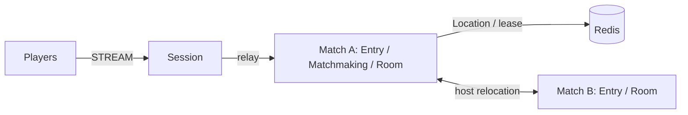

# MyGame: match entry lobby

This Kotlin template provides an action/FPS lobby and authoritative two-player rooms. The Entry Spot forwards admission; the fixed Matchmaking User Spot owns queues and room allocation. Room User Spots own position, HP, action sequences, and the winner. Session binding owns Actor identity.



## Prerequisites

Docker with Compose v2 and Linux containers, network access to Maven Central and the Gradle Plugin Portal, and PowerShell 7 on Windows. JDK 25 is required only for local process debugging. The Gradle wrapper is included; public package versions are pinned in `build.gradle.kts`.

## Build

Bash:

```sh
./run-e2e.sh --build-only
```

PowerShell:

```powershell
pwsh -NoProfile -File ./run-e2e.ps1 -BuildOnly
```

## Docker e2e

Docker builds a shared node image for all roles and a runner image. The pinned Eclipse Temurin JDK/JRE bases are defined by the Dockerfile ARGs. The runner uses the Docker socket to create sibling nodes sharing its network namespace, preserving loopback listeners and stdin/stdout control. Each invocation removes its containers, network and image tags; cleanup errors return exit 1. Logs remain in `.logs/`.

For local process debugging, run `./run-e2e.sh --local` or `pwsh -NoProfile -File ./run-e2e.ps1 -Local`. Local mode uses JDK 25 and Compose Redis. Scenario and structure options work in both modes.

Bash:

```sh
./run-e2e.sh
./run-e2e.sh --scenario hit,wall,input,reconnect,update
```

PowerShell:

```powershell
pwsh -NoProfile -File ./run-e2e.ps1
pwsh -NoProfile -File ./run-e2e.ps1 -Scenario hit,wall,input,reconnect,update
```

| Scenario | Checks |
| --- | --- |
| hit | Matchmaking, client `RoomAssignment` rejection, HP 75 after a hit, wall and range rejections without damage, absent target, HP zero, and winner |
| wall | A wall blocks movement and a shot at its segment; walking below its endpoint reaches the other side, where a shot with the wall behind the target is accepted |
| input | Duplicate and reversed sequences, `MaxStep`, map and wall bounds, movement and fire cooldown responses, unchanged state after rejection, and retry acceptance after the server-provided delay |
| reconnect | A new Session retains Actor identity and the Room's position, HP, last sequence, phase, and winner, including after the match finishes |
| update | Relocation retains Room state and client Sessions, then the replacement node accepts new work |

Each scenario owns its Redis Compose project, ephemeral loopback ports, key prefix, and node processes. Configuration and stdout/stderr logs remain in `.logs/run-<id>/`. Framework message-flow diagnostics run at Normal and write to stderr. Cleanup failures fail the run. Use `pwsh -NoProfile -File ./run-e2e.ps1 -CheckStructure` or `./run-e2e.sh --check-structure` for structure validation.

Message Follow is configured explicitly to 30 seconds. After `RELOCATED`, the safe shutdown observation budget is the follow duration plus the existing relocation observation budget; the relocation operation deadline is unchanged.

## Known issues

Validated against the published Framework 0.32.0 packages.

## Deployment sequence

Wait for the bootstrap owner to report `READY` before starting another match host. Its public GetOrCreate completes while it is the only placement candidate, so the fixed Matchmaking Spot starts on its declared owner.

Start Redis, then matchA with `bootstrap: true`, matchB, and session. Each node has a separate entry point; both match nodes use the match application. Set production endpoints and a deployment-specific Redis key prefix in `server/config/`. The e2e runner overrides Redis addressing and the prefix for each run, sets Room capacity to one per match host, and obtains the actual port-zero endpoints from `READY`. The capacity setting lets the update scenario verify that the replacement accepts a new room while the surviving host retains the relocated room.

For planned maintenance, send `drain` to the room host's stdin and wait for `RELOCATION_REQUESTED`, `RELOCATED`, and `SAFE_TO_SHUTDOWN`. Send `shutdown`, wait for `STOPPED`, and start the replacement with the same configuration; bootstrap uses GetOrCreate and accepts the existing Matchmaking object on the surviving host. The runner performs this sequence through the public relocation API.

Players start at `(40, 10)` and `(60, 10)` with 100 HP. `MoveRequest` carries displacement. The server checks finite values, `MaxStep` 2.0, map bounds `[0, 100]` on each axis, the closed wall segment at `x=50, y=20..60`, and the movement budget `min(MaxStep, MaxSpeed × elapsed)` with `MaxSpeed` 10 units per second. Shots have range 80, damage 25, and a 250 ms fire interval. Contract integers are limited to `9,007,199,254,740,991`; values outside that range are rejected. Only accepted moves and shots advance `LastSequence`; rejected actions preserve room state. `ActionRejected` carries `Reason` and `RetryAfterMs`; only time-limited rejections have a positive delay, and clients wait for that returned value before retrying the same request. `RoomView` includes each player's `LastSequence`, the room `Phase`, and `Winner`. Relocation snapshots store remaining cooldown and movement-budget time in milliseconds, not process timestamps.

`QueueRequest` is the first client packet. The Session relays only `QueueRequest`, `RoomViewRequest`, `MoveRequest`, `ShootRequest`, and `SessionInfoRequest`; internal packets receive `ActionRejected("packet-not-allowed", 0)`. Requests use typed messages and the default Framework serializer. The Framework message model carries only finite JSON numbers, so nonfinite input reaches only the domain checks.
