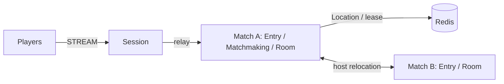

# MyGame: match entry lobby

This Kotlin template provides an action/FPS lobby and authoritative two-player rooms. The Entry Spot forwards admission; the fixed Matchmaking User Spot owns queues and room allocation. Room User Spots own position, HP, action sequences, and the winner. Session binding owns Actor identity.



## Prerequisites

Docker with Compose v2 and Linux containers, network access to Maven Central and the Gradle Plugin Portal, and PowerShell 7 on Windows. JDK 25 is required only for local process debugging. The Gradle wrapper is included; public package versions are pinned in `build.gradle.kts`.

## Build

Bash:

```sh
./run-e2e.sh --build-only
```

PowerShell:

```powershell
pwsh -NoProfile -File ./run-e2e.ps1 -BuildOnly
```

## Docker e2e

Docker builds a shared node image for all roles and a runner image. The pinned Eclipse Temurin JDK/JRE bases are defined by the Dockerfile ARGs. The runner uses the Docker socket to create sibling nodes sharing its network namespace, preserving loopback listeners and stdin/stdout control. Each invocation removes its containers, network and image tags; cleanup errors return exit 1. Logs remain in `.logs/`.

For local process debugging, run `./run-e2e.sh --local` or `pwsh -NoProfile -File ./run-e2e.ps1 -Local`. Local mode uses JDK 25 and Compose Redis. Scenario and structure options work in both modes.

Bash:

```sh
./run-e2e.sh
./run-e2e.sh --scenario hit,reconnect,update
```

PowerShell:

```powershell
pwsh -NoProfile -File ./run-e2e.ps1
pwsh -NoProfile -File ./run-e2e.ps1 -Scenario hit,reconnect,update
```

`hit` verifies shared room admission, movement, HP damage, wall/range/no-target rejection, and the winner. `reconnect` verifies a new Session with the same Actor generation and room state. `update` drains the room host, verifies unchanged Session binding and game state, replaces the stopped process, and verifies a new room on the replacement.

Each scenario owns its Redis Compose project, ephemeral loopback ports, key prefix, and node processes. Configuration and stdout/stderr logs remain in `.logs/run-<id>/`. Framework message-flow diagnostics run at Normal and write to stderr. Cleanup failures fail the run. Use `pwsh -NoProfile -File ./run-e2e.ps1 -CheckStructure` or `./run-e2e.sh --check-structure` for structure validation.

Message Follow is configured explicitly to 30 seconds. After `RELOCATED`, the safe shutdown observation budget is the follow duration plus the existing relocation observation budget; the relocation operation deadline is unchanged.

## Known issues

Public 0.30.0 validation is blocked by #1729: cross-node deferred Actor Join reports `DATA_LOST` during initial matchmaking. A `RoomAssignment` can then reach the old Entry Spot and be dropped with `no_handler`. This template does not compensate for that Framework failure. Validation with the 0.30.2 candidate feed remains pending.

## Deployment sequence

Wait for the bootstrap owner to report `READY` before starting another match host. Its public GetOrCreate completes while it is the only placement candidate, so the fixed Matchmaking Spot starts on its declared owner.

Start Redis, then matchA with `bootstrap: true`, matchB, and session. Each node has a separate entry point; both match nodes use the match application. Set production endpoints and a deployment-specific Redis key prefix in `server/config/`. The e2e runner overrides Redis addressing and the prefix for each run, sets Room capacity to one per match host, and obtains the actual port-zero endpoints from `READY`. The capacity setting lets the update scenario verify that the replacement accepts a new room while the surviving host retains the relocated room.

For planned maintenance, send `drain` to the room host's stdin and wait for `RELOCATION_REQUESTED`, `RELOCATED`, and `SAFE_TO_SHUTDOWN`. Send `shutdown`, wait for `STOPPED`, and start the replacement with the same configuration; bootstrap uses GetOrCreate and accepts the existing Matchmaking object on the surviving host. The runner performs this sequence through the public relocation API.

Players start with 100 HP. Shots have range 80 and damage 25. A closed vertical wall at x=50, y=0..100 blocks intersecting shots. RoomState validates monotonically increasing action sequences, finite movement, and terminal matches. Extend combat rules in `server/match/.../Domain.kt`; transport, binding, and lifecycle remain Framework responsibilities.

## 한국어 실행 안내

기본 e2e는 Docker에서 실행합니다. 로컬 process 디버깅은 JDK 25를 준비하고 `--local` 또는 `-Local`로 실행합니다. Docker Compose를 준비한 뒤 위 Build 명령과 Docker e2e 명령을 실행합니다. runner는 시나리오마다 Redis와 node process를 생성하고 자신이 만든 자원만 정리합니다. 실행 설정과 message-flow 기록은 `.logs/run-<id>/`에 남습니다.

대기열은 Matchmaking User Spot이 소유하며 Room Spot이 위치·HP·명중을 판정합니다. 운영 중 갱신할 때는 room host에 `drain`을 보내고 `SAFE_TO_SHUTDOWN`을 확인한 뒤 종료합니다. 대체 process는 같은 설정으로 시작하며 bootstrap의 GetOrCreate가 기존 Matchmaking object를 사용합니다.
