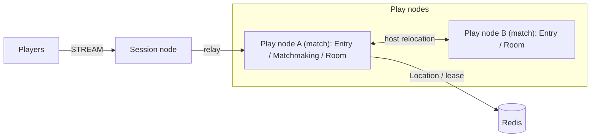

# MyGame: match entry lobby

This Kotlin template provides an action/FPS lobby and authoritative two-player rooms. The Entry Spot forwards admission; the fixed Matchmaking User Spot owns queues and room allocation. Room User Spots own position, HP, action sequences, and the winner. Session binding owns Actor identity.



[한국어](README.ko.md)

This template is a reference. To build a new game, create a new project and design its nodes, Spots, Actors and messages for that game, using this template's structure and rules as reference; do not rename or edit this template in place into the game.

## Prerequisites

Docker with Compose v2 and Linux containers, network access to Maven Central and the Gradle Plugin Portal, and PowerShell 7 on Windows. JDK 25 is required only for local process debugging. The Gradle wrapper is included; public package versions are pinned in `build.gradle.kts`.

## Build

Bash:

```sh
./run-e2e.sh --build-only
```

PowerShell:

```powershell
.\run-e2e.cmd -BuildOnly
```

## Local server and e2e

Run the first command from this directory to build and start Redis and the application nodes. Run the second command from a separate terminal to connect the scenarios to that deployment. When the server is ready, `Server ready` shows the WebSocket address for game clients. Press Ctrl+C in the server terminal to stop its processes and Redis. On Windows the `.cmd` files use PowerShell 7 (`pwsh`).

```bash
./run-server.sh
./run-e2e.sh
```

```powershell
.\run-server.cmd
.\run-e2e.cmd
```

With no running server, `run-e2e` creates and removes an isolated Docker deployment. The `update` scenario replaces a play node and requires an isolated run. Use `--isolated` (`-Isolated` on Windows) to force isolation while a server is running.

The local server uses the configured Room capacity. Isolated scenarios can set a smaller capacity to verify placement and node replacement.

The server publishes its endpoints in `.logs/server.json`. Each run keeps node stdout, stderr, Framework message-flow records and failure details under `.logs/run-<id>/`. For an attached run, find the node logs under the directory printed by `run-server` and the scenario details under the directory printed by `run-e2e`. Docker build and cleanup logs are under `.logs/docker-<project>/`.

## Client connection

### Endpoint and first packet

The Session client STREAM listener defaults to `ws://127.0.0.1:0` in `server/config/session.json`. Port `0` asks the OS for a free port; use the actual `streamEndpoint` in the process line `READY <json>`, which also contains `id` and `meshEndpoint`. Use the WebSocket address printed by `run-server` for browser clients.

Loopback is reachable only inside the same host/network namespace. Keep a deployment running for external clients, bind to a reachable interface and port, and expose that port from containers. The Docker e2e deployment is temporary and is removed after the run. Mesh listeners and Redis are not game-client endpoints.

Send `QueueRequest(playerId)` first (`mode` defaults to `duel`). Matching requires another player in the same mode; `MatchFound(roomId)` and `RoomView` are pushes, not correlated replies.

After admission, `SessionInfoRequest` uses `connector.kotlin().request<SessionInfo>(SessionInfoRequest()).await()` for a correlated `SessionInfo` reply. The first game operation above uses `send(...).await()` and server pushes. This template does not authenticate player identity; add identity validation before Actor binding for production.

### Connector installation

Use the same connector release as this template pins in `build.gradle.kts`, `extra["frameworkVersion"]`; `e2e/build.gradle.kts` uses that key for `systems.zlink:zlink-stream-connector`. Replace `<version>` below with that pinned version. Engine installation instructions are in the linked repository READMEs; all clients use this template's packets.

| Client                             | Connector installation                                                                                                                                                                                                                                                                                                                                                                                                                                                          | Documentation guide                                                                                                                                                          |
| ---------------------------------- | ------------------------------------------------------------------------------------------------------------------------------------------------------------------------------------------------------------------------------------------------------------------------------------------------------------------------------------------------------------------------------------------------------------------------------------------------------------------------------- | ---------------------------------------------------------------------------------------------------------------------------------------------------------------------------- |
| Unity                              | Native/Editor: restore `Zlink.Stream.Connector` with NuGetForUnity. WebGL: add the `com.zlink.stream-connector.webgl` UPM Git package; include only the connector assembly for the active target. See the [Unity README](https://github.com/zlink-systems/zlink/blob/main/framework/languages/engines/Unity/README.md) and its package manifest.                                                                                                                                | [.NET engine integration](https://docs.zlink.systems/dotnet/guide/stream-connector/12-engine-integration/)                                                                   |
| Unreal                             | Copy `framework/languages/cpp/connector/engines/unreal` into `Plugins/ZLinkStreamConnector`, then package the native connector under `ThirdParty/ZLink` as described in the [Unreal README](https://github.com/zlink-systems/zlink/blob/main/framework/languages/engines/Unreal/README.md).                                                                                                                                                                                     | [C++ engine integration](https://docs.zlink.systems/cpp/guide/stream-connector/12-engine-integration/)                                                                       |
| Godot                              | .NET: add the NuGet package `Zlink.Stream.Connector` and run `dotnet restore`; see the [C# README](https://github.com/zlink-systems/zlink/blob/main/framework/languages/engines/Godot/csharp/README.md). GDExtension: build the C++ Godot adapter against the framework prebuilt and matching `godot-cpp`; see the [C++ README](https://github.com/zlink-systems/zlink/blob/main/framework/languages/engines/Godot/cpp/README.md). The .NET sample does not support Web export. | [.NET](https://docs.zlink.systems/dotnet/guide/stream-connector/12-engine-integration/), [C++](https://docs.zlink.systems/cpp/guide/stream-connector/12-engine-integration/) |
| Cocos Creator                      | Web target: `npm install @zlink-systems/stream-connector@<version>`; see the [Cocos Creator README](https://github.com/zlink-systems/zlink/blob/main/framework/languages/engines/CocosCreator/README.md). This package does not provide a Creator native adapter.                                                                                                                                                                                                                  | [TypeScript engine integration](https://docs.zlink.systems/node/guide/stream-connector/12-engine-integration/)                                                               |
| Axmol                              | Copy `framework/languages/cpp/connector/engines/axmol` into `third_party/zlink_axmol_connector` and link `zlink::stream_connector` from the installed C++ framework package; see the [Axmol README](https://github.com/zlink-systems/zlink/blob/main/framework/languages/engines/Axmol/README.md).                                                                                                                                                                              | [C++ engine integration](https://docs.zlink.systems/cpp/guide/stream-connector/12-engine-integration/)                                                                       |
| Web browser (TypeScript connector) | `npm install @zlink-systems/stream-connector@<version>`; import the package root in the browser build. Use `ws://` or `wss://`, subject to the page's security policy.                                                                                                                                                                                                                                                                                                             | [TypeScript connector](https://docs.zlink.systems/node/guide/stream-connector/)                                                                                              |
| C++                                | Install the C++ framework prebuilt containing the connector; use `find_package(zlink_stream_connector_cpp CONFIG REQUIRED)` and link `zlink::stream_connector`.                                                                                                                                                                                                                                                                                                                 | [C++ connector](https://docs.zlink.systems/cpp/guide/stream-connector/)                                                                                                      |
| C#/.NET                            | `dotnet add package Zlink.Stream.Connector --version <version>`                                                                                                                                                                                                                                                                                                                                                                                                                    | [.NET connector](https://docs.zlink.systems/dotnet/guide/stream-connector/)                                                                                                  |
| Java                               | Add Maven/Gradle dependency `systems.zlink:zlink-stream-connector:<version>`.                                                                                                                                                                                                                                                                                                                                                                                                      | [Java connector](https://docs.zlink.systems/java/guide/stream-connector/)                                                                                                    |
| Kotlin                             | Add `systems.zlink:zlink-stream-connector:<version>` and `systems.zlink:zlink-framework-kotlin:<version>` for the coroutine wrapper.                                                                                                                                                                                                                                                                                                                                                  | [Kotlin connector](https://docs.zlink.systems/kotlin/guide/stream-connector/)                                                                                                |
| Node                               | `npm install @zlink-systems/stream-connector@<version>`; use the package root and Node.js 22 or later.                                                                                                                                                                                                                                                                                                                                                     | [Node connector](https://docs.zlink.systems/node/guide/stream-connector/)                                                                                                    |

### Kotlin connection example

The example uses the same public connector and Kotlin coroutine wrapper as `e2e/src/main/kotlin/MyGame/e2e/Client.kt`. Save it as `e2e/src/main/kotlin/MyGame/e2e/ConnectOnce.kt` in a copy of the template. It defines a suspending function to call from your application coroutine while the deployment is running; compile it with `./gradlew :e2e:compileKotlin`. Call it for two distinct player IDs concurrently to complete matchmaking.

```kotlin
package MyGame.e2e

import MyGame.*
import java.net.URI
import java.time.Duration
import java.util.concurrent.CompletableFuture
import kotlinx.coroutines.CompletableDeferred
import kotlinx.coroutines.withTimeout
import systems.zlink.framework.kotlin.*
import systems.zlink.stream.connector.*

suspend fun connectOnce(endpoint: String, playerId: String) {
    val d = ZLinkStreamConnectorOptions.createDefault(URI(endpoint))
    val connector = ZLinkStreamConnectorFactory.create(
        ZLinkStreamConnectorOptions(
            URI(endpoint), ZLinkStreamDispatchMode.IMMEDIATE, Duration.ofSeconds(5),
            d.maxReconnectAttempts(), d.connectTimeout(), d.maxSendPayloadSize(),
            d.heartbeatEnabled(), d.heartbeatInterval(), d.heartbeatTimeout(), false,
            d.reconnectInitialDelay(), d.reconnectMaxDelay(), d.reconnectBackoffFactor(),
        )
    )
    val response = CompletableDeferred<MatchFound>()
    val registrations = listOf(
        connector.on(MatchFound::class.java) { message ->
            response.complete(message.payload())
            CompletableFuture.completedFuture(null)
        },
        connector.on(ActionRejected::class.java) { message ->
            response.completeExceptionally(IllegalStateException(message.payload().toString()))
            CompletableFuture.completedFuture(null)
        },
        connector.onErrorReceived { event ->
            response.completeExceptionally(IllegalStateException(event.toString()))
            CompletableFuture.completedFuture(null)
        },
        connector.onDisconnected { event ->
            response.completeExceptionally(IllegalStateException(event.toString()))
            CompletableFuture.completedFuture(null)
        },
    )
    try {
        connector.kotlin().connect().await()
        connector.kotlin().send(QueueRequest(playerId)).await()
        println(withTimeout(5_000) { response.await() })
    } finally {
        try { connector.kotlin().close().await() }
        finally { registrations.forEach { it.close() } }
    }
}
```

## Scenario selection and validation

Docker builds a shared node image for all roles and a runner image. The pinned Eclipse Temurin JDK/JRE bases are defined by the Dockerfile ARGs. The runner uses the Docker socket to create sibling nodes sharing its network namespace, preserving loopback listeners and stdin/stdout control. Each invocation removes its containers, network and image tags; cleanup errors return exit 1. Logs remain in `.logs/`.

For local process debugging, run `./run-e2e.sh --local` or `.\run-e2e.cmd -Local`. Local mode uses JDK 25 and Compose Redis. Scenario and structure options work in both modes.

Bash:

```sh
./run-e2e.sh
./run-e2e.sh --scenario hit,wall,input,reconnect,update
```

PowerShell:

```powershell
.\run-e2e.cmd
.\run-e2e.cmd -Scenario hit,wall,input,reconnect,update
```

| Scenario | Checks |
| --- | --- |
| hit | Matchmaking, client `RoomAssignment` rejection, HP 75 after a hit, wall and range rejections without damage, absent target, HP zero, and winner |
| wall | A wall blocks movement and a shot at its segment; walking below its endpoint reaches the other side, where a shot with the wall behind the target is accepted |
| input | Duplicate and reversed sequences, `MaxStep`, map and wall bounds, movement and fire cooldown responses, unchanged state after rejection, and retry acceptance after the server-provided delay |
| reconnect | A new Session retains Actor identity and the Room's position, HP, last sequence, phase, and winner, including after the match finishes |
| update | Relocation retains Room state and client Sessions, then the replacement node accepts new work |

Each scenario owns its Redis Compose project, ephemeral loopback ports, key prefix, and node processes. Configuration and stdout/stderr logs remain in `.logs/run-<id>/`. Framework message-flow diagnostics run at Normal and write to each node’s `*-message-flow.log`. Cleanup failures fail the run. Use `.\run-e2e.cmd -CheckStructure` or `./run-e2e.sh --check-structure` for structure validation.

Message Follow is configured explicitly to 30 seconds. After `RELOCATED`, the safe shutdown observation budget is the follow duration plus the existing relocation observation budget; the relocation operation deadline is unchanged.

## Framework behavior to know

- **Waiting for DB or file I/O in a handler** — An ordinary async terminal retains the turn, while `Yield` lets other handlers on the same Spot proceed. [Guide](https://docs.zlink.systems/kotlin/guide/server/32-execution-model/#io-worker-wait).
- **Creation that misses its deadline** — `DeadlineExceeded` and caller cancellation have distinct outcomes. [Guide](https://docs.zlink.systems/kotlin/guide/server/22-actor/#creation-deadline). [server/session/src/main/kotlin/MyGame/session/Program.kt:79](server/session/src/main/kotlin/MyGame/session/Program.kt).
- **Many logins at once** — Each creation for a different ID requires a Location Store round trip, so measure expected load when setting the deadline. [Guide](https://docs.zlink.systems/kotlin/guide/server/25-location/#creation-load).
- **Sending under load** — Send waits for capacity, and the application sees the final result. [Guide](https://docs.zlink.systems/kotlin/guide/server/33-backpressure/#send-backpressure). [server/session/src/main/kotlin/MyGame/session/Program.kt:99](server/session/src/main/kotlin/MyGame/session/Program.kt).
- **Duplicate login** — Without a callback, a bind from another Session is accepted; reject it in the Actor duplicate-bind callback to prevent this. [Guide](https://docs.zlink.systems/kotlin/guide/server/39-session-binding/#duplicate-session-bind). This template keeps the default (accepts the new Session).
- **ObjectGeneration** — `ObjectGeneration` distinguishes logical incarnations of the same ID; it is not a data version or write authority. [Guide](https://docs.zlink.systems/kotlin/guide/server/34-activation-lifetime/#object-generation). [server/session/src/main/kotlin/MyGame/session/Program.kt:68](server/session/src/main/kotlin/MyGame/session/Program.kt).
- **READY and Serving** — The Framework host prints `READY` after observing runtime `Serving`. [Guide](https://docs.zlink.systems/kotlin/guide/server/12-operations/#wait-for-serving). [server/shared/src/main/kotlin/MyGame/Hosting.kt:130](server/shared/src/main/kotlin/MyGame/Hosting.kt); [server/shared/src/main/kotlin/MyGame/Hosting.kt:156](server/shared/src/main/kotlin/MyGame/Hosting.kt).

## Known issues

Drain confirmation takes about 30 seconds, so a turn clock may expire during the wait. For an update scenario in a game with turn clocks, finish the round before relocating it. Verify that relocation preserves the remaining time in a domain check with a controlled clock.

Validated against the published Framework 0.34.2 packages.

## Deployment sequence

Wait for the bootstrap owner to report `READY` before starting another play node (match). Its public GetOrCreate completes while it is the only placement candidate, so the fixed Matchmaking Spot starts on its declared owner.

Start Redis, then matchA with `bootstrap: true`, matchB, and session. Each node has a separate entry point; both play nodes (match) use the match application. Set production endpoints and a deployment-specific Redis key prefix in `server/config/`. The e2e runner overrides Redis addressing and the prefix for each run, sets Room capacity to one per play node (match), and obtains the actual port-zero endpoints from `READY`. The capacity setting lets the update scenario verify that the replacement accepts a new room while the surviving host retains the relocated room.

For planned maintenance, send `drain` to the play node's stdin and wait for `RELOCATION_REQUESTED`, `RELOCATED`, and `SAFE_TO_SHUTDOWN`. Send `shutdown`, wait for `STOPPED`, and start the replacement with the same configuration; bootstrap uses GetOrCreate and accepts the existing Matchmaking object on the surviving host. The runner performs this sequence through the public relocation API.

Players start at `(40, 10)` and `(60, 10)` with 100 HP. `MoveRequest` carries displacement. The server checks finite values, `MaxStep` 2.0, map bounds `[0, 100]` on each axis, the closed wall segment at `x=50, y=20..60`, and the movement budget `min(MaxStep, MaxSpeed × elapsed)` with `MaxSpeed` 10 units per second. Shots have range 80, damage 25, and a 250 ms fire interval. Contract integers are limited to `9,007,199,254,740,991`; values outside that range are rejected. Only accepted moves and shots advance `LastSequence`; rejected actions preserve room state. `ActionRejected` carries `Reason` and `RetryAfterMs`; only time-limited rejections have a positive delay, and clients wait for that returned value before retrying the same request. `RoomView` includes each player's `LastSequence`, the room `Phase`, and `Winner`. Relocation snapshots store remaining cooldown and movement-budget time in milliseconds, not process timestamps.

`QueueRequest` is the first client packet. The Session relays only `QueueRequest`, `RoomViewRequest`, `MoveRequest`, `ShootRequest`, and `SessionInfoRequest`; internal packets receive `ActionRejected("packet-not-allowed", 0)`. Requests use typed messages and the default Framework serializer. The Framework message model carries only finite JSON numbers, so nonfinite input reaches only the domain checks.
