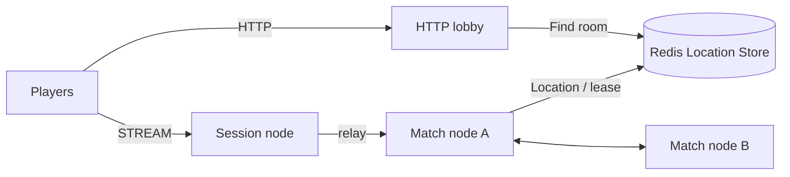

# my-game — HTTP lobby and match servers

This Kotlin template pairs two players through HTTP and runs their match through ZLink STREAM. The lobby prepares a dynamic Room with its matched roster and returns the Room ID only after receiving `RoomPrepared`. `RoomState` owns game state and decisions; `RoomRoster` owns admission; `Player` owns its Framework Actor context.



## Prerequisites

Docker with Compose v2 and Linux containers, network access to Maven Central and the Gradle Plugin Portal, and PowerShell 7 on Windows. JDK 25 is required only for local process debugging. The Gradle wrapper is included; public package versions are pinned in `build.gradle.kts`.

## Build

Bash:

```sh
./run-e2e.sh --build-only
```

PowerShell:

```powershell
pwsh -NoProfile -File ./run-e2e.ps1 -BuildOnly
```

## Docker e2e

Docker builds a shared node image for all roles and a runner image. The pinned Eclipse Temurin JDK/JRE bases are defined by the Dockerfile ARGs. The runner uses the Docker socket to create sibling nodes sharing its network namespace, preserving loopback listeners and stdin/stdout control. Each invocation removes its containers, network and image tags; cleanup errors return exit 1. Logs remain in `.logs/`.

For local process debugging, run `./run-e2e.sh --local` or `pwsh -NoProfile -File ./run-e2e.ps1 -Local`. Local mode uses JDK 25 and Compose Redis. Scenario and structure options work in both modes.

Bash:

```sh
./run-e2e.sh
./run-e2e.sh --scenario lobby,hit,wall,input,reconnect,update
./run-e2e.sh --check-structure
```

PowerShell:

```powershell
pwsh -NoProfile -File ./run-e2e.ps1
pwsh -NoProfile -File ./run-e2e.ps1 -Scenario lobby,hit,wall,input,reconnect,update
pwsh -NoProfile -File ./run-e2e.ps1 -CheckStructure
```

The runner validates `zlink.structure.json`, runs game and wire checks during the build and 19 HTTP domain checks before scenarios, creates its own Redis Compose project with an OS-assigned loopback port, and starts match, session, and lobby processes. Each scenario uses a fresh cluster, unique Redis prefix and `.logs/run-<id>/` directory. Cleanup errors fail the run. The build reports game and wire test results; the runner prints HTTP check counts and `Scenarios: n/n passed`.

| Scenario | Observed behavior |
| --- | --- |
| `lobby` | Omitting `mode` selects `duel`; both players receive the same prepared Room assignment with a `room-` prefix and 32 lowercase UUID hex characters. An outsider receives `admission-rejected`, a client `PrepareRoom` packet receives `packet-not-allowed`, and restarting the lobby produces a new Room ID. |
| `hit` | Accepted shots change HP and sequence; out-of-range, missing-target, and any observed `fire-too-soon` rejections preserve the Room view. If the server reports `fire-too-soon`, the client waits only for the response's `RetryAfterMs` before retrying. The scenario checks the final `phase` and `winner`; domain checks cover the cooldown boundary deterministically. |
| `wall` | Shots across both wall sides return `blocked-by-wall` without changing HP or sequence. A shot along the clear lane below the wall hits the target. |
| `input` | Accepted and rejected movement requests are sent consecutively before waiting for replies, followed by consecutive shot requests. `MoveResult` and `ShotResult` identify accepted actions; `move-budget` and `fire-too-soon` preserve accepted state and sequence. Retrying the same request after the server's `RetryAfterMs` succeeds. Oversized, stale, out-of-map, wall-crossing and over-limit sequences are also rejected without state changes. |
| `reconnect` | Reconnecting after a finished match restores player sequence, `phase`, `winner`, HP, and Actor identity. |
| `update` | Relocation restores `{game, roster}` and its remaining timers; an outsider remains rejected. The replacement process becomes ready and accepts a new Room. |

## Known issues

Validated against the published Framework 0.32.0 packages.

## Deployment sequence

Start Redis, then both match processes using `server/config/match-a.json` and `match-b.json`. Start Session using `session.json`. Read its `READY` stream endpoint, write that value into the lobby configuration's `sessionEndpoint`, then start the lobby using `lobby.json`. Each installed application accepts its configuration path as its only argument. Configuration IDs match structure node IDs; endpoint port zero requests an OS-assigned port.

The match configuration `roomCapacity` sets the positive per-node Room stable-type limit. Deployment configurations allow multiple Rooms; the e2e runner uses one so the surviving host is full after relocation and the replacement must handle the next Room.

For a match host update, send `drain` to stdin and require `RELOCATION_REQUESTED`, `RELOCATED` and `SAFE_TO_SHUTDOWN`. Send `shutdown`, require `STOPPED` and exit zero, then start the replacement with the same configuration. The lobby remains outside host relocation. HTTP matchmaking holds the first POST response until another player requests the same mode; shutdown fails pending requests. The Netty HTTP adapter removes an unpaired request when its client disconnects, allowing the same player ID to request again. Cancellation does not change paired requests.

The game domain is in `server/match/src/main/kotlin/MyGame/match/domain/RoomState.kt`; matched membership and admission are in `RoomRoster.kt`. HTTP and ZLink lobby adapters implement the application matching port. Relocation stores game state and the roster, including remaining timer durations, without process clock values or Framework-owned identity and routing state.
