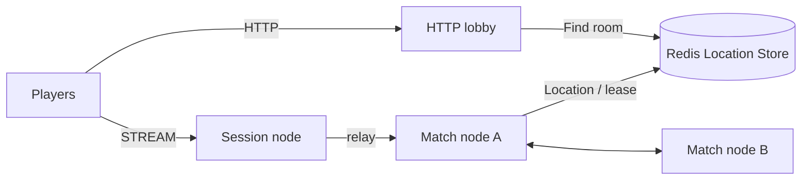

# my-game — HTTP lobby and match servers

This Kotlin template pairs two players through HTTP and runs their match through ZLink STREAM. The lobby prepares a dynamic Room with its matched roster and returns the Room ID only after receiving `RoomPrepared`. `RoomState` owns game state and decisions; `RoomRoster` owns admission; `Player` owns its Framework Actor context.



## Prerequisites

Docker with Compose v2 and Linux containers, network access to Maven Central and the Gradle Plugin Portal, and PowerShell 7 on Windows. JDK 25 is required only for local process debugging. The Gradle wrapper is included; public package versions are pinned in `build.gradle.kts`.

## Build

Bash:

```sh
./run-e2e.sh --build-only
```

PowerShell:

```powershell
pwsh -NoProfile -File ./run-e2e.ps1 -BuildOnly
```

## Docker e2e

Docker builds a shared node image for all roles and a runner image. The pinned Eclipse Temurin JDK/JRE bases are defined by the Dockerfile ARGs. The runner uses the Docker socket to create sibling nodes sharing its network namespace, preserving loopback listeners and stdin/stdout control. Each invocation removes its containers, network and image tags; cleanup errors return exit 1. Logs remain in `.logs/`.

For local process debugging, run `./run-e2e.sh --local` or `pwsh -NoProfile -File ./run-e2e.ps1 -Local`. Local mode uses JDK 25 and Compose Redis. Scenario and structure options work in both modes.

Bash:

```sh
./run-e2e.sh
./run-e2e.sh --scenario lobby,hit,wall,input,reconnect,update
./run-e2e.sh --check-structure
```

PowerShell:

```powershell
pwsh -NoProfile -File ./run-e2e.ps1
pwsh -NoProfile -File ./run-e2e.ps1 -Scenario lobby,hit,wall,input,reconnect,update
pwsh -NoProfile -File ./run-e2e.ps1 -CheckStructure
```

The runner validates `zlink.structure.json`, runs game and wire checks during the build and 19 HTTP domain checks before scenarios, creates its own Redis Compose project with an OS-assigned loopback port, and starts match, session, and lobby processes. Each scenario uses a fresh cluster, unique Redis prefix and `.logs/run-<id>/` directory. Cleanup errors fail the run. The build reports game and wire test results; the runner prints HTTP check counts and `Scenarios: n/n passed`.

| Scenario | Observed behavior |
| --- | --- |
| `lobby` | Omitting `mode` selects `duel`; both players receive the same prepared Room assignment with a `room-` prefix and 32 lowercase UUID hex characters. An outsider receives `admission-rejected`, a client `PrepareRoom` packet receives `packet-not-allowed`, and restarting the lobby produces a new Room ID. |
| `hit` | Accepted shots change HP and sequence; out-of-range, missing-target, and any observed `fire-too-soon` rejections preserve the Room view. If the server reports `fire-too-soon`, the client waits only for the response's `RetryAfterMs` before retrying. The scenario checks the final `phase` and `winner`; domain checks cover the cooldown boundary deterministically. |
| `wall` | Shots across both wall sides return `blocked-by-wall` without changing HP or sequence. A shot along the clear lane below the wall hits the target. |
| `input` | Accepted and rejected movement requests are sent consecutively before waiting for replies, followed by consecutive shot requests. `MoveResult` and `ShotResult` identify accepted actions; `move-budget` and `fire-too-soon` preserve accepted state and sequence. Retrying the same request after the server's `RetryAfterMs` succeeds. Oversized, stale, out-of-map, wall-crossing and over-limit sequences are also rejected without state changes. |
| `reconnect` | Reconnecting after a finished match restores player sequence, `phase`, `winner`, HP, and Actor identity. |
| `update` | Relocation restores `{game, roster}` and its remaining timers; an outsider remains rejected. The replacement process becomes ready and accepts a new Room. |

## Known issues

Validated against the published Framework 0.30.2 packages.

## Deployment sequence

Start Redis, then both match processes using `server/config/match-a.json` and `match-b.json`. Start Session using `session.json`. Read its `READY` stream endpoint, write that value into the lobby configuration's `sessionEndpoint`, then start the lobby using `lobby.json`. Each installed application accepts its configuration path as its only argument. Configuration IDs match structure node IDs; endpoint port zero requests an OS-assigned port.

The match configuration `roomCapacity` sets the positive per-node Room stable-type limit. Deployment configurations allow multiple Rooms; the e2e runner uses one so the surviving host is full after relocation and the replacement must handle the next Room.

For a match host update, send `drain` to stdin and require `RELOCATION_REQUESTED`, `RELOCATED` and `SAFE_TO_SHUTDOWN`. Send `shutdown`, require `STOPPED` and exit zero, then start the replacement with the same configuration. The lobby remains outside host relocation. HTTP matchmaking holds the first POST response until another player requests the same mode; shutdown fails pending requests. The Netty HTTP adapter removes an unpaired request when its client disconnects, allowing the same player ID to request again. Cancellation does not change paired requests.

The game domain is in `server/match/src/main/kotlin/MyGame/match/domain/RoomState.kt`; matched membership and admission are in `RoomRoster.kt`. HTTP and ZLink lobby adapters implement the application matching port. Relocation stores game state and the roster, including remaining timer durations, without process clock values or Framework-owned identity and routing state.

## 한국어 실행 안내

기본 e2e는 runner와 node를 Docker에서 실행합니다. 로컬 process 디버깅에는 JDK 25를 준비하고 `--local` 또는 `-Local`을 지정합니다. Docker Compose를 설치한 뒤 위 Build 명령으로 빌드합니다. Windows에서는 PowerShell 7을 사용합니다. runner는 실행마다 별도 Redis project와 key prefix를 만들고 임시 포트를 사용하며, 로그를 `.logs/run-<id>/`에 보존합니다.

HTTP 로비는 같은 mode의 두 요청을 모으며, mode 생략은 `duel`로 처리합니다. `room-`과 소문자 32자 UUID로 Room ID를 만들고, 매칭 명단으로 Room을 준비해 `RoomPrepared`를 받은 뒤 Session endpoint를 반환합니다. Session은 client packet 허용 목록만 중계하고 `PrepareRoom` 같은 내부 packet은 `ActionRejected("packet-not-allowed", 0)`으로 거부합니다. 게임 정수는 `9,007,199,254,740,991` 이하이며, 도메인 시계는 단조 시계이고 relocation snapshot은 timer의 남은 ms를 저장합니다.

`lobby`는 생략한 mode의 `duel` 기본값, UUID Room ID, 외부인·client `PrepareRoom` 거부, lobby 재시작 뒤 새 Room ID를 확인합니다. `hit`은 out-of-range·no-target·관측된 cooldown 거부 뒤 상태 불변, cooldown 거부가 도착하면 응답의 `RetryAfterMs`만 대기하는 재시도와 승자·phase를 확인합니다. `input`은 oversized·stale·벽 통과·관측된 move-budget 거부 뒤 상태 불변과 서버 `RetryAfterMs` 대기를 확인합니다. `reconnect`는 sequence·phase·winner 복원을 확인하고, `update`는 relocation 뒤 game·roster 복원과 교체 process의 새 Room 수락을 확인합니다. 시간 경계는 domain checks에서 결정적으로 검사합니다. 배포 시 Session의 READY 출력에서 실제 endpoint를 확인하여 로비 설정에 넣습니다. match node 교체는 drain 완료와 SAFE_TO_SHUTDOWN을 확인한 뒤 shutdown 순서로 수행합니다.

`input`은 이동 요청 두 개와 사격 요청 두 개를 각각 응답 대기 없이 연속 전송한다. 수락 결과와 시간 제한 거부를 모두 확인하고, 거부 뒤 값·순번·쿨다운 불변 및 서버가 준 `RetryAfterMs` 뒤 같은 요청의 수락을 검사한다. 게임 경계는 기준 match-entry-lobby의 게임 범주 9개로 검사하며, 매칭 범주는 HTTP 경계 19개에서 검사한다. `wall`은 벽 반대편 사격 거부와 HP 불변 및 벽 구간 밖 명중을 확인한다.

Run domain and wire checks separately with `./run-e2e.sh --check-domain` or `pwsh -NoProfile -File ./run-e2e.ps1 -CheckDomain`. Game boundary checks use the existing language-specific test location; the HTTP domain suite contains 19 checks.
