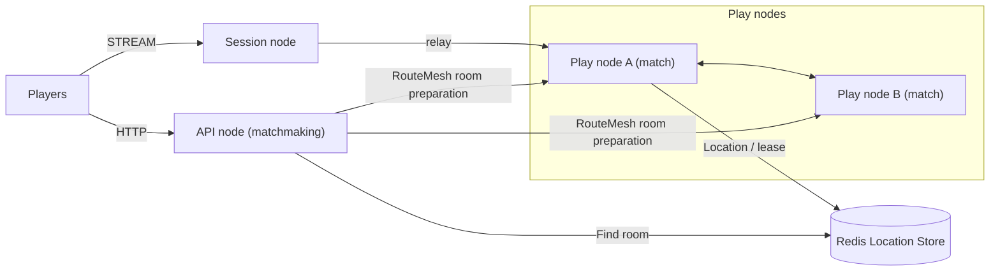

# my-game — Matchmaking API node and match servers

This Kotlin template pairs two players through HTTP and runs their match through ZLink STREAM. The API node prepares a dynamic Room with its matched roster and returns the Room ID only after receiving `RoomPrepared`. `RoomState` owns game state and decisions; `RoomRoster` owns admission; `Player` owns its Framework Actor context.



[한국어](README.ko.md)

This template is a reference. To build a new game, create a new project and design its nodes, Spots, Actors and messages for that game, using this template's structure and rules as reference; do not rename or edit this template in place into the game.

## Prerequisites

Docker with Compose v2 and Linux containers, network access to Maven Central and the Gradle Plugin Portal, and PowerShell 7 on Windows. JDK 25 is required only for local process debugging. The Gradle wrapper is included; public package versions are pinned in `build.gradle.kts`.

## Build

Bash:

```sh
./run-e2e.sh --build-only
```

PowerShell:

```powershell
.\run-e2e.cmd -BuildOnly
```

## Local server and e2e

Run the first command from this directory to build and start Redis and the application nodes. Run the second command from a separate terminal to connect the scenarios to that deployment. When the server is ready, `Server ready` shows the WebSocket address for game clients. Press Ctrl+C in the server terminal to stop its processes and Redis. On Windows the `.cmd` files use PowerShell 7 (`pwsh`).

```bash
./run-server.sh
./run-e2e.sh
```

```powershell
.\run-server.cmd
.\run-e2e.cmd
```

With no running server, `run-e2e` creates and removes an isolated Docker deployment. The `lobby` and `update` scenarios start or replace nodes and require an isolated run. Use `--isolated` (`-Isolated` on Windows) to force isolation while a server is running.

The local server uses the configured Room capacity. Isolated scenarios can set a smaller capacity to verify placement and node replacement.

The server publishes its endpoints in `.logs/server.json`. Each run keeps node stdout, stderr, Framework message-flow records and failure details under `.logs/run-<id>/`. For an attached run, find the node logs under the directory printed by `run-server` and the scenario details under the directory printed by `run-e2e`. Docker build and cleanup logs are under `.logs/docker-<project>/`.

## Client connection

### Endpoint and first packet

The Session client STREAM listener defaults to `ws://127.0.0.1:0` in `server/config/session.json`. Port `0` asks the OS for a free port; use the actual `streamEndpoint` in the process line `READY <json>`, which also contains `id` and `meshEndpoint`. Use the WebSocket address printed by `run-server` for browser clients. The API node defaults to `http://127.0.0.1:0` in `server/config/lobby.json`; its READY JSON provides `httpEndpoint`. Replace `sessionEndpoint` ending in `CHANGE_ME` with the actual Session endpoint before starting Lobby; `e2e/src/main/kotlin/MyGame/e2e/Nodes.kt` performs that wiring for its temporary deployment.

Loopback is reachable only inside the same host/network namespace. Keep a deployment running for external clients, bind to a reachable interface and port, and expose that port from containers. The Docker e2e deployment is temporary and is removed after the run. Mesh listeners and Redis are not game-client endpoints.

First submit `POST /match` to the API node's HTTP endpoint with JSON `playerId` and optional `mode` (`duel`). Submit both players concurrently: matchmaking waits for a pair. The `MatchResponse` contains `roomId` and `sessionEndpoint`. Connect to that endpoint, then send `JoinRoomRequest(playerId, roomId)`. Only assigned players may join. Admission produces a `RoomView` push; `ActionRejected` reports rejection.

After admission, `SessionInfoRequest` uses `connector.kotlin().request<SessionInfo>(SessionInfoRequest()).await()` for a correlated `SessionInfo` reply. The first game operation above uses `send(...).await()` and server pushes. This template does not authenticate player identity; add identity validation before Actor binding for production.

### Connector installation

Use the same connector release as this template pins in `build.gradle.kts`, `extra["frameworkVersion"]`; `e2e/build.gradle.kts` uses that key for `systems.zlink:zlink-stream-connector`. Replace `<version>` below with that pinned version. Engine installation instructions are in the linked repository READMEs; all clients use this template's packets.

| Client                             | Connector installation                                                                                                                                                                                                                                                                                                                                                                                                                                                          | Documentation guide                                                                                                                                                          |
| ---------------------------------- | ------------------------------------------------------------------------------------------------------------------------------------------------------------------------------------------------------------------------------------------------------------------------------------------------------------------------------------------------------------------------------------------------------------------------------------------------------------------------------- | ---------------------------------------------------------------------------------------------------------------------------------------------------------------------------- |
| Unity                              | Native/Editor: restore `Zlink.Stream.Connector` with NuGetForUnity. WebGL: add the `com.zlink.stream-connector.webgl` UPM Git package; include only the connector assembly for the active target. See the [Unity README](https://github.com/zlink-systems/zlink/blob/main/framework/languages/engines/Unity/README.md) and its package manifest.                                                                                                                                | [.NET engine integration](https://docs.zlink.systems/dotnet/guide/stream-connector/12-engine-integration/)                                                                   |
| Unreal                             | Copy `framework/languages/cpp/connector/engines/unreal` into `Plugins/ZLinkStreamConnector`, then package the native connector under `ThirdParty/ZLink` as described in the [Unreal README](https://github.com/zlink-systems/zlink/blob/main/framework/languages/engines/Unreal/README.md).                                                                                                                                                                                     | [C++ engine integration](https://docs.zlink.systems/cpp/guide/stream-connector/12-engine-integration/)                                                                       |
| Godot                              | .NET: add the NuGet package `Zlink.Stream.Connector` and run `dotnet restore`; see the [C# README](https://github.com/zlink-systems/zlink/blob/main/framework/languages/engines/Godot/csharp/README.md). GDExtension: build the C++ Godot adapter against the framework prebuilt and matching `godot-cpp`; see the [C++ README](https://github.com/zlink-systems/zlink/blob/main/framework/languages/engines/Godot/cpp/README.md). The .NET sample does not support Web export. | [.NET](https://docs.zlink.systems/dotnet/guide/stream-connector/12-engine-integration/), [C++](https://docs.zlink.systems/cpp/guide/stream-connector/12-engine-integration/) |
| Cocos Creator                      | Web target: `npm install @zlink-systems/stream-connector@<version>`; see the [Cocos Creator README](https://github.com/zlink-systems/zlink/blob/main/framework/languages/engines/CocosCreator/README.md). This package does not provide a Creator native adapter.                                                                                                                                                                                                                  | [TypeScript engine integration](https://docs.zlink.systems/node/guide/stream-connector/12-engine-integration/)                                                               |
| Axmol                              | Copy `framework/languages/cpp/connector/engines/axmol` into `third_party/zlink_axmol_connector` and link `zlink::stream_connector` from the installed C++ framework package; see the [Axmol README](https://github.com/zlink-systems/zlink/blob/main/framework/languages/engines/Axmol/README.md).                                                                                                                                                                              | [C++ engine integration](https://docs.zlink.systems/cpp/guide/stream-connector/12-engine-integration/)                                                                       |
| Web browser (TypeScript connector) | `npm install @zlink-systems/stream-connector@<version>`; import the package root in the browser build. Use `ws://` or `wss://`, subject to the page's security policy.                                                                                                                                                                                                                                                                                                             | [TypeScript connector](https://docs.zlink.systems/node/guide/stream-connector/)                                                                                              |
| C++                                | Install the C++ framework prebuilt containing the connector; use `find_package(zlink_stream_connector_cpp CONFIG REQUIRED)` and link `zlink::stream_connector`.                                                                                                                                                                                                                                                                                                                 | [C++ connector](https://docs.zlink.systems/cpp/guide/stream-connector/)                                                                                                      |
| C#/.NET                            | `dotnet add package Zlink.Stream.Connector --version <version>`                                                                                                                                                                                                                                                                                                                                                                                                                    | [.NET connector](https://docs.zlink.systems/dotnet/guide/stream-connector/)                                                                                                  |
| Java                               | Add Maven/Gradle dependency `systems.zlink:zlink-stream-connector:<version>`.                                                                                                                                                                                                                                                                                                                                                                                                      | [Java connector](https://docs.zlink.systems/java/guide/stream-connector/)                                                                                                    |
| Kotlin                             | Add `systems.zlink:zlink-stream-connector:<version>` and `systems.zlink:zlink-framework-kotlin:<version>` for the coroutine wrapper.                                                                                                                                                                                                                                                                                                                                                  | [Kotlin connector](https://docs.zlink.systems/kotlin/guide/stream-connector/)                                                                                                |
| Node                               | `npm install @zlink-systems/stream-connector@<version>`; use the package root and Node.js 22 or later.                                                                                                                                                                                                                                                                                                                                                     | [Node connector](https://docs.zlink.systems/node/guide/stream-connector/)                                                                                                    |

### Kotlin connection example

The example uses the same public connector and Kotlin coroutine wrapper as `e2e/src/main/kotlin/MyGame/e2e/Client.kt`. Save it as `e2e/src/main/kotlin/MyGame/e2e/ConnectOnce.kt` in a copy of the template. It defines a suspending function to call from your application coroutine while the deployment is running; compile it with `./gradlew :e2e:compileKotlin`. Complete the HTTP matchmaking step above first, then pass the assigned endpoint, player ID, and room ID.

```kotlin
package MyGame.e2e

import MyGame.*
import java.net.URI
import java.time.Duration
import java.util.concurrent.CompletableFuture
import kotlinx.coroutines.CompletableDeferred
import kotlinx.coroutines.withTimeout
import systems.zlink.framework.kotlin.*
import systems.zlink.stream.connector.*

suspend fun connectOnce(endpoint: String, playerId: String, roomId: String) {
    val d = ZLinkStreamConnectorOptions.createDefault(URI(endpoint))
    val connector = ZLinkStreamConnectorFactory.create(
        ZLinkStreamConnectorOptions(
            URI(endpoint), ZLinkStreamDispatchMode.IMMEDIATE, Duration.ofSeconds(5),
            d.maxReconnectAttempts(), d.connectTimeout(), d.maxSendPayloadSize(),
            d.heartbeatEnabled(), d.heartbeatInterval(), d.heartbeatTimeout(), false,
            d.reconnectInitialDelay(), d.reconnectMaxDelay(), d.reconnectBackoffFactor(),
        )
    )
    val response = CompletableDeferred<RoomView>()
    val registrations = listOf(
        connector.on(RoomView::class.java) { message ->
            response.complete(message.payload())
            CompletableFuture.completedFuture(null)
        },
        connector.on(ActionRejected::class.java) { message ->
            response.completeExceptionally(IllegalStateException(message.payload().toString()))
            CompletableFuture.completedFuture(null)
        },
        connector.onErrorReceived { event ->
            response.completeExceptionally(IllegalStateException(event.toString()))
            CompletableFuture.completedFuture(null)
        },
        connector.onDisconnected { event ->
            response.completeExceptionally(IllegalStateException(event.toString()))
            CompletableFuture.completedFuture(null)
        },
    )
    try {
        connector.kotlin().connect().await()
        connector.kotlin().send(JoinRoomRequest(playerId, roomId)).await()
        println(withTimeout(5_000) { response.await() })
    } finally {
        try { connector.kotlin().close().await() }
        finally { registrations.forEach { it.close() } }
    }
}
```

## Scenario selection and validation

Docker builds a shared node image for all roles and a runner image. The pinned Eclipse Temurin JDK/JRE bases are defined by the Dockerfile ARGs. The runner uses the Docker socket to create sibling nodes sharing its network namespace, preserving loopback listeners and stdin/stdout control. Each invocation removes its containers, network and image tags; cleanup errors return exit 1. Logs remain in `.logs/`.

For local process debugging, run `./run-e2e.sh --local` or `.\run-e2e.cmd -Local`. Local mode uses JDK 25 and Compose Redis. Scenario and structure options work in both modes.

Bash:

```sh
./run-e2e.sh
./run-e2e.sh --scenario lobby,hit,wall,input,reconnect,update
./run-e2e.sh --check-structure
```

PowerShell:

```powershell
.\run-e2e.cmd
.\run-e2e.cmd -Scenario lobby,hit,wall,input,reconnect,update
.\run-e2e.cmd -CheckStructure
```

The runner validates `zlink.structure.json`, runs game and wire checks during the build and 19 HTTP domain checks before scenarios, creates its own Redis Compose project with an OS-assigned loopback port, and starts match, session, and lobby processes. Each scenario uses a fresh cluster, unique Redis prefix and `.logs/run-<id>/` directory. Cleanup errors fail the run. The build reports game and wire test results; the runner prints HTTP check counts and `Scenarios: n/n passed`.

| Scenario | Observed behavior |
| --- | --- |
| `lobby` | Omitting `mode` selects `duel`; both players receive the same prepared Room assignment with a `room-` prefix and 32 lowercase UUID hex characters. An outsider receives `admission-rejected`, a client `PrepareRoom` packet receives `packet-not-allowed`, and restarting the API node produces a new Room ID. |
| `hit` | Accepted shots change HP and sequence; out-of-range, missing-target, and any observed `fire-too-soon` rejections preserve the Room view. If the server reports `fire-too-soon`, the client waits only for the response's `RetryAfterMs` before retrying. The scenario checks the final `phase` and `winner`; domain checks cover the cooldown boundary deterministically. |
| `wall` | Shots across both wall sides return `blocked-by-wall` without changing HP or sequence. A shot along the clear lane below the wall hits the target. |
| `input` | Accepted and rejected movement requests are sent consecutively before waiting for replies, followed by consecutive shot requests. `MoveResult` and `ShotResult` identify accepted actions; `move-budget` and `fire-too-soon` preserve accepted state and sequence. Retrying the same request after the server's `RetryAfterMs` succeeds. Oversized, stale, out-of-map, wall-crossing and over-limit sequences are also rejected without state changes. |
| `reconnect` | Reconnecting after a finished match restores player sequence, `phase`, `winner`, HP, and Actor identity. |
| `update` | Relocation restores `{game, roster}` and its remaining timers; an outsider remains rejected. The replacement process becomes ready and accepts a new Room. |

## Framework behavior to know

- **Waiting for DB or file I/O in a handler** — An ordinary async terminal retains the turn, while `Yield` lets other handlers on the same Spot proceed. [Guide](https://docs.zlink.systems/kotlin/guide/server/32-execution-model/#io-worker-wait).
- **Creation that misses its deadline** — `DeadlineExceeded` and caller cancellation have distinct outcomes. [Guide](https://docs.zlink.systems/kotlin/guide/server/22-actor/#creation-deadline). [server/session/src/main/kotlin/MyGame/session/Program.kt:86](server/session/src/main/kotlin/MyGame/session/Program.kt).
- **Many logins at once** — Each creation for a different ID requires a Location Store round trip, so measure expected load when setting the deadline. [Guide](https://docs.zlink.systems/kotlin/guide/server/25-location/#creation-load).
- **Sending under load** — Send waits for capacity, and the application sees the final result. [Guide](https://docs.zlink.systems/kotlin/guide/server/33-backpressure/#send-backpressure). [server/session/src/main/kotlin/MyGame/session/Program.kt:62](server/session/src/main/kotlin/MyGame/session/Program.kt).
- **Duplicate login** — Without a callback, a bind from another Session is accepted; reject it in the Actor duplicate-bind callback to prevent this. [Guide](https://docs.zlink.systems/kotlin/guide/server/39-session-binding/#duplicate-session-bind). This template keeps the default (accepts the new Session).
- **ObjectGeneration** — `ObjectGeneration` distinguishes logical incarnations of the same ID; it is not a data version or write authority. [Guide](https://docs.zlink.systems/kotlin/guide/server/34-activation-lifetime/#object-generation). [server/session/src/main/kotlin/MyGame/session/Program.kt:75](server/session/src/main/kotlin/MyGame/session/Program.kt).
- **READY and Serving** — The Framework host prints `READY` after observing runtime `Serving`. [Guide](https://docs.zlink.systems/kotlin/guide/server/12-operations/#wait-for-serving). [server/shared/src/main/kotlin/MyGame/Hosting.kt:134](server/shared/src/main/kotlin/MyGame/Hosting.kt); [server/shared/src/main/kotlin/MyGame/Hosting.kt:149](server/shared/src/main/kotlin/MyGame/Hosting.kt).

## Known issues

Drain confirmation takes about 30 seconds, so a turn clock may expire during the wait. For an update scenario in a game with turn clocks, finish the round before relocating it. Verify that relocation preserves the remaining time in a domain check with a controlled clock.

Validated against the published Framework 0.34.2 packages.

## Deployment sequence

Start Redis, then both play nodes (match) using `server/config/match-a.json` and `match-b.json`. Start the session node using `session.json`. Read its `READY` stream endpoint, write that value into the API node configuration's `sessionEndpoint`, then start the API node using `lobby.json`. Each installed application accepts its configuration path as its only argument. Configuration IDs match structure node IDs; endpoint port zero requests an OS-assigned port.

The match configuration `roomCapacity` sets the positive per-node Room stable-type limit. Deployment configurations allow multiple Rooms; the e2e runner uses one so the surviving host is full after relocation and the replacement must handle the next Room.

For a play node (match) update, send `drain` to stdin and require `RELOCATION_REQUESTED`, `RELOCATED` and `SAFE_TO_SHUTDOWN`. Send `shutdown`, require `STOPPED` and exit zero, then start the replacement with the same configuration. The API node remains outside host relocation. HTTP matchmaking holds the first POST response until another player requests the same mode; shutdown fails pending requests. The Netty HTTP adapter removes an unpaired request when its client disconnects, allowing the same player ID to request again. Cancellation does not change paired requests.

The game domain is in `server/match/src/main/kotlin/MyGame/match/domain/RoomState.kt`; matched membership and admission are in `RoomRoster.kt`. HTTP and ZLink lobby adapters implement the application matching port. Relocation stores game state and the roster, including remaining timer durations, without process clock values or Framework-owned identity and routing state.
